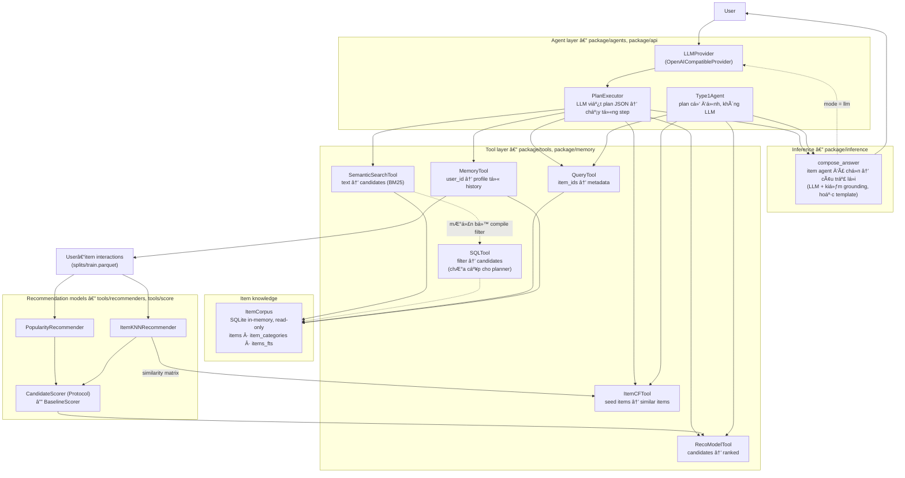
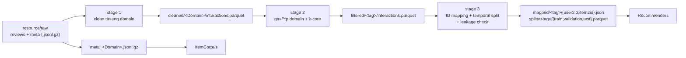

# 1. Đọc nhanh

**agentic-rag-for-rcm-sys / `src`** — hệ gợi ý sản phẩm bằng LLM agent, chạy trên Amazon Reviews 2023 (3 domain: `Video_Games`, `Toys_and_Games`, `Electronics`).

> **LLM chỉ quyết định "làm gì"; tool cung cấp thao tác có kiểm soát; `ItemCorpus` cung cấp kiến thức về item; recommender cung cấp tín hiệu gợi ý; tầng agent ghép kết quả; tầng inference viết câu trả lời cuối từ đúng những item agent đã chọn.**

Mỗi mục dưới đây là một thành phần: vai trò → bảng *từng file làm gì* → điểm dễ nhầm. Trạng thái đối chiếu: repo tại commit `f00b62f` (02/11/2026), GitNexus index hiện tại (6.013 nodes, 11.804 edges, 209 clusters, 264 flows).

| Thành phần | Nơi nằm | Vai trò |
|---|---|---|
| Config | `configs/`, `package/config/` | Mọi tham số trong YAML; một nguồn duy nhất cho đường dẫn |
| Data pipeline | `package/data/`, `scripts/data_pipeline/`, `scripts/eda_diagnostic/` | Review thô → sạch → gộp domain + k-core → map id + chia theo thời gian |
| Item corpus | `package/tools/corpus/`, `tools/_schema.py`, `tools/_limits.py` | Kho item read-only (SQLite in-memory) mà mọi tool đọc |
| Tools | `package/tools/{base,sql_query,retrieval,ranking,score}/`, `package/memory/` | Các thao tác có kiểm soát mà agent được gọi |
| Recommendation models | `package/tools/recommenders/` | Popularity, ItemKNN, BPR-MF… |
| API layer (LLM) | `package/api/` | `LLMProvider` + bản OpenAI-compatible |
| Agent layer | `package/agents/{planner,type1,toolkit,results}/` | `PlanExecutor` (LLM viết plan), `Type1Agent` (plan cố định) |
| Inference | `package/inference/{outcome,compose,grounding}/` | Viết câu trả lời cuối từ item agent đã chọn (LLM + grounding, hoặc template) |
| Evaluation | `package/evaluation/`, `package/tools/evaluation/` | **5-layer evaluation (L1-L5), 7 request kinds, component benchmarks, multi-turn, campaign orchestration, statistical analysis, reporting** |
| Demo | `package/demo/{adapter,backend,samples,view}/`, `scripts/demo/` | Giao diện Gradio (mock / live, đã nối inference) |
| Scripts | `scripts/` | Entry point chạy pipeline, thí nghiệm, đánh giá |
| Tests | `tests/` | pytest cho config, data, agents, tools, demo, evaluation |

Bố cục chi tiết: §2.1. Quy ước code (một symbol mỗi file, tên trùng tên file): §2.6. Bảng đổi tên sau refactor 17/10: §2.7.

## 1.1. Snapshot hiện tại — 02/11/2026, commit `f00b62f`

**Thay đổi so với snapshot 31/10** (`git diff --name-status b40643d..HEAD`: 47 file mới, 23 sửa, 2 xoá, 1 đổi tên):

- **`package/agents/session.py`**: `Turn` → `_Turn` (private) để tuân thủ quy ước "một symbol public mỗi file" (test `tests/config/test_package_layout.py` giờ pass).
- **`package/evaluation/`**: Thêm `campaign/` (orchestration multi-run), `statistics/` (bootstrap CI, paired significance), `reporting/generator.py` (chart layer-comparison, request-kind heatmap, retrieval funnel, latency distribution, multi-turn performance).
- **`package/tools/evaluation/`**: Thêm `normalize_query_text.py` (ascii_fold cho Unicode), `ranking_run_store.py` (checkpoint SQLite + lock), `ranking_stream_summary.py` (cộng dồn metric retrieval/ranking), `stage_progress.py` (progress bar ETA).
- **`package/tools/recommenders/`**: Thêm provenance files (`file_hash.py`, `mapping_hash.py`, `fit_split_names.py`, `fit_provenance.py`) để trace artifact reproducibility.
- **`package/memory/memory_tool.py`**: Tổng hợp `love/hate_categories`, `loved/hated_items` từ rating; dùng SQL `MIN/MAX/GROUP BY` (không bị giới hạn 100 dòng `corpus.select`).
- **`package/inference/`**: `compose_llm.py` có `price_tolerance`, `check_numbers` config; `grounding/check_grounding.py` kiểm `bare_asin`, `mentioned_item_ids` vs text, giá rating.
- **Mới trong `scripts/evaluation/`**: `analyze_ranking_bottlenecks.py` (chẩn đoán mất mát retrieval vs headroom ranking + fusion nguồn), `evaluate_product_reply.py`, `evaluate_with_jev.py` (product reply evaluation faithfulness + communication).
- **`tests/config/test_package_layout.py`**: Bắt buộc 1 symbol public/file, tên trùng file (case/underscore-insensitive); cross-folder private import cấm.
- **`docs/evaluation/`**: `RANKING_PILOT_REVIEW.md`, `FINAL_SUMMARY.md`, `METRICS.md`, `REQUEST_KINDS.md`, `MULTI_TURN.md`, `EXECUTION.md`, `CAMPAIGN.md`, `ARCHITECTURE.md`.

---

# 2. Bức tranh tổng thể

## 2.1. Cấu trúc thư mục
## 2.1. Cấu trúc thư mục

```
src/
├── configs/     20 file YAML, 4 thư mục con: path/ (3), data/ (3), eval/ (6), agent/ (8)
├── package/     toàn bộ logic (import là `package.*`): config, data, api, tools, memory, agents, inference, evaluation, demo, utils
│                `evaluation/`: ablation/, requests/, layer1_outcome/ … layer5_deployment/, component/ (+ benchmarks/), diagnostics/, judge/, score_trajectory.py, summarize.py
├── scripts/     7 thư mục theo chức năng + README.md (chạy `PYTHONPATH=. python scripts/<thư mục>/<tên>.py`)
├── tests/       pytest: agents/ (+ fakes/), config/, data/, demo/, evaluation/ (agent/, component/, ablation/), tools/ (mỗi module một thư mục con) + README.md, logs/
├── docs/        EVALUATION_PROTOCOL.md + evaluation/ (16 file); **không có** ablation_protocol.md / demo.md / inference_contract.md / decisions.md
│
├── resource/    (sinh ra khi chạy, .gitignore) raw → cleaned → filtered → mapped → splits; corpus/ (SQLite cache), item_knn/ (.npz cache)
└── experiments/ README.md + exp_NNN/{config.yaml, metrics.json, README.md}; baselines/, agent_eval/ (kèm exp_009–exp_013, component_benchmarks/, memory_utility_analysis/, requests / trajectories / scored .jsonl), candidate_recall/, ranking_eval/, ranking_diagnostics/, data_pipeline/, smoke_tests/, test_logs/, logs/<tag>/
```

`pyproject.toml`, `PACKAGE_SETUP.md`, `.gitattributes` **không còn trong `src/`** — đã chuyển lên gốc repo trong commit `7c1144a` (29/10).

## 2.2. Nguyên tắc xuyên suốt

- **Tham số nằm trong YAML, hợp đồng (schema) nằm trong code.** Ví dụ `configs/agent/tools.yaml` chứa giới hạn runtime (đọc bởi `tools/_limits.py`), còn tên cột / filter key là hợp đồng nên nằm ở `tools/_schema.py`.
- **Đường dẫn chỉ lấy qua `package.config.get_data_paths()`**; có test AST (`test_path_hygiene.py`) cấm hard-code `resource/…`, `experiments/…`.
- **Business logic chỉ phụ thuộc interface `LLMProvider`**, không import SDK của một provider cụ thể.
- **Quy ước đặt tên:** file bắt đầu bằng `_` là nội bộ của folder đó (`_schema.py`, `_helper.py`, `_dataclass.py`, `_error.py`, `_limits.py`, `_constants.py`); mỗi hàm/class công khai nằm trong file cùng tên.
- `load_config` nhận tên **có thư mục**: `load_config("agent/tools")`, `load_config("path/data_paths")`.

## 2.3. Hai luồng chạy

- **Luồng offline (không LLM):** review thô → pipeline dữ liệu (mục 4) → fit recommender (mục 7) → đánh giá (mục 10).
- **Luồng online (có LLM):** câu request → `PlanExecutor` (mục 9) → tool (mục 6) → kết quả → `Inference` (mục 9.4) → câu trả lời. Tool dựa trên `ItemCorpus` (mục 5) và recommender đã fit (mục 7).

## 2.4. Sơ đồ runtime



~~Ba điểm dễ nhầm:~~

1. ~~🔴**Planner không có `SQLTool`.** `agents/toolkit/build_tools.py` (`build_tools()` → `AgentTools`; `for_planner()` = 4 tool: ItemCF, RecoModel, Query, SemanticSearch; `for_planner_memory()` = thêm `MemoryTool`) — dùng bởi `run_agent_eval.py` và `smoke_real_llm.py` — không đưa `SQLTool` vào. `SQLTool` vẫn được code, test và chạy trong `scripts/tools/run_tools.py`, và `SemanticSearchTool` dùng chung hàm `compile_filters` (`sql_query/compile_filters.py`) với nó. Nếu muốn planner dùng filter thuần cấu trúc (không text) thì phải thêm vào `agents/toolkit/build_tools.py` **và** cập nhật `agents/planner/_prompt.py`. (`scripts/demo/demo_full_agent.py` còn bản `build_tools()` riêng, cũ, 5 tool, không qua `AgentTools` — đừng nhầm với bản thật.)~~
2. ~~`PlanExecutor.run()` **trả về danh sách kết quả tool**; câu trả lời cuối do `package/inference` (mục 9.4) sinh sau đó và **chỉ trình bày** các item agent đã chọn (không chọn lại, không đổi thứ tự). Chưa có vòng lặp "LLM đọc kết quả → quyết định bước kế" (mục 15). `demo` chưa gọi `inference` (mục 13.1).~~
3. ~~🔴`MemoryTool` đọc **cả** `interactions` (DataFrame) và `ItemCorpus`.~~

## 2.5. Chiều phụ thuộc giữa các package

Hướng **được phép** (test `test_dependency_direction.py` ép các cặp **bị cấm** ở cột phải):

```
tools ──────────► data, config                              tools ✗ agents
memory ─────────► tools, data.leakage
api ────────────► config
agents ─────────► tools, memory, api                        agents ✗ inference, demo, evaluation
inference ──────► agents, api                               inference ✗ demo, evaluation
evaluation ─────► agents, inference, tools, data            evaluation ✗ demo
demo ───────────► agents, inference, tools, memory, data    demo ✗ evaluation
mọi nơi ────────► config
```

`config` và `data` không import `tools`/`agents` (ngoại lệ: `tools/corpus` dùng `data.namespaced_item_id`; `DataPaths.split_path` import `data.split` lazily). Vì `agents` không được import `evaluation`, `extract_recommendations` và `TEMPLATES` nằm trong `agents/` (`agents/results/`, `agents/_schema.py`) để `inference`, `evaluation` và `demo` cùng dùng. `evaluation/agent/_schema.py` vẫn **lặp lại** `ANSWER_STATUSES` của `inference` (có test giữ hai bản bằng nhau); lý do ban đầu là tránh vòng import, nay `evaluation` được phép import `inference` nên bản lặp có thể bỏ. `package/__init__.py` **rỗng**; `tools/__init__.py` vẫn import eager `evaluation`, `recommenders`… (mục 16.2). `tests/test_package_import.py` giữ cho import nhẹ.

## 2.6. Quy ước cấu trúc (được test ép)

Ba file test trong `tests/config/` biến quy ước thành luật (`scripts/` được kiểm cùng `package/`; `tests/` được miễn vì là white-box):

- **Một file, một symbol** (`test_package_layout.py`): module công khai (không bắt đầu bằng `_`, không phải `__init__` / `__main__`) có **đúng một** class / hàm công khai ở cấp module, và tên đó trùng tên file (bỏ dấu `_`, không phân biệt hoa thường): `ItemCFTool` ↔ `item_cf_tool.py`. Vì vậy `candidate_results` tách khỏi `candidate_ids.py`, mỗi recommender một file, mỗi hàm demo một file.
- **Tên công khai duy nhất toàn package** (cùng file test): vì thế hai lớp ma trận đổi tên `PopularityMatrixRecommender` / `ItemKNNMatrixRecommender`, còn tên cũ `PopularityRecommender` / `ItemKNNRecommender` được giữ bằng **lớp con rỗng** của lớp DataFrame-based.
- **Riêng tư theo thư mục** (cùng file test): module `_xxx` chỉ được import trong chính thư mục chứa nó; ngoài thư mục phải đi qua `__init__.py` hoặc một module công khai. Vì thế `compile_filters.py` (dùng chung cho `retrieval/`) là module công khai thay vì `_helper.py`.
- **Hướng phụ thuộc** (`test_dependency_direction.py`): bảng ở mục 2.5; danh sách ngoại lệ hiện rỗng.
- **Import phải trỏ tới module có thật** (`test_import_resolution.py`): ra đời từ lỗi `compare_experiments.py` import `package.agents.evaluation.ablation` (không tồn tại).

Hệ quả khi đọc code: hàm / class `X` nằm ở file cùng tên; `_dataclass.py`, `_helper.py`, `_schema.py`, `_limits.py`, `_error.py`, `_prompt.py` là nội bộ của thư mục chứa chúng; `__init__.py` là mặt tiền công khai của thư mục.

## 2.7. Bảng đổi tên (trước → sau refactor 17/10)

| TrÆ°á»›c | Sau |
|---|---|
| `config/loader.py` | `config/load_config.py` |
| `utils/console.py` | `utils/ensure_utf8_stdout.py` |
| `tools/corpus/corpus.py` | `tools/corpus/item_corpus.py` |
| `tools/sql_query/_helper.py` | `tools/sql_query/compile_filters.py` (công khai) |
| `api/{base,factory,openai_compatible}.py` | `api/{llm_provider,build_llm_provider,openai_compatible_provider}.py` |
| `tools/base/candidate_ids.py` (kèm `candidate_results`) | `candidate_ids.py` + `candidate_results.py` |
| `popularity.py`, `item_knn.py` (matrix) | `popularity_matrix_recommender.py`, `item_knn_matrix_recommender.py` |
| `baseline_{popularity,item_knn}.py` | `baseline_*_recommender.py` + lớp con rỗng giữ tên cũ (`popularity_recommender.py`, `item_knn_recommender.py`) |
| `tools/evaluation/{evaluator,recommendation_metrics,segment_users}.py` | `evaluate_recommender.py`, `evaluate_ranking.py`, `segment_users_by_history.py` |
| `agents/{plan_executor,_prompt,_schema,_helper}.py` | `agents/planner/…` |
| `agents/evaluation/…`, `agents/ablation/…` | `package/evaluation/agent/…` → nay là `evaluation/{requests/,score_trajectory.py,summarize.py}`; `evaluation/ablation/…` |
| `inference/_helper.py` | `inference/grounding/*`, `inference/cut.py`, `inference/empty_usage.py` |
| `demo/_view_model.py`, `_formatter.py`, `_adapter.py`, `_samples.py` | `demo/view/*`, `demo/adapter/*`, `demo/samples/*` |
| `configs/agent/judge.yaml` | `configs/eval/judge.yaml` |

Các đổi tên còn lại theo cùng quy ước ở §2.6 (mỗi file một symbol công khai, tên trùng tên file; `_xxx.py` là nội bộ thư mục): `metrics/*.py` → `*_at_k.py`, `bpr_mf.py`/`random_rec.py`/`fallback.py`/`factory.py` → `*_recommender.py` + `build_model.py`.

---

# 3. Config

**Vai trò:** mọi giá trị chỉnh được nằm trong `configs/*.yaml`; `package/config` đọc YAML (có thay biến môi trường) và là **nguồn duy nhất** cho đường dẫn.

## 3.1. `configs/`

|File|Giữ gì|Ai đọc|
|---|---|---|
|`path/data_paths.yaml`|Mọi thư mục: `raw_dir`, `cleaned_dir`, `filtered_dir`, `mapped_dir`, `splits_dir`, `item_knn_dir` (cache `.npz`), `corpus_dir` (cache `.sqlite`), `log_dir` (= `experiments/logs`, trước là `resource/logs`), `experiments_dir`. Chú thích đầu file liệt kê `experiments/{logs,test_logs,baselines,agent_eval,data_pipeline,smoke_tests}/` — vẫn **chưa khớp** code (`candidate_recall`, `ranking_eval`, `ranking_diagnostics` không được nhắc; mục 16.2)|`get_data_paths()` → mọi script|
|`path/run_tag.yaml`|`tag: multi_domain` — tên một lần chạy; stage 2/3 ghi vào `<dir>/<tag>/`|`get_data_paths()`|
|`path/domains.yaml`|3 domain bật (`Video_Games` primary; `Toys_and_Games`, `Electronics` secondary)|`get_domains()`. Trường `role` **không có code nào đọc**|
|`data/cleaning.yaml`|`chunk_size: 250000`|stage 1|
|`data/filtering.yaml`|k-core `min_user_interactions=5`, `min_item_interactions=5`|stage 2|
|`data/split.yaml`|0.8 / 0.1 / 0.1 (luôn temporal)|stage 3|
|`eval/baselines.yaml`|`seed`, `models`, `popularity_fallback`, `item_knn.{k,block_elements}`, `bpr_mf.{…}`|`run_baselines`, `tune_baselines`, `candidate_recall`, `run_agent_eval` (lấy `item_knn.k`, `seed`)|
|`eval/tuning.yaml`|`selection_metric: ndcg@10`, lưới tham số cho `item_knn`, `bpr_mf`|`tune_baselines`|
|`eval/recommendation_metrics.yaml`|`k_values: [5, 10, 20]`|`run_baselines`, `tune_baselines`|
|`eval/segment_thresholds.yaml`|`sparse_max_history: 4` (cold = 0, sparse 1–4, warm ≥ 5)|evaluator, `candidate_recall`, `run_agent_eval`|
|`eval/candidate_recall.yaml`|`budgets [50,100,200]`, `per_segment 1000`, `seed_items 10`, `query_items 3`, `min_metadata_coverage 0.5`, `experiments_subdir candidate_recall`|`candidate_recall`|
|`agent/tools.yaml`|`max_candidates 1000`, `max_query_rows 100`, `sql_time_budget_seconds 5`, `max_output_summary_chars 500`, `defaults.{sql_limit 100, item_cf_top_k 20, query_max_rows 20, memory_top_n_categories 3, memory_recent_items 5}`, `semantic_search.{default_limit 50, max_query_tokens 20}`|`tools/_limits.py` (**validate lúc load, đọc một lần lúc import**)|
|`agent/agent.yaml`|`max_steps 8`, `plan_retries 1`, `reflect_rounds 1` (0 = tắt plan-reflect), `max_tokens 2048`, `temperature 0.0`, `type1.{candidate_multiplier 5, min_candidates 50}`, `reflect_error_chars 300`|`agents/_limits.py` (validate)|
|`agent/llm.yaml`|`provider`, `model` (ghi thẳng), `base_url: ${LLM_BASE_URL:-}`, `api_key: ${LLM_API_KEY:-}`, `timeout_seconds`|`build_llm_provider`|
|`agent/agent_eval.yaml`|`agents [baseline,type1,planner,planner_memory]`, `k 10`, `per_segment 20`, `n_ambiguous 6`, `language vi`, `price_slack 1.25`, `price_round_to 5`, `min_metadata_coverage 0.5`, `trajectory_error_chars 300`, `max_consecutive_llm_errors 5`, `experiments_subdir agent_eval`, `trajectory_file`|`run_agent_eval` (và `ranking_eval` cho `min_metadata_coverage`)|
|`agent/inference.yaml`|`mode` (`llm` \| `template`), `max_items 10`, `max_tokens 2048`, `temperature 0.0`, `llm_retries 1`, `check_numbers true`, `price_tolerance 0.5` (USD), `title_chars 120`, `reason_chars 300`|`inference/_limits.py` (validate)|
|`agent/demo.yaml`|`max_error_length 300`, `max_items_display 10`, `sample_users_per_segment 3`, `default_language vi`, `max_recent_items_display 5`, `max_turn_history_rows 50`|`demo/_limits.py` (validate)|
|`agent/ablation.yaml`|`bootstrap_resamples 10000`, `confidence 0.95`, `min_n_warn 20`, `seed 42`, `metrics` (11 mục, gồm `answer_fallback`, `inference_latency_seconds`, `inference_completion_tokens`), `groups` (**nay khai báo thật**: `reflect_0: [exp_012]`, `reflect_1: [exp_013]`, `infer_template: [exp_011]`), `contrasts` (6 contrast), `output_subdir agent_eval/ablation`|`evaluation/ablation/_limits.py`, `scripts/experiments/compare_experiments.py`|
|`agent/demo_profiles.yaml`|`demo_profiles.pinned` (danh sách profile ghim cho demo UI; hiện `[]`)|`demo/_profile_builder.py` (`build_profiles`, `load_config("agent/demo_profiles")`)|
|`eval/judge.yaml`|`api_key: ${OPENROUTER_API_KEY:-}`, `model jev-latest`, `base_url https://api.typesafe.ai`, `timeout_seconds 30`, `enable_long_context false`, `evaluation.faithfulness.{claim_extraction rule, support_threshold 0.7}`, `evaluation.communication.criteria.{relevance, clarity, language, honesty_about_gaps}` + rubric 5 mức|`evaluation/judge/jev_client.py`, `evaluation/jev_product_evaluator.py` (đọc thẳng file bằng `yaml.safe_load`, mặc định `configs/eval/judge.yaml`, **không** qua `load_config`)|

`tools.yaml`, `agent.yaml`, `inference.yaml`, `demo.yaml`, `ablation.yaml` được validate (trong `_limits.py` của từng package); các file còn lại script đọc thẳng (`eval/judge.yaml` đọc bằng `yaml.safe_load`). **Biến môi trường:** `LLM_API_KEY`, `LLM_BASE_URL` (cả hai mặc định rỗng → `build_llm_provider` báo thiếu `base_url`), `OPENROUTER_API_KEY` (cho `eval/judge.yaml`). `scripts/README.md` **không nhắc** biến môi trường nào. Từ 29/10 **không còn comment hay docstring nào trỏ tới file `docs/*` không tồn tại** (đã bỏ tham chiếu `decisions.md` ở `llm.yaml`/`domains.yaml` và `inference_contract.md` ở `inference.yaml` + `classify_outcome.py`; mục 16).

## 3.2. `package/config/`

|File|Việc|
|---|---|
|`__init__.py`|export `load_config`, `DataPaths`, `get_data_paths`, `get_domains`|
|`load_config.py`|`load_config("<thư_mục>/<tên>")` đọc `configs/<thư_mục>/<tên>.yaml`, thay `${VAR}` / `${VAR:-default}` bằng biến môi trường (kết quả luôn là **chuỗi**)|
|`_helper.py`|`_interpolate_env`: ngữ nghĩa shell `:-` (biến chưa đặt **hoặc rỗng** thì dùng default); `${VAR}` không default mà thiếu → `ConfigError`|
|`get_data_paths.py`|`get_data_paths(tag)` → `DataPaths`. **Không đọc biến môi trường `TAG`** (script Python dùng `--tag`)|
|`_dataclass.py`|`DataPaths` (frozen) + `corpus_path`, `item_knn_path` (cache theo `tag` và `eval_on`) và các hàm `review_path` (**nay thử `<domain>/<domain>.jsonl[.gz]` trước**, rồi file phẳng ở `raw_dir`), `meta_path`, `cleaned_path`, `filtered_path`, `split_path`; tên file `interactions.parquet`; `log_dir` = `experiments/logs/<tag>`|
|`get_domains.py`|danh sách tên domain từ `path/domains.yaml`|
|`__main__.py`|CLI để shell đọc config/đường dẫn (không script nào trong repo còn gọi, vì `scripts/sh/` đã bỏ): `python -m package.config path/domains.domains` hoặc `path:raw_dir`, `path:cleaned_path:Video_Games`. Có bảng `folder_map` hard-code cho tên cũ không có thư mục (`domains.domains` vẫn chạy).|
|`_constants.py`|`PROJECT_ROOT`, `CONFIG_DIR`, regex `${VAR}`|
|`_error.py`|`ConfigError`|

---

# 4. Data pipeline

**Vai trò:** biến review thô Amazon thành 3 split theo thời gian đã map sang chỉ số nguyên, đủ để fit mô hình, đồng thời có kiểm tra leakage.



## 4.1. Ba stage (scripts)

|Stage|Script|Việc chính|
|---|---|---|
|1|`data_pipeline/stage1_clean_domain.py`|Đọc review theo chunk (`chunk_size`), `clean_interactions` từng chunk, **dedupe xuyên chunk bằng bảng SQLite tạm** (khoá `(user_id, parent_asin, timestamp)`), ghi parquet theo chunk. Output đọc ra theo thứ tự khoá chính (đã sort theo `user_id`). Không có `--force` thì báo lỗi nếu output đã tồn tại|
|2|`data_pipeline/stage2_merge_filter.py`|`tag_domain` từng domain → `merge_domains` → `clean_interactions` lần nữa → `k_core_filter` **trên dữ liệu đã gộp** (đếm xuyên domain) → `optimize_interaction_dtypes` → parquet. `--cold-start-report` so số user warm khi lọc riêng từng domain với khi gộp|
|3|`data_pipeline/stage3_map_split.py`|`build_id_mappings` + `apply_id_mapping` trên **toàn bộ** dữ liệu (kể cả val/test) → `compute_temporal_cutoffs` + `temporal_split` → 3 leakage check → `save_splits`|
|EDA|`eda_diagnostic/run_eda.py`|EDA interaction trên review thô, streaming. Chỉ in thống kê interaction; **`compute_metadata_stats` không được script nào gọi** (chỉ có test)|
|Chẩn đoán|`eda_diagnostic/diagnose_splits.py`|`--tag <tag> [--out file.json]`: đọc splits + mapping đã sinh, in báo cáo và (tuỳ chọn) ghi JSON (`SplitDiagnosis`): số dòng / user / item và khoảng thời gian từng split; tỉ lệ domain; **% item của val/test đã có trong train** (theo item và theo dòng); **% user val/test có lịch sử train** (+ min / median / p90 độ dài lịch sử); **% cặp (user, item) lặp** đã nằm trong history; **% dòng `reachable`** (item có trong train **và** cặp chưa nằm trong history); % user đa-domain. Mục đích: trả lời "vì sao recall@10 ≈ 0" (§19.6, §21.7). **Chưa thấy kết quả chạy trên dữ liệu thật trong zip**|

**Item id** dạng `{domain}::{parent_asin}`. Sau `tag_domain`, cột vẫn tên `parent_asin` nhưng giá trị đã namespace; `original_item_id` giữ asin gốc. **`user_id` không namespace** (id toàn cục của Amazon → giúp cross-domain). Domain lưu thành cột và tra lại, **không parse từ id**. **Split** luôn là temporal toàn cục (không random, không leave-one-out).

## 4.2. `package/data/` — từng file

| Folder     | File                                     | Việc                                                                                                                                                                                                                                   |
| ---------- | ---------------------------------------- | -------------------------------------------------------------------------------------------------------------------------------------------------------------------------------------------------------------------------------------- |
| (gốc)      | `__init__.py`                            | export các subpackage và `domain.*`                                                                                                                                                                                                    |
|            | `_schema.py`                             | `REQUIRED_COLUMNS` (user_id, parent_asin, rating, timestamp), `OPTIONAL_COLUMNS`, `ITEM_ID_SEPARATOR = "::"`                                                                                                                           |
| `clean/`   | `clean_interactions.py`                  | bỏ dòng thiếu field bắt buộc + dedupe `(user, item, timestamp)`; trả `(df, report)` có số lượng loại ở mỗi bước                                                                                                                        |
|            | `iter_reviews_dataframes.py`             | đọc `.jsonl.gz` theo chunk (`pd.read_json(chunksize=…)`)                                                                                                                                                                               |
|            | `load_reviews_dataframe.py`              | đọc cả file vào một DataFrame (cho file nhỏ/test)                                                                                                                                                                                      |
| `domain/`  | `tag_domain.py`                          | thêm cột `domain`, `original_item_id`; ghi đè `parent_asin` thành id có namespace                                                                                                                                                      |
|            | `namespaced_item_id.py`                  | `"{domain}::{asin}"`                                                                                                                                                                                                                   |
|            | `merge_domains.py`                       | `pd.concat` các DataFrame đã tag (báo lỗi nếu chưa tag)                                                                                                                                                                                |
|            | `domain_breakdown.py`                    | thống kê interaction/user/item theo domain                                                                                                                                                                                             |
| `filter/`  | `k_core_filter.py`                       | lặp tối đa 20 vòng loại user/item dưới ngưỡng (**đếm theo số dòng**); hết 20 vòng chưa hội tụ thì **cảnh báo** (`warnings`) nhưng vẫn trả kết quả chưa hội tụ                                                                          |
| `loader/`  | `iter_jsonl_gz.py`                       | generator đọc `.jsonl.gz` theo dòng                                                                                                                                                                                                    |
|            | `load_item_metadata.py`                  | đọc `meta_<Domain>.jsonl.gz`, chỉ giữ item `keep(domain, asin)`; cột theo `META_FIELDS` + `domain`                                                                                                                                     |
|            | `optimize_interaction_dtypes.py`         | `user_id/parent_asin/domain/original_item_id` → `category`, `rating` → float32 (giữ `timestamp` int64)                                                                                                                                 |
|            | `estimate_memory_usage_mb.py`            | đo RAM (`deep=True`) để log                                                                                                                                                                                                            |
|            | `_schema.py`                             | `META_FIELDS`                                                                                                                                                                                                                          |
| `mapping/` | `build_id_mappings.py`                   | gán index theo thứ tự xuất hiện đầu tiên (không dựa timestamp)                                                                                                                                                                         |
|            | `apply_id_mapping.py`                    | thêm `user_idx`, `item_idx`; id lạ → `ValueError` (không âm thầm bỏ)                                                                                                                                                                   |
|            | `save_mappings.py` / `load_mappings.py`  | ghi/đọc `user2id.json`, `item2id.json`                                                                                                                                                                                                 |
|            | `_schema.py`                             | tên 2 file trên                                                                                                                                                                                                                        |
| `split/`   | `compute_temporal_cutoffs.py`            | 2 mốc timestamp theo phân vị toàn cục                                                                                                                                                                                                  |
|            | `temporal_split.py`                      | cắt thành train / validation / test theo 2 mốc                                                                                                                                                                                         |
|            | `save_splits.py` / `load_splits.py`      | ghi/đọc 3 parquet; `load_splits` chỉ lấy cột có trong file; `infer_matrix_shape` (định nghĩa ở `infer_matrix_shape.py`) được `load_splits.py` import lại và re-export                                                                  |
|            | `split_path.py`                          | nơi duy nhất quyết định `<splits_dir>/<name>.parquet`                                                                                                                                                                                  |
|            | `infer_matrix_shape.py`                  | `infer_matrix_shape(*frames)` — kích thước ma trận suy từ chỉ số lớn nhất. Sau refactor đã hết trùng (không còn bản thứ hai trong `load_splits.py`); `load_splits.py` import lại nên pyflakes báo import thừa                          |
|            | `_schema.py`                             | `SPLIT_NAMES = (train, validation, test)`                                                                                                                                                                                              |
| `leakage/` | `check_split_temporal_order.py`          | `max(train) ≤ min(val)` và `max(val) ≤ min(test)`                                                                                                                                                                                      |
|            | `check_no_duplicate_across_splits.py`    | không dòng nào xuất hiện ở 2 split                                                                                                                                                                                                     |
|            | `check_profile_snapshot.py`              | không interaction nào có `timestamp > as_of` (dùng cho `MemoryTool`, `run_agent_eval`, stage 3)                                                                                                                                        |
|            | `_error.py`                              | `LeakageError`                                                                                                                                                                                                                         |
| `eda/`     | `compute_interaction_stats.py`           | thống kê trên DataFrame (chỉ dùng trong test)                                                                                                                                                                                          |
|            | `compute_interaction_stats_streaming.py` | thống kê streaming trên review thô (dùng bởi `run_eda`)                                                                                                                                                                                |
|            | `print_streaming_stats_report.py`        | in báo cáo                                                                                                                                                                                                                             |
|            | `diagnose_splits.py`                     | `diagnose_splits(...)` → `SplitDiagnosis` (các chỉ số ở mục 4.1: item/user đã thấy trong train, cặp lặp, `reachable`, độ dài history, tỉ lệ domain, % user đa-domain); chỉ gọi bởi `scripts/eda_diagnostic/diagnose_splits.py` và test |
|            | `compute_metadata_stats.py`              | thống kê completeness metadata (chỉ dùng trong test)                                                                                                                                                                                   |
|            | `segment_users.py`                       | phân nhóm kiểu cũ (`new`/`sparse_history`/`warm`, ngưỡng 3, cột `evolving_interest` luôn `False`); **chỉ dùng trong test**. Phân đoạn thật là `tools/evaluation/_helper.assign_segments` (`cold`/`sparse`/`warm`, `sparse_max=4`)      |
|            | `_dataclass.py`                          | `InteractionStats`, `StreamingInteractionStats`, `MetadataStats`, `SplitDiagnosis` (nay thêm `protocol`, `fit_diagnostics`, `domain_diagnostics`; các `*_reachable_pct` được chú thích lại là **unique-pair catalog eligibility**, không phải trần macro Recall@K)                                                                                                                                                     |

Lưu ý đọc code: nhiều file trong `clean/`, `domain/`, `mapping/`, `leakage/`, `filter/k_core_filter.py`, `eda/segment_users.py` **dùng chung một docstring đầu module copy từ file khác** — đừng tin docstring đầu file, hãy tin tên hàm.

---

# 5. Item corpus — kiến thức về item

**Vai trò:** kho item chỉ đọc mà `SQLTool`, `SemanticSearchTool`, `QueryTool`, `MemoryTool`, `ItemCFTool`, `RecoModelTool` cùng dùng (hai tool cuối chỉ để gắn `domain`).

|File|Việc|
|---|---|
|`tools/corpus/item_corpus.py`|`ItemCorpus`: dựng từ metadata DataFrame (`from_dataframe`, `from_parquet`) thành SQLite in-memory; khoá lại bằng `PRAGMA query_only` + authorizer chỉ cho `SELECT` (`PRAGMA`, kể cả `pragma_table_info()`, bị chặn). API: `select(sql, params, max_rows)` (trả `(rows, truncated)`), `count`, `domains`, `item_domains`; **cả `select` và `count` có timeout `sql_time_budget_seconds`** (ném `SQLTimeOutError`). `from_dataframe` từ chối `domain=` mâu thuẫn với cột `domain` và `original_item_id` không khớp `parent_asin` (`ValueError`)|
|`tools/corpus/_helper.py`|`read_only_authorizer` (được `item_corpus.py` dùng), `_clean_row` (NaN→None, numpy→Python), `normalize_categories`, `numeric_column`|
|`tools/corpus/_sql.py`|DDL của `item_categories` và `items_fts`, các index (`idx_items_id` UNIQUE, `idx_items_domain`, `idx_items_price`, `idx_cat_item`, `idx_cat_cat`, **`idx_cat_item_cat (item_id, category)` — mới, hướng xử lý timeout `categories_any`**), câu SQL nạp FTS. Có hằng `ITEMS_TABLE_SCHEMA`: **không** dùng để tạo bảng (bảng do `DataFrame.to_sql` tạo trong `from_dataframe`) nhưng **có** dùng để tính `_CORPUS_SCHEMA_FINGERPRINT` (`_sql.py:79`; mục 16 bản 29/10)|
|`tools/corpus/_schema.py`, `_error.py`|hằng số (`COVERAGE_SAMPLE`, `QUERY_CHUNK_SIZE`…); `SQLTimeOutError` (lớp con của `ToolInputError`)|
|`tools/corpus/apply_metadata_policy.py`|`apply_metadata_policy(corpus, policy, *, as_of_timestamp)`: chốt policy metadata **một lần** cho corpus (`historical_static_catalog` → mask `price`/`average_rating`/`rating_number`; `snapshot` → không mask); mask bằng TEMP VIEW `items` + authorizer `SQLITE_DENY` trên các cột bị mask; đổi policy/cutoff sau đó → `ValueError` (phải reload corpus)|
|🔴`tools/corpus/build_corpus.py`|🔴dựng corpus từ `meta_<Domain>.jsonl.gz`, chỉ giữ item có trong mapping, ném `ValueError` nếu độ phủ dưới `min_coverage`|
|`tools/_schema.py`|hợp đồng: `ITEM_COLUMNS`, `SCHEMA_HINT` (đưa vào thông báo lỗi SQL để LLM sửa), `FILTER_KEYS`, `ORDER_COLUMNS`|
|`tools/_limits.py`|giới hạn từ `agent/tools.yaml` (`MAX_CANDIDATES`, `MAX_QUERY_ROWS`, `SQL_TIME_BUDGET_SECONDS`, `SEMANTIC_*`, các default), **đọc một lần lúc import**|

**Bảng trong corpus:** `items(item_id, domain, original_item_id, title, store, price NULL, average_rating, rating_number, main_category)` (**`item_id` không phải PRIMARY KEY**, tính duy nhất do `UNIQUE INDEX idx_items_id`; kiểu cột theo dữ liệu, vd `rating_number` là INTEGER nếu mọi giá trị nguyên, REAL nếu có thiếu), `item_categories(item_id, category)` (multi-label), `items_fts` (FTS5 trên title/store/main_category/categories, tokenizer `porter unicode61`). `price` được làm sạch (bỏ `$`, `,`; khoảng giá dạng `"10 - 20"` hoặc null → NULL). Rất nhiều item thiếu giá (~55% ở Video_Games) → mọi filter giá mặc định loại item NULL trừ khi `include_missing_price=true`. `rating_number`, `average_rating` là số tổng hợp **đến cuối dataset** (không phải tại thời điểm split) — xem §16.3.

---

# 6. Tools

**Vai trò:** các thao tác có kiểm soát mà agent được phép gọi. LLM chỉ thấy `name`, `description`, `input_schema` và `output_schema` (không thấy code).

## 6.1. Hợp đồng chung — `tools/base/`

|File|Việc|
|---|---|
|`tool.py`|`Tool` (ABC): `name`, `description`, `input_schema`, `output_schema`, `execute()` trừu tượng. `__init_subclass__` **bắt buộc** subclass khai báo cả bốn thuộc tính và cấm tên tham số `agent`/`action` (`TypeError` lúc định nghĩa class). `__call__` bọc `execute()` bằng log (`ToolCallLogger`) và bắt `ToolInputError` thành `ToolResult(ok=False, error=…)`; exception khác được log (`ok=False`) rồi **ném lại**|
|`_dataclass.py`|`ToolResult(ok, data, error)`|
|`_error.py`|`ToolInputError` (input sai: filter lạ, SQL không an toàn, domain lạ…)|
|`tool_call_logger.py`|ghi call vào bộ nhớ (`input` rút gọn + tóm tắt output, không lưu toàn bộ output), tuỳ chọn thêm JSONL|
|`_helper.py`|`_hash_input` (hash kwargs), `_simplify_args` (rút gọn args trước khi log)|
|`_validation.py`|`validate_list_like`, `validate_int`… (kiểm kiểu đầu vào, ném `ToolInputError` rõ ràng; dùng chung cho tool); `validate_int` có `allow_numpy` (nhận `numpy.integer`, vẫn từ chối `bool` / `np.bool_`)|
|`candidate_ids.py`|nhận `list[str]` hoặc `list[{item_id: …}]` (tức output tool khác) → list id đã dedupe; **từ chối** đầu vào không phải list/tuple (chuỗi không còn bị tách từng ký tự). `candidate_results.py` (file riêng sau refactor): giữ nguyên dict (kể cả `score`/`similarity`), bỏ trùng theo `item_id` — **chưa tool nào dùng**, chỉ có test|
|`check_top_k.py`|kiểm `1 ≤ giá trị ≤ upper` (mặc định `MAX_CANDIDATES`); từ chối bool/float; thông báo dùng đúng tên tham số (`name=`); nay gọi `validate_int(…, allow_numpy=True)` thay vì tự kiểm|

## 6.2. Bảng tổng quan 6 tool

|Tool|Nhóm|Vào|Ra (top-level keys = đường dẫn `$N.path` hợp lệ)|Dựa vào|Planner có?|
|---|---|---|---|---|---|
|`SemanticSearchTool`|retrieval|`query` (từ khoá tiếng Anh), `filters`, `limit`|`candidates` (kèm `score`), `total_matches` (`int`, **`None` nếu truy vấn đếm hết giờ**), `query_tokens`, `truncated`, `applied_filters`|corpus (FTS5 + BM25)|có|
|`SQLTool`|retrieval|`filters`, `order_by`, `descending`, `limit`|`candidates`, `total_matches`, `truncated`, `applied_filters`|corpus|**chÆ°a**|
|`ItemCFTool`|retrieval|`items` (seed), `top_k`, `domain`, `exclude_input`|`candidates` (`item_id`, `similarity`, `domain`), `unknown_items`|ma trận similarity của ItemKNN|có|
|`RecoModelTool`|ranking|`user_id`, `candidates`, `top_k`, `exclude_seen`|`ranked`, `model`, `cold_start`, `excluded_seen`, `unscored_item_ids`|`CandidateScorer`|có|
|`QueryTool`|hydration|đúng một trong `item_ids` / `query` (SELECT) , `max_rows`|`items`, `missing_item_ids` (chỉ với `item_ids`), `truncated`|corpus|có|
|`MemoryTool`|memory|`user_id`, `top_n_categories`|`user_id`, `known`, `n_interactions`, `top_categories`, `price_range`|interactions + corpus|chỉ ở `planner_memory`|

**Retrieval vs Ranking vs Hydration:** retrieval trả "item nào có thể liên quan" (luôn có `item_id` nên đưa thẳng được vào `RecoModelTool`); ranking trả "trong các candidate này cái nào đứng trên"; hydration trả metadata cho id đã biết.

## 6.3. Chi tiết từng tool

|File|Ghi chú đáng biết|
|---|---|
|`sql_query/sql_tool.py` — `SQLTool`|Filter compile thành SQL **có tham số**, key lạ bị từ chối → LLM không thể SQL-injection. Key hợp lệ: `domain, price_min, price_max, include_missing_price, min_rating, min_rating_number, categories_any, categories_all, store, title_contains, exclude_item_ids`. **Không nhận danh sách candidate để lọc** — tự truy vấn corpus. Sắp xếp NULL cuối, rồi `item_id` để deterministic; `filters` phải là dict, `descending` phải là bool (chuỗi `"false"` không còn âm thầm sort DESC)|
|`sql_query/query_tool.py` — `QueryTool`|`item_ids` (tối đa `max_query_rows` id) hoặc một `SELECT` tự do; trần `max_query_rows` vì kết quả đi thẳng vào prompt; `item_ids` qua `validate_list_like`, phần tử phải là chuỗi khác rỗng; `query` phải là chuỗi|
|`sql_query/compile_filters.py`|`compile_filters` (filter → `WHERE` có tham số, dùng chung `SQLTool` + `SemanticSearchTool`; kiểm kiểu bằng `_as_list` / `_as_float` / `_as_int`, `store` so khớp không phân biệt hoa/thường); trả `(where, params, normalized_filters)` — `applied_filters` của `SQLTool` / `SemanticSearchTool` là bản **đã chuẩn hoá**, không còn là filter thô LLM gửi|
|`retrieval/semantic_search_tool.py` — `SemanticSearchTool`|**Thực tế là lexical** (SQLite FTS5 + BM25), chưa phải embedding. Token `\w+`, bỏ stopword, đặt trong nháy kép, nối `OR` → text người dùng không inject được cú pháp FTS. Sắp xếp `score DESC, rating_number DESC, item_id`. `total_matches` đếm bằng truy vấn MATCH thứ hai; nếu **chỉ** truy vấn đếm hết giờ thì `total_matches = None` và vẫn trả `candidates` (truy vấn chính hết giờ vẫn là `ok=False`). `input_schema` của _instance_ liệt kê **tên domain thật** của corpus để planner không bịa. Tồn tại vì ~72% user chỉ có 1 interaction → với họ chỉ có "điều họ nói"|
|`retrieval/_helper.py`, `retrieval/_schema.py`|`_tokenize` (helper) + `STOPWORDS` (schema; bỏ `want`, `need`, `cheap`, `best`… — giá để cho filter)|
|`ranking/item_cf_tool.py` — `ItemCFTool`|Cộng các hàng similarity của seed (không densify), trả `unknown_items`. Cross-domain mặc định; `domain` filter có thể trả **ít hơn** `top_k` vì ItemKNN chỉ giữ top-k láng giềng; `domain` lạ → lỗi `unknown domain …; available: […]`, `domain=""` = không lọc; từ chối `item2id` có chỉ số trùng; `items` phải là list chuỗi khác rỗng|
|`ranking/reco_model_tool.py` — `RecoModelTool`|Xếp hạng candidate bằng model (**không phải LLM**). Báo `cold_start`, `excluded_seen`, `unscored_item_ids` thay vì giấu. Không có timestamp: "as-of" được quyết định bởi dữ liệu mà model đã fit; kiểm kiểu `user_id` (chuỗi khác rỗng) và `exclude_seen` (bool); scorer trả sai số lượng điểm hoặc NaN/inf → `ToolInputError`|
|`memory/memory_tool.py` — `MemoryTool`|**Chỉ đọc** (không write/update/forget) vì Amazon Reviews không có hội thoại để trích preference. Tổng hợp category hay mua + khoảng giá từ history. `as_of_timestamp` → `check_profile_snapshot` chặn leakage. Output dùng được qua ref, vd `"$1.top_categories"` → `filters.categories_any`. Tổng hợp **bằng SQL** (`MIN/MAX` giá, `GROUP BY category`) nên không bị giới hạn 100 dòng của `corpus.select`. User lạ hoặc 0 tương tác → `known=False`, `top_categories=[]`, `price_range=None`, **không** ném lỗi (nhất quán với cold-start của `RecoModelTool`). **Import public**: dùng `package.memory.limits.get_memory_limits()` và `package.data.leakage.check_profile_snapshot()` thay vì cross-folder private imports|

## 6.4. Scorer — `tools/score/`

|File|Việc|
|---|---|
|`candidate_scorer.py`|`CandidateScorer` (Protocol): `name`, `is_known_user`, `seen_items`, `score(user_idx, item_idxs)` — chỗ cắm cho SASRec/BPR sau này|
|`baseline_scorer.py`|`BaselineScorer`: bọc model họ DataFrame-based. Điểm ItemKNN = tổng similarity láng giềng với history + một số hạng popularity rất nhỏ (`1e-6`) để phá hoà; user không history → chỉ popularity; `__init__` gọi `_validate_model` (độ dài `popularity`, shape `user_items` / `similarity`, giá trị hữu hạn)|

---

# 7. Recommendation models

**Vai trò:** tín hiệu gợi ý. Trong `package/tools/recommenders/` có **hai họ class song song, trùng tên** — đây là chỗ dễ nhầm nhất của repo.

|Họ|File|API|Dùng ở đâu|
|---|---|---|---|
|**DataFrame-based** (cho agent)|`baseline_popularity_recommender.py` (`BaselinePopularityRecommender`), `baseline_item_knn_recommender.py` (`BaselineItemKNNRecommender`); tên cũ giữ qua hai **lớp con rỗng** `popularity_recommender.py` (`PopularityRecommender`), `item_knn_recommender.py` (`ItemKNNRecommender`)|`fit(interactions_df)`, `.recommend(user_idx, k)`, có `.scores`, `.user_items`, `.similarity`|`ItemCFTool`, `BaselineScorer` → `RecoModelTool`, `Type1Agent`, `run_tools`, `run_agent_eval`. Là `package.tools.recommenders.ItemKNNRecommender` / `PopularityRecommender`|
|**Matrix-based** (offline eval)|`recommender.py` (`Recommender` ABC), `popularity_matrix_recommender.py` (`PopularityMatrixRecommender`), `item_knn_matrix_recommender.py` (`ItemKNNMatrixRecommender`), `bpr_mf_recommender.py`, `random_recommender.py`, `fallback_recommender.py`, `build_model.py`|`fit(csr_matrix)`, `.score_batch()`, `.recommend(user_idxs, k, exclude)`|`run_baselines`, `tune_baselines`, `candidate_recall`, `tools/evaluation/`. Tên cũ còn là **alias** (không phải ABC dù có hậu tố): `ItemKNNRecommenderABC = ItemKNNMatrixRecommender`, `PopularityRecommenderABC = PopularityMatrixRecommender`|

| File                                                   | Việc                                                                                                                                                                                                                                     |
| ------------------------------------------------------ | ---------------------------------------------------------------------------------------------------------------------------------------------------------------------------------------------------------------------------------------- |
| `baseline_popularity_recommender.py`                   | đếm tần suất item trong tập fit; có `user_items` (CSR nhị phân); kiểm cột `user_idx` / `item_idx`, dữ liệu rỗng, `top_k` nguyên dương                                                                                                    |
| `baseline_item_knn_recommender.py`                     | kế thừa Popularity; cosine item–item từ co-occurrence, giữ `neighbors` (mặc định 20) láng giềng mỗi item; user không history → popularity                                                                                                |
| `popularity_recommender.py`, `item_knn_recommender.py` | lớp con **rỗng** của hai lớp trên, giữ tên cũ cho code hiện có; tồn tại để thoả luật "tên công khai duy nhất" khi lớp ma trận đổi tên                                                                                                    |
| `recommender.py`                                       | `Recommender` ABC: `fit`, `_fit`, `score_batch`, `history_sizes`, `recommend` (loại item trong `exclude`); `_prepare_train_matrix` chuẩn hoá ma trận train; `recommend` trả `int64` với `-1` **chỉ là padding**; điểm NaN → `ValueError` |
| `popularity_matrix_recommender.py`                     | popularity dạng ma trận                                                                                                                                                                                                                  |
| `item_knn_matrix_recommender.py`                       | ItemKNN dạng ma trận, tính theo block (`block_elements`) để không nổ RAM; mặc định `k=50`                                                                                                                                                |
| `bpr_mf_recommender.py`                                | BPR-MF tự cài bằng numpy (negative sampling, SGD theo batch); mặc định `learning_rate=0.05`; kiểm tham số; `_sample_negatives` lấy đúng item chưa tương tác (tối đa 10 vòng rejection, rồi lấy chính xác từ phần bù của user)            |
| `random_recommender.py`                                | baseline ngẫu nhiên có seed                                                                                                                                                                                                              |
| `fallback_recommender.py`                              | `FallbackRecommender(primary, fallback)`: user không history dùng điểm của fallback (popularity)                                                                                                                                         |
| `build_model.py`                                       | `ALL_MODELS = [random, popularity, item_knn, bpr_mf]`, `build_model(name, cfg)`; bọc `FallbackRecommender` nếu `popularity_fallback: true`; seed riêng của model (`bpr_mf.seed`) ghi đè seed toàn cục                                    |
| `build_interaction_matrix.py`                          | DataFrame → CSR nhị phân với shape cho trước                                                                                                                                                                                             |
| `_helper.py`                                           | `_append_popular_unseen`, `_user_item_matrix` (gần trùng `build_interaction_matrix` nhưng tự suy shape), `_keep_top_neighbors`                                                                                                           |
| `file_hash.py`                                         | `file_hash(path)` — hash nội dung file, dùng cho provenance của artifact (`.npz` ItemKNN, `.sqlite` corpus)                                                                                                                              |
| `mapping_hash.py`                                      | `mapping_hash(mapping)` — hash cả tên lẫn chỉ số của `user2id` / `item2id`, không phụ thuộc thứ tự dict                                                                                                                                  |
| `fit_split_names.py`                                   | `fit_split_names(eval_on)` → `["train"]` (validation) hoặc `["train", "validation"]` (test); `eval_on` khác hai giá trị này → `ValueError`                                                                                               |
| `fit_provenance.py`                                    | `fit_provenance(fit_pairs, *, user2id, item2id, eval_on, tag)` → dict provenance (`scope`, hash 2 mapping, `eval_on`, `fit_splits`, `tag`); thiếu một trong hai mapping, hoặc chỉ số fit vượt chiều mapping → `ValueError`             |
| Hệ quả:                                                |                                                                                                                                                                                                                                          |

- **`BPRMFRecommender` hiện chỉ dùng trong đánh giá baseline offline.** `BaselineScorer` đòi model có `.scores`, `.user_items`, `.num_items` — chỉ họ DataFrame-based có. Muốn BPR/SASRec làm ranker cho agent thì viết thêm một class thoả `CandidateScorer`.
- Cùng key `eval/baselines.yaml → item_knn.k` điều khiển **cả hai họ**; `block_elements` chỉ họ matrix đọc. Mặc định trong class lệch YAML (ItemKNN matrix `k=50`, DataFrame `neighbors=20`, BPR `learning_rate` 0.05 so với 0.001).
- `tune_baselines` chỉ cho phép `popularity`, `item_knn`, `bpr_mf` (không tune `random`).
- **Hai ItemKNN không cho cùng thứ hạng khi bị cắt top-k:** `ItemKNNRecommender` (DataFrame) và `ItemKNNMatrixRecommender` chấm điểm theo hai hướng ngược nhau (`history @ S` so với `history @ S.T`) nên chỉ khớp khi không cắt láng giềng (chú thích trong `recommenders/__init__.py`, test `tests/tools/recommenders/test_contract_recommenders.py`).

**Hardening ở snapshot 17/10** (theo diff so với snapshot 11/10 và docstring mới; chưa tái hiện lại từng mục): `Recommender` chuẩn hoá ma trận train (`_prepare_train_matrix`: gộp trùng, bỏ số 0, từ chối NaN / âm / không phải ma trận thưa); `recommend` trả `-1` chỉ khi ít hơn k item khuyến nghị được; toàn điểm hợp lệ bằng 0 thì dùng popularity làm điểm; `BPRMFRecommender` kiểm tham số và lấy mẫu item âm đúng; factory không còn lỗi `multiple values for keyword 'seed'`; `PopularityRecommender` (họ DataFrame) kiểm đầu vào. Vẫn đúng: `BPRMFRecommender` chưa có scorer cho agent.

---

# 8. API layer — `package/api/` (trước là `package/llm/`)

**Vai trò:** giao diện thống nhất tới LLM; phần còn lại của repo chỉ biết `LLMProvider`. Từ snapshot 17/10 thư mục đổi tên từ `package/llm/` thành `package/api/` và không còn thư mục con `providers/` (không còn tham chiếu `package.llm` nào trong code). Tên `api/` dễ hiểu nhầm là API serving; thực tế đây là tầng gọi LLM. Sau refactor mỗi file giữ một public symbol (mục 2.6); docstring còn trích "spec mục XXI" (mục 16.2).

|File|Việc|
|---|---|
|`llm_provider.py`|`LLMProvider` (ABC): `complete(messages, *, temperature, max_tokens, response_format_json)`, `health_check()`|
|`openai_compatible_provider.py`|`OpenAICompatibleProvider` — OpenAI / vLLM / Ollama / LM Studio qua `urllib` (không SDK). `response_format_json=True` → `{"type": "json_object"}`. Lỗi mạng/timeout/JSON hỏng → `LLMProviderError`. `health_check` gửi một request `ping` thật. Docstring còn ghi chú `BLOCKED` (cần endpoint thật) và nhắc `scripts/tools/check_llm_provider.py` để xác nhận|
|`build_llm_provider.py`|`build_llm_provider(config)` đọc `agent/llm.yaml`; thiếu `base_url` hoặc `model` → `ValueError`; provider lạ → `ValueError`|
|`_dataclass.py`|`LLMMessage(role, content)`, `LLMResponse(text, raw, prompt_tokens, completion_tokens, latency_seconds, provider_name, model_name, metadata)`|
|`_error.py`|`LLMProviderError`|
|`__init__.py`|export `LLMMessage`, `LLMProviderError`, `LLMProvider`, `build_llm_provider`, `OpenAICompatibleProvider` (`LLMResponse` không được export ở cấp `package.api`, import từ `package.api._dataclass`)|

Không có `MockLLMProvider`; test dùng `ScriptedLLM` định nghĩa trong `tests/agents/test_plan_executor.py`. `inference` (mục 9.4) và `demo` (mục 13.1) cũng import từ `package.api`.

---

# 9. Agent layer — `package/agents/`

**Vai trò:** ghép LLM và tool. Hiện có hai agent: `PlanExecutor` (LLM viết toàn bộ plan một lần rồi chạy; nếu lỗi thì sửa plan thêm `reflect_rounds` lần với quality gate) và `Type1Agent` (plan cố định, không LLM). **Hỗ trợ multi-turn conversation qua `Session`**. Kết quả của agent được `package/inference` (mục 9.4) biến thành câu trả lời cuối.

## 9.1. Cách `PlanExecutor` hoạt động

1. `build_tool_prompt()` biến mỗi tool thành `- <name>: <description>` + `input_schema` + `returns` (= `output_schema`); LLM chỉ thấy **mô tả và schema vào/ra**, không thấy code.
2. LLM trả JSON `{"steps": [{"tool": ..., "args": {...}}], "ask_user": null}` (JSON mode). Reply sai định dạng → retry tối đa `plan_retries` lần kèm thông báo lỗi (chỉ cho JSON sai, **không** cho lỗi provider). Hàng rào ` ```json ` được tự bóc.
3. Plan dài hơn `max_steps` bị cắt (`last_truncated = True`).
4. Mỗi step chạy tuần tự. Arg tham chiếu output step trước bằng `"$N.path"`, vd `"$1.candidates"`, `"$2.ranked.*.item_id"` (`*` = lấy field từ mọi phần tử list). **Multi-turn:** có thể tham chiếu session state bằng `"$S.field"` (vd `$S.shown_items`, `$S.candidates`, `$S.ranked`, `$S.constraints`, `$S.shown_items.1` cho item thứ 2). Chuỗi tham chiếu phải là **toàn bộ** giá trị arg.
5. Chốt an toàn (tool **không được gọi** nếu vi phạm):
    - tên tool lạ → `unknown tool`;
    - `user_id` / `items` / `item_ids` literal **không xuất hiện trong câu request hoặc session** → coi là bịa id (`invented_ids`);
    - **arg không có trong `input_schema`** → lỗi có gợi ý (vd `'price_max' belongs inside 'filters'`); tool không khai báo schema thì không bị kiểm tra;
    - ref hỏng hoặc arg sai kiểu → chỉ step đó lỗi (`skipped, step N failed`), các step còn lại vẫn chạy;
    - thiếu thông tin → LLM trả `steps: []` kèm `ask_user` để hỏi lại thay vì đoán.
6. Sau `plan()`/`run()`, các thuộc tính `last_plan`, `last_question`, `last_response`, `last_usage` (token, latency, số lần thử; cộng dồn mọi lần gọi LLM, reflect gồm cả), `last_truncated` mô tả request gần nhất.
7. **Plan-reflect** (`reflect_rounds`, mặc định 1; 0 = tắt): nếu plan chạy xong nhưng có step lỗi, hoặc không ra item nào (và không phải `ask_user`), `run()` gửi cho LLM báo cáo từng step (`_step_report`, lỗi cắt `reflect_error_chars` ký tự, mặc định 300) rồi chạy plan đã sửa, tối đa `reflect_rounds` lần. **Không reflect** khi có step dùng id bịa hoặc chạm time budget SQL (plan mới không giúp ích: `_blocks_reflect`). **Quality gate:** reflection chỉ được chấp nhận nếu cải thiện quality (fewer failed steps, more items, fewer error kinds). Reply reflect không dùng được (hoặc lỗi provider lúc reflect) thì bị bỏ và giữ kết quả trước. Thuộc tính thêm: `last_reflections` (số lượt đã dùng, reply hỏng cũng tính), `last_first_attempt_ok`, `last_attempt_plans`.
8. **Session update:** sau mỗi turn thành công, PlanExecutor cập nhật Session với turns, shown_items, candidates, ranked (method `_update_session`).

`output_schema` của mỗi tool được render vào prompt (dòng `returns:`) để LLM biết tên field hợp lệ cho `$N.path`; nó **chưa** được dùng để kiểm tra ref lúc chạy (`_resolve_path` duyệt kết quả thật).

## 9.2. `Type1Agent`

Không LLM, chuỗi cố định: `ItemCFTool` (lấy `max(top_k × candidate_multiplier, min_candidates)` candidate quanh seed; mặc định 5 và 50 trong `agent.yaml → type1`) → `RecoModelTool` (xếp hạng cho `user_id`) → `QueryTool` (gắn metadata). Bước nào lỗi trả `{"ok": False, "stage": "retrieve"|"rank"|"fetch", "error": …}`. Chỉ áp dụng cho request kiểu `similar` (cần seed item).

## 9.3. Từng file

|File|Việc|
|---|---|
||`planner/plan_executor.py`|`PlanExecutor` (mục 9.1). Giới hạn mặc định từ `agent/agent.yaml`, ghi đè được qua tham số. Mỗi entry step nay có thêm `error_kind` (`unknown_tool` / `invented_id` / `unknown_args` / `tool_error` / `bad_reference` / `exception`). Có method `_update_session()` để cập nhật session sau mỗi turn|
||`session.py`|`Session`: quản lý state multi-turn conversation (turns, shown_items, candidates, ranked, constraints, feedback). _Turn (internal dataclass): 1 lượt hội thoại. Limits (max_turns, max_shown_items, max_candidates, max_turn_chars). Methods: `add_turn`, `add_shown_items`, `set_candidates`, `update_constraints`, `add_exclusions`, `add_feedback`, `get_valid_ids`, `reset`, `to_dict`|
|`planner/_prompt.py`|`SYSTEM_PROMPT` của planner: luật (chỉ dùng tool/arg có sẵn, không bịa id, cách viết ref, luôn rank bằng `RecoModelTool` rồi fetch bằng `QueryTool`, thiếu thông tin thì `ask_user`) + một ví dụ. Chỉ nhắc `ItemCFTool`, `SemanticSearchTool`, `RecoModelTool`, `QueryTool`|
|`planner/_schema.py`|ngữ pháp tham chiếu `_REF` và `ID_ARG_KEYS = (user_id, items, item_ids)`|
|`planner/_helper.py`|`_extract_plan`, `_resolve_refs`/`_resolve_path`, `_invented_ids`, `_unknown_args`; cho plan-reflect: `_is_time_budget`, `_is_bad_reference`, `_blocks_reflect`, `_reflect_problem`, `_step_report`; hàm công khai `check_time_budget_error` (dùng chung với `layer5_deployment`)|
|`type1/type1_agent.py`|`Type1Agent` (mục 9.2)|
|`toolkit/agent_tools.py`|`AgentTools`: **nơi duy nhất liệt kê tool cho agent**; `for_planner()` (5 tool: item_cf, reco, query, search, sql), `for_planner_memory()` (+ `MemoryTool`)|
|`toolkit/build_tools.py`|`build_tools(knn, scorer, user2id, item2id, interactions, corpus, …)` → `AgentTools`|
|`toolkit/build_tool_prompt.py`|tool → text cho system prompt (render `input_schema` và `returns` = `output_schema`)|
|`results/extract_recommendations.py`|"người dùng thực sự thấy gì": ưu tiên `ranked` của `RecoModelTool` > retrieval > `QueryTool`. Chuyển từ `agents/evaluation/` sang đây để `inference`, `evaluation` dùng chung mà không vi phạm hướng phụ thuộc|
|`_schema.py`|`TEMPLATES`: câu request mẫu theo ngôn ngữ (`vi` / `en`) và kind — dùng bởi `evaluation/agent/build_requests.py` và `demo/samples/sample_requests.py`|
|`_limits.py`|`AgentLimits` từ `agent/agent.yaml` (validate; gồm `reflect_rounds ≥ 0`, `reflect_error_chars`, `type1_candidate_multiplier`, `type1_min_candidates`)|
|`__init__.py`|export `PlanExecutor`, `Type1Agent`, `AgentTools`, `build_tools`, `build_tool_prompt`, `extract_recommendations`, `get_agent_limits`, `TEMPLATES`|

(`package/evaluation/agent/` ở mục 10.3, `package/evaluation/ablation/` ở mục 10.4, `package/inference/` ở mục 9.4. Thư mục `agents/ablation/` và `agents/evaluation/` còn sót lại trong zip nhưng **rỗng** — chỉ có `__pycache__`.)

## 9.4. Inference — câu trả lời cuối (`package/inference/`)

**Vai trò:** bước _trình bày_. Nhận kết quả agent đã chọn và viết câu trả lời cho người dùng; **không chọn lại, không thêm / bớt / đổi thứ tự item**. Không phải vòng lặp "quan sát kết quả → quyết định bước kế" (mục 15). Config: `agent/inference.yaml`.

Luồng: kết quả agent → `outcome_from_*` → `AgentOutcome` → `classify_outcome` (status) → `compose_answer` → `Answer`.

|File|Việc|
|---|---|
|`_dataclass.py`|`AgentOutcome(request_text, items, question, errors, invented_ids, cold_start, n_steps)` — agent đã làm gì; `Answer(status, text, items, grounded, composer, fallback_reason, usage, reason)` — người dùng thấy gì|
|`outcome/outcome_from_plan_results.py`|kết quả `PlanExecutor.run()` → `AgentOutcome`: item = `extract_recommendations(...)` (từ `agents/results/`; cùng id, cùng thứ tự với `trajectory["recommended"]`), bỏ trùng, cắt `max_items`; metadata lấy từ output tool (`QueryTool` trước, rồi dòng của search / ranker), không bịa; lỗi tool và lỗi planner vào `errors`|
|`outcome/outcome_from_type1.py`|output `Type1Agent.recommend()` → `AgentOutcome`|
|`outcome/classify_outcome.py`|status theo luật, khớp đầu tiên thắng: `ask_user` (có câu hỏi và 0 step) → `tool_error` (id bịa; lỗi planner) → `ok` (có item; nếu có tool lỗi thì ghi `partial: … failed`) → `tool_error` (có lỗi mà không có item) → `no_result`|
|`compose/compose_template.py`|câu trả lời **tất định, không LLM**: văn bản cố định (tiếng Việt) cho `no_result` / `tool_error`, câu hỏi của planner cho `ask_user`, danh sách đánh số cho `ok` (giá, rating, store nếu có)|
|`compose/compose_llm.py`|LLM viết (JSON `{answer, mentioned_item_ids}`), kiểm grounding, retry `llm_retries` lần kèm lý do; hết lượt hoặc lỗi provider thì lùi về template (`fallback_reason`). **Không ném lỗi**. Chỉ status `ok` mới gọi LLM|
|`compose/compose_answer.py`|điểm vào `compose_answer(outcome, llm=None, mode=…)`: mode `template`, status khác `ok` hoặc `llm=None` ⇒ không gọi LLM (`fallback_reason="no_llm"`)|
|`compose/item_view.py`, `compose/cut_title.py`|`item_view`: item như LLM nhìn thấy; `cut_title`: cắt tiêu đề còn `title_chars` (mặc định 120) ký tự, thêm `…`|
|`compose/_prompt.py`|system prompt + các câu cố định (tiếng Việt)|
|`grounding/check_grounding.py`, `grounding/parse_llm_reply.py`, `grounding/_helper.py`|`parse_llm_reply`; `check_grounding` (JSON hợp lệ, id có trong dữ liệu, đủ item và đúng thứ tự; nếu `check_numbers` thì giá / rating trong câu không lệch quá `price_tolerance`); `ids_in_text` và trích giá / rating (nội bộ)|
|`cut.py`, `empty_usage.py`|`cut`: cắt lý do / lỗi còn `reason_chars` (mặc định 300) ký tự; `empty_usage`: dict usage rỗng|
|`_schema.py`, `_limits.py`|`ITEM_FIELDS`, `STATUSES = (ok, ask_user, no_result, tool_error)`, `MODES = (llm, template)`; `InferenceLimits` từ `agent/inference.yaml` (validate)|
|`__init__.py`|export `compose_answer`, `compose_llm`, `compose_template`, `classify_outcome`, `outcome_from_plan_results`, `outcome_from_type1`, `empty_usage`, `AgentOutcome`, `Answer`, `MODES`, `get_inference_limits`|
|**Trong đánh giá:** `run_agent_eval.py --inference-mode llm|template`gắn câu trả lời vào trajectory của`type1`,` planner`,` planner_memory `(`INFERENCE_AGENTS`; baseline không có). Vì chỉ trình bày nên` recommended`,` task_success`, recall… **không đổi**; câu trả lời được chấm bằng cột riêng (mục 10.3).` --resume` không trộn câu trả lời LLM và template trong một thí nghiệm.|

**Điều cần biết:** `docs/inference_contract.md` mà bản cũ trích **không tồn tại** (mục 16); luồng và bảng ánh xạ status nằm ngay trong code — `outcome/classify_outcome.py` và `_schema.STATUSES`. `demo` **đã** gọi `compose_answer` (mục 13.1).

---

# 10. Evaluation

Có **bốn** loại đánh giá: ba loại đầu trả lời ba câu hỏi về mô hình / agent, loại thứ tư so sánh các lần chạy.

|Loại|Câu hỏi|Script|Cần LLM?|
|---|---|---|---|
|Offline recommender|Model nào gợi ý tốt hơn trên split?|`run_baselines`, `tune_baselines`|không|
|Candidate recall|Retrieval có đưa item held-out vào tay reranker không?|`candidate_recall`|không|
|Agent eval|Tầng agent có thêm giá trị so với recommender thuần không, và ở đâu?|`run_agent_eval`|có (trừ `baseline`, `type1`)|
|So sánh các lần chạy (ablation)|Cấu hình A có hơn B không, có ý nghĩa thống kê không?|`compare_experiments`|không (chỉ đọc `exp_NNN`)|

## 10.1. Offline recommender — `package/tools/evaluation/`

(Nằm trong `tools/` nhưng **không phải Tool** — chỉ là bộ đánh giá offline.)

|File|Việc|
|---|---|
|`evaluate_recommender.py`|`evaluate_recommender(model, exclude, target, ks, sparse_max)` → `EvaluationResult`: metric tổng + theo segment cold/sparse/warm, `catalog_coverage@k`, `target_item_seen_ratio` (đường chính, họ matrix-based)|
|`metrics/`|`ranking_metrics_at_k(hits, num_relevant, k)`: precision/recall/hit-rate/NDCG/MRR/MAP@k vectorised, mỗi metric một file (`recall_at_k.py`, `precision_at_k.py`, `hit_rate_at_k.py`, `ndcg_at_k.py`, `mrr_at_k.py`, `average_precision_at_k.py`, gộp bởi `ranking_metrics_at_k.py`; cũng được `score_trajectory` của agent eval dùng)|
|`evaluate_ranking.py`|`evaluate_ranking(model, interactions_df, ks)`: cùng các metric nhưng vòng lặp từng user, cho họ DataFrame-based; **chỉ dùng trong test**|
|`_dataclass.py`|`EvaluationResult`|
|`_helper.py`|`assign_segments` (cold = 0 history, sparse ≤ `sparse_max`, warm), `_git_commit`|
|`segment_users_by_history.py`|`segment_users_by_history(users, history_sizes, sparse_max)` → `{user_idx: segment}` theo số interaction trong dữ liệu fit|
|`select_fit_target.py`|giao thức fit/target dùng chung: `validation` → fit = train; `test` → fit = train + validation|
|`save_experiment.py`|ghi `exp_NNN/{config.yaml, metrics.json, README.md}` (kèm git commit, phần cứng, seed, thời gian chạy)|
|`next_experiment_dir.py`|tên thư mục `exp_NNN` kế tiếp|
|`parameter_grid.py` / `merge_model_params.py`|khai triển lưới tham số / ghi đè tham số của một model trong config baseline|
|`hardware_info.py`|platform, python, số CPU|
|`evaluation_protocol.py`|`evaluation_protocol(..., eval_on, tag, fit_df, target_df, user2id, item2id, segments, sampled, metadata_policy, evaluation_kind)`: bắt fit **hoàn toàn trước** target theo timestamp, cutoff metadata phải bằng `target.min`, rồi trả dict mô tả protocol (provenance ItemKNN, chính sách label / cohort / history, cỡ mẫu theo segment)|
|`normalize_query_text.py`|`normalize_query_text(query, mode)`: `raw` (nguyên văn) hoặc `ascii_fold` (bỏ dấu, ký tự > ASCII → space); mode khác → `ValueError`|
|`ranking_run_store.py`|`RankingRunStore`: checkpoint SQLite + lock file cho ranking eval; `append` theo stream phải là **tiền tố liền mạch** (trùng / lỗ hổng → fail atomic), `rows` đọc theo keyset, có `export`, `timing`, `close`|
|`ranking_stream_summary.py`|`RankingStreamSummary`: cộng dồn candidate + scored row thành metric retrieval / ranking, p50 / p95 latency theo segment, đếm health và error|
|`stage_progress.py`|`StageProgress`: in tiến độ `committed/total`, rate và ETA cho các vòng chạy dài|

## 10.2. Candidate recall — `scripts/evaluation/candidate_recall.py`

Với mỗi user mẫu, mỗi nguồn candidate (`popularity`, `item_cf`, `semantic`, `union`) trả N item; loại item user đã có; đếm bao nhiêu item held-out xuất hiện. Câu query của `semantic` được mô phỏng bằng `history` (title item gần nhất — trung thực nhưng rỗng với cold user) hoặc `category_oracle` (category của item held-out — **cận trên, không báo cáo như kết quả thật**).

## 10.3. Agent eval — `package/evaluation/` (+ `requests/`)

Dựng request giả lập từ dữ liệu held-out (offline không có query log thật), gửi **cùng tập request** cho từng agent, chấm điểm.

|File|Việc|
|---|---|
|`_schema.py`|`AGENTS`, `PLANNER_AGENTS`, `KIND_SEGMENTS`, `KINDS`, `ORACLE_KINDS`, `REFERENCE_PLANS` (nhóm tool một plan tốt đi qua theo từng kind), `INFERENCE_AGENTS` (agent có câu trả lời: type1, planner, planner_memory), `ANSWER_STATUSES` (lặp lại của `inference._schema.STATUSES`, có test giữ bằng nhau); `TEMPLATES` (câu request) đã chuyển sang `agents/_schema.py`; sau refactor `evaluation` được phép import `inference` nên bản lặp `ANSWER_STATUSES` có thể bỏ|
|`requests/_dataclass.py`|`AgentRequest` (kind, segment, text, user, seed, targets, price_max, category, `oracle`); có `to_dict()`|
|`requests/build_requests.py`|sinh request theo seed của `rng`; `constrained` lấy giá/category từ item held-out; `requests/filter_requests_by_scope.py` chọn `realistic` hay `oracle` theo scope|
|`requests/reference_groups.py`|`reference_groups(kind, available_tools)`: các nhóm tool của plan tham chiếu (`REFERENCE_PLANS`) còn lại sau khi lọc theo tool agent có; dùng trong `score_trajectory` cho `tool_selection_ok`|
|`agents/results/extract_recommendations.py`|"người dùng thực sự thấy gì": ưu tiên `ranked` của `RecoModelTool` > retrieval > `QueryTool`|
|`score_trajectory.py` (nay ở gốc `package/evaluation/`, ghép 5 lớp `score_layer1…5`)|chấm một trajectory: metric xếp hạng, `tool_selection_ok`, `constraint_satisfaction`, `invented_ids`, `asked_clarification`, `task_success`, token/latency. Lỗi tính là 0 chứ không bỏ mẫu; thêm cột câu trả lời `answer_status_<status>`, `answer_grounded`, `answer_fallback`, `inference_{attempts,prompt_tokens,completion_tokens,latency_seconds}` (None khi trajectory không có answer: baseline hoặc bản ghi cũ)|
|`summarize.py` (nay ở gốc `package/evaluation/`)|gộp theo agent → kind → segment (`all` = mọi segment)|
|`requests/_helper.py`|tra corpus: giá, category sâu nhất, `items_satisfying`, `items_without_price`|

**5 lớp scoring (`layer1_outcome/` … `layer5_deployment/`)** — `score_trajectory` gọi từng lớp rồi ghép thành một hàng phẳng:

|File|Việc|
|---|---|
|`layer1_outcome/layer1_outcome.py`|`score_layer1_outcome(request, trajectory, *, item2id, k, seen_item_ids)` — metric xếp hạng trên `recommended` so với `targets`|
|`layer2_interaction/layer2_interaction.py`|`score_layer2_interaction(request, trajectory, *, corpus)` — `task_success` (v2: `plan_valid` ∧ `steps_ok` ∧ có item ∧ thoả ràng buộc; `ambiguous` = hỏi lại), `constraint_satisfaction`|
|`layer3_grounding/layer3_grounding.py`|`score_layer3_grounding(trajectory)` — `answer_status_*`, `answer_grounded`, `answer_fallback` (None khi trajectory không có answer)|
|`layer4_process/layer4_process.py`|`score_layer4_process(request, trajectory)` — `plan_valid`, `plan_attempts`, `plan_truncated`, `n_steps`, `steps_ok_rate`, `invented_ids`, `reflections`, `tool_selection_ok` (qua `_helper.check_tool_selection`)|
|`layer5_deployment/layer5_deployment.py`|`score_layer5_deployment(trajectory)` — token, `llm_latency_seconds`, `tool_latency_seconds`, `wall_seconds`, `inference_*`|
|`layer*/_schema.py`|hằng tên cột của từng lớp|

**Component benchmark — `package/evaluation/component/`** (đo từng component tách rời, không cần LLM thật / dữ liệu thật):

|File|Việc|
|---|---|
|`_evaluator.py`|`ComponentEvaluator`: subclass cài `run_component` / `score_component`; `run_case`, `run_benchmark(cases, runs, component_name, git_sha)`|
|`_schema.py`|`BenchmarkCase`, `BenchmarkResult`, `BenchmarkSummary`, `RegressionReport` (+ `to_dict` / `from_dict`)|
|`_loader.py`|`load_cases`, `save_cases`, `filter_cases_by_tag`, `filter_cases_by_metadata` (JSON / JSONL)|
|`_regression.py`|`compare_benchmarks` (ngưỡng 5% metric / 10% latency), `format_regression_report`|
|`run.py`, `run_all.py`|CLI chạy một benchmark / chạy tất cả rồi gộp `unified_report` (`.json` + `.md`)|
|`link_e2e.py`|`link_component_to_e2e`, `create_traceback_tool` — nối điểm component với lỗi trajectory end-to-end|
|`benchmarks/planner_benchmark.py`, `planner_mock_llm.py`, `planner_mock_tools.py`|`PlannerBenchmark` trên LLM + tool giả: chọn tool, arg, schema, ref `$N.path`, ràng buộc|
|`benchmarks/executor_benchmark.py`, `executor_mock_tools.py`|`ExecutorBenchmark` (executor + reflection) trên tool giả điều khiển được (fail / timeout / rỗng / sai schema)|
|`benchmarks/grounding_benchmark.py`|`GroundingBenchmark` — chấm claim-level bằng Jev (`jev_product_evaluator`)|
|`benchmarks/integration_benchmark.py`|`IntegrationBenchmark` — kiểm ranh giới giữa các component|
|`benchmarks/memory_correctness_evaluator.py`, `memory_oracle.py`, `memory_correctness_setup.py`, `build_memory_correctness_dataset.py`|`MemoryCorrectnessEvaluator` chấm theo **oracle độc lập** (`compute_memory_oracle`, `leakage_probe`; oracle **không** import `MemoryTool`/`ItemCorpus`); script sinh dataset và `--check` phát hiện lệch|
|`benchmarks/memory_utility.py`|phân tích **utility** ghép cặp nhiều run `planner` vs `planner_memory` (không gọi LLM; nhóm chỉ 1 run → không kết luận)|
|`benchmarks/*.jsonl`|dataset: `planner`, `executor`, `grounding`, `integration`, `memory_correctness` (+ `dummy_memory_dataset.jsonl`)|
|`README.md`, `benchmarks/planner_README.md`|cách chạy benchmark component|

**Chẩn đoán & judge:**

|File|Việc|
|---|---|
|`diagnostics/failure_rates.py`|`failure_rates(rows)` — tỉ lệ lỗi theo agent × kind (gồm `answer_status_tool_error_rate`)|
|`diagnostics/error_taxonomy.py`|`error_taxonomy(trajectories)` — phân loại lỗi step / plan theo agent × kind|
|`diagnostics/reflection_diagnostics.py`|`reflection_diagnostics(rows)` — hành vi reflection (lần đầu lỗi, số lượt, …)|
|`judge/jev_client.py`|`JevClient` (TypeSafe AI): `evaluate`, `evaluate_noul`, `evaluate_choice`, `evaluate_score`|
|`jev_product_evaluator.py`|`evaluate_product_reply_with_jev(...)` — faithfulness (claim → Noul) + communication (Score theo rubric); đọc `configs/eval/judge.yaml`|
|`product_reply_evaluator.py`|`evaluate_product_reply(...)` — bản không cần Jev|
|`build_run_provenance.py`|`build_run_provenance(planner_tools, memory_tools)` — hash prompt / tool schema / git state / limits của một lần chạy|

|Kind|Dựng từ|Ghi chú|
|---|---|---|
|`similar`|item gần nhất trong history|trung thực|
|`personalized`|chỉ history|trung thực; cô lập tác dụng của `MemoryTool`|
|`constrained`|category + giá của item held-out|**ORACLE** (cận trên)|
|`cold_text`|category của item held-out|**ORACLE**|
|`ambiguous`|câu mơ hồ ("Có gì mới không?")|thành công = agent **hỏi lại** thay vì bịa id|
||`exclusion`|exclude categories + items|trung thực; kiểm tra khả năng lọc|
||`unanswerable`|query bất khả thi|trung thực; kiểm tra xử lý trường hợp null|

Bốn agent so sánh: `baseline` (ItemKNN, không LLM), `type1` (plan cố định, chỉ cho `similar`), `planner` (LLM + 4 tool), `planner_memory` (planner + `MemoryTool`).

**Plan-reflect trong eval:** trajectory của planner có thêm `reflections` (số lượt reflect), `first_attempt_ok` (lần chạy đầu không lỗi step và ra item hoặc hỏi lại) và `reflect_rounds` (giá trị lúc chạy; `--resume` chỉ dùng lại trajectory cùng `reflect_rounds`). `steps` trong trajectory là của lần chạy **cuối**, và `task_success` chấm trên kết quả cuối. Cờ `--reflect-rounds` ghi đè `agent.reflect_rounds`. Script phân tích lỗi theo tool `analyze_agent_failures.py` có ở bản 12/10 nhưng **không có trong zip 17/10** (mục 11.1).

**Câu trả lời (Inference) trong eval:** `--inference-mode` (mặc định lấy từ `inference.mode`) quyết định `llm` (LLM viết, kiểm grounding, lỗi thì dùng template; tối đa `1 + llm_retries` lần gọi thêm cho mỗi request được trả lời) hay `template` (tất định, không gọi LLM). Trajectory có thêm `answer`, `answer_status`, `answer_grounded`, `answer_composer`, `answer_fallback`, `answer_reason`, `inference_usage`, `inference_mode`; `inference_usage` tách riêng với `usage` của planner. Bản ghi cũ không có các trường này vẫn được dùng lại khi `--resume` (cột answer để trống).

## 10.4. So sánh nhiều lần chạy (ablation) — `package/evaluation/ablation/`

**Vai trò:** so sánh các thí nghiệm `agent_eval` (`exp_NNN`) theo "nhóm cấu hình" (ví dụ `reflect_rounds` 0 và 1, mỗi nhóm nhiều lần lặp): đọc `scored.jsonl` và `config.yaml` của từng exp, ghép cặp theo `request_id`, kiểm tương thích config, trung bình qua các lần lặp trong nhóm, rồi báo chênh lệch theo kind × segment × metric kèm khoảng tin cậy; metric nhị phân có thêm McNemar. Config: `agent/ablation.yaml` (nay **đã khai báo** `groups` thật: `reflect_0: [exp_012]`, `reflect_1: [exp_013]`, `infer_template: [exp_011]`; 6 `contrasts`; `output_subdir: agent_eval/ablation`). Script: `scripts/experiments/compare_experiments.py`. `docs/ablation_protocol.md` **không tồn tại** trong repo và không còn chỗ nào trích tới (mục 16).

|File|Việc|
|---|---|
|`_limits.py`|`AblationLimits` từ `agent/ablation.yaml`|
|`_loader.py`|`load_scored_data`, `load_config_data`, `load_group_data`, `validate_contrast_config`, `check_compatibility`|
|`_compare.py`|`pair_by_request_id`, `average_across_runs`, `compute_metric_diff`, `compute_binary_disagreement`, `compare_two_groups`, `find_disagreements`|
|`_statistics.py`|`bootstrap_ci` (khoảng tin cậy cho trung bình), `mcnemar_test` (xấp xỉ chi-bình-phương; trả `None` nếu số cặp bất nhất `b + c < 10`; p-value **thô**, chỉ lấy một trong 4 mức 1.0 / 0.05 / 0.01 / 0.001)|
|`_report.py`|`render_markdown_report`, `write_csv`, `write_json`, `write_disagreements` (→ `disagreements.jsonl`)|

`compare_experiments.py` nay import đúng `package.evaluation.ablation` (lỗi import trước refactor đã hết; `test_import_resolution.py` chặn lỗi loại này). `_compare.py` đã dùng `kind_key` ở nhánh ghi kết quả McNemar; lỗi `king_key` của bản 17/10 đã hết (xác nhận trong snapshot 20/10).

---

# 11. Scripts — `scripts/`

Script chạy trực tiếp từ gốc `src/`: `PYTHONPATH=. python scripts/<thư mục>/<tên>.py [tham số]`. Chi tiết lệnh: `--help` của từng script và `scripts/README.md` (mô tả bố cục 7 thư mục; không nhắc biến môi trường `LLM_API_KEY` / `LLM_BASE_URL`).

## 11.1. Từng thư mục

| Thư mục           | File                          | Việc                                                                                                                                                                                                                                                                                                             | Dùng chính                                                                                           |
| ----------------- | ----------------------------- | ---------------------------------------------------------------------------------------------------------------------------------------------------------------------------------------------------------------------------------------------------------------------------------------------------------------- | ---------------------------------------------------------------------------------------------------- |
| `data_pipeline/`  | `stage1_clean_domain.py`      | stage 1                                                                                                                                                                                                                                                                                                          | `data.clean`, SQLite dedupe, pyarrow                                                                 |
|                   | `stage2_merge_filter.py`      | stage 2                                                                                                                                                                                                                                                                                                          | `data.domain`, `data.filter`                                                                         |
|                   | `stage3_map_split.py`         | stage 3                                                                                                                                                                                                                                                                                                          | `data.mapping`, `data.split`, `data.leakage`                                                         |
| `eda_diagnostic/` | `run_eda.py`                  | EDA streaming trên review thô                                                                                                                                                                                                                                                                                    | `data.eda`                                                                                           |
|                   | `diagnose_splits.py`          | chẩn đoán split (mục 4.1): `--tag`, `--out`; bản 29/10 in **riêng** mẫu số theo event / pair / user (`print_diagnosis_report`) và không còn coi `*_reachable_pct` là trần macro Recall@K                                                                                                                             | `data.eda.diagnose_splits`, `data.split`, `data.mapping`                                             |
| `evaluation/`     | `run_baselines.py`            | chạy random/popularity/item_knn/bpr_mf, ghi `exp_NNN` trực tiếp trong `experiments/`                                                                                                                                                                                                                             | họ matrix-based + `tools/evaluation`                                                                 |
|                   | `tune_baselines.py`           | tune chỉ bằng validation; `--run-final-test` refit train+val và đo test một lần                                                                                                                                                                                                                                  | họ matrix-based                                                                                      |
|                   | `candidate_recall.py`         | mục 10.2; ghi vào `<experiments_dir>/<candidate_recall.experiments_subdir>`                                                                                                                                                                                                                                      | `ItemCFTool`, `SemanticSearchTool`, `ItemCorpus`                                                     |
|                   | `run_agent_eval.py`           | mục 10.3: so sánh baseline / type1 / planner / planner_memory; `--resume` (trajectory ghi dần), `--reflect-rounds` (ghi đè `agent.reflect_rounds`), `--inference-mode` (llm hoặc template; ghi đè `inference.mode`), `--eval-on test` mới đụng test; ghi vào `<experiments_dir>/<agent_eval.experiments_subdir>` | `evaluation` (5 layer + `requests/`), `inference`                                                                      |
|                   | `benchmark_categories_any.py` | đo `SemanticSearchTool` + `categories_any` **có / không có** index `idx_cat_item_cat` (dựng corpus từ `meta_*.jsonl.gz`, in `EXPLAIN QUERY PLAN` và thời gian); `--tag`, `--queries-file` (JSONL), `--iterations`, `--limit`                                                                                     | corpus + `SemanticSearchTool`                                                                        |
|                   | `analyze_ranking_bottlenecks.py` | đọc candidate / score đã lưu: mất mát do retrieval, headroom của ranking, fusion nguồn; **không** fit model, **không** load corpus, **không** gọi LLM (dùng target chỉ để chẩn đoán)                                                                                                                            | `tools/evaluation` (metric), artifact ranking                                                                 |
|                   | `evaluate_product_reply.py`   | chấm câu trả lời cuối theo 2 trục faithfulness + communication (`product_reply_evaluator`); `--input-file` JSONL hoặc `--request` + `--items-file` + `--answer`                                                                                                                                                    | `evaluation/product_reply_evaluator`                                                                 |
|                   | `evaluate_with_jev.py`        | như trên nhưng dùng Jev (TypeSafe AI) làm judge (`jev_product_evaluator`, `configs/eval/judge.yaml`)                                                                                                                                                                                                              | `evaluation/judge`, `evaluation/jev_product_evaluator`                                                |
| `experiments/`    | `compare_experiments.py`      | so sánh các `exp_NNN` theo `agent/ablation.yaml` (`--config`) → báo cáo markdown / CSV / JSON (mục 10.4; `docs/ablation_protocol.md`). Import đã đúng sau refactor                                                                                                                                               | `evaluation/ablation`                                                                                |
| `tools/`          | `run_tools.py`                | chạy mọi tool trên dữ liệu thật (`--model` knn hoặc popularity, `--neighbors`, `--eval-users`, `--negatives`); ghi `<log_dir>/run_tools.log` (log kiểm tool, không phải kết quả thí nghiệm)                                                                                                                      | corpus + họ DataFrame-based + `BaselineScorer`; **là nơi duy nhất chạy `SQLTool` trên dữ liệu thật** |
|                   | `check_llm_provider.py`       | gọi thử LLM thật (`health_check` + một request JSON)                                                                                                                                                                                                                                                             | `api/`                                                                                               |
| `llm_agent/`      | `smoke_real_llm.py`           | `PlanExecutor` + 5 tool trên fixture synthetic, LLM thật                                                                                                                                                                                                                                                         | `api/`, `agents/`                                                                                    |
| `demo/`           | `run_demo.py`                 | Gradio UI: `--mock` (không cần dữ liệu / LLM / mạng) hoặc backend thật với `--tag`, `--domain`, `--eval-on`, `--host`, `--port`; cần `pip install gradio`                                                                                                                                                        | `package/demo`                                                                                       |
|                   | `demo_full_agent.py`          | `build_tools()` / `build_executor()` **bản cũ** (5 tool, không có `SQLTool`, không qua `AgentTools`); agent thật dùng `package/agents/toolkit/build_tools.py`. Không chạy trực tiếp; chưa quyết định xoá                                                                                                         | —                                                                                                    |

`analyze_agent_failures.py` (có ở bản 12/10) **không có trong snapshot 17/10**: hiện chưa có script phân tích lỗi step theo tool.

## 11.2. Thứ tự chạy

Không còn `sh/`: những việc `_common.sh` từng làm (đọc `TAG`, lặp qua domain, bỏ qua stage đã có output) **không tự động**; dùng tham số của từng script: `data_pipeline/stage1_clean_domain.py` (`--domain`, `--review-path`, `--output-dir`, `--chunk-size`, `--force`) → `stage2_merge_filter.py` (`--domain`, `--tag`, `--force`, `--cold-start-report`) → `stage3_map_split.py` (`--tag`, `--force`) → (tuỳ chọn) `eda_diagnostic/diagnose_splits.py --tag <tag>`. `evaluation/run_baselines.py`, `evaluation/candidate_recall.py`, `tools/run_tools.py` nhận `--tag`; `eda_diagnostic/run_eda.py` nhận `--domain` / `--path`. Script tải review/meta (`download_review_data.sh`) và `download.yaml` không còn trong repo: dữ liệu thô phải được đặt sẵn vào `resource/raw/`.

---

# 12. Tests — `tests/`

Chạy: `PYTHONPATH=. pytest tests -q`, hoặc `tests/run_all_tests.sh` (cũng có `.bat`); mỗi thư mục con (`agents/`, `config/`, `data/`, `tools/`…) có `run_tests.sh` / `.bat` riêng; `tests/README.md` mô tả bố cục. **Snapshot 17/10 sau refactor (`src_e44a83.zip`), `pytest tests`: 952 pass, 1 đỏ, 1 skip** (trước refactor, `src_1.zip`: 925 pass / 15 đỏ). Số test thu thập theo thư mục: agents 115, config 37, data 62, demo 17, evaluation 72, tools 649, cộng `test_package_import.py`. **1 test đỏ:** `tests/demo/test_live_backend.py::test_live_backend_get_sample_users` cần dữ liệu thật `resource/splits/multi_domain/train.parquet` (đỏ khi không có dữ liệu, không phải lỗi code). **Log test:** `tests/README.md` ghi `experiments/test_logs/`, nhưng `run_all_tests.sh` và `results_report.py` (`DEFAULT_RESULTS_DIR`) vẫn ghi `tests/logs/`; zip đã chuyển tay các file cũ sang `experiments/test_logs/`; `test_data_paths.py` khẳng định `tests/logs` **không** nằm trong cấu hình đường dẫn. (Bản 12/10: 796 test / 792 pass / 4 đỏ trên một zip khác.)

**31/10/2026 — đã chạy lại `pytest tests -q`** (sau khi sửa `package/__init__.py`, mục 16, và sửa import `memory_tool.py`): **1212 test thu thập được → 1198 passed, 10 failed, 2 skipped, 2 xfailed.** Chạy chia lô theo thư mục vì giới hạn thời gian của shell; `pytest tests --collect-only -q` xác nhận tổng 1212. 10 test đỏ (**chưa điều tra nguyên nhân**): `config/test_data_paths.py::test_data_paths_layout_is_under_resource`, `config/test_data_paths.py::test_config_cli_resolves_paths_from_datapaths_for_shell_scripts`, `config/test_package_layout.py::test_every_public_module_has_one_public_symbol_named_after_the_file`, `config/test_package_layout.py::test_public_names_are_unique_across_the_package`, `config/test_path_hygiene.py::test_no_hardcoded_project_dirs_in_code`, `evaluation/ablation/test_loader.py::test_comparison_rejects_policy_and_protocol_mixing`, `evaluation/agent/test_behavior_snapshot.py::test_behavior_snapshot_matches_existing`, `evaluation/agent/test_eval_integration.py::{test_run_planner_adds_the_answer_without_touching_the_recommendation_or_planner_usage, test_end_to_end_scenario[llm]}`. **Test privacy `test_no_module_imports_a_private_module_of_another_folder` giờ pass** (memory_tool.py không còn import cross-folder private). `tests/demo` 46 passed — không có test nào đỏ vì thiếu `resource/` trong lần chạy này. Số **file** test hiện tại (đếm `tests/**/test_*.py`): `agents/` 17, `config/` 8, `data/` 16, `demo/` 5, `evaluation/` 13, `tools/` 34, và 1 file ở gốc `tests/` (`test_package_import.py`).

|File|Kiểm gì|
|---|---|
|`conftest.py`, `tools_helpers.py`, `results_report.py`|fixture dùng chung: `corpus` (5 item mẫu), `cf_setup` (interactions + mapping); plugin ghi kết quả từng test|
|`test_package_import.py`|import `package.*` phải nhẹ (CLI `python -m package.config` chạy từ shell)|
|**`config/`**||
|`test_config_loader.py`|thay biến môi trường, `${VAR:-default}`, thiếu file/biến, `llm.yaml` không chứa credential, CLI `python -m package.config`|
|`test_data_paths.py`|mọi key `data_paths` ↔ field `DataPaths`, các thư mục phân biệt và nằm trong project, `tag` chỉ đổi thư mục theo run|
|`test_domain_registry.py`|`namespaced_item_id`, `tag_domain`, `merge_domains` (không đụng id, giữ `user_id`), `domain_breakdown`|
|`test_path_hygiene.py`|AST cấm hard-code `resource/…`, `experiments/…`; **code trong `package/` và `scripts/` không tự đọc mục `paths` thô của `data_paths.yaml`** (phải qua `DataPaths`); không còn `_config.py`; không có secret trong config|
|`test_package_layout.py`|**một file, một symbol**; tên công khai duy nhất toàn package; module `_xxx` riêng theo thư mục (mục 2.6). **Test privacy giờ pass** cho `memory_tool.py` (đã xoá khỏi `EXEMPT_FILES`, import dùng public API). Còn 1 vi phạm ở `layer5_deployment.py` (đã exempt).|
|`test_dependency_direction.py`|hướng phụ thuộc giữa `tools`, `agents`, `inference`, `evaluation`, `demo` (mục 2.5); danh sách ngoại lệ phải còn được dùng|
|`test_import_resolution.py`|mọi `package.*` import trong `package/`, `scripts/`, `tests/` trỏ tới file tồn tại|
|`test_tool_limits.py`|giới hạn lấy từ `tools.yaml`, `check_top_k`, giá trị sai bị từ chối|
|**`data/`**||
|`test_clean.py`, `test_mapping.py`, `test_temporal_split.py`, `test_load_splits.py`, `test_split_paths.py`, `test_load_item_metadata.py`|các hàm tương ứng trong `package/data`|
|`test_leakage_check.py`|**cả hai chiều**: pass khi hợp lệ, raise khi vi phạm|
|`test_eda.py`, `test_streaming_eda.py`, `test_metadata_eda.py`|các hàm EDA (kể cả `segment_users`, `compute_metadata_stats`)|
|`test_eval_helpers.py`|`select_fit_target`, `segment_users_by_history`, `build_corpus` (độ phủ quá thấp → lỗi), `parameter_grid`|
|`test_diagnose_splits.py`|`diagnose_splits` / `SplitDiagnosis` (các chỉ số item đã thấy, cặp lặp, `reachable`, tỉ lệ domain …)|
|**`agents/`**||
|`test_plan_executor.py`|retry JSON sai, cắt `max_steps`, id bịa không chạy tool, ref `$N`, `ask_user`, arg sai chỗ có gợi ý, mọi tool tự mô tả|
|`test_plan_reflect.py`|plan-reflect: sửa plan khi step lỗi / không ra item, giới hạn `reflect_rounds`, không reflect khi id bịa hoặc timeout SQL, reply reflect hỏng bị bỏ, `last_reflections` / `last_first_attempt_ok`|
|`test_memory_tool.py`|`MemoryTool`: user 300 interaction, user lạ, 0 interaction, giá toàn NULL, dùng làm ref trong plan|
|`test_llm_provider.py`|factory + provider (HTTP bị fake)|
|`test_phase1_smoke.py`|config → factory → provider end-to-end (fake `urlopen`) và nạp config dữ liệu|
|`test_baselines.py`, `test_item_knn_equivalence.py`|popularity loại item đã thấy, ItemKNN, metric macro-average, top_k; hai họ ItemKNN cho cùng ma trận similarity|
|`inference/`: `test_limits.py`, `test_adapters.py`, `test_compose.py`|`package/inference`: validate `inference.yaml`, `outcome_from_*`, `classify_outcome`, template / LLM (grounding, retry, fallback)|
|`fakes/` (thư viện, không phải test): `fake_tools.py`, `sample_data.py`, `scripted_llm.py`|tool giả khớp schema tool thật, builder dữ liệu mẫu, `ScriptedLLM` tất định (không gọi API)|
|`test_executor_guards.py`, `test_plan_building.py`, `test_reflection_behavior.py`, `test_classify_outcome.py`, `test_inference_behavior.py`, `test_end_to_end.py`, `test_fake_contracts.py`|guard của `_execute` (tool lạ, id bịa, arg sai chỗ, ref hỏng, cắt `max_steps`), retry plan JSON, plan-reflect, bảng status của `classify_outcome`, grounding / fallback của inference, pipeline planner → executor → outcome → compose, hợp đồng fake tool ↔ tool thật|
|**`demo/`**||
|`test_demo_config.py`, `test_demo_backend.py`, `test_inference_adapter.py`, `test_live_backend.py`, `test_gradio_ui.py`|`demo.yaml`, `MockBackend`, adapter (`adapt_from_inference` …), `LiveBackend`, giao diện Gradio. `test_live_backend_get_sample_users` cần dữ liệu thật|
|**`evaluation/`**||
|`agent/`: `test_agent_eval.py`, `test_eval_integration.py`|`build_requests`, `extract_recommendations`, `score_trajectory`, `summarize`, cột reflect trong trajectory/summary, `--resume` theo `reflect_rounds`. nạp `scripts/evaluation/run_agent_eval.py` (đường dẫn đã sửa sau refactor) `test_eval_integration.py`: tích hợp `run_agent_eval` với `inference` (`--inference-mode`, cột answer, `--resume`; dùng chung loader `_load_run_agent_eval` của `test_agent_eval.py`)|
|`ablation/`: `test_limits.py`, `test_loader.py`, `test_compare.py`, `test_statistics.py`, `test_report.py`, `test_integration.py`|`package/evaluation/ablation`: validate config, nạp `scored.jsonl` / `config.yaml`, ghép cặp theo `request_id`, bootstrap CI, McNemar, báo cáo, so sánh hai nhóm. (Nhánh `king_key` ở `_compare.py:256` chưa có test chạm tới)|
|`component/`: `test_loader.py`, `test_regression.py`, `test_memory_correctness.py`, `test_memory_utility.py`|loader dataset của component benchmark, so sánh hai lần chạy (regression), `MemoryCorrectnessEvaluator` đối chiếu oracle độc lập + phát hiện leakage cài vào, phân tích memory utility ghép cặp nhiều run|
|`agent/` (mới 29/10): `test_behavior_snapshot.py` (+ `behavior_snapshot.json`)|khoá hành vi chấm điểm trước / sau refactor 5 lớp: so `score_trajectory` với snapshot đã lưu|
|**`tools/`** (mỗi module một thư mục con; fixture "tiny world" trong `tools/conftest.py`, giá trị mong đợi tính tay)||
|`base/`: `test_tool_call_logger.py`, `test_validation.py`|hợp đồng log của mọi tool (field, `input_hash` ổn định, JSONL); `validate_list_like` / `validate_int`…|
|`corpus/`: `test_contract_corpus.py`, `test_corpus_regressions.py`|`ItemCorpus`: namespace id, giá/NULL, id trùng, bắt buộc domain, categories, cột số, chỉ đọc (authorizer chặn ghi), `item_domains` chia chunk, `from_parquet`; **`SCHEMA_HINT` chỉ nêu bảng/cột có thật** (so với `SELECT … LIMIT 0` và `sqlite_master`, vì `PRAGMA` bị chặn; không so kiểu cột)|
|`sql_query/`: `test_contract_sql_query.py`, `test_sql_filter_semantics.py`, `test_sql_filter_validation.py`, `test_query_tool_regressions.py`, `test_sql_hardening.py`|`SQLTool` / `QueryTool` / `compile_filters`: filter giá, categories any/all, domain, key lạ bị từ chối, wildcard `LIKE` là literal, kiểu sai bị từ chối rõ ràng, `total_matches`/`truncated`, trần `max_rows`, timeout, SQL nhiều câu / ghi bị chặn|
|`retrieval/`: `test_contract_retrieval.py`, `test_semantic_search_regressions.py`|`SemanticSearchTool` (lexical FTS5/BM25): tokenizer (giữ `usb-c`), match tốt nhất trước, filter, output đưa được sang tool khác, không match → rỗng, không inject FTS, limit, **truy vấn đếm hết giờ → `total_matches=None` vẫn có candidates; truy vấn chính hết giờ → `ok=False`**|
|`ranking/`: `test_item_cf_tool.py`, `test_reco_model_tool.py`, `test_ranking_hardening.py`, `test_contract_ranking_extras.py`|`ItemCFTool` (cộng nhiều seed, `unknown_items`, validate), `RecoModelTool` (loại/giữ item đã thấy, nhận output tool khác, `unscored_item_ids`, `has_personal_signal`, cold start, note khi mọi ứng viên đã xem) và hợp đồng scorer|
|`score/`: `test_contract_baseline_scorer.py`, `test_baseline_scorer_validation.py`|`BaselineScorer`: công thức, tie-break, user lạ, validate|
|`recommenders/`: `test_base_recommender.py`, `test_contract_recommenders.py`|`Recommender` base, cả hai họ API, factory, fallback, negative sampling của BPR|
|`evaluation/`: `test_contract_evaluation.py`, `test_evaluator.py`|metric, `evaluate_recommender`, `EvaluationResult`, phân đoạn user|
|`utilities/`: `test_contract_utilities.py`|`merge_model_params`, `hardware_info`, `select_fit_target`, `parameter_grid`, lÆ°u experiment|
|`integration/`: `test_tools_integration.py`|các module khớp nhau ở ranh giới (tiny world)|
|`corpus/` (mới 29/10): `test_metadata_policy.py`|policy metadata ép **ở tầng SQL**: mask `price` / `average_rating` / `rating_number`, không có đường vòng SQL, policy chốt một lần (mục 5)|
|`evaluation/` (mới 29/10): `test_protocol.py`, `test_query_normalization.py`, `test_ranking_bottlenecks.py`, `test_ranking_checkpoint.py`, `test_ranking_streaming.py`|`evaluation_protocol` (mẫu số, cutoff), `ascii_fold`, replay bottleneck, checkpoint / resume / export của ranking eval — chạy end-to-end với tool thật, không cần LLM|

Không có file test riêng cho `agents/_limits.py` (chỉ được dùng gián tiếp qua `reflect_rounds`).

---

# 13. Phần còn lại

|Nơi|Trạng thái|
|---|---|
|`demo/`|backend + view model của demo UI (mục 13.1)|
|`utils/ensure_utf8_stdout.py`|`ensure_utf8_stdout()` (export qua `package.utils`) — tránh `UnicodeEncodeError` trên Windows khi in tiếng Việt|
|`memory/__init__.py`|export `MemoryTool`, `get_memory_limits`, `MemoryLimits` (code ở `memory/memory_tool.py`, `memory/limits.py`; mục 6.3)|
|`tools/embeddings/`|**placeholder** (`__init__.py` 3 dòng, chưa có code). Dự kiến: embedding retrieval|

Các package `embeddings/`, `features/`, `sequential/` ở cấp `package/` đã bỏ; `api/` (mục 8) và `inference/` (mục 9.4) đã có code.

## 13.1. `package/demo/` — backend của demo UI

**Vai trò:** tách "những gì UI hiển thị" khỏi agent. `scripts/demo/run_demo.py` dựng giao diện Gradio trên các lớp này. Config: `agent/demo.yaml`. Cách chạy: `--help` của `scripts/demo/run_demo.py` (`docs/demo.md` mà bản cũ trích **không tồn tại**).

|File|Việc|
|---|---|
|`view/_dataclass.py`|`DemoItem`, `DemoRequest` (có `inference_mode`, `use_memory`), `DemoTrace` (plan, steps, `ask_user`, `reflections`, `first_attempt_ok`, `truncated`, `usage`, `inference`), `DemoResult` (`status`, `text`, `items`, `trace`), `DemoProfile`, `MemoryView`|
|`view/format_items.py`, `view/format_trace.py`, `view/status_badge.py`|định dạng danh sách item thành bảng, vết thực thi thành markdown, badge theo status|
|`adapter/adapt_from_plan_executor.py`|kết quả `PlanExecutor` → `DemoResult`; `text` do hàm mẫu tất định, **không phải LLM**|
|`adapter/adapt_from_plan_executor_error.py`|khi `PlanExecutor` ném ngoại lệ|
|`adapter/adapt_from_inference.py`|`adapt_from_inference(answer, *, request, item_id_to_metadata, trace=None)`: `Answer` → `DemoResult`; bổ sung metadata còn thiếu từ corpus, `error` chỉ khi status `tool_error`, gắn `trace.inference` (composer / grounded / fallback_reason / reason / usage). **Đã cài đặt — không còn `raise NotImplementedError`**|
|`adapter/_helper.py`|văn bản trạng thái dùng chung cho các adapter|
|`backend/mock_backend.py`|`MockBackend`: trả kết quả có sẵn (phương án dự phòng khi demo lỗi; không cần dữ liệu / LLM / mạng)|
|`backend/live_backend.py`|`LiveBackend`: tải dữ liệu **một lần** (`initialize`), dựng executor và `Type1Agent`, xử lý request tuần tự có khoá (`respond`); nay `respond` chạy cả `compose_answer(outcome, llm, mode=request.inference_mode)` → `adapt_from_inference`, và chụp memory trước / sau bằng `take_memory_snapshot` khi `use_memory`; `get_sample_users`, `build_profiles`|
|`samples/sample_requests.py`, `samples/sample_users.py`|`sample_requests(language)` (từ `TEMPLATES` của `agents/_schema.py`), `sample_users(…)` (chọn user thật theo segment cold / sparse / warm)|
|`samples/_identity_injection.py`|`identity_injection_vi` / `identity_injection_en`: câu gắn danh tính user vào request mẫu|
|`_profile_builder.py`|`build_profiles(...)` — đọc `agent/demo_profiles.yaml` (`demo_profiles.pinned`) và dựng profile `blank` / `pinned` / `auto` cho UI|
|`_consumed_by.py`|`detect_consumed_by(steps, memory_step_indices)`: step nào đã dùng output `MemoryTool` qua ref `$<n>`|
|`_memory_snapshot.py`|`take_memory_snapshot(memory_tool, user_id)`: chụp profile trước / sau một request để UI so sánh|
|`view/format_memory.py`|`format_memory(view, item_id_to_metadata=None)`: render `MemoryView` thành markdown|
|`_limits.py`|`DemoLimits` từ `agent/demo.yaml` (validate)|

**Điều cần biết:** demo **đã dùng** `package/inference` — `live_backend.respond` gọi `compose_answer(...)` rồi `adapt_from_inference(...)`, nên `text` lấy từ `Answer` (hết "hàm mẫu"). Các import thừa của `LiveBackend` **chưa đối chiếu lại** (`.venv` không có `pyflakes`).

---

# 14. Ví dụ end-to-end

Dữ liệu trong ví dụ là **minh hoạ**; luồng, tên tool, tên trường và status lấy từ code (`agents/planner/*`, `agents/results/extract_recommendations.py`, `inference/**`).

## 14.1. Một dòng

```text
request ─► PlanExecutor.plan()      1 LLM call; JSON hỏng thì retry plan_retries lần
        ─► _execute()               mỗi step: validate → gọi tool → ghi entry
        ─► (REFLECT nếu step lỗi / không ra item, ≤ reflect_rounds) ─► _execute lại
        ─► outcome_from_plan_results() ─► AgentOutcome
        ─► compose_answer(): classify_outcome → status → template | LLM (+grounding)
        ─► Answer
```

Ba loại việc tách riêng, không tool nào làm hai việc:

|Tool|Việc|Trả về|
|---|---|---|
|ItemCF / SemanticSearch / SQL|**tìm ứng viên**|`candidates` (id + điểm/metadata thô)|
|RecoModel|**xếp hạng** ứng viên cho một user|`ranked` (id + score, **không** có tên/giá)|
|Query|**lấy metadata** theo id|`items` (title, store, price, rating…)|
|Memory|**tóm tắt lịch sử** user|`top_categories`, `price_range`, `recent_items`|

QueryTool ở cuối là để Inference có title/price mà viết câu trả lời và kiểm grounding; nó **bổ sung thông tin hiển thị**, không đổi thứ tự.

## 14.2. Kịch bản A — đường thành công

**Request:** `Tôi là u1, vừa mua Video_Games::B00X1, gợi ý game tương tự.`

```json
{"steps": [
  {"tool": "ItemCFTool",    "args": {"items": ["Video_Games::B00X1"], "top_k": 30}},
  {"tool": "RecoModelTool", "args": {"user_id": "u1", "candidates": "$1.candidates", "top_k": 5}},
  {"tool": "QueryTool",     "args": {"item_ids": "$2.ranked.*.item_id"}}
], "ask_user": null}
```

- Step 1 → 30 dòng `candidates`; step 2 → `ranked` 5 dòng (theo điểm, `cold_start=false`); step 3 → metadata 5 item.
- Mỗi step ghi `{tool, ok, data, error, invented_ids, args (đã resolve, cắt gọn), output_summary, latency_seconds, error_kind}`. Không step lỗi + có item ⇒ `first_attempt_ok=true` ⇒ không reflect.
- Inference: `extract_recommendations` lấy 5 id **theo `ranked`** → `classify_outcome` ⇒ `ok` → `compose_answer(mode="llm")`; `check_grounding` kiểm 4 điều: id lạ, `mentioned_item_ids` khớp text, đủ item + đúng thứ tự, giá trong `price_tolerance`. Trượt ⇒ retry `llm_retries` lần ⇒ hết lượt thì lùi template (`fallback_reason`).

## 14.3. Kịch bản B — đường lỗi

|Lỗi trong plan|Chốt chặn|Kết quả step|
|---|---|---|
|tool không có trong danh sách|`unknown tool`|`ok=false`, **không gọi tool**|
|id không xuất hiện trong request|`_invented_ids`|`ok=false`, `invented_ids=[…]`, **không gọi**|
|arg không có trong `input_schema` (vd `price_max` ngoài `filters`)|`_unknown_args` (có gợi ý)|`ok=false`, không gọi|
|ref hỏng (`$5.x` khi mới 3 step, step được tham chiếu đã lỗi)|`_resolve_refs` ném `ValueError`|step đó lỗi (`bad_reference`), step khác vẫn chạy|
|plan dài hơn `max_steps`|cắt bớt|`last_truncated=true`|
|LLM trả rỗng / không phải JSON|`_extract_plan` ném `ValueError`|retry `plan_retries`, hết thì `run()` ném lỗi|

**Reflect** chạy khi plan chạy xong nhưng có step lỗi **hoặc** không ra item (và không phải `ask_user`): gửi LLM `_step_report` (tên khoá + độ dài list, không gửi dữ liệu), chạy plan đã sửa. **Không** reflect khi có id bịa, SQL hết time budget, hoặc `reflect_rounds=0`; reply reflect hỏng ⇒ bỏ, giữ kết quả cũ. **Cold start:** `RecoModelTool` không lỗi — trả `cold_start=true`, `has_personal_signal=false`.

|Điều kiện (rule đầu tiên khớp thắng)|Status|
|---|---|
|có `question`, không step nào chạy|`ask_user`|
|có `invented_ids`, hoặc lỗi ở planner|`tool_error`|
|có item (dù có step lỗi)|`ok` (reason `partial: <tool> failed`)|
|không item + có lỗi|`tool_error`|
|không item + không lỗi|`no_result`|

`ask_user`, `no_result`, `tool_error` **không bao giờ gọi LLM**.

## 14.4. Kịch bản C — cá nhân hoá với `MemoryTool`

**Request:** `Tôi là u1, gợi ý game cho tôi.` → plan: `MemoryTool` → `SQLTool(filters.categories_any="$1.top_categories")` → `RecoModelTool` → `QueryTool`.

- `known=false` (user lạ) ⇒ `top_categories=[]`, `price_range=None` ⇒ `$1.price_range.max` **lỗi tham chiếu** ⇒ step 2 lỗi ⇒ reflect.
- Cách khác: dùng `$1.recent_items` làm seed cho `ItemCFTool`.

## 14.5. Chỗ ví dụ cũ (PDF §14) lệch code

1. **"Thích Elden Ring"** phải là id namespaced (`Video_Games::B00X1`) **và** xuất hiện trong request, nếu không `_invented_ids` chặn; tên → id cần một bước tra cứu (`SemanticSearchTool`) mà prompt chưa dạy.
2. **"Dưới $60" + "giống item này" không đi cùng một plan:** `ItemCFTool` không có tham số giá; `price_max` chỉ có trong `filters` của `SQLTool`/`SemanticSearchTool`; `SQLTool` không nhận `candidates`. Vì vậy request `constrained` nên chấm theo "thoả ràng buộc giá", không đòi giống item gốc.
3. `SQLTool` **đã** nằm trong `for_planner()` (bản PDF ghi là không).
4. Memory không có trong ví dụ cũ dù `for_planner_memory` có `MemoryTool`.

## 14.6. Điểm nên thành test

Mỗi hàng của hai bảng ở 14.3 = một test với plan viết sẵn, kiểm `entry.error` + việc tool **không** được gọi; grounding: mutate câu trả lời (thêm id lạ, đổi thứ tự, đổi giá) và kiểm `check_grounding` bắt được.

---

# 15. Kiến trúc hiện tại vs. đích (bản nén)

**Hiện tại:** `User → LLM → plan hoàn chỉnh → PlanExecutor → tools → Inference` — một lượt, không có vòng lặp có state. **Đích:** `User → LLM → chọn tool → kết quả → LLM → …` (tool-calling lặp, multi-turn, memory ghi được).

Đã có: planning, plan-reflect hẹp (§9.1), memory read-only (§6.3), inference trình bày (§9.4), bộ đánh giá nhiều tầng (§10). Còn thiếu: vòng lặp "quan sát kết quả → quyết định bước kế", conversation state, memory ghi/forget.

> Timeline 06/10 → 20/10 của mục 15 cũ và mục 17 (kế hoạch 17/10), 18 (snapshot 19/10) đã bỏ khi tinh gọn ngày 30/10 — mốc thời gian xem §1.1, số liệu 20/10 xem §19, số liệu mới nhất xem §21.

---

# 16. Issue tracker — phát hiện theo snapshot và trạng thái cần xác minh

> **Lưu ý đồng bộ theo tuần:** mục này là issue tracker tích luỹ từ các snapshot 06/10, 12/10 và 17/10, không phải toàn bộ đều được xác minh lại ở `src(8).zip` ngày 20/10. Nhãn dưới đây phản ánh bằng chứng tại thời điểm ghi chú; không tự động phản ánh trạng thái hiện tại. Khi một mục chưa được đối chiếu lại với zip 20/10, hãy xem là **historical / cần re-check**, không phải khẳng định đang còn lỗi.
>
> Quy ước nhãn lịch sử: **[Đã sửa]** đã xác nhận trong snapshot ghi chú; **[Còn]** còn tồn tại ở snapshot được nêu; **[Chưa đối chiếu lại]** không có xác nhận mới; **[Chưa đo]** là giả thuyết chưa kiểm trên dữ liệu thật. Snapshot 17/10 đã chạy thử `ItemCFTool(items=str)`, `candidate_ids(str)`, `k_core_filter` (chuỗi 30 vòng), `mcnemar_test`, pyflakes và test suite theo ghi chú lúc đó. Đây là kết quả của mốc 17/10, không nên diễn đạt như vừa chạy lại ngày 20/10.

**Đối chiếu cơ học ngày 29/10/2026 (commit `7c1144a`) — chỉ các mục kiểm được bằng một lệnh:**

- **[Đã sửa 29/10]** `package/__init__.py` — trước là `from .judge import JevClient` trong khi `package/judge/` đã chuyển sang `package/evaluation/judge/` (commit `7c1144a`), làm mọi `import package…` ném `ModuleNotFoundError: No module named 'package.judge'` và `pytest` dừng ngay ở `tests/conftest.py`. Đã trả file về **rỗng** (đúng trạng thái 20/10): `import package` không nạp subpackage nào (thoả `tests/test_package_import.py`), còn `from package.evaluation.judge import JevClient` vẫn dùng được. Sau đó `pytest`: 1212 test → 1198 passed / 10 failed / 2 skipped / 2 xfailed (mục 12).
- **[Còn — 10 test đỏ khi chạy lại 29/10]** danh sách đầy đủ ở mục 12; **chưa điều tra nguyên nhân** nên chưa gắn nhãn lỗi cụ thể.
- **[Đã sửa 29/10]** `package/demo/adapter/adapt_from_inference.py` không còn `raise NotImplementedError` (grep = 0 kết quả); `live_backend.respond` đã gọi `compose_answer` + adapter này.
- **[Đã sửa 29/10]** `tests/config/test_path_hygiene.py` không còn glob `scripts/sh/*.sh` (grep = 0 kết quả).
- **[Đã sửa 29/10]** tham chiếu `docs/decisions.md` đã bỏ (`configs/agent/llm.yaml:2` D-003b, `configs/path/domains.yaml:2` D-010); bản thân `docs/decisions.md` vẫn không tồn tại nhưng không còn ai trích.
- **[Đã sửa 29/10]** `docs/inference_contract.md`, `docs/ablation_protocol.md`, `docs/demo.md` **không tồn tại ở bất kỳ mốc nào trong git** (`git ls-tree -r 40d31f2 -- docs` rỗng; `docs/` chỉ xuất hiện từ 26/10). Hai chỗ trích trong code đã bỏ (`configs/agent/inference.yaml:1`, `package/inference/outcome/classify_outcome.py:10`); mục 9.4 / 10.4 / 13.1 nay ghi rõ file không tồn tại.
- **[Còn]** trong `docs/evaluation/` còn 2 chỗ trích `PR_DESCRIPTION_PHASE0.md` (`component_evaluation_summary.md`, `FINAL_SUMMARY.md`) — file này không có trong repo (chưa sửa vì là tài liệu phân tích của bạn).
- **[Còn — cần hiểu lại]** `tools/corpus/_sql.py::ITEMS_TABLE_SCHEMA`: **không** dùng để tạo bảng (bảng do `DataFrame.to_sql` tạo) nhưng **có** được dùng để tính `_CORPUS_SCHEMA_FINGERPRINT` (`_sql.py:79`). Câu "không được dùng" ở §5 và §16.2 vì vậy không còn đúng theo nghĩa đen.
- **[Còn]** `scripts/evaluation/analyze_agent_failures.py` vẫn không có (đã có script khác: `analyze_ranking_bottlenecks.py`).
- **[Còn]** `package/agents/{ablation,evaluation}/` vẫn tồn tại và chỉ chứa `__pycache__`.
- **[Còn]** `scripts/demo/demo_full_agent.py` vẫn còn bản `build_tools()` riêng (5 tool).
- **[Còn]** `package/tools/__init__.py` vẫn import eager `evaluation` / `recommenders` và không export `Tool`, `ToolResult`, `ToolInputError`, `candidate_ids`, `MemoryTool`.
- **[Còn]** `tools/base/candidate_results.py` vẫn chưa tool nào dùng (chỉ `tools/base/__init__.py` export và test).
- **[Đã sửa 29/10]** docstring lệch: `package/evaluation/jev_product_evaluator.py:37` ghi "default configs/agent/judge.yaml" trong khi dòng 51 đọc `configs/eval/judge.yaml` — nay docstring ghi đúng `configs/eval/judge.yaml`.
- **[Chưa đối chiếu lại 29/10]** danh sách import thừa (pyflakes) ở §16.2 — `.venv` không có `pyflakes` nên không chạy lại được.

## 16.1. Đã sửa ở các snapshot trước (nén)

13 nhóm lỗi đã xác nhận sửa trong giai đoạn 17/10–20/10: kiểm kiểu đầu vào (`ToolInputError` rõ ràng), `MemoryTool` tính bằng SQL (hết cắt 100 dòng), `RecoModelTool` báo `unscored_item_ids`/`has_personal_signal`, `ItemCorpus` có authorizer + time budget + `ValueError` khi domain/id mâu thuẫn, `SQLTool` filter semantics (store không phân biệt hoa/thường, `price_min > price_max` báo lỗi), `QueryTool` giữ thứ tự `item_ids`, `SemanticSearchTool` dùng `compile_filters` công khai, `Tool.__init_subclass__` bắt buộc khai báo schema, `compare_experiments` import đúng, 14 test trỏ `scripts/run_agent_eval.py` đã sửa, `infer_matrix_shape` hết bản trùng, và quy ước §2.6 được test ép.

> Danh sách chi tiết từng mục đã bỏ khi tinh gọn 30/10. Trạng thái hiện tại kiểm bằng test (§12) và bằng mục 29/10 ở trên.

## 16.2. [Còn tại snapshot cũ / cần re-check với `src(8).zip`] (các mục ban đầu xác nhận 12/10; một phần đối chiếu 19/10)

- **`SCHEMA_HINT` lệch kiểu:** ghi `rating_number REAL`, nhưng bảng thật là INTEGER khi mọi giá trị nguyên (REAL nếu có thiếu). Test chỉ so tên bảng/cột, không so kiểu. Đổi cách tạo bảng sẽ đổi giá trị tool trả ra (`200` → `200.0`) nên chưa làm.
- **Giá dạng khoảng** `"10 - 20"` thành NULL, không phân biệt được với giá vốn trống.
- **`SQLTool`:** `include_missing_price` đứng một mình vẫn không có tác dụng.
- **`ItemCFTool`:** lọc domain **sau** khi cắt top-k láng giềng nên có thể ra ít hơn `top_k` (đã ghi trong docstring).
- **Planner không có `SQLTool`** (mục 2.4); **plan-reflect không cứu được timeout SQL và id bịa** (do thiết kế).
- **Test và script:** 1 test demo cần dữ liệu thật (mục 12). `scripts/README.md` có nhưng không nhắc biến môi trường; `analyze_agent_failures.py` (có ở bản 12/10) **không có** trong zip. (14 test trỏ đường dẫn cũ của script đã được sửa sau refactor.)
- **Còn import thừa / lỗi nhỏ (pyflakes, zip sau refactor):** `tools/corpus/item_corpus.py` (`warnings`, `Iterable`, `numpy as np`), `tools/ranking/item_cf_tool.py` (`Sequence`), `tools/sql_query/compile_filters.py` (`FILTER_KEYS`; f-string thiếu placeholder ~dòng 255), `tools/score/baseline_scorer.py` (`math`), `agents/toolkit/agent_tools.py` (`ItemCorpus`), `data/split/load_splits.py` (`infer_matrix_shape` import để re-export), `inference/grounding/_helper.py` (`Any`), `demo/` (`adapter/_helper.py`: f-string thiếu placeholder; `backend/live_backend.py`: `ItemCorpus`, biến `k`, `as_of`; `backend/mock_backend.py`: `Any`), `evaluation/ablation/` (`_compare`: `json`, `Path`, `ORACLE_KINDS`, `load_group_data`, `get_ablation_limits`; `_loader`: `get_ablation_limits`; `_statistics`: `Any`), `scripts/` (`diagnose_splits`: `pd`; `compare_experiments`: `json`, `Path`, `Any`; `demo_full_agent`: `load_config`, `build_llm_provider`; `run_demo`: `Any`, `get_data_paths`, `get_domains`).
- **`tools/corpus/_sql.py::ITEMS_TABLE_SCHEMA` không được dùng** (`from_dataframe` tạo bảng bằng `to_sql`; `item_id` chỉ có `UNIQUE INDEX`, không phải PRIMARY KEY như DDL gợi ý). Xoá hằng số hoặc dùng thật; dùng thật sẽ đổi kiểu cột (xem dòng `SCHEMA_HINT` ở trên).
- **`scripts/demo/demo_full_agent.py`** còn bản `build_tools()` riêng, cũ, trùng vai trò với `agents/toolkit/build_tools.py`.
- **[Đã sửa sau refactor]** `data/split/infer_matrix_shape.py` không còn là bản trùng của hàm trong `load_splits.py` (xem mục 4.2).
- **`tools/__init__`** vẫn import eager `evaluation`/`recommenders` và không export `Tool`, `ToolResult`, `ToolInputError`, `candidate_ids`, `MemoryTool` (import từ `package.tools.base` / `package.memory`).
- **[Cập nhật 17/10: đã thêm index `idx_cat_item_cat`, chưa đo trên dữ liệu thật — xem 16.1]** **Timeout SQL = `SemanticSearchTool` + `categories_any` (đã đo trên log thật; cơ chế đã tái hiện trên corpus giả):**
    - _Log thật_ (`exp_002`, `exp_003` trong zip, các step `SemanticSearchTool` của planner / planner_memory, đếm theo `latency_seconds ≥ 4 s` vì step phụ thuộc cũng mang chuỗi `interrupted` trong thông báo lỗi): **11 step timeout, latency p50 ≈ 5,01 s, max 5,04 s (đúng budget `sql_time_budget_seconds = 5.0`)**. Cả 11 đều có `filters.categories_any`; trong 17 lời gọi có `categories_any` thì 11 timeout, 6 chạy xong; trong 19 lời gọi không có `categories_any` thì **0** timeout. `QueryTool`, `RecoModelTool`, `ItemCFTool` không có timeout riêng. Mẫu nhỏ (n = 20 request/exp).
    - _Cơ chế:_ filter `categories_any` biên dịch thành `EXISTS (SELECT 1 FROM item_categories c WHERE c.item_id = items.item_id AND c.category IN (…))`. `EXPLAIN QUERY PLAN` cho thấy SQLite dùng `idx_cat_cat (category=?)` (không dùng `idx_cat_item`), tức **với mỗi dòng FTS khớp nó duyệt cả danh mục** rồi mới so `item_id`: chi phí ≈ (số dòng khớp) × (kích thước danh mục), rất chậm với danh mục lớn như `Cases`, `Earbud Headphones`. Cùng filter ấy dùng trong `SQLTool`, và `categories_all` cũng có dạng tương tự.
    - _Tái hiện (corpus GIẢ 300k item, 40% thuộc `Cases`, không phải dữ liệu thật):_ query `cases black` + `categories_any=["Cases"]` + `price_max=15` → **5,01 s, `ok=False`, `query exceeded the time budget`**; thêm index `CREATE INDEX idx_cat_item_cat ON item_categories(item_id, category)` → **0,22 s, `ok=True`**. Cùng query không có `categories_any`: 0,4 s (trước) / 0,28 s (sau).
    - **[Chưa đo]** trên corpus thật (631k item) và chưa sửa code: cần tạo index này trên `ItemCorpus` rồi chạy lại đúng các query bị timeout trong log (xem §16.2 và §20.7). Giả thuyết cũ "FTS5 OR trên 631k item vượt budget" **không được ủng hộ**: query không có `categories_any` chạy < 1,4 s trong log thật.

**Mới ở bản 17/10:**

- **[Đã sửa sau refactor]** `scripts/experiments/compare_experiments.py` trước đây import `package.agents.evaluation.ablation._compare` (không tồn tại) nên `--help` đã `ModuleNotFoundError`; nay import `package.evaluation.ablation`.
- **[Đã sửa trong `src(7).zip`] `package/evaluation/ablation/_compare.py`:** nhánh McNemar hiện ghi `results[kind_key]`, không còn `king_key`. Tuy nhiên vẫn nên giữ test hồi quy chạm nhánh McNemar (≥ 10 cặp bất nhất), vì test chỉ xác nhận tên biến đúng chưa chứng minh báo cáo end-to-end trên experiment thật.
- **`candidate_results`** (`tools/base/candidate_results.py`, giữ `score` / `similarity`) **chưa tool nào dùng**, chỉ có test — liên quan quyết định ranking vs retrieval score (16.3).
- **[Đã sửa 29/10] `demo` đã nối `inference`:** `adapt_from_inference` đã cài đặt, `live_backend.respond` gọi `compose_answer`; (bản 20/10: còn `raise NotImplementedError`, `text` của demo là hàm mẫu).
- **Tham chiếu tài liệu:** `docs/inference_contract.md`, `docs/ablation_protocol.md`, `docs/demo.md` nay có trong zip; **`docs/decisions.md` vẫn không có** (`llm.yaml` D-003b, `domains.yaml` D-010). Nhiều docstring còn trích số mục của spec cũ ("mục XX", "spec mục XXI" ở `api/llm_provider.py`, `api/build_llm_provider.py`, `config/load_config.py`).
- **Bố cục `experiments/` và log test chưa thống nhất:** zip có `experiments/{baselines,agent_eval}/…`, `experiments/README.md` (mô tả cả `phase4_baselines/`) và `experiments/test_logs/` (chuyển tay), nhưng `run_baselines` / `tune_baselines` vẫn ghi `exp_NNN` thẳng trong `experiments/`, `run_agent_eval` / `candidate_recall` ghi vào subdir theo config, `run_all_tests.sh` / `results_report.py` vẫn ghi `tests/logs/` (README nói `experiments/test_logs/`); comment `data_paths.yaml` liệt kê `experiments/{baselines,data_pipeline,smoke_tests,test_logs}/`.
- **`tests/config/test_path_hygiene.py`** còn glob `scripts/sh/*.sh` (thư mục không còn) nên kiểm tra đó luôn qua mà không kiểm gì.

## 16.3. Quyết định còn treo (giữ lại từ bản 06/10, đã nén)

- **Ranking vs retrieval score:** `RecoModelTool` bỏ `similarity` của retrieval rồi chấm lại từ lịch sử user; ba hướng (trộn hybrid / chỉ rank khi cần / đổi model) chưa chọn. Câu hỏi gốc: agent trả lời "giống cái này" hay "hợp với tôi"?
- **Hai họ ItemKNN:** `history @ S` vs `history @ S.T` cho thứ hạng khác nhau khi cắt top-k → chưa chốt họ nào là chuẩn (test `test_contract_recommenders.py` chỉ khẳng định chúng khớp khi **không** cắt láng giềng).
- **Default lệch YAML:** ItemKNN matrix `k=50` vs DataFrame `neighbors=20`; BPR `learning_rate` 0.05 vs 0.001; lưới tuning `[0.001, 0.005]` không thử 0.05.
- **`Type1Agent`** không clamp `top_k` theo `max_candidates`: `top_k ≥ 201` (5 × 201 > 1000) ⇒ lỗi ở bước retrieve.

---

# 17. Snapshot 20/10 — `src(8).zip`

> Số liệu đọc từ `experiments/agent_eval/*/metrics.json` và báo cáo ablation, **không** chạy lại. Mục 21 là snapshot mới hơn (27/10); chỗ nào khác nhau thì §21 đúng hơn.

## 17.1. Bằng chứng có trong zip

| Nhánh | Bằng chứng | Kết luận được đến đâu |
|---|---|---|
| Offline recommender | `baselines/exp_001`–`exp_003`, `phase4_baselines/` | Có số baseline cũ; chưa chứng minh kết quả mới hay nguyên nhân recall thấp |
| Agent evaluation | `agent_eval/exp_002`–`exp_008` (requests / trajectories / scored / metrics) | Phân tích được theo kind × segment; phải ghi rõ config, n, loại request |
| Memory ablation | `ablation/memory_vs_no_memory/` | Ghép cặp 146 request, nhưng **1 run/nhóm** ⇒ chưa có phương sai |
| Reflection ablation | `ablation/planner_reflect0_vs_reflect1/`, `planner_memory_reflect0_vs_reflect1/` | Như trên; thêm nữa inference mode khác nhau ở 007/008 |
| Inference ablation | `planner_template_vs_llm/`, `planner_memory_template_vs_llm/`, `type1_template_vs_llm/` | Là chất lượng/chi phí **câu trả lời**, không phải chất lượng gợi ý |
| Candidate retrieval | `candidate_recall/exp_001`–`exp_018` | 18 bộ artifact; phải tổng hợp theo nguồn × budget × segment |
| Multi-turn | trajectory + request hiện có | **Không đủ** chứng minh multi-turn |

## 17.2. Agent eval `exp_004`–`exp_008`

Dataset tag `multi_domain`, 2,76 triệu user / 678.281 item, validation. `exp_004`–`006` khác scope với `exp_007`–`008` nên **không** gộp thành một xu hướng.

| Run | Cấu hình | Request | Kết quả đáng chú ý | Giới hạn |
|---|---|---:|---|---|
| `exp_004` | planner + planner_memory, realistic, template | 86 | `planner_memory` recall@10 0.1917 ở `cold_text` (planner 0.0417); cả hai 0.175 ở `constrained`; 0 ở `personalized`/`similar` | `cold_text`/`constrained` là ORACLE |
| `exp_005` | baseline + type1, realistic, template | 86 | `similar`: task success 1.0 nhưng recall@10 = 0 | task success không thay được relevance |
| `exp_006` | baseline + type1, cùng scope | 86 | Lặp lại đúng pattern của 005 | Không phải lặp độc lập |
| `exp_007` | planner + planner_memory, `reflect_rounds=0`, inference LLM | 146 | `cold_text` recall 0.0667/0.0917; `constrained` 0.200/0.225; 0 ở `personalized`/`similar` | ORACLE + 1 run |
| `exp_008` | 4 agent, `reflect_rounds=1`, inference template | 146 | `planner_memory` 0.0917 `cold_text`, 0.250 `constrained`; planner 0.0667 / 0.175 | Không phải ablation của 007 (khác inference mode + danh sách agent) |

**Điểm cần nhấn mạnh:** `task_success = 1.0` vẫn có thể đi cùng `recall@10 = 0` — hai metric đo hai thứ khác nhau. `cold_text`/`constrained` lấy category/price từ item held-out ⇒ **ORACLE upper bound**, không báo như query thật. `ambiguous` có ground truth riêng: thành công = **hỏi lại**.

## 17.3. Reflection (20/10) — chưa phải so sánh sạch

Hai cặp báo cáo, 146 paired request, bootstrap 10.000, 95% — nhưng **1 run/nhóm** (báo cáo ghi "Only 1 run per group, cannot compute variance"). Ví dụ `planner_reflect0_vs_reflect1`, `cold_text` (n=20, ORACLE): task success 1.00 → 0.85, recall@10 0.0667 → 0.0417. Không đủ để nói reflection làm tăng **hay** giảm chất lượng. Cặp so sánh sạch đầu tiên chỉ có ở **§21.3** (`exp_012` vs `exp_013`, cùng inference mode).

## 17.4. Memory (20/10) — tín hiệu cục bộ

`memory_vs_no_memory` (146 paired request): `cold_text` recall@10 **+0.1500** (0.0417 → 0.1917), NDCG@10 +0.0579; `constrained` không đổi (0.1750). Chưa kết luận vì: ORACLE, `personalized`/`similar` vẫn recall 0, 1 run/nhóm, chưa kiểm cùng request + snapshot. Không chọn một metric đẹp rồi suy rộng.

## 17.5. Inference (20/10)

Ba báo cáo `*_template_vs_llm` đã có. Inference **không chọn item** — nó diễn đạt lại danh sách agent đã chọn, nên phải báo riêng 4 tầng: (1) recommendation quality (Recall/NDCG/candidate recall), (2) agent/tool behavior (plan valid, tool selection, first-attempt, reflections), (3) answer generation (grounding, fallback, latency, token), (4) task behavior (clarification, constraint). Không gộp thành một điểm "agent tốt hơn".

## 17.6. Candidate recall — `candidate_recall/exp_018`

Run 1.000 user/segment, validation, 4.147 target interaction ở segment cold. Đây là Recall của **candidate set trước ranking**:

| Segment | Nguồn | Recall@50 | Recall@100 | Recall@200 |
|---|---|---:|---:|---:|
| cold | Popularity | 0.0153 | 0.0207 | 0.0345 |
| cold | ItemCF | 0.0000 | 0.0000 | 0.0000 |
| cold | Semantic | 0.0000 | 0.0000 | 0.0000 |
| cold | Union-RR / Union-all | 0.0153 | 0.0207 | 0.0345 |
| sparse | Popularity | 0.0166 | 0.0215 | 0.0355 |
| sparse | ItemCF | 0.0092 | 0.0102 | 0.0102 |
| sparse | Semantic | 0.0098 | 0.0116 | 0.0154 |
| sparse | Union-RR | 0.0155 | 0.0229 | 0.0324 |
| sparse | **Union-all** | **0.0286** | **0.0353** | **0.0520** |
| warm | Popularity | 0.0128 | 0.0179 | 0.0283 |
| warm | ItemCF | 0.0028 | 0.0090 | 0.0090 |
| warm | Semantic | 0.0053 | 0.0067 | 0.0106 |
| warm | Union-RR | 0.0105 | 0.0179 | 0.0235 |
| warm | **Union-all** | **0.0191** | **0.0292** | **0.0414** |

**Đọc thận trọng:** Union-all tốt nhất ở sparse/warm (Recall@200 0.0520 vs 0.0355; 0.0414 vs 0.0283); ở cold, ItemCF và Semantic trả rỗng nên union không cải thiện được Popularity. Recall vẫn thấp ở cả 3 segment ⇒ candidate generation có thể là nút thắt, **nhưng** phải kiểm reachable target và evaluator trước khi quy hết lỗi cho retrieval. Đây là 1 run/seed.

## 17.7. Multi-turn — chưa đủ bằng chứng

`requests.jsonl` + `trajectories.jsonl` không tự chứng minh multi-turn. Cần: (a) request có phụ thuộc thông tin lượt trước, (b) agent nhận conversation state thật, (c) scoring đo việc dùng thông tin qua lượt. Nếu mỗi request chạy độc lập thì đó là **single-request evaluation**, dù câu chữ là hội thoại.

## 17.8. Kế hoạch experiment

Đã thay bằng **§21.7** (ưu tiên: lặp `exp_012/013` để có phương sai, chạy lại `memory_utility` trên run cùng cấu hình, giải thích `recall@10 = 0` trước khi tune planner).

---

# 18. Performance review (bản nén, 20/10)

> Static review đọc từ code, **chưa phải benchmark runtime**. Ba loại "performance" phải đo riêng: latency/runtime, recommendation quality, agent reliability — tối ưu latency **không** tự động tăng Recall@K.

## 18.1. Request chạy qua đâu

```text
User request
  ├─ Type1Agent   ItemCFTool → RecoModelTool → QueryTool            (không LLM planning)
  └─ PlanExecutor LLM plan → validate tool/args → resolve $N.path → chạy tool tuần tự
                  → reflect nếu lỗi/rỗng → AgentOutcome → Inference (template | LLM + grounding)
Tools: Tool.__call__ (validation + logging + error contract) bọc ItemCF / SemanticSearch /
       SQL / RecoModel / Query / Memory
Nền:   Recommender + ma trận sparse | ItemCorpus (SQLite + FTS5) | user2id / item2id + interactions
```

## 18.2. Ưu tiên phát hiện từ code

| Ưu tiên | Component | Quan sát trực tiếp trong code | Hướng kiểm tra/tối ưu |
|---|---|---|---|
| **P0 — correctness** | `BaselineScorer.score` vs `ItemKNNMatrixRecommender.score_batch` | Các implementation không thống nhất hướng nhân: `BaselineScorer.score` dùng `history @ similarity`, cũng như `BaselineItemKNNRecommender.recommend`; `ItemKNNMatrixRecommender.score_batch` lại dùng `history @ similarity.T`. Vì top-k truncation có thể làm similarity bất đối xứng, kết quả ranking có thể khác nhau khi đổi model implementation. | Viết test với ma trận similarity bất đối xứng để khóa contract cho từng recommender và bảo đảm `RecoModelTool` đang nhận đúng loại scorer/model. Không tự ý đổi transpose: `BaselineScorer` hiện có vẻ nhất quán với `BaselineItemKNNRecommender`, nhưng cần xác minh khi dùng `ItemKNNMatrixRecommender` hoặc thay model family. |
| **P1 — hot path** | `Tool.__call__` / `ToolCallLogger` | Mỗi call hash toàn bộ kwargs bằng JSON; rồi tạo `len(str(result.data))`; logger giữ mọi record trong list và có thể mở file/append đồng bộ ở mỗi call. Với candidate list lớn, serialization/logging có thể tốn thêm đáng kể. | Benchmark cùng input với logger tối giản/đầy đủ; log `candidate_count`, `data_keys`, bytes ước lượng thay vì stringify toàn bộ output; cân nhắc tắt retention in-memory hoặc batch file writes cho benchmark dài. Giữ hash nếu cần traceability nhưng đo chi phí. |
| **P1 — hot path** | `MemoryTool.execute` | Mỗi request lọc toàn bộ `interactions` để tìm user; nếu có timestamp lại lọc toàn frame trước, sau đó lọc user history thêm lần nữa. Đây là O(N_interactions) scan lặp lại cho mỗi lần gọi. | Tiền xử lý/index theo `user_idx` khi build tool, giữ đúng `as_of_timestamp`; đo memory tăng thêm so với giảm latency. Thêm test leakage để chứng minh history tại cutoff không chứa tương tác tương lai. |
| **P1 — hot path** | `BaselineScorer.score` + `has_personal_signal` | Scoring tính `user_items.getrow(user_idx) @ similarity`; sau đó `RecoModelTool` gọi `has_personal_signal`, phép này nhân lại cùng user-history với similarity. | Sau khi xử lý P0 về hướng ma trận, dùng một phép tính per-user tái sử dụng trong cùng request, hoặc tính score trực tiếp cho candidates. Tránh cache vô hạn nếu user cardinality lớn; benchmark cache theo request trước. |
| **P1 — retrieval** | `SQLTool.execute` | Chạy query lấy candidates rồi chạy thêm `COUNT(*)` riêng qua `corpus.count`. Cùng điều kiện lọc có thể khiến SQLite quét/index lookup hai lần. | Đo riêng SELECT và COUNT theo filter. Nếu `total_matches` không cần chính xác trong mọi request, thêm chế độ không đếm hoặc trả total đã biết/truncated; đừng âm thầm đổi contract vì eval/UI đang dùng field này. |
| **P1 — retrieval** | `SemanticSearchTool.execute` | Chạy FTS query để lấy candidates, sau đó chạy thêm COUNT JOIN FTS/filters. `ORDER BY score DESC, rating_number DESC, item_id` cần sort; BM25 và filter kết hợp quyết định chi phí. | Đo query time và COUNT time riêng; thử `EXPLAIN QUERY PLAN` trên các query thực tế; giữ query an toàn bằng parameterized match/filter. So sánh recall trước khi đổi FTS query/filters. |
| **P1 — planner** | `PlanExecutor` | Một request có ít nhất một LLM call; JSON lỗi thì retry; `reflect_rounds > 0` có thể thêm nhiều LLM call và chạy lại toàn bộ plan. `build_tool_prompt` serializes description + input/output schema của tất cả tools vào system prompt mỗi plan. | Đo latency/tokens theo plan attempt, reflect, số steps; giảm schema/prompt dư thừa hoặc expose tools theo task nếu đánh giá chứng minh không làm giảm tool-selection accuracy. Trước tiên xem P95 và số call thực tế. |
| **P1 — candidate reach** | `ItemCFTool` / retrieval candidates | ItemCF chỉ có top-k neighbors đã lưu cho mỗi seed; lọc domain sau khi tổng hợp, nên có thể trả ít hơn `top_k`. `RecoModelTool` chỉ xếp hạng danh sách đầu vào; không tự tìm item bị retriever bỏ sót. | Candidate Recall@K theo từng retriever/segment là cổng bắt buộc. Tăng `top_k` chỉ có ích nếu candidate pool chứa target; theo dõi candidate count, duplicate rate, target reach. |
| **P2 — scoring** | `RecoModelTool.execute` | Tạo NumPy array candidate IDs, score toàn bộ candidate, rồi `argsort` toàn bộ danh sách để lấy `top_k`. | Nếu candidate pool thực tế lớn, dùng partial top-k (`argpartition` + sort top-k) có thể giảm sorting; cần tie-break ổn định và test thứ tự. Với giới hạn candidates hiện tại nhỏ, có thể chưa đáng làm. |
| **P2 — model fit** | `ItemKNNMatrixRecommender._fit` | Xây similarity theo block nhưng mỗi block vẫn materialize ma trận dense `(block_items, num_items)`; `block_elements` giới hạn phần tử, không phải peak RSS toàn hàm. | Đo peak RAM và fit time theo catalog size; kiểm tra dtype trước `toarray()`/`astype(float32)` để tránh bản sao dư; tăng/giảm `block_elements` theo RAM thực. Không ưu tiên trước correctness/latency request. |
| **P2 — eval** | `Recommender.recommend` / `evaluate_recommender` | Ranking full catalog cần tạo score matrix cho batch user và sau đó chọn top-k. Batch được giới hạn qua `batch_elements`, nhưng có thể tốn CPU/RAM. | Chạy benchmark theo `num_users × num_items`, theo dõi peak RAM; giảm batch khi OOM, tăng batch chỉ khi throughput tăng và RAM còn dư. Tách fit time khỏi eval time. |
| **P2 — final answer** | `compose_llm` | Khi mode LLM, answer generation là một call nữa; grounding/JSON lỗi có thể kích hoạt retry, rồi template fallback. Nó trình bày items, không sửa ranking. | Nếu metric chính là ranking, đánh giá `template` trước để cô lập agent/retriever. Chỉ bật LLM inference khi đo answer quality, grounding, token cost và latency riêng. |

## 18.3. Từng tool: chi phí, giới hạn, hướng tối ưu

|Tool|Chi phí chính|Giới hạn|Tối ưu hợp lý|
|---|---|---|---|
|`ItemCFTool`|tổng non-zero similarity của các seed row + sort candidate hợp nhất|chỉ có top-k neighbors đã lưu; lọc `domain` **sau** khi cắt ⇒ có thể trả ít hơn `top_k`|đo candidate count/latency theo số seed × domain; không densify|
|`RecoModelTool`|O(C) map/filter + scorer + O(C log C) sort|chỉ xếp hạng candidate đầu vào, không tìm item bị bỏ sót; `unscored_item_ids` bị loại|partial top-k nếu C lớn; cache `seen_items` trong phạm vi 1 request|
|`SemanticSearchTool`|FTS match + JOIN/filter + ORDER BY + **COUNT lần hai**|**lexical** (FTS5/BM25), không phải embedding; query cần tiếng Anh; category phải exact|tách timing fetch/count; `EXPLAIN QUERY PLAN`; đo empty-result rate|
|`SQLTool`|2 query (SELECT + `COUNT(*)`)|`limit` không giảm chi phí sort/count|chế độ `include_total=False` nếu caller không cần; index theo query plan|
|`QueryTool`|1 query `IN (…)` theo batch|trần `MAX_QUERY_ROWS`; nhiều placeholder nếu list dài|một batch id list, không gọi lặp từng item|
|`MemoryTool`|scan/filter cả DataFrame mỗi call + 2 query `IN (…)`|category đếm theo interaction (1 category lặp nhiều lần)|index history theo user lúc build (giữ cutoff); benchmark build-time vs per-call|
|`Tool.__call__`|hash kwargs bằng JSON + `len(str(data))` + logger giữ mọi record + append file mỗi call|chi phí tăng theo kích thước candidate list|summary có cấu trúc (`candidate_count`, `n_keys`); logger `off/basic/full`; batch writes|

## 18.4. Agent / framework

- **`PlanExecutor`**: ≥ 1 LLM call mỗi request; JSON lỗi thì retry; `reflect_rounds > 0` thêm call + chạy lại plan. Đo `first_attempt_ok`, `reflections`, `plan_attempts`, `n_steps`, latency/token theo từng attempt.
- **`build_tool_prompt`**: description + input/output schema của **mọi** tool vào system prompt ⇒ context cost. Đo prompt tokens; nếu compact theo intent thì phải kiểm `tool_selection_ok` và đừng xoá field cần cho ref `$N.path`.
- **`Type1Agent`**: deterministic, không tốn LLM planning, dễ benchmark — nhưng chỉ ItemCF + seed, cold/seed rỗng là fail sớm.
- **`extract_recommendations`**: ưu tiên `ranked` > retrieval > `QueryTool` ⇒ đọc `tool_selection_ok`/`n_steps`, không chỉ "list có rỗng hay không".
- **Inference**: template để cô lập agent/retriever; chỉ bật LLM khi đo answer quality + grounding + token/latency.
- **Provider**: `urllib` đồng bộ, không batch/async; mọi so sánh phải ghi model, base_url, timeout, retries, tokens.

## 18.5. Model / data / evaluation

- **ItemKNN fit:** mỗi block vẫn materialize ma trận dense `(block_items, num_items)` — `block_elements` không phải peak RSS. Đo fit time + peak RAM + nnz.
- **Offline eval:** `Recommender.recommend` chấm toàn catalog theo batch, khác `RecoModelTool` (rank subset) ⇒ **không** dùng timing offline làm latency online.
- **Chẩn đoán theo bậc:** candidate recall thấp → retriever/query/seed; candidate recall tốt mà Recall@10 thấp → scorer/seen/mapping/split; ranking tốt mà task success thấp → constraint/tool lỗi; task success cao mà Recall@10 = 0 → metric success không đại diện relevance.

## 18.6. Protocol benchmark (trÆ°á»›c khi sá»­a code)

Ghi đủ: commit/hash + config snapshot + fingerprint dataset/split; model/scorer, seed, `top_k`, segment, request IDs cố định; warm-up + số lần lặp + median/P95 (không chỉ mean) + peak RAM; per-request `wall_seconds`, per-step tool name/ok/latency, LLM calls/tokens, reflection/retry counts; candidate count trước/sau filter, `unscored_item_ids`, target-in-candidates; **cùng một tập request** cho before/after (không trộn đổi prompt + model + split + tool trong một ablation).

## 18.7. Bốn đợt tối ưu

1. **Đợt 0 — baseline, không đổi behavior:** chạy tập request cố định, lưu trajectory + tool log; báo median/P95 theo agent × kind × segment; ghi cả candidate reach + ranking metrics.
2. **Đợt 1 — correctness trước tốc độ:** test ma trận bất đối xứng để khoá convention `BaselineScorer` / `BaselineItemKNNRecommender` / `ItemKNNMatrixRecommender`; kiểm mapping id, exclude-seen, unknown, cold start; xử lý segment có Recall@K = 0 trước khi tune.
3. **Đợt 2 — hot path có bằng chứng:** logger on/off/basic; index `MemoryTool` theo user; bỏ phép nhân sparse lặp giữa `score` và `has_personal_signal`; tuỳ chọn bỏ COUNT; chỉ sau đó mới tới partial top-k / prompt compression.
4. **Đợt 3 — quality có ablation:** so Popularity / ItemCF / Semantic / SQL / union theo Recall@50/100/200 + latency; tăng pool chỉ khi candidate recall còn room; tune ranker sau khi target reach được.

## 18.8. Kết luận

Đừng tối ưu tất cả tool cùng lúc: **xác minh correctness của scorer trước**, rồi đo và giảm overhead trong `Tool.__call__`/logger và `MemoryTool`, sau đó profile COUNT và planner LLM call. Song song, candidate recall quyết định trần chất lượng của ranker. Mọi cải tiến phải báo **cả latency lẫn quality**.

> Checklist "sửa ngay / chưa nên sửa" và 20.9 chi tiết đã bỏ khi tinh gọn 30/10; nội dung đã gộp vào 4 đợt ở 20.7.

---

# 19. Snapshot artifact 27/10 — `exp_009`–`exp_013`, ablation, component benchmark

> **Phạm vi:** các artifact trong `experiments/agent_eval/` sinh ngày **26–27/10**, đọc ngày **29/10**. Số liệu lấy trực tiếp từ `config.yaml`, `metrics.json`, `scored.jsonl`, `ablation/*/report.md` + `comparison.json`, `component_benchmarks/*.json`, `memory_utility_analysis/memory_utility.md`. **Không** phải tôi chạy lại experiment. Mục 19–20 (snapshot 20/10) giữ nguyên để đối chiếu lịch sử; chỗ nào khác nhau thì mục này mới hơn.

## 19.1. Năm run agent_eval mới — cấu hình thực tế

| Run | Thời điểm (UTC) | Commit | `reflect_rounds` | `inference_mode` | `per_segment` | `n_requests` | runtime |
|---|---|---|---|---|---|---|---|
| `exp_009` | 26/10 09:35 | `ec14e6d` | 0 | template | 15 | 66 | 851 s |
| `exp_010` | 26/10 10:09 | `ec14e6d` | 1 | template | 15 | 66 | 961 s |
| `exp_011` | 27/10 09:39 | `7828141` | 1 | llm | 2 | 14 | 571 s |
| `exp_012` | 27/10 10:16 | `7828141` | 0 | llm | 15 | 66 | 2.203 s |
| `exp_013` | 27/10 11:05 | `7828141` | 1 | llm | 15 | 66 | 2.339 s |

Chung cho cả 5 run: `eval_on=validation`, `seed=42`, `k=10`, `request_scope=realistic`, `sparse_max=4`, `item_knn_k=20`, `llm_model=gpt-5.4`, agent `baseline / type1 / planner / planner_memory`.

Ba điểm dễ đọc sai:

- **Không còn kind ORACLE.** `request_scope=realistic` ⇒ chỉ có `personalized` (30), `similar` (30), `ambiguous` (6); **không có `constrained` / `cold_text`**. Vì vậy mọi so sánh ORACLE ở mục 19 (exp_004/007/008) không nối tiếp được với loạt run này.
- **`exp_011` là smoke run** (`per_segment=2` ⇒ 4 request/kind, 14 request), đừng so trực tiếp với run 66 request.
- **26/10 ≠ 27/10 về artifact:** `mapping_hash` của `exp_009/010` là `13e3e5b3…`, của `exp_011–013` là `1160c09b…`; từ 27/10 mới có `mapping_hash_protocol: sorted_key_index_json_v1` và `sha256` cho từng split (`train/validation/test` giống nhau giữa 011–013). Không gộp hai nhóm này thành một chuỗi.

## 19.2. `personalized` (n = 30 mỗi ô) — nơi khác biệt nằm ở đâu

| Run (reflect / inference) | Agent | recall@10 | task_success | first_attempt_ok | reflections | steps_ok_rate | answer_status_ok | answer_status_tool_error | wall p50 (s) |
|---|---|---:|---:|---:|---:|---:|---:|---:|---:|
| `exp_009` (0 / template) | `planner` | 0.000 | — | 1.000 | 0.000 | 1.000 | 1.000 | 0.000 | 6.44 |
| `exp_009` (0 / template) | `planner_memory` | 0.000 | 1.000 | 1.000 | 0.000 | 1.000 | 1.000 | 0.000 | 6.31 |
| `exp_010` (1 / template) | `planner` | 0.000 | — | 1.000 | 0.000 | 1.000 | 0.967 | 0.000 | 6.46 |
| `exp_010` (1 / template) | `planner_memory` | 0.000 | 1.000 | 1.000 | 0.000 | 1.000 | 1.000 | 0.000 | 6.46 |
| `exp_012` (0 / llm) | `planner` | 0.000 | — | 0.400 | 0.000 | 0.600 | 0.400 | 0.600 | 5.85 |
| `exp_012` (0 / llm) | `planner_memory` | 0.000 | 0.400 | 0.400 | 0.000 | 0.577 | 0.533 | 0.467 | 5.49 |
| `exp_013` (1 / llm) | `planner` | 0.000 | — | 0.567 | 0.433 | 0.949 | 0.800 | 0.067 | 5.50 |
| `exp_013` (1 / llm) | `planner_memory` | 0.000 | 0.933 | 0.500 | 0.500 | 0.964 | 0.967 | 0.033 | 8.66 |

Ô `task_success = —` của `planner` **không phải lỗi dữ liệu**: `score_trajectory.py:66-70` chủ động đặt `task_success = tool_selection_ok = None` cho `personalized` + planner **không có** `MemoryTool`, vì planner đó không có cách cá nhân hoá trung thực (hỏi lại vẫn được coi là hợp lệ). Hệ quả: muốn nói về memory trên `personalized` thì phải so `planner_memory` với baseline, hoặc chấp nhận ô `planner` bị bỏ trống.

- `similar` (n = 30) và `ambiguous` (n = 6): `task_success` = 1.000 cho mọi agent ở cả 5 run; `ambiguous` có `asked_clarification` = 1.000; `recall@10` = 0.000 ở mọi ô `similar`.
- **`recall@10` và `ndcg@10` = 0.000 ở *toàn bộ* 5 run**, kể cả `baseline` và `type1`. Đây vẫn là vấn đề của §19.6 chứ không phải phát hiện mới, nhưng nó có nghĩa: **không thể dùng loạt run này để so chất lượng gợi ý**; chỉ so được hành vi agent (plan, step, tool, answer).

## 19.3. Reflection: cặp so sánh **sạch** đầu tiên — `exp_012` vs `exp_013`

Đây là điểm mới quan trọng nhất của loạt artifact này. Mục 19 từng kết luận "chưa có ablation reflection sạch" vì `exp_007`/`exp_008` khác inference mode. `exp_012` và `exp_013` **giống nhau mọi thứ** (cùng commit, cùng split + `mapping_hash`, cùng 66 request, `inference_mode=llm`, `seed=42`), chỉ khác `reflect_rounds` 0 → 1. Báo cáo: `ablation/planner_reflect0_vs_reflect1/` (66 paired requests, bootstrap 10.000, 95%).

| `personalized` (n = 30) | `exp_012` (r0) | `exp_013` (r1) | Diff | 95% CI |
|---|---:|---:|---:|---|
| `first_attempt_ok` | 0.400 | 0.567 | **+0.167** | [−0.133, +0.467] — McNemar b=8, c=13, **p = 1.000** |
| `reflections` | 0.000 | 0.433 | +0.433 | [+0.267, +0.600] |
| `steps_ok_rate` | 0.600 | 0.949 | +0.349 | (từ `metrics.json`) |
| `answer_status_ok` | 0.400 | 0.800 | +0.400 | (từ `metrics.json`) |
| `answer_status_tool_error` | 0.600 | 0.067 | **−0.533** | (từ `metrics.json`) |
| `llm_latency_seconds` | 5.98 | 7.41 | **+1.43 s** | [+0.226, +2.643] |
| `completion_tokens` | 346.0 | 457.9 | +111.9 | [+17.6, +208.0] |
| `inference_latency_seconds` | 3.29 | 5.82 | **+2.53 s** | [+0.578, +4.329] |
| `inference_completion_tokens` | 304.7 | 579.8 | +275.1 | [+88.6, +441.3] |

Ở `similar` và `ambiguous` hai run gần như trùng nhau (`first_attempt_ok` = 1.000 cả hai; `llm_latency` 4.43 → 4.19 s ở `similar`, 3.25 → 3.85 s ở `ambiguous`).

**Đọc thế nào cho đúng:**

1. Có **tín hiệu rõ** rằng reflection sửa được lỗi tool ở `personalized`: 60% request lỗi ở lần đầu (r0) xuống còn 6,7% (r1); 43% request thực sự phải reflect.
2. **Chưa phải bằng chứng thống kê:** mỗi nhóm chỉ **1 run** (báo cáo ghi "Only 1 run per group, cannot compute variance"), n = 30, và McNemar cho `first_attempt_ok` ra **p = 1.000** — tức chưa đủ để kết luận.
3. **Giá phải trả:** +1,4 s planner latency và +2,5 s inference latency mỗi request `personalized`, cộng thêm ~390 completion tokens.
4. Reflection **không** cải thiện `recall@10` (vẫn 0.000 ở mọi ô) — nó sửa *cách chạy*, không sửa *chất lượng gợi ý*.

## 19.4. Memory: `planner_memory` vs `planner` trên cùng run

**Trong `exp_013`** (`ablation/memory_vs_no_memory/`, cùng 66 request):

- `similar`: hai agent **giống hệt** (`task_success` 1.000, `first_attempt_ok` 1.000, `recall@10` 0.000). Chi phí của memory: `llm_latency` 4.357 → 6.351 s ở segment `warm` (+1.99 s), `answer_fallback` 0 → 0.033.
- `personalized`: `planner` **không được chấm** `task_success` (mục 21.2) nên chỉ so được hành vi: `first_attempt_ok` 0.567 vs 0.500; `steps_ok_rate` 0.949 vs 0.964; `answer_status_ok` 0.800 vs **0.967**; `answer_status_tool_error` 0.067 vs **0.033**; `wall p50` 5.50 s vs 8.66 s. `planner_memory` có `task_success` = 0.933.
- Contrast này **bỏ sót `personalized`**: `configs/agent/ablation.yaml` khai báo `memory_vs_no_memory.kinds: [similar, constrained, cold_text]`, mà `constrained`/`cold_text` không tồn tại trong run realistic ⇒ báo cáo chỉ còn `similar`, đúng loại request mà memory không thể giúp gì.

**Trong `planner_memory_reflect0_vs_reflect1`** (r0 vs r1, cùng `exp_012`/`exp_013`): `personalized` là nơi duy nhất thay đổi mạnh — `task_success` 0.333 → 0.933 ở segment `sparse` (+0.600) và 0.467 → 0.933 ở `warm` (+0.467); `llm_latency` +3.42 s / +2.19 s. Cơ chế khớp với 21.3: `task_success` (v2) đòi `answer_status = ok` **và** grounded, nên sửa lỗi tool bằng reflection là điều kiện để ô này có điểm.

**`memory_utility_analysis/`** (sinh 27/10 09:16) là phân tích ghép cặp 3 run/arm, bootstrap 5.000, `min_n = 20` — nhưng trên **run cũ 20 request** (6 ORACLE + 14 realistic; `docs/evaluation/FINAL_SUMMARY.md` ghi là `exp_002`–`exp_004`), **không phải** `exp_012/013`. Kết quả: **mọi nhóm đều `inconclusive`** vì n < 20. Vài con số để tham khảo, không để trích dẫn như kết luận:

| Metric | Realistic (n=14) | Personalized (n=4) |
|---|---|---|
| `task_success` | 0.857 → 0.929 (+0.071, CI [0.000, +0.214]) | 0.500 → 0.750 (+0.250, CI [0.000, +0.750]) |
| `recall@10` | 0.000 → 0.000 | 0.000 → 0.000 |
| `llm_latency_seconds` | 12.25 → 11.43 | 13.24 → 15.04 |

⇒ Kết luận trung thực: **chưa có bằng chứng memory cải thiện chất lượng**; chỉ có tín hiệu về hành vi/độ trễ, và mọi verdict đều `inconclusive`.

**Chạy lại `memory_utility.py` trên 2 run mới (29/10)** — lệnh: `--dirs experiments/agent_eval/exp_012 experiments/agent_eval/exp_013 --min-n 20 --resamples 5000` (66 request, **2 run/arm**, output ghi ra ngoài repo):

| Metric | `realistic` (n = 66) | `personalized` (n = 30) | verdict |
|---|---|---|---|
| `task_success` | +0.000 [+0.000, +0.000] | **`no_pairs`** — planner không chấm, `unscored` 30/0 | inconclusive / no_pairs |
| `recall@10`, `ndcg@10` | +0.000 (30 cặp) | +0.000 (30 cặp) | inconclusive |
| `first_attempt_ok` | −0.015 [−0.098, +0.068] | −0.033 [−0.217, +0.150] | inconclusive |
| `completion_tokens` | +7.3 [−18.6, +33.7] | +6.2 [−50.3, +63.7] | inconclusive |
| `llm_latency_seconds` | +0.323 [−0.272, +1.073] | +0.206 [−0.628, +1.049] | inconclusive |
| `constraint_satisfaction` | `no_pairs` (66/66) | `no_pairs` (30/30) | — |

Tổng: **1 `memory_worse`, 46 `inconclusive`, 16 `no_pairs`**. Verdict duy nhất: `completion_tokens` ở `similar` +11,3 token [+2,75, +19,98] (W/L/T 22/7/1) — memory **tốn token hơn** ngay cả ở loại request mà nó không giúp gì.

> **Cảnh báo phương pháp:** hai run này khác `reflect_rounds` (0 vs 1), nên bước "trung bình qua các run" đang trộn **hai điều kiện**; cột `run-std` vì thế phản ánh hiệu ứng reflection chứ không phải nhiễu LLM. `memory_utility.py` **không** kiểm tra tương thích config giữa các run (khác `ablation/_loader.check_compatibility`). Vì vậy lần chạy này chỉ dùng để **kiểm tra pipeline chạy đúng**, không dùng để kết luận về memory.

## 19.5. Component benchmark — `experiments/agent_eval/component_benchmarks/`

Số dưới đây lấy từ file **mới nhất** của từng component (26–27/10), `run_count` ghi trong file.

| Component | File | Cases | Runs | Metric chính | Latency |
|---|---|---:|---:|---|---|
| `memory` (fixture) | `memory_benchmark_20261027_114412.json` | 16 | 3 | `known_correct` 0.188, `n_interactions_correct` 0.188, `price_range_correct` 0.313, `recent_items_match` 0.250, `top_categories_match` 0.250 | ~0 |
| `memory_correctness` (oracle) | `memory_correctness_current.json` | 16 | 1 | `all_fields_match` 1.000, `error_behavior_correct` 1.000, `future_leakage` **0.000** (không rò) | ~1 ms |
| `planner` (LLM thật) | `planner_benchmark_20261027_084904.json` | 4 | 1 | `plan_validity` 1.000, `tool_selection_accuracy` 0.500, `argument_correctness` **0.375**, `constraint_handling` 0.500, `reference_correctness` 0.750, `clarification_precision` 0.500 / `recall` 0.750 | mean **5.29 s**, p95 7.84 s |
| `executor` + reflection | `executor_benchmark_20261027_084905.json` | 5 | 1 | `all_steps_ok` 0.600, `reflection_triggered` 0.400, `reflection_rescued` **0.000**, `reflection_worsened` 0.000, `reflection_no_change` 1.000 | ~0.1 ms |
| `grounding` (rule-based) | `grounding_benchmark_20261027_084906.json` | 5 | 1 | `grounding_rate` 0.800, `hallucination_rate` 0.200, `prompt_injection_detected` 0.200 | ~0 |
| `integration` | `integration_benchmark_20261027_114417.json` | 7 | 3 | `contract_valid` 0.571, `no_mismatch` 0.571 | ~0 |

Ba điều cần biết khi đọc bảng này:

- **Hai benchmark memory cho kết quả trái ngược** (0.188 vs 1.000) vì đo hai thứ khác nhau: `memory_benchmark` so với **fixture kỳ vọng** trong `memory_correctness_dataset.jsonl`, còn `memory_correctness` so với **oracle độc lập** (`memory_oracle.py`, không import `MemoryTool`/`ItemCorpus`). Chênh lệch này **chưa được điều tra** — có thể fixture sai, có thể hai bên hiểu khác nhau về `recent_items`/`top_categories`. Đừng trích "memory đúng 100%" mà bỏ qua ô 0.188 (và ngược lại).
- **`run_all.py` chưa gom được đủ 5 component:** `unified_report_20261027_184417.md` ghi 2/5 success, còn `planner` / `executor` / `grounding` là "Benchmark did not run". Các file benchmark riêng của 3 component đó **vẫn có** (bảng trên), nên đây là lỗi của bước tổng hợp, chưa phải lỗi benchmark.
- Tác giả đã tự tổng hợp trong `docs/evaluation/FINAL_SUMMARY.md` + 6 file theo phase; các "missing parts" được ghi ở đó vẫn đúng: **Jev cần Typesafe API key** (OpenRouter key trả 401), **reflection cần LLM thật** (mock LLM không tạo được plan sửa), **sample size 4–16 case** là quá nhỏ.

## 19.6. Cái gì đã chứng minh được, cái gì chưa

| Nhận định | Bằng chứng trong artifact | Trạng thái |
|---|---|---|
| Reflection sửa được lỗi tool ở `personalized` | `exp_012` vs `exp_013`: `answer_status_tool_error` 0.600 → 0.067; `steps_ok_rate` 0.600 → 0.949 | **Tín hiệu mạnh**, nhưng 1 run/nhóm, n = 30, McNemar p = 1.000 → chưa kết luận |
| Reflection làm agent "gợi ý tốt hơn" | `recall@10` = 0.000 ở cả hai run | **Không** — không có bằng chứng |
| Memory cải thiện chất lượng gợi ý | `memory_utility_analysis` mọi nhóm `inconclusive`; `recall@10` = 0 | **Chưa chứng minh** |
| Memory làm câu trả lời ổn định hơn | `answer_status_ok` 0.800 → 0.967 và `tool_error` 0.067 → 0.033 (`exp_013`, `personalized`) | Tín hiệu, cùng run, chưa lặp |
| Agent > baseline về recommendation | `baseline`/`type1`/`planner` đều `recall@10` = 0 ở `similar` | **Không thể kết luận** — metric chưa phân biệt được |
| Từng component chạy đúng hợp đồng | planner `plan_validity` 1.000 nhưng `argument_correctness` 0.375; integration `contract_valid` 0.571 | **Một phần** — còn lỗi hợp đồng cụ thể |
| Hệ thống eval đã đủ tin để viết kết quả | 10 test đỏ (mục 12), `run_all` 2/5 component, Jev 401, ORACLE kind bị bỏ khỏi run mới | **Chưa** |

## 19.7. Việc tiếp theo (đề xuất, theo thứ tự)

1. **Lặp `exp_012`/`exp_013` ≥ 3 lần** để có phương sai cho câu "reflection giảm lỗi tool" — **cần LLM thật** (`LLM_BASE_URL` + `LLM_API_KEY`), mỗi run ~37–39 phút nên 3+3 run ≈ 4 giờ; **chưa chạy được ở môi trường hiện tại** (ba biến `LLM_*` đều rỗng). Lệnh (đã kiểm qua `--help`): `python scripts/evaluation/run_agent_eval.py --reflect-rounds 0 --inference-mode llm --trajectory-file agent_llm_r0_rep2.jsonl`, lặp lại với `--reflect-rounds 1`; mỗi lần tự sinh `exp_NNN` mới.
2. **`memory_utility.py`**: pipeline đã chạy được (29/10 — bảng ở 21.4) nhưng trên 2 run **khác điều kiện**, nên chỉ để kiểm tra công cụ; muốn kết luận cần ≥ 3 run **cùng cấu hình**. Đồng thời **thêm `personalized`** vào `memory_vs_no_memory.kinds` (hiện chỉ còn `similar`) và nên bổ sung kiểm tra tương thích config như `ablation/_loader.check_compatibility`.
3. **Trả lời "vì sao recall@10 = 0"** trước khi tune planner: chạy `diagnose_splits.py` + `candidate_recall.py` trên đúng split đã dùng cho `exp_012/013` và lưu JSON.
4. **Sửa `run_all.py`** để report gom đủ 5 component (hiện 3 component báo "Benchmark did not run"), và nâng case planner/executor/grounding từ 4–5 lên ≥ 20.
5. **Làm rõ chênh lệch memory 0.188 vs 1.000** (fixture vs oracle) — chọn một định nghĩa "đúng" và ghi vào `memory_correctness_dataset.jsonl`/`memory_oracle.py`.
6. Nếu cần một kết luận về chất lượng gợi ý: phải có ít nhất một cấu hình cho `recall@10 > 0` (kể cả baseline) — nếu không, mọi so sánh agent chỉ đang so hành vi, không so relevance.

---

# 20. Bức tranh tổng thể

## 20.1. Cấu trúc thư mục

```
src/
├── configs/     20 file YAML, 4 thư mục con: path/ (3), data/ (3), eval/ (6), agent/ (8)
├── package/     toàn bộ logic (import là `package.*`): config, data, api, tools, memory, agents, inference, evaluation, demo, utils
│                `evaluation/`: ablation/, requests/, layer1_outcome/ … layer5_deployment/, component/ (+ benchmarks/), diagnostics/, judge/, score_trajectory.py, summarize.py
├── scripts/     7 thư mục theo chức năng + README.md (chạy `PYTHONPATH=. python scripts/<thư mục>/<tên>.py`)
├── tests/       pytest: agents/ (+ fakes/), config/, data/, demo/, evaluation/ (agent/, component/, ablation/), tools/ (mỗi module một thư mục con) + README.md, logs/
├── docs/        EVALUATION_PROTOCOL.md + evaluation/ (16 file); **không có** ablation_protocol.md / demo.md / inference_contract.md / decisions.md
│
├── resource/    (sinh ra khi chạy, .gitignore) raw → cleaned → filtered → mapped → splits; corpus/ (SQLite cache), item_knn/ (.npz cache)
└── experiments/ README.md + exp_NNN/{config.yaml, metrics.json, README.md}; baselines/, agent_eval/ (kèm exp_009–exp_013, component_benchmarks/, memory_utility_analysis/, requests / trajectories / scored .jsonl), candidate_recall/, ranking_eval/, ranking_diagnostics/, data_pipeline/, smoke_tests/, test_logs/, logs/<tag>/
```

`pyproject.toml`, `PACKAGE_SETUP.md`, `.gitattributes` **không còn trong `src/`** — đã chuyển lên gốc repo trong commit `7c1144a` (29/10).

## 20.2. Nguyên tắc xuyên suốt

- **Tham số nằm trong YAML, hợp đồng (schema) nằm trong code.** Ví dụ `configs/agent/tools.yaml` chứa giới hạn runtime (đọc bởi `tools/_limits.py`), còn tên cột / filter key là hợp đồng nên nằm ở `tools/_schema.py`.
- **Đường dẫn chỉ lấy qua `package.config.get_data_paths()`**; có test AST (`test_path_hygiene.py`) cấm hard-code `resource/…`, `experiments/…`.
- **Business logic chỉ phụ thuộc interface `LLMProvider`**, không import SDK của một provider cụ thể.
- **Quy ước đặt tên:** file bắt đầu bằng `_` là nội bộ của folder đó (`_schema.py`, `_helper.py`, `_dataclass.py`, `_error.py`, `_limits.py`, `_constants.py`); mỗi hàm/class công khai nằm trong file cùng tên.
- `load_config` nhận tên **có thư mục**: `load_config("agent/tools")`, `load_config("path/data_paths")`.

## 20.3. Hai luồng chạy

- **Luồng offline (không LLM):** review thô → pipeline dữ liệu (mục 4) → fit recommender (mục 7) → đánh giá (mục 10).
- **Luồng online (có LLM):** câu request → `PlanExecutor` (mục 9) → tool (mục 6) → kết quả → `Inference` (mục 9.4) → câu trả lời. Tool dựa trên `ItemCorpus` (mục 5) và recommender đã fit (mục 7).

## 20.4. Sơ đồ runtime


~~Ba điểm dễ nhầm:~~

1. ~~🔴**Planner không có `SQLTool`.** `agents/toolkit/build_tools.py` (`build_tools()` → `AgentTools`; `for_planner()` = 4 tool: ItemCF, RecoModel, Query, SemanticSearch; `for_planner_memory()` = thêm `MemoryTool`) — dùng bởi `run_agent_eval.py` và `smoke_real_llm.py` — không đưa `SQLTool` vào. `SQLTool` vẫn được code, test và chạy trong `scripts/tools/run_tools.py`, và `SemanticSearchTool` dùng chung hàm `compile_filters` (`sql_query/compile_filters.py`) với nó. Nếu muốn planner dùng filter thuần cấu trúc (không text) thì phải thêm vào `agents/toolkit/build_tools.py` **và** cập nhật `agents/planner/_prompt.py`. (`scripts/demo/demo_full_agent.py` còn bản `build_tools()` riêng, cũ, 5 tool, không qua `AgentTools` — đừng nhầm với bản thật.)~~
2. ~~`PlanExecutor.run()` **trả về danh sách kết quả tool**; câu trả lời cuối do `package/inference` (mục 9.4) sinh sau đó và **chỉ trình bày** các item agent đã chọn (không chọn lại, không đổi thứ tự). Chưa có vòng lặp "LLM đọc kết quả → quyết định bước kế" (mục 15). `demo` chưa gọi `inference` (mục 13.1).~~
3. ~~🔴`MemoryTool` đọc **cả** `interactions` (DataFrame) và `ItemCorpus`.~~

## 20.5. Chiều phụ thuộc giữa các package

Hướng **được phép** (test `test_dependency_direction.py` ép các cặp **bị cấm** ở cột phải):

```
tools ──────────► data, config                              tools ✗ agents
memory ─────────► tools, data.leakage
api ────────────► config
agents ─────────► tools, memory, api                        agents ✗ inference, demo, evaluation
inference ──────► agents, api                               inference ✗ demo, evaluation
evaluation ─────► agents, inference, tools, data            evaluation ✗ demo
demo ───────────► agents, inference, tools, memory, data    demo ✗ evaluation
mọi nơi ────────► config
```

`config` và `data` không import `tools`/`agents` (ngoại lệ: `tools/corpus` dùng `data.namespaced_item_id`; `DataPaths.split_path` import `data.split` lazily). Vì `agents` không được import `evaluation`, `extract_recommendations` và `TEMPLATES` nằm trong `agents/` (`agents/results/`, `agents/_schema.py`) để `inference`, `evaluation` và `demo` cùng dùng. `evaluation/agent/_schema.py` vẫn **lặp lại** `ANSWER_STATUSES` của `inference` (có test giữ hai bản bằng nhau); lý do ban đầu là tránh vòng import, nay `evaluation` được phép import `inference` nên bản lặp có thể bỏ. `package/__init__.py` **rỗng**; `tools/__init__.py` vẫn import eager `evaluation`, `recommenders`… (mục 16.2). `tests/test_package_import.py` giữ cho import nhẹ.

## 20.6. Quy ước cấu trúc (được test ép)

Ba file test trong `tests/config/` biến quy ước thành luật (`scripts/` được kiểm cùng `package/`; `tests/` được miễn vì là white-box):

- **Một file, một symbol** (`test_package_layout.py`): module công khai (không bắt đầu bằng `_`, không phải `__init__` / `__main__`) có **đúng một** class / hàm công khai ở cấp module, và tên đó trùng tên file (bỏ dấu `_`, không phân biệt hoa thường): `ItemCFTool` ↔ `item_cf_tool.py`. Vì vậy `candidate_results` tách khỏi `candidate_ids.py`, mỗi recommender một file, mỗi hàm demo một file.
- **Tên công khai duy nhất toàn package** (cùng file test): vì thế hai lớp ma trận đổi tên `PopularityMatrixRecommender` / `ItemKNNMatrixRecommender`, còn tên cũ `PopularityRecommender` / `ItemKNNRecommender` được giữ bằng **lớp con rỗng** của lớp DataFrame-based.
- **Riêng tư theo thư mục** (cùng file test): module `_xxx` chỉ được import trong chính thư mục chứa nó; ngoài thư mục phải đi qua `__init__.py` hoặc một module công khai. Vì thế `compile_filters.py` (dùng chung cho `retrieval/`) là module công khai thay vì `_helper.py`.
- **Hướng phụ thuộc** (`test_dependency_direction.py`): bảng ở mục 2.5; danh sách ngoại lệ hiện rỗng.
- **Import phải trỏ tới module có thật** (`test_import_resolution.py`): ra đời từ lỗi `compare_experiments.py` import `package.agents.evaluation.ablation` (không tồn tại).

Hệ quả khi đọc code: hàm / class `X` nằm ở file cùng tên; `_dataclass.py`, `_helper.py`, `_schema.py`, `_limits.py`, `_error.py`, `_prompt.py` là nội bộ của thư mục chứa chúng; `__init__.py` là mặt tiền công khai của thư mục.

## 20.7. Bảng đổi tên (trước → sau refactor 17/10)

| TrÆ°á»›c | Sau |
|---|---|
| `config/loader.py` | `config/load_config.py` |
| `utils/console.py` | `utils/ensure_utf8_stdout.py` |
| `tools/corpus/corpus.py` | `tools/corpus/item_corpus.py` |
| `tools/sql_query/_helper.py` | `tools/sql_query/compile_filters.py` (công khai) |
| `api/{base,factory,openai_compatible}.py` | `api/{llm_provider,build_llm_provider,openai_compatible_provider}.py` |
| `tools/base/candidate_ids.py` (kèm `candidate_results`) | `candidate_ids.py` + `candidate_results.py` |
| `popularity.py`, `item_knn.py` (matrix) | `popularity_matrix_recommender.py`, `item_knn_matrix_recommender.py` |
| `baseline_{popularity,item_knn}.py` | `baseline_*_recommender.py` + lớp con rỗng giữ tên cũ (`popularity_recommender.py`, `item_knn_recommender.py`) |
| `tools/evaluation/{evaluator,recommendation_metrics,segment_users}.py` | `evaluate_recommender.py`, `evaluate_ranking.py`, `segment_users_by_history.py` |
| `agents/{plan_executor,_prompt,_schema,_helper}.py` | `agents/planner/…` |
| `agents/evaluation/…`, `agents/ablation/…` | `package/evaluation/agent/…` → nay là `evaluation/{requests/,score_trajectory.py,summarize.py}`; `evaluation/ablation/…` |
| `inference/_helper.py` | `inference/grounding/*`, `inference/cut.py`, `inference/empty_usage.py` |
| `demo/_view_model.py`, `_formatter.py`, `_adapter.py`, `_samples.py` | `demo/view/*`, `demo/adapter/*`, `demo/samples/*` |
| `configs/agent/judge.yaml` | `configs/eval/judge.yaml` |

Các đổi tên còn lại theo cùng quy ước ở §2.6 (mỗi file một symbol công khai, tên trùng tên file; `_xxx.py` là nội bộ thư mục): `metrics/*.py` → `*_at_k.py`, `bpr_mf.py`/`random_rec.py`/`fallback.py`/`factory.py` → `*_recommender.py` + `build_model.py`.

---

# 21. Config

**Vai trò:** mọi giá trị chỉnh được nằm trong `configs/*.yaml`; `package/config` đọc YAML (có thay biến môi trường) và là **nguồn duy nhất** cho đường dẫn.

## 21.1. `configs/`

|File|Giữ gì|Ai đọc|
|---|---|---|
|`path/data_paths.yaml`|Mọi thư mục: `raw_dir`, `cleaned_dir`, `filtered_dir`, `mapped_dir`, `splits_dir`, `item_knn_dir` (cache `.npz`), `corpus_dir` (cache `.sqlite`), `log_dir` (= `experiments/logs`, trước là `resource/logs`), `experiments_dir`. Chú thích đầu file liệt kê `experiments/{logs,test_logs,baselines,agent_eval,data_pipeline,smoke_tests}/` — vẫn **chưa khớp** code (`candidate_recall`, `ranking_eval`, `ranking_diagnostics` không được nhắc; mục 16.2)|`get_data_paths()` → mọi script|
|`path/run_tag.yaml`|`tag: multi_domain` — tên một lần chạy; stage 2/3 ghi vào `<dir>/<tag>/`|`get_data_paths()`|
|`path/domains.yaml`|3 domain bật (`Video_Games` primary; `Toys_and_Games`, `Electronics` secondary)|`get_domains()`. Trường `role` **không có code nào đọc**|
|`data/cleaning.yaml`|`chunk_size: 250000`|stage 1|
|`data/filtering.yaml`|k-core `min_user_interactions=5`, `min_item_interactions=5`|stage 2|
|`data/split.yaml`|0.8 / 0.1 / 0.1 (luôn temporal)|stage 3|
|`eval/baselines.yaml`|`seed`, `models`, `popularity_fallback`, `item_knn.{k,block_elements}`, `bpr_mf.{…}`|`run_baselines`, `tune_baselines`, `candidate_recall`, `run_agent_eval` (lấy `item_knn.k`, `seed`)|
|`eval/tuning.yaml`|`selection_metric: ndcg@10`, lưới tham số cho `item_knn`, `bpr_mf`|`tune_baselines`|
|`eval/recommendation_metrics.yaml`|`k_values: [5, 10, 20]`|`run_baselines`, `tune_baselines`|
|`eval/segment_thresholds.yaml`|`sparse_max_history: 4` (cold = 0, sparse 1–4, warm ≥ 5)|evaluator, `candidate_recall`, `run_agent_eval`|
|`eval/candidate_recall.yaml`|`budgets [50,100,200]`, `per_segment 1000`, `seed_items 10`, `query_items 3`, `min_metadata_coverage 0.5`, `experiments_subdir candidate_recall`|`candidate_recall`|
|`agent/tools.yaml`|`max_candidates 1000`, `max_query_rows 100`, `sql_time_budget_seconds 5`, `max_output_summary_chars 500`, `defaults.{sql_limit 100, item_cf_top_k 20, query_max_rows 20, memory_top_n_categories 3, memory_recent_items 5}`, `semantic_search.{default_limit 50, max_query_tokens 20}`|`tools/_limits.py` (**validate lúc load, đọc một lần lúc import**)|
|`agent/agent.yaml`|`max_steps 8`, `plan_retries 1`, `reflect_rounds 1` (0 = tắt plan-reflect), `max_tokens 2048`, `temperature 0.0`, `type1.{candidate_multiplier 5, min_candidates 50}`, `reflect_error_chars 300`|`agents/_limits.py` (validate)|
|`agent/llm.yaml`|`provider`, `model` (ghi thẳng), `base_url: ${LLM_BASE_URL:-}`, `api_key: ${LLM_API_KEY:-}`, `timeout_seconds`|`build_llm_provider`|
|`agent/agent_eval.yaml`|`agents [baseline,type1,planner,planner_memory]`, `k 10`, `per_segment 20`, `n_ambiguous 6`, `language vi`, `price_slack 1.25`, `price_round_to 5`, `min_metadata_coverage 0.5`, `trajectory_error_chars 300`, `max_consecutive_llm_errors 5`, `experiments_subdir agent_eval`, `trajectory_file`|`run_agent_eval` (và `ranking_eval` cho `min_metadata_coverage`)|
|`agent/inference.yaml`|`mode` (`llm` \| `template`), `max_items 10`, `max_tokens 2048`, `temperature 0.0`, `llm_retries 1`, `check_numbers true`, `price_tolerance 0.5` (USD), `title_chars 120`, `reason_chars 300`|`inference/_limits.py` (validate)|
|`agent/demo.yaml`|`max_error_length 300`, `max_items_display 10`, `sample_users_per_segment 3`, `default_language vi`, `max_recent_items_display 5`, `max_turn_history_rows 50`|`demo/_limits.py` (validate)|
|`agent/ablation.yaml`|`bootstrap_resamples 10000`, `confidence 0.95`, `min_n_warn 20`, `seed 42`, `metrics` (11 mục, gồm `answer_fallback`, `inference_latency_seconds`, `inference_completion_tokens`), `groups` (**nay khai báo thật**: `reflect_0: [exp_012]`, `reflect_1: [exp_013]`, `infer_template: [exp_011]`), `contrasts` (6 contrast), `output_subdir agent_eval/ablation`|`evaluation/ablation/_limits.py`, `scripts/experiments/compare_experiments.py`|
|`agent/demo_profiles.yaml`|`demo_profiles.pinned` (danh sách profile ghim cho demo UI; hiện `[]`)|`demo/_profile_builder.py` (`build_profiles`, `load_config("agent/demo_profiles")`)|
|`eval/judge.yaml`|`api_key: ${OPENROUTER_API_KEY:-}`, `model jev-latest`, `base_url https://api.typesafe.ai`, `timeout_seconds 30`, `enable_long_context false`, `evaluation.faithfulness.{claim_extraction rule, support_threshold 0.7}`, `evaluation.communication.criteria.{relevance, clarity, language, honesty_about_gaps}` + rubric 5 mức|`evaluation/judge/jev_client.py`, `evaluation/jev_product_evaluator.py` (đọc thẳng file bằng `yaml.safe_load`, mặc định `configs/eval/judge.yaml`, **không** qua `load_config`)|

`tools.yaml`, `agent.yaml`, `inference.yaml`, `demo.yaml`, `ablation.yaml` được validate (trong `_limits.py` của từng package); các file còn lại script đọc thẳng (`eval/judge.yaml` đọc bằng `yaml.safe_load`). **Biến môi trường:** `LLM_API_KEY`, `LLM_BASE_URL` (cả hai mặc định rỗng → `build_llm_provider` báo thiếu `base_url`), `OPENROUTER_API_KEY` (cho `eval/judge.yaml`). `scripts/README.md` **không nhắc** biến môi trường nào. Từ 29/10 **không còn comment hay docstring nào trỏ tới file `docs/*` không tồn tại** (đã bỏ tham chiếu `decisions.md` ở `llm.yaml`/`domains.yaml` và `inference_contract.md` ở `inference.yaml` + `classify_outcome.py`; mục 16).

## 21.2. `package/config/`

|File|Việc|
|---|---|
|`__init__.py`|export `load_config`, `DataPaths`, `get_data_paths`, `get_domains`|
|`load_config.py`|`load_config("<thư_mục>/<tên>")` đọc `configs/<thư_mục>/<tên>.yaml`, thay `${VAR}` / `${VAR:-default}` bằng biến môi trường (kết quả luôn là **chuỗi**)|
|`_helper.py`|`_interpolate_env`: ngữ nghĩa shell `:-` (biến chưa đặt **hoặc rỗng** thì dùng default); `${VAR}` không default mà thiếu → `ConfigError`|
|`get_data_paths.py`|`get_data_paths(tag)` → `DataPaths`. **Không đọc biến môi trường `TAG`** (script Python dùng `--tag`)|
|`_dataclass.py`|`DataPaths` (frozen) + `corpus_path`, `item_knn_path` (cache theo `tag` và `eval_on`) và các hàm `review_path` (**nay thử `<domain>/<domain>.jsonl[.gz]` trước**, rồi file phẳng ở `raw_dir`), `meta_path`, `cleaned_path`, `filtered_path`, `split_path`; tên file `interactions.parquet`; `log_dir` = `experiments/logs/<tag>`|
|`get_domains.py`|danh sách tên domain từ `path/domains.yaml`|
|`__main__.py`|CLI để shell đọc config/đường dẫn (không script nào trong repo còn gọi, vì `scripts/sh/` đã bỏ): `python -m package.config path/domains.domains` hoặc `path:raw_dir`, `path:cleaned_path:Video_Games`. Có bảng `folder_map` hard-code cho tên cũ không có thư mục (`domains.domains` vẫn chạy).|
|`_constants.py`|`PROJECT_ROOT`, `CONFIG_DIR`, regex `${VAR}`|
|`_error.py`|`ConfigError`|

---

# 22. Data pipeline

**Vai trò:** biến review thô Amazon thành 3 split theo thời gian đã map sang chỉ số nguyên, đủ để fit mô hình, đồng thời có kiểm tra leakage.


## 22.1. Ba stage (scripts)

|Stage|Script|Việc chính|
|---|---|---|
|1|`data_pipeline/stage1_clean_domain.py`|Đọc review theo chunk (`chunk_size`), `clean_interactions` từng chunk, **dedupe xuyên chunk bằng bảng SQLite tạm** (khoá `(user_id, parent_asin, timestamp)`), ghi parquet theo chunk. Output đọc ra theo thứ tự khoá chính (đã sort theo `user_id`). Không có `--force` thì báo lỗi nếu output đã tồn tại|
|2|`data_pipeline/stage2_merge_filter.py`|`tag_domain` từng domain → `merge_domains` → `clean_interactions` lần nữa → `k_core_filter` **trên dữ liệu đã gộp** (đếm xuyên domain) → `optimize_interaction_dtypes` → parquet. `--cold-start-report` so số user warm khi lọc riêng từng domain với khi gộp|
|3|`data_pipeline/stage3_map_split.py`|`build_id_mappings` + `apply_id_mapping` trên **toàn bộ** dữ liệu (kể cả val/test) → `compute_temporal_cutoffs` + `temporal_split` → 3 leakage check → `save_splits`|
|EDA|`eda_diagnostic/run_eda.py`|EDA interaction trên review thô, streaming. Chỉ in thống kê interaction; **`compute_metadata_stats` không được script nào gọi** (chỉ có test)|
|Chẩn đoán|`eda_diagnostic/diagnose_splits.py`|`--tag <tag> [--out file.json]`: đọc splits + mapping đã sinh, in báo cáo và (tuỳ chọn) ghi JSON (`SplitDiagnosis`): số dòng / user / item và khoảng thời gian từng split; tỉ lệ domain; **% item của val/test đã có trong train** (theo item và theo dòng); **% user val/test có lịch sử train** (+ min / median / p90 độ dài lịch sử); **% cặp (user, item) lặp** đã nằm trong history; **% dòng `reachable`** (item có trong train **và** cặp chưa nằm trong history); % user đa-domain. Mục đích: trả lời "vì sao recall@10 ≈ 0" (§19.6, §21.7). **Chưa thấy kết quả chạy trên dữ liệu thật trong zip**|

**Item id** dạng `{domain}::{parent_asin}`. Sau `tag_domain`, cột vẫn tên `parent_asin` nhưng giá trị đã namespace; `original_item_id` giữ asin gốc. **`user_id` không namespace** (id toàn cục của Amazon → giúp cross-domain). Domain lưu thành cột và tra lại, **không parse từ id**. **Split** luôn là temporal toàn cục (không random, không leave-one-out).

## 22.2. `package/data/` — từng file

| Folder     | File                                     | Việc                                                                                                                                                                                                                                   |
| ---------- | ---------------------------------------- | -------------------------------------------------------------------------------------------------------------------------------------------------------------------------------------------------------------------------------------- |
| (gốc)      | `__init__.py`                            | export các subpackage và `domain.*`                                                                                                                                                                                                    |
|            | `_schema.py`                             | `REQUIRED_COLUMNS` (user_id, parent_asin, rating, timestamp), `OPTIONAL_COLUMNS`, `ITEM_ID_SEPARATOR = "::"`                                                                                                                           |
| `clean/`   | `clean_interactions.py`                  | bỏ dòng thiếu field bắt buộc + dedupe `(user, item, timestamp)`; trả `(df, report)` có số lượng loại ở mỗi bước                                                                                                                        |
|            | `iter_reviews_dataframes.py`             | đọc `.jsonl.gz` theo chunk (`pd.read_json(chunksize=…)`)                                                                                                                                                                               |
|            | `load_reviews_dataframe.py`              | đọc cả file vào một DataFrame (cho file nhỏ/test)                                                                                                                                                                                      |
| `domain/`  | `tag_domain.py`                          | thêm cột `domain`, `original_item_id`; ghi đè `parent_asin` thành id có namespace                                                                                                                                                      |
|            | `namespaced_item_id.py`                  | `"{domain}::{asin}"`                                                                                                                                                                                                                   |
|            | `merge_domains.py`                       | `pd.concat` các DataFrame đã tag (báo lỗi nếu chưa tag)                                                                                                                                                                                |
|            | `domain_breakdown.py`                    | thống kê interaction/user/item theo domain                                                                                                                                                                                             |
| `filter/`  | `k_core_filter.py`                       | lặp tối đa 20 vòng loại user/item dưới ngưỡng (**đếm theo số dòng**); hết 20 vòng chưa hội tụ thì **cảnh báo** (`warnings`) nhưng vẫn trả kết quả chưa hội tụ                                                                          |
| `loader/`  | `iter_jsonl_gz.py`                       | generator đọc `.jsonl.gz` theo dòng                                                                                                                                                                                                    |
|            | `load_item_metadata.py`                  | đọc `meta_<Domain>.jsonl.gz`, chỉ giữ item `keep(domain, asin)`; cột theo `META_FIELDS` + `domain`                                                                                                                                     |
|            | `optimize_interaction_dtypes.py`         | `user_id/parent_asin/domain/original_item_id` → `category`, `rating` → float32 (giữ `timestamp` int64)                                                                                                                                 |
|            | `estimate_memory_usage_mb.py`            | đo RAM (`deep=True`) để log                                                                                                                                                                                                            |
|            | `_schema.py`                             | `META_FIELDS`                                                                                                                                                                                                                          |
| `mapping/` | `build_id_mappings.py`                   | gán index theo thứ tự xuất hiện đầu tiên (không dựa timestamp)                                                                                                                                                                         |
|            | `apply_id_mapping.py`                    | thêm `user_idx`, `item_idx`; id lạ → `ValueError` (không âm thầm bỏ)                                                                                                                                                                   |
|            | `save_mappings.py` / `load_mappings.py`  | ghi/đọc `user2id.json`, `item2id.json`                                                                                                                                                                                                 |
|            | `_schema.py`                             | tên 2 file trên                                                                                                                                                                                                                        |
| `split/`   | `compute_temporal_cutoffs.py`            | 2 mốc timestamp theo phân vị toàn cục                                                                                                                                                                                                  |
|            | `temporal_split.py`                      | cắt thành train / validation / test theo 2 mốc                                                                                                                                                                                         |
|            | `save_splits.py` / `load_splits.py`      | ghi/đọc 3 parquet; `load_splits` chỉ lấy cột có trong file; `infer_matrix_shape` (định nghĩa ở `infer_matrix_shape.py`) được `load_splits.py` import lại và re-export                                                                  |
|            | `split_path.py`                          | nơi duy nhất quyết định `<splits_dir>/<name>.parquet`                                                                                                                                                                                  |
|            | `infer_matrix_shape.py`                  | `infer_matrix_shape(*frames)` — kích thước ma trận suy từ chỉ số lớn nhất. Sau refactor đã hết trùng (không còn bản thứ hai trong `load_splits.py`); `load_splits.py` import lại nên pyflakes báo import thừa                          |
|            | `_schema.py`                             | `SPLIT_NAMES = (train, validation, test)`                                                                                                                                                                                              |
| `leakage/` | `check_split_temporal_order.py`          | `max(train) ≤ min(val)` và `max(val) ≤ min(test)`                                                                                                                                                                                      |
|            | `check_no_duplicate_across_splits.py`    | không dòng nào xuất hiện ở 2 split                                                                                                                                                                                                     |
|            | `check_profile_snapshot.py`              | không interaction nào có `timestamp > as_of` (dùng cho `MemoryTool`, `run_agent_eval`, stage 3)                                                                                                                                        |
|            | `_error.py`                              | `LeakageError`                                                                                                                                                                                                                         |
| `eda/`     | `compute_interaction_stats.py`           | thống kê trên DataFrame (chỉ dùng trong test)                                                                                                                                                                                          |
|            | `compute_interaction_stats_streaming.py` | thống kê streaming trên review thô (dùng bởi `run_eda`)                                                                                                                                                                                |
|            | `print_streaming_stats_report.py`        | in báo cáo                                                                                                                                                                                                                             |
|            | `diagnose_splits.py`                     | `diagnose_splits(...)` → `SplitDiagnosis` (các chỉ số ở mục 4.1: item/user đã thấy trong train, cặp lặp, `reachable`, độ dài history, tỉ lệ domain, % user đa-domain); chỉ gọi bởi `scripts/eda_diagnostic/diagnose_splits.py` và test |
|            | `compute_metadata_stats.py`              | thống kê completeness metadata (chỉ dùng trong test)                                                                                                                                                                                   |
|            | `segment_users.py`                       | phân nhóm kiểu cũ (`new`/`sparse_history`/`warm`, ngưỡng 3, cột `evolving_interest` luôn `False`); **chỉ dùng trong test**. Phân đoạn thật là `tools/evaluation/_helper.assign_segments` (`cold`/`sparse`/`warm`, `sparse_max=4`)      |
|            | `_dataclass.py`                          | `InteractionStats`, `StreamingInteractionStats`, `MetadataStats`, `SplitDiagnosis` (nay thêm `protocol`, `fit_diagnostics`, `domain_diagnostics`; các `*_reachable_pct` được chú thích lại là **unique-pair catalog eligibility**, không phải trần macro Recall@K)                                                                                                                                                     |

Lưu ý đọc code: nhiều file trong `clean/`, `domain/`, `mapping/`, `leakage/`, `filter/k_core_filter.py`, `eda/segment_users.py` **dùng chung một docstring đầu module copy từ file khác** — đừng tin docstring đầu file, hãy tin tên hàm.

---

# 23. Item corpus — kiến thức về item

**Vai trò:** kho item chỉ đọc mà `SQLTool`, `SemanticSearchTool`, `QueryTool`, `MemoryTool`, `ItemCFTool`, `RecoModelTool` cùng dùng (hai tool cuối chỉ để gắn `domain`).

|File|Việc|
|---|---|
|`tools/corpus/item_corpus.py`|`ItemCorpus`: dựng từ metadata DataFrame (`from_dataframe`, `from_parquet`) thành SQLite in-memory; khoá lại bằng `PRAGMA query_only` + authorizer chỉ cho `SELECT` (`PRAGMA`, kể cả `pragma_table_info()`, bị chặn). API: `select(sql, params, max_rows)` (trả `(rows, truncated)`), `count`, `domains`, `item_domains`; **cả `select` và `count` có timeout `sql_time_budget_seconds`** (ném `SQLTimeOutError`). `from_dataframe` từ chối `domain=` mâu thuẫn với cột `domain` và `original_item_id` không khớp `parent_asin` (`ValueError`)|
|`tools/corpus/_helper.py`|`read_only_authorizer` (được `item_corpus.py` dùng), `_clean_row` (NaN→None, numpy→Python), `normalize_categories`, `numeric_column`|
|`tools/corpus/_sql.py`|DDL của `item_categories` và `items_fts`, các index (`idx_items_id` UNIQUE, `idx_items_domain`, `idx_items_price`, `idx_cat_item`, `idx_cat_cat`, **`idx_cat_item_cat (item_id, category)` — mới, hướng xử lý timeout `categories_any`**), câu SQL nạp FTS. Có hằng `ITEMS_TABLE_SCHEMA`: **không** dùng để tạo bảng (bảng do `DataFrame.to_sql` tạo trong `from_dataframe`) nhưng **có** dùng để tính `_CORPUS_SCHEMA_FINGERPRINT` (`_sql.py:79`; mục 16 bản 29/10)|
|`tools/corpus/_schema.py`, `_error.py`|hằng số (`COVERAGE_SAMPLE`, `QUERY_CHUNK_SIZE`…); `SQLTimeOutError` (lớp con của `ToolInputError`)|
|`tools/corpus/apply_metadata_policy.py`|`apply_metadata_policy(corpus, policy, *, as_of_timestamp)`: chốt policy metadata **một lần** cho corpus (`historical_static_catalog` → mask `price`/`average_rating`/`rating_number`; `snapshot` → không mask); mask bằng TEMP VIEW `items` + authorizer `SQLITE_DENY` trên các cột bị mask; đổi policy/cutoff sau đó → `ValueError` (phải reload corpus)|
|🔴`tools/corpus/build_corpus.py`|🔴dựng corpus từ `meta_<Domain>.jsonl.gz`, chỉ giữ item có trong mapping, ném `ValueError` nếu độ phủ dưới `min_coverage`|
|`tools/_schema.py`|hợp đồng: `ITEM_COLUMNS`, `SCHEMA_HINT` (đưa vào thông báo lỗi SQL để LLM sửa), `FILTER_KEYS`, `ORDER_COLUMNS`|
|`tools/_limits.py`|giới hạn từ `agent/tools.yaml` (`MAX_CANDIDATES`, `MAX_QUERY_ROWS`, `SQL_TIME_BUDGET_SECONDS`, `SEMANTIC_*`, các default), **đọc một lần lúc import**|

**Bảng trong corpus:** `items(item_id, domain, original_item_id, title, store, price NULL, average_rating, rating_number, main_category)` (**`item_id` không phải PRIMARY KEY**, tính duy nhất do `UNIQUE INDEX idx_items_id`; kiểu cột theo dữ liệu, vd `rating_number` là INTEGER nếu mọi giá trị nguyên, REAL nếu có thiếu), `item_categories(item_id, category)` (multi-label), `items_fts` (FTS5 trên title/store/main_category/categories, tokenizer `porter unicode61`). `price` được làm sạch (bỏ `$`, `,`; khoảng giá dạng `"10 - 20"` hoặc null → NULL). Rất nhiều item thiếu giá (~55% ở Video_Games) → mọi filter giá mặc định loại item NULL trừ khi `include_missing_price=true`. `rating_number`, `average_rating` là số tổng hợp **đến cuối dataset** (không phải tại thời điểm split) — xem §16.3.

---

# 24. Tools

**Vai trò:** các thao tác có kiểm soát mà agent được phép gọi. LLM chỉ thấy `name`, `description`, `input_schema` và `output_schema` (không thấy code).

## 24.1. Hợp đồng chung — `tools/base/`

|File|Việc|
|---|---|
|`tool.py`|`Tool` (ABC): `name`, `description`, `input_schema`, `output_schema`, `execute()` trừu tượng. `__init_subclass__` **bắt buộc** subclass khai báo cả bốn thuộc tính và cấm tên tham số `agent`/`action` (`TypeError` lúc định nghĩa class). `__call__` bọc `execute()` bằng log (`ToolCallLogger`) và bắt `ToolInputError` thành `ToolResult(ok=False, error=…)`; exception khác được log (`ok=False`) rồi **ném lại**|
|`_dataclass.py`|`ToolResult(ok, data, error)`|
|`_error.py`|`ToolInputError` (input sai: filter lạ, SQL không an toàn, domain lạ…)|
|`tool_call_logger.py`|ghi call vào bộ nhớ (`input` rút gọn + tóm tắt output, không lưu toàn bộ output), tuỳ chọn thêm JSONL|
|`_helper.py`|`_hash_input` (hash kwargs), `_simplify_args` (rút gọn args trước khi log)|
|`_validation.py`|`validate_list_like`, `validate_int`… (kiểm kiểu đầu vào, ném `ToolInputError` rõ ràng; dùng chung cho tool); `validate_int` có `allow_numpy` (nhận `numpy.integer`, vẫn từ chối `bool` / `np.bool_`)|
|`candidate_ids.py`|nhận `list[str]` hoặc `list[{item_id: …}]` (tức output tool khác) → list id đã dedupe; **từ chối** đầu vào không phải list/tuple (chuỗi không còn bị tách từng ký tự). `candidate_results.py` (file riêng sau refactor): giữ nguyên dict (kể cả `score`/`similarity`), bỏ trùng theo `item_id` — **chưa tool nào dùng**, chỉ có test|
|`check_top_k.py`|kiểm `1 ≤ giá trị ≤ upper` (mặc định `MAX_CANDIDATES`); từ chối bool/float; thông báo dùng đúng tên tham số (`name=`); nay gọi `validate_int(…, allow_numpy=True)` thay vì tự kiểm|

## 24.2. Bảng tổng quan 6 tool

|Tool|Nhóm|Vào|Ra (top-level keys = đường dẫn `$N.path` hợp lệ)|Dựa vào|Planner có?|
|---|---|---|---|---|---|
|`SemanticSearchTool`|retrieval|`query` (từ khoá tiếng Anh), `filters`, `limit`|`candidates` (kèm `score`), `total_matches` (`int`, **`None` nếu truy vấn đếm hết giờ**), `query_tokens`, `truncated`, `applied_filters`|corpus (FTS5 + BM25)|có|
|`SQLTool`|retrieval|`filters`, `order_by`, `descending`, `limit`|`candidates`, `total_matches`, `truncated`, `applied_filters`|corpus|**chÆ°a**|
|`ItemCFTool`|retrieval|`items` (seed), `top_k`, `domain`, `exclude_input`|`candidates` (`item_id`, `similarity`, `domain`), `unknown_items`|ma trận similarity của ItemKNN|có|
|`RecoModelTool`|ranking|`user_id`, `candidates`, `top_k`, `exclude_seen`|`ranked`, `model`, `cold_start`, `excluded_seen`, `unscored_item_ids`|`CandidateScorer`|có|
|`QueryTool`|hydration|đúng một trong `item_ids` / `query` (SELECT) , `max_rows`|`items`, `missing_item_ids` (chỉ với `item_ids`), `truncated`|corpus|có|
|`MemoryTool`|memory|`user_id`, `top_n_categories`|`user_id`, `known`, `n_interactions`, `top_categories`, `price_range`|interactions + corpus|chỉ ở `planner_memory`|

**Retrieval vs Ranking vs Hydration:** retrieval trả "item nào có thể liên quan" (luôn có `item_id` nên đưa thẳng được vào `RecoModelTool`); ranking trả "trong các candidate này cái nào đứng trên"; hydration trả metadata cho id đã biết.

## 24.3. Chi tiết từng tool

|File|Ghi chú đáng biết|
|---|---|
|`sql_query/sql_tool.py` — `SQLTool`|Filter compile thành SQL **có tham số**, key lạ bị từ chối → LLM không thể SQL-injection. Key hợp lệ: `domain, price_min, price_max, include_missing_price, min_rating, min_rating_number, categories_any, categories_all, store, title_contains, exclude_item_ids`. **Không nhận danh sách candidate để lọc** — tự truy vấn corpus. Sắp xếp NULL cuối, rồi `item_id` để deterministic; `filters` phải là dict, `descending` phải là bool (chuỗi `"false"` không còn âm thầm sort DESC)|
|`sql_query/query_tool.py` — `QueryTool`|`item_ids` (tối đa `max_query_rows` id) hoặc một `SELECT` tự do; trần `max_query_rows` vì kết quả đi thẳng vào prompt; `item_ids` qua `validate_list_like`, phần tử phải là chuỗi khác rỗng; `query` phải là chuỗi|
|`sql_query/compile_filters.py`|`compile_filters` (filter → `WHERE` có tham số, dùng chung `SQLTool` + `SemanticSearchTool`; kiểm kiểu bằng `_as_list` / `_as_float` / `_as_int`, `store` so khớp không phân biệt hoa/thường); trả `(where, params, normalized_filters)` — `applied_filters` của `SQLTool` / `SemanticSearchTool` là bản **đã chuẩn hoá**, không còn là filter thô LLM gửi|
|`retrieval/semantic_search_tool.py` — `SemanticSearchTool`|**Thực tế là lexical** (SQLite FTS5 + BM25), chưa phải embedding. Token `\w+`, bỏ stopword, đặt trong nháy kép, nối `OR` → text người dùng không inject được cú pháp FTS. Sắp xếp `score DESC, rating_number DESC, item_id`. `total_matches` đếm bằng truy vấn MATCH thứ hai; nếu **chỉ** truy vấn đếm hết giờ thì `total_matches = None` và vẫn trả `candidates` (truy vấn chính hết giờ vẫn là `ok=False`). `input_schema` của _instance_ liệt kê **tên domain thật** của corpus để planner không bịa. Tồn tại vì ~72% user chỉ có 1 interaction → với họ chỉ có "điều họ nói"|
|`retrieval/_helper.py`, `retrieval/_schema.py`|`_tokenize` (helper) + `STOPWORDS` (schema; bỏ `want`, `need`, `cheap`, `best`… — giá để cho filter)|
|`ranking/item_cf_tool.py` — `ItemCFTool`|Cộng các hàng similarity của seed (không densify), trả `unknown_items`. Cross-domain mặc định; `domain` filter có thể trả **ít hơn** `top_k` vì ItemKNN chỉ giữ top-k láng giềng; `domain` lạ → lỗi `unknown domain …; available: […]`, `domain=""` = không lọc; từ chối `item2id` có chỉ số trùng; `items` phải là list chuỗi khác rỗng|
|`ranking/reco_model_tool.py` — `RecoModelTool`|Xếp hạng candidate bằng model (**không phải LLM**). Báo `cold_start`, `excluded_seen`, `unscored_item_ids` thay vì giấu. Không có timestamp: "as-of" được quyết định bởi dữ liệu mà model đã fit; kiểm kiểu `user_id` (chuỗi khác rỗng) và `exclude_seen` (bool); scorer trả sai số lượng điểm hoặc NaN/inf → `ToolInputError`|
|`memory/memory_tool.py` — `MemoryTool`|**Chỉ đọc** (không write/update/forget) vì Amazon Reviews không có hội thoại để trích preference. Tổng hợp category hay mua + khoảng giá từ history. `as_of_timestamp` → `check_profile_snapshot` chặn leakage. Output dùng được qua ref, vd `"$1.top_categories"` → `filters.categories_any`. Tổng hợp **bằng SQL** (`MIN/MAX` giá, `GROUP BY category`) nên không bị giới hạn 100 dòng của `corpus.select`. User lạ hoặc 0 tương tác → `known=False`, `top_categories=[]`, `price_range=None`, **không** ném lỗi (nhất quán với cold-start của `RecoModelTool`). **Import public**: dùng `package.memory.limits.get_memory_limits()` và `package.data.leakage.check_profile_snapshot()` thay vì cross-folder private imports|

## 24.4. Scorer — `tools/score/`

|File|Việc|
|---|---|
|`candidate_scorer.py`|`CandidateScorer` (Protocol): `name`, `is_known_user`, `seen_items`, `score(user_idx, item_idxs)` — chỗ cắm cho SASRec/BPR sau này|
|`baseline_scorer.py`|`BaselineScorer`: bọc model họ DataFrame-based. Điểm ItemKNN = tổng similarity láng giềng với history + một số hạng popularity rất nhỏ (`1e-6`) để phá hoà; user không history → chỉ popularity; `__init__` gọi `_validate_model` (độ dài `popularity`, shape `user_items` / `similarity`, giá trị hữu hạn)|

---

# 25. Recommendation models

**Vai trò:** tín hiệu gợi ý. Trong `package/tools/recommenders/` có **hai họ class song song, trùng tên** — đây là chỗ dễ nhầm nhất của repo.

|Họ|File|API|Dùng ở đâu|
|---|---|---|---|
|**DataFrame-based** (cho agent)|`baseline_popularity_recommender.py` (`BaselinePopularityRecommender`), `baseline_item_knn_recommender.py` (`BaselineItemKNNRecommender`); tên cũ giữ qua hai **lớp con rỗng** `popularity_recommender.py` (`PopularityRecommender`), `item_knn_recommender.py` (`ItemKNNRecommender`)|`fit(interactions_df)`, `.recommend(user_idx, k)`, có `.scores`, `.user_items`, `.similarity`|`ItemCFTool`, `BaselineScorer` → `RecoModelTool`, `Type1Agent`, `run_tools`, `run_agent_eval`. Là `package.tools.recommenders.ItemKNNRecommender` / `PopularityRecommender`|
|**Matrix-based** (offline eval)|`recommender.py` (`Recommender` ABC), `popularity_matrix_recommender.py` (`PopularityMatrixRecommender`), `item_knn_matrix_recommender.py` (`ItemKNNMatrixRecommender`), `bpr_mf_recommender.py`, `random_recommender.py`, `fallback_recommender.py`, `build_model.py`|`fit(csr_matrix)`, `.score_batch()`, `.recommend(user_idxs, k, exclude)`|`run_baselines`, `tune_baselines`, `candidate_recall`, `tools/evaluation/`. Tên cũ còn là **alias** (không phải ABC dù có hậu tố): `ItemKNNRecommenderABC = ItemKNNMatrixRecommender`, `PopularityRecommenderABC = PopularityMatrixRecommender`|

| File                                                   | Việc                                                                                                                                                                                                                                     |
| ------------------------------------------------------ | ---------------------------------------------------------------------------------------------------------------------------------------------------------------------------------------------------------------------------------------- |
| `baseline_popularity_recommender.py`                   | đếm tần suất item trong tập fit; có `user_items` (CSR nhị phân); kiểm cột `user_idx` / `item_idx`, dữ liệu rỗng, `top_k` nguyên dương                                                                                                    |
| `baseline_item_knn_recommender.py`                     | kế thừa Popularity; cosine item–item từ co-occurrence, giữ `neighbors` (mặc định 20) láng giềng mỗi item; user không history → popularity                                                                                                |
| `popularity_recommender.py`, `item_knn_recommender.py` | lớp con **rỗng** của hai lớp trên, giữ tên cũ cho code hiện có; tồn tại để thoả luật "tên công khai duy nhất" khi lớp ma trận đổi tên                                                                                                    |
| `recommender.py`                                       | `Recommender` ABC: `fit`, `_fit`, `score_batch`, `history_sizes`, `recommend` (loại item trong `exclude`); `_prepare_train_matrix` chuẩn hoá ma trận train; `recommend` trả `int64` với `-1` **chỉ là padding**; điểm NaN → `ValueError` |
| `popularity_matrix_recommender.py`                     | popularity dạng ma trận                                                                                                                                                                                                                  |
| `item_knn_matrix_recommender.py`                       | ItemKNN dạng ma trận, tính theo block (`block_elements`) để không nổ RAM; mặc định `k=50`                                                                                                                                                |
| `bpr_mf_recommender.py`                                | BPR-MF tự cài bằng numpy (negative sampling, SGD theo batch); mặc định `learning_rate=0.05`; kiểm tham số; `_sample_negatives` lấy đúng item chưa tương tác (tối đa 10 vòng rejection, rồi lấy chính xác từ phần bù của user)            |
| `random_recommender.py`                                | baseline ngẫu nhiên có seed                                                                                                                                                                                                              |
| `fallback_recommender.py`                              | `FallbackRecommender(primary, fallback)`: user không history dùng điểm của fallback (popularity)                                                                                                                                         |
| `build_model.py`                                       | `ALL_MODELS = [random, popularity, item_knn, bpr_mf]`, `build_model(name, cfg)`; bọc `FallbackRecommender` nếu `popularity_fallback: true`; seed riêng của model (`bpr_mf.seed`) ghi đè seed toàn cục                                    |
| `build_interaction_matrix.py`                          | DataFrame → CSR nhị phân với shape cho trước                                                                                                                                                                                             |
| `_helper.py`                                           | `_append_popular_unseen`, `_user_item_matrix` (gần trùng `build_interaction_matrix` nhưng tự suy shape), `_keep_top_neighbors`                                                                                                           |
| `file_hash.py`                                         | `file_hash(path)` — hash nội dung file, dùng cho provenance của artifact (`.npz` ItemKNN, `.sqlite` corpus)                                                                                                                              |
| `mapping_hash.py`                                      | `mapping_hash(mapping)` — hash cả tên lẫn chỉ số của `user2id` / `item2id`, không phụ thuộc thứ tự dict                                                                                                                                  |
| `fit_split_names.py`                                   | `fit_split_names(eval_on)` → `["train"]` (validation) hoặc `["train", "validation"]` (test); `eval_on` khác hai giá trị này → `ValueError`                                                                                               |
| `fit_provenance.py`                                    | `fit_provenance(fit_pairs, *, user2id, item2id, eval_on, tag)` → dict provenance (`scope`, hash 2 mapping, `eval_on`, `fit_splits`, `tag`); thiếu một trong hai mapping, hoặc chỉ số fit vượt chiều mapping → `ValueError`             |
| Hệ quả:                                                |                                                                                                                                                                                                                                          |

- **`BPRMFRecommender` hiện chỉ dùng trong đánh giá baseline offline.** `BaselineScorer` đòi model có `.scores`, `.user_items`, `.num_items` — chỉ họ DataFrame-based có. Muốn BPR/SASRec làm ranker cho agent thì viết thêm một class thoả `CandidateScorer`.
- Cùng key `eval/baselines.yaml → item_knn.k` điều khiển **cả hai họ**; `block_elements` chỉ họ matrix đọc. Mặc định trong class lệch YAML (ItemKNN matrix `k=50`, DataFrame `neighbors=20`, BPR `learning_rate` 0.05 so với 0.001).
- `tune_baselines` chỉ cho phép `popularity`, `item_knn`, `bpr_mf` (không tune `random`).
- **Hai ItemKNN không cho cùng thứ hạng khi bị cắt top-k:** `ItemKNNRecommender` (DataFrame) và `ItemKNNMatrixRecommender` chấm điểm theo hai hướng ngược nhau (`history @ S` so với `history @ S.T`) nên chỉ khớp khi không cắt láng giềng (chú thích trong `recommenders/__init__.py`, test `tests/tools/recommenders/test_contract_recommenders.py`).

**Hardening ở snapshot 17/10** (theo diff so với snapshot 11/10 và docstring mới; chưa tái hiện lại từng mục): `Recommender` chuẩn hoá ma trận train (`_prepare_train_matrix`: gộp trùng, bỏ số 0, từ chối NaN / âm / không phải ma trận thưa); `recommend` trả `-1` chỉ khi ít hơn k item khuyến nghị được; toàn điểm hợp lệ bằng 0 thì dùng popularity làm điểm; `BPRMFRecommender` kiểm tham số và lấy mẫu item âm đúng; factory không còn lỗi `multiple values for keyword 'seed'`; `PopularityRecommender` (họ DataFrame) kiểm đầu vào. Vẫn đúng: `BPRMFRecommender` chưa có scorer cho agent.

---

# 26. API layer — `package/api/` (trước là `package/llm/`)

**Vai trò:** giao diện thống nhất tới LLM; phần còn lại của repo chỉ biết `LLMProvider`. Từ snapshot 17/10 thư mục đổi tên từ `package/llm/` thành `package/api/` và không còn thư mục con `providers/` (không còn tham chiếu `package.llm` nào trong code). Tên `api/` dễ hiểu nhầm là API serving; thực tế đây là tầng gọi LLM. Sau refactor mỗi file giữ một public symbol (mục 2.6); docstring còn trích "spec mục XXI" (mục 16.2).

|File|Việc|
|---|---|
|`llm_provider.py`|`LLMProvider` (ABC): `complete(messages, *, temperature, max_tokens, response_format_json)`, `health_check()`|
|`openai_compatible_provider.py`|`OpenAICompatibleProvider` — OpenAI / vLLM / Ollama / LM Studio qua `urllib` (không SDK). `response_format_json=True` → `{"type": "json_object"}`. Lỗi mạng/timeout/JSON hỏng → `LLMProviderError`. `health_check` gửi một request `ping` thật. Docstring còn ghi chú `BLOCKED` (cần endpoint thật) và nhắc `scripts/tools/check_llm_provider.py` để xác nhận|
|`build_llm_provider.py`|`build_llm_provider(config)` đọc `agent/llm.yaml`; thiếu `base_url` hoặc `model` → `ValueError`; provider lạ → `ValueError`|
|`_dataclass.py`|`LLMMessage(role, content)`, `LLMResponse(text, raw, prompt_tokens, completion_tokens, latency_seconds, provider_name, model_name, metadata)`|
|`_error.py`|`LLMProviderError`|
|`__init__.py`|export `LLMMessage`, `LLMProviderError`, `LLMProvider`, `build_llm_provider`, `OpenAICompatibleProvider` (`LLMResponse` không được export ở cấp `package.api`, import từ `package.api._dataclass`)|

Không có `MockLLMProvider`; test dùng `ScriptedLLM` định nghĩa trong `tests/agents/test_plan_executor.py`. `inference` (mục 9.4) và `demo` (mục 13.1) cũng import từ `package.api`.

---

# 27. Agent layer — `package/agents/`

**Vai trò:** ghép LLM và tool. Hiện có hai agent: `PlanExecutor` (LLM viết toàn bộ plan một lần rồi chạy; nếu lỗi thì sửa plan thêm `reflect_rounds` lần với quality gate) và `Type1Agent` (plan cố định, không LLM). **Hỗ trợ multi-turn conversation qua `Session`**. Kết quả của agent được `package/inference` (mục 9.4) biến thành câu trả lời cuối.

## 27.1. Cách `PlanExecutor` hoạt động

1. `build_tool_prompt()` biến mỗi tool thành `- <name>: <description>` + `input_schema` + `returns` (= `output_schema`); LLM chỉ thấy **mô tả và schema vào/ra**, không thấy code.
2. LLM trả JSON `{"steps": [{"tool": ..., "args": {...}}], "ask_user": null}` (JSON mode). Reply sai định dạng → retry tối đa `plan_retries` lần kèm thông báo lỗi (chỉ cho JSON sai, **không** cho lỗi provider). Hàng rào ` ```json ` được tự bóc.
3. Plan dài hơn `max_steps` bị cắt (`last_truncated = True`).
4. Mỗi step chạy tuần tự. Arg tham chiếu output step trước bằng `"$N.path"`, vd `"$1.candidates"`, `"$2.ranked.*.item_id"` (`*` = lấy field từ mọi phần tử list). **Multi-turn:** có thể tham chiếu session state bằng `"$S.field"` (vd `$S.shown_items`, `$S.candidates`, `$S.ranked`, `$S.constraints`, `$S.shown_items.1` cho item thứ 2). Chuỗi tham chiếu phải là **toàn bộ** giá trị arg.
5. Chốt an toàn (tool **không được gọi** nếu vi phạm):
    - tên tool lạ → `unknown tool`;
    - `user_id` / `items` / `item_ids` literal **không xuất hiện trong câu request hoặc session** → coi là bịa id (`invented_ids`);
    - **arg không có trong `input_schema`** → lỗi có gợi ý (vd `'price_max' belongs inside 'filters'`); tool không khai báo schema thì không bị kiểm tra;
    - ref hỏng hoặc arg sai kiểu → chỉ step đó lỗi (`skipped, step N failed`), các step còn lại vẫn chạy;
    - thiếu thông tin → LLM trả `steps: []` kèm `ask_user` để hỏi lại thay vì đoán.
6. Sau `plan()`/`run()`, các thuộc tính `last_plan`, `last_question`, `last_response`, `last_usage` (token, latency, số lần thử; cộng dồn mọi lần gọi LLM, reflect gồm cả), `last_truncated` mô tả request gần nhất.
7. **Plan-reflect** (`reflect_rounds`, mặc định 1; 0 = tắt): nếu plan chạy xong nhưng có step lỗi, hoặc không ra item nào (và không phải `ask_user`), `run()` gửi cho LLM báo cáo từng step (`_step_report`, lỗi cắt `reflect_error_chars` ký tự, mặc định 300) rồi chạy plan đã sửa, tối đa `reflect_rounds` lần. **Không reflect** khi có step dùng id bịa hoặc chạm time budget SQL (plan mới không giúp ích: `_blocks_reflect`). **Quality gate:** reflection chỉ được chấp nhận nếu cải thiện quality (fewer failed steps, more items, fewer error kinds). Reply reflect không dùng được (hoặc lỗi provider lúc reflect) thì bị bỏ và giữ kết quả trước. Thuộc tính thêm: `last_reflections` (số lượt đã dùng, reply hỏng cũng tính), `last_first_attempt_ok`, `last_attempt_plans`.
8. **Session update:** sau mỗi turn thành công, PlanExecutor cập nhật Session với turns, shown_items, candidates, ranked (method `_update_session`).

`output_schema` của mỗi tool được render vào prompt (dòng `returns:`) để LLM biết tên field hợp lệ cho `$N.path`; nó **chưa** được dùng để kiểm tra ref lúc chạy (`_resolve_path` duyệt kết quả thật).

## 27.2. `Type1Agent`

Không LLM, chuỗi cố định: `ItemCFTool` (lấy `max(top_k × candidate_multiplier, min_candidates)` candidate quanh seed; mặc định 5 và 50 trong `agent.yaml → type1`) → `RecoModelTool` (xếp hạng cho `user_id`) → `QueryTool` (gắn metadata). Bước nào lỗi trả `{"ok": False, "stage": "retrieve"|"rank"|"fetch", "error": …}`. Chỉ áp dụng cho request kiểu `similar` (cần seed item).

## 27.3. Từng file

|File|Việc|
|---|---|
||`planner/plan_executor.py`|`PlanExecutor` (mục 9.1). Giới hạn mặc định từ `agent/agent.yaml`, ghi đè được qua tham số. Mỗi entry step nay có thêm `error_kind` (`unknown_tool` / `invented_id` / `unknown_args` / `tool_error` / `bad_reference` / `exception`). Có method `_update_session()` để cập nhật session sau mỗi turn|
||`session.py`|`Session`: quản lý state multi-turn conversation (turns, shown_items, candidates, ranked, constraints, feedback). _Turn (internal dataclass): 1 lượt hội thoại. Limits (max_turns, max_shown_items, max_candidates, max_turn_chars). Methods: `add_turn`, `add_shown_items`, `set_candidates`, `update_constraints`, `add_exclusions`, `add_feedback`, `get_valid_ids`, `reset`, `to_dict`|
|`planner/_prompt.py`|`SYSTEM_PROMPT` của planner: luật (chỉ dùng tool/arg có sẵn, không bịa id, cách viết ref, luôn rank bằng `RecoModelTool` rồi fetch bằng `QueryTool`, thiếu thông tin thì `ask_user`) + một ví dụ. Chỉ nhắc `ItemCFTool`, `SemanticSearchTool`, `RecoModelTool`, `QueryTool`|
|`planner/_schema.py`|ngữ pháp tham chiếu `_REF` và `ID_ARG_KEYS = (user_id, items, item_ids)`|
|`planner/_helper.py`|`_extract_plan`, `_resolve_refs`/`_resolve_path`, `_invented_ids`, `_unknown_args`; cho plan-reflect: `_is_time_budget`, `_is_bad_reference`, `_blocks_reflect`, `_reflect_problem`, `_step_report`; hàm công khai `check_time_budget_error` (dùng chung với `layer5_deployment`)|
|`type1/type1_agent.py`|`Type1Agent` (mục 9.2)|
|`toolkit/agent_tools.py`|`AgentTools`: **nơi duy nhất liệt kê tool cho agent**; `for_planner()` (5 tool: item_cf, reco, query, search, sql), `for_planner_memory()` (+ `MemoryTool`)|
|`toolkit/build_tools.py`|`build_tools(knn, scorer, user2id, item2id, interactions, corpus, …)` → `AgentTools`|
|`toolkit/build_tool_prompt.py`|tool → text cho system prompt (render `input_schema` và `returns` = `output_schema`)|
|`results/extract_recommendations.py`|"người dùng thực sự thấy gì": ưu tiên `ranked` của `RecoModelTool` > retrieval > `QueryTool`. Chuyển từ `agents/evaluation/` sang đây để `inference`, `evaluation` dùng chung mà không vi phạm hướng phụ thuộc|
|`_schema.py`|`TEMPLATES`: câu request mẫu theo ngôn ngữ (`vi` / `en`) và kind — dùng bởi `evaluation/agent/build_requests.py` và `demo/samples/sample_requests.py`|
|`_limits.py`|`AgentLimits` từ `agent/agent.yaml` (validate; gồm `reflect_rounds ≥ 0`, `reflect_error_chars`, `type1_candidate_multiplier`, `type1_min_candidates`)|
|`__init__.py`|export `PlanExecutor`, `Type1Agent`, `AgentTools`, `build_tools`, `build_tool_prompt`, `extract_recommendations`, `get_agent_limits`, `TEMPLATES`|

(`package/evaluation/agent/` ở mục 10.3, `package/evaluation/ablation/` ở mục 10.4, `package/inference/` ở mục 9.4. Thư mục `agents/ablation/` và `agents/evaluation/` còn sót lại trong zip nhưng **rỗng** — chỉ có `__pycache__`.)

## 27.4. Inference — câu trả lời cuối (`package/inference/`)

**Vai trò:** bước _trình bày_. Nhận kết quả agent đã chọn và viết câu trả lời cho người dùng; **không chọn lại, không thêm / bớt / đổi thứ tự item**. Không phải vòng lặp "quan sát kết quả → quyết định bước kế" (mục 15). Config: `agent/inference.yaml`.

Luồng: kết quả agent → `outcome_from_*` → `AgentOutcome` → `classify_outcome` (status) → `compose_answer` → `Answer`.

|File|Việc|
|---|---|
|`_dataclass.py`|`AgentOutcome(request_text, items, question, errors, invented_ids, cold_start, n_steps)` — agent đã làm gì; `Answer(status, text, items, grounded, composer, fallback_reason, usage, reason)` — người dùng thấy gì|
|`outcome/outcome_from_plan_results.py`|kết quả `PlanExecutor.run()` → `AgentOutcome`: item = `extract_recommendations(...)` (từ `agents/results/`; cùng id, cùng thứ tự với `trajectory["recommended"]`), bỏ trùng, cắt `max_items`; metadata lấy từ output tool (`QueryTool` trước, rồi dòng của search / ranker), không bịa; lỗi tool và lỗi planner vào `errors`|
|`outcome/outcome_from_type1.py`|output `Type1Agent.recommend()` → `AgentOutcome`|
|`outcome/classify_outcome.py`|status theo luật, khớp đầu tiên thắng: `ask_user` (có câu hỏi và 0 step) → `tool_error` (id bịa; lỗi planner) → `ok` (có item; nếu có tool lỗi thì ghi `partial: … failed`) → `tool_error` (có lỗi mà không có item) → `no_result`|
|`compose/compose_template.py`|câu trả lời **tất định, không LLM**: văn bản cố định (tiếng Việt) cho `no_result` / `tool_error`, câu hỏi của planner cho `ask_user`, danh sách đánh số cho `ok` (giá, rating, store nếu có)|
|`compose/compose_llm.py`|LLM viết (JSON `{answer, mentioned_item_ids}`), kiểm grounding, retry `llm_retries` lần kèm lý do; hết lượt hoặc lỗi provider thì lùi về template (`fallback_reason`). **Không ném lỗi**. Chỉ status `ok` mới gọi LLM|
|`compose/compose_answer.py`|điểm vào `compose_answer(outcome, llm=None, mode=…)`: mode `template`, status khác `ok` hoặc `llm=None` ⇒ không gọi LLM (`fallback_reason="no_llm"`)|
|`compose/item_view.py`, `compose/cut_title.py`|`item_view`: item như LLM nhìn thấy; `cut_title`: cắt tiêu đề còn `title_chars` (mặc định 120) ký tự, thêm `…`|
|`compose/_prompt.py`|system prompt + các câu cố định (tiếng Việt)|
|`grounding/check_grounding.py`, `grounding/parse_llm_reply.py`, `grounding/_helper.py`|`parse_llm_reply`; `check_grounding` (JSON hợp lệ, id có trong dữ liệu, đủ item và đúng thứ tự; nếu `check_numbers` thì giá / rating trong câu không lệch quá `price_tolerance`); `ids_in_text` và trích giá / rating (nội bộ)|
|`cut.py`, `empty_usage.py`|`cut`: cắt lý do / lỗi còn `reason_chars` (mặc định 300) ký tự; `empty_usage`: dict usage rỗng|
|`_schema.py`, `_limits.py`|`ITEM_FIELDS`, `STATUSES = (ok, ask_user, no_result, tool_error)`, `MODES = (llm, template)`; `InferenceLimits` từ `agent/inference.yaml` (validate)|
|`__init__.py`|export `compose_answer`, `compose_llm`, `compose_template`, `classify_outcome`, `outcome_from_plan_results`, `outcome_from_type1`, `empty_usage`, `AgentOutcome`, `Answer`, `MODES`, `get_inference_limits`|
|**Trong đánh giá:** `run_agent_eval.py --inference-mode llm|template`gắn câu trả lời vào trajectory của`type1`,` planner`,` planner_memory `(`INFERENCE_AGENTS`; baseline không có). Vì chỉ trình bày nên` recommended`,` task_success`, recall… **không đổi**; câu trả lời được chấm bằng cột riêng (mục 10.3).` --resume` không trộn câu trả lời LLM và template trong một thí nghiệm.|

**Điều cần biết:** `docs/inference_contract.md` mà bản cũ trích **không tồn tại** (mục 16); luồng và bảng ánh xạ status nằm ngay trong code — `outcome/classify_outcome.py` và `_schema.STATUSES`. `demo` **đã** gọi `compose_answer` (mục 13.1).

---

# 28. Evaluation

Có **bốn** loại đánh giá: ba loại đầu trả lời ba câu hỏi về mô hình / agent, loại thứ tư so sánh các lần chạy.

|Loại|Câu hỏi|Script|Cần LLM?|
|---|---|---|---|
|Offline recommender|Model nào gợi ý tốt hơn trên split?|`run_baselines`, `tune_baselines`|không|
|Candidate recall|Retrieval có đưa item held-out vào tay reranker không?|`candidate_recall`|không|
|Agent eval|Tầng agent có thêm giá trị so với recommender thuần không, và ở đâu?|`run_agent_eval`|có (trừ `baseline`, `type1`)|
|So sánh các lần chạy (ablation)|Cấu hình A có hơn B không, có ý nghĩa thống kê không?|`compare_experiments`|không (chỉ đọc `exp_NNN`)|

## 28.1. Offline recommender — `package/tools/evaluation/`

(Nằm trong `tools/` nhưng **không phải Tool** — chỉ là bộ đánh giá offline.)

|File|Việc|
|---|---|
|`evaluate_recommender.py`|`evaluate_recommender(model, exclude, target, ks, sparse_max)` → `EvaluationResult`: metric tổng + theo segment cold/sparse/warm, `catalog_coverage@k`, `target_item_seen_ratio` (đường chính, họ matrix-based)|
|`metrics/`|`ranking_metrics_at_k(hits, num_relevant, k)`: precision/recall/hit-rate/NDCG/MRR/MAP@k vectorised, mỗi metric một file (`recall_at_k.py`, `precision_at_k.py`, `hit_rate_at_k.py`, `ndcg_at_k.py`, `mrr_at_k.py`, `average_precision_at_k.py`, gộp bởi `ranking_metrics_at_k.py`; cũng được `score_trajectory` của agent eval dùng)|
|`evaluate_ranking.py`|`evaluate_ranking(model, interactions_df, ks)`: cùng các metric nhưng vòng lặp từng user, cho họ DataFrame-based; **chỉ dùng trong test**|
|`_dataclass.py`|`EvaluationResult`|
|`_helper.py`|`assign_segments` (cold = 0 history, sparse ≤ `sparse_max`, warm), `_git_commit`|
|`segment_users_by_history.py`|`segment_users_by_history(users, history_sizes, sparse_max)` → `{user_idx: segment}` theo số interaction trong dữ liệu fit|
|`select_fit_target.py`|giao thức fit/target dùng chung: `validation` → fit = train; `test` → fit = train + validation|
|`save_experiment.py`|ghi `exp_NNN/{config.yaml, metrics.json, README.md}` (kèm git commit, phần cứng, seed, thời gian chạy)|
|`next_experiment_dir.py`|tên thư mục `exp_NNN` kế tiếp|
|`parameter_grid.py` / `merge_model_params.py`|khai triển lưới tham số / ghi đè tham số của một model trong config baseline|
|`hardware_info.py`|platform, python, số CPU|
|`evaluation_protocol.py`|`evaluation_protocol(..., eval_on, tag, fit_df, target_df, user2id, item2id, segments, sampled, metadata_policy, evaluation_kind)`: bắt fit **hoàn toàn trước** target theo timestamp, cutoff metadata phải bằng `target.min`, rồi trả dict mô tả protocol (provenance ItemKNN, chính sách label / cohort / history, cỡ mẫu theo segment)|
|`normalize_query_text.py`|`normalize_query_text(query, mode)`: `raw` (nguyên văn) hoặc `ascii_fold` (bỏ dấu, ký tự > ASCII → space); mode khác → `ValueError`|
|`ranking_run_store.py`|`RankingRunStore`: checkpoint SQLite + lock file cho ranking eval; `append` theo stream phải là **tiền tố liền mạch** (trùng / lỗ hổng → fail atomic), `rows` đọc theo keyset, có `export`, `timing`, `close`|
|`ranking_stream_summary.py`|`RankingStreamSummary`: cộng dồn candidate + scored row thành metric retrieval / ranking, p50 / p95 latency theo segment, đếm health và error|
|`stage_progress.py`|`StageProgress`: in tiến độ `committed/total`, rate và ETA cho các vòng chạy dài|

## 28.2. Candidate recall — `scripts/evaluation/candidate_recall.py`

Với mỗi user mẫu, mỗi nguồn candidate (`popularity`, `item_cf`, `semantic`, `union`) trả N item; loại item user đã có; đếm bao nhiêu item held-out xuất hiện. Câu query của `semantic` được mô phỏng bằng `history` (title item gần nhất — trung thực nhưng rỗng với cold user) hoặc `category_oracle` (category của item held-out — **cận trên, không báo cáo như kết quả thật**).

## 28.3. Agent eval — `package/evaluation/` (+ `requests/`)

Dựng request giả lập từ dữ liệu held-out (offline không có query log thật), gửi **cùng tập request** cho từng agent, chấm điểm.

|File|Việc|
|---|---|
|`_schema.py`|`AGENTS`, `PLANNER_AGENTS`, `KIND_SEGMENTS`, `KINDS`, `ORACLE_KINDS`, `REFERENCE_PLANS` (nhóm tool một plan tốt đi qua theo từng kind), `INFERENCE_AGENTS` (agent có câu trả lời: type1, planner, planner_memory), `ANSWER_STATUSES` (lặp lại của `inference._schema.STATUSES`, có test giữ bằng nhau); `TEMPLATES` (câu request) đã chuyển sang `agents/_schema.py`; sau refactor `evaluation` được phép import `inference` nên bản lặp `ANSWER_STATUSES` có thể bỏ|
|`requests/_dataclass.py`|`AgentRequest` (kind, segment, text, user, seed, targets, price_max, category, `oracle`); có `to_dict()`|
|`requests/build_requests.py`|sinh request theo seed của `rng`; `constrained` lấy giá/category từ item held-out; `requests/filter_requests_by_scope.py` chọn `realistic` hay `oracle` theo scope|
|`requests/reference_groups.py`|`reference_groups(kind, available_tools)`: các nhóm tool của plan tham chiếu (`REFERENCE_PLANS`) còn lại sau khi lọc theo tool agent có; dùng trong `score_trajectory` cho `tool_selection_ok`|
|`agents/results/extract_recommendations.py`|"người dùng thực sự thấy gì": ưu tiên `ranked` của `RecoModelTool` > retrieval > `QueryTool`|
|`score_trajectory.py` (nay ở gốc `package/evaluation/`, ghép 5 lớp `score_layer1…5`)|chấm một trajectory: metric xếp hạng, `tool_selection_ok`, `constraint_satisfaction`, `invented_ids`, `asked_clarification`, `task_success`, token/latency. Lỗi tính là 0 chứ không bỏ mẫu; thêm cột câu trả lời `answer_status_<status>`, `answer_grounded`, `answer_fallback`, `inference_{attempts,prompt_tokens,completion_tokens,latency_seconds}` (None khi trajectory không có answer: baseline hoặc bản ghi cũ)|
|`summarize.py` (nay ở gốc `package/evaluation/`)|gộp theo agent → kind → segment (`all` = mọi segment)|
|`requests/_helper.py`|tra corpus: giá, category sâu nhất, `items_satisfying`, `items_without_price`|

**5 lớp scoring (`layer1_outcome/` … `layer5_deployment/`)** — `score_trajectory` gọi từng lớp rồi ghép thành một hàng phẳng:

|File|Việc|
|---|---|
|`layer1_outcome/layer1_outcome.py`|`score_layer1_outcome(request, trajectory, *, item2id, k, seen_item_ids)` — metric xếp hạng trên `recommended` so với `targets`|
|`layer2_interaction/layer2_interaction.py`|`score_layer2_interaction(request, trajectory, *, corpus)` — `task_success` (v2: `plan_valid` ∧ `steps_ok` ∧ có item ∧ thoả ràng buộc; `ambiguous` = hỏi lại), `constraint_satisfaction`|
|`layer3_grounding/layer3_grounding.py`|`score_layer3_grounding(trajectory)` — `answer_status_*`, `answer_grounded`, `answer_fallback` (None khi trajectory không có answer)|
|`layer4_process/layer4_process.py`|`score_layer4_process(request, trajectory)` — `plan_valid`, `plan_attempts`, `plan_truncated`, `n_steps`, `steps_ok_rate`, `invented_ids`, `reflections`, `tool_selection_ok` (qua `_helper.check_tool_selection`)|
|`layer5_deployment/layer5_deployment.py`|`score_layer5_deployment(trajectory)` — token, `llm_latency_seconds`, `tool_latency_seconds`, `wall_seconds`, `inference_*`|
|`layer*/_schema.py`|hằng tên cột của từng lớp|

**Component benchmark — `package/evaluation/component/`** (đo từng component tách rời, không cần LLM thật / dữ liệu thật):

|File|Việc|
|---|---|
|`_evaluator.py`|`ComponentEvaluator`: subclass cài `run_component` / `score_component`; `run_case`, `run_benchmark(cases, runs, component_name, git_sha)`|
|`_schema.py`|`BenchmarkCase`, `BenchmarkResult`, `BenchmarkSummary`, `RegressionReport` (+ `to_dict` / `from_dict`)|
|`_loader.py`|`load_cases`, `save_cases`, `filter_cases_by_tag`, `filter_cases_by_metadata` (JSON / JSONL)|
|`_regression.py`|`compare_benchmarks` (ngưỡng 5% metric / 10% latency), `format_regression_report`|
|`run.py`, `run_all.py`|CLI chạy một benchmark / chạy tất cả rồi gộp `unified_report` (`.json` + `.md`)|
|`link_e2e.py`|`link_component_to_e2e`, `create_traceback_tool` — nối điểm component với lỗi trajectory end-to-end|
|`benchmarks/planner_benchmark.py`, `planner_mock_llm.py`, `planner_mock_tools.py`|`PlannerBenchmark` trên LLM + tool giả: chọn tool, arg, schema, ref `$N.path`, ràng buộc|
|`benchmarks/executor_benchmark.py`, `executor_mock_tools.py`|`ExecutorBenchmark` (executor + reflection) trên tool giả điều khiển được (fail / timeout / rỗng / sai schema)|
|`benchmarks/grounding_benchmark.py`|`GroundingBenchmark` — chấm claim-level bằng Jev (`jev_product_evaluator`)|
|`benchmarks/integration_benchmark.py`|`IntegrationBenchmark` — kiểm ranh giới giữa các component|
|`benchmarks/memory_correctness_evaluator.py`, `memory_oracle.py`, `memory_correctness_setup.py`, `build_memory_correctness_dataset.py`|`MemoryCorrectnessEvaluator` chấm theo **oracle độc lập** (`compute_memory_oracle`, `leakage_probe`; oracle **không** import `MemoryTool`/`ItemCorpus`); script sinh dataset và `--check` phát hiện lệch|
|`benchmarks/memory_utility.py`|phân tích **utility** ghép cặp nhiều run `planner` vs `planner_memory` (không gọi LLM; nhóm chỉ 1 run → không kết luận)|
|`benchmarks/*.jsonl`|dataset: `planner`, `executor`, `grounding`, `integration`, `memory_correctness` (+ `dummy_memory_dataset.jsonl`)|
|`README.md`, `benchmarks/planner_README.md`|cách chạy benchmark component|

**Chẩn đoán & judge:**

|File|Việc|
|---|---|
|`diagnostics/failure_rates.py`|`failure_rates(rows)` — tỉ lệ lỗi theo agent × kind (gồm `answer_status_tool_error_rate`)|
|`diagnostics/error_taxonomy.py`|`error_taxonomy(trajectories)` — phân loại lỗi step / plan theo agent × kind|
|`diagnostics/reflection_diagnostics.py`|`reflection_diagnostics(rows)` — hành vi reflection (lần đầu lỗi, số lượt, …)|
|`judge/jev_client.py`|`JevClient` (TypeSafe AI): `evaluate`, `evaluate_noul`, `evaluate_choice`, `evaluate_score`|
|`jev_product_evaluator.py`|`evaluate_product_reply_with_jev(...)` — faithfulness (claim → Noul) + communication (Score theo rubric); đọc `configs/eval/judge.yaml`|
|`product_reply_evaluator.py`|`evaluate_product_reply(...)` — bản không cần Jev|
|`build_run_provenance.py`|`build_run_provenance(planner_tools, memory_tools)` — hash prompt / tool schema / git state / limits của một lần chạy|

|Kind|Dựng từ|Ghi chú|
|---|---|---|
|`similar`|item gần nhất trong history|trung thực|
|`personalized`|chỉ history|trung thực; cô lập tác dụng của `MemoryTool`|
|`constrained`|category + giá của item held-out|**ORACLE** (cận trên)|
|`cold_text`|category của item held-out|**ORACLE**|
|`ambiguous`|câu mơ hồ ("Có gì mới không?")|thành công = agent **hỏi lại** thay vì bịa id|
||`exclusion`|exclude categories + items|trung thực; kiểm tra khả năng lọc|
||`unanswerable`|query bất khả thi|trung thực; kiểm tra xử lý trường hợp null|

Bốn agent so sánh: `baseline` (ItemKNN, không LLM), `type1` (plan cố định, chỉ cho `similar`), `planner` (LLM + 4 tool), `planner_memory` (planner + `MemoryTool`).

**Plan-reflect trong eval:** trajectory của planner có thêm `reflections` (số lượt reflect), `first_attempt_ok` (lần chạy đầu không lỗi step và ra item hoặc hỏi lại) và `reflect_rounds` (giá trị lúc chạy; `--resume` chỉ dùng lại trajectory cùng `reflect_rounds`). `steps` trong trajectory là của lần chạy **cuối**, và `task_success` chấm trên kết quả cuối. Cờ `--reflect-rounds` ghi đè `agent.reflect_rounds`. Script phân tích lỗi theo tool `analyze_agent_failures.py` có ở bản 12/10 nhưng **không có trong zip 17/10** (mục 11.1).

**Câu trả lời (Inference) trong eval:** `--inference-mode` (mặc định lấy từ `inference.mode`) quyết định `llm` (LLM viết, kiểm grounding, lỗi thì dùng template; tối đa `1 + llm_retries` lần gọi thêm cho mỗi request được trả lời) hay `template` (tất định, không gọi LLM). Trajectory có thêm `answer`, `answer_status`, `answer_grounded`, `answer_composer`, `answer_fallback`, `answer_reason`, `inference_usage`, `inference_mode`; `inference_usage` tách riêng với `usage` của planner. Bản ghi cũ không có các trường này vẫn được dùng lại khi `--resume` (cột answer để trống).

## 28.4. So sánh nhiều lần chạy (ablation) — `package/evaluation/ablation/`

**Vai trò:** so sánh các thí nghiệm `agent_eval` (`exp_NNN`) theo "nhóm cấu hình" (ví dụ `reflect_rounds` 0 và 1, mỗi nhóm nhiều lần lặp): đọc `scored.jsonl` và `config.yaml` của từng exp, ghép cặp theo `request_id`, kiểm tương thích config, trung bình qua các lần lặp trong nhóm, rồi báo chênh lệch theo kind × segment × metric kèm khoảng tin cậy; metric nhị phân có thêm McNemar. Config: `agent/ablation.yaml` (nay **đã khai báo** `groups` thật: `reflect_0: [exp_012]`, `reflect_1: [exp_013]`, `infer_template: [exp_011]`; 6 `contrasts`; `output_subdir: agent_eval/ablation`). Script: `scripts/experiments/compare_experiments.py`. `docs/ablation_protocol.md` **không tồn tại** trong repo và không còn chỗ nào trích tới (mục 16).

|File|Việc|
|---|---|
|`_limits.py`|`AblationLimits` từ `agent/ablation.yaml`|
|`_loader.py`|`load_scored_data`, `load_config_data`, `load_group_data`, `validate_contrast_config`, `check_compatibility`|
|`_compare.py`|`pair_by_request_id`, `average_across_runs`, `compute_metric_diff`, `compute_binary_disagreement`, `compare_two_groups`, `find_disagreements`|
|`_statistics.py`|`bootstrap_ci` (khoảng tin cậy cho trung bình), `mcnemar_test` (xấp xỉ chi-bình-phương; trả `None` nếu số cặp bất nhất `b + c < 10`; p-value **thô**, chỉ lấy một trong 4 mức 1.0 / 0.05 / 0.01 / 0.001)|
|`_report.py`|`render_markdown_report`, `write_csv`, `write_json`, `write_disagreements` (→ `disagreements.jsonl`)|

`compare_experiments.py` nay import đúng `package.evaluation.ablation` (lỗi import trước refactor đã hết; `test_import_resolution.py` chặn lỗi loại này). `_compare.py` đã dùng `kind_key` ở nhánh ghi kết quả McNemar; lỗi `king_key` của bản 17/10 đã hết (xác nhận trong snapshot 20/10).

---

# 29. Scripts — `scripts/`

Script chạy trực tiếp từ gốc `src/`: `PYTHONPATH=. python scripts/<thư mục>/<tên>.py [tham số]`. Chi tiết lệnh: `--help` của từng script và `scripts/README.md` (mô tả bố cục 7 thư mục; không nhắc biến môi trường `LLM_API_KEY` / `LLM_BASE_URL`).

## 29.1. Từng thư mục

| Thư mục           | File                          | Việc                                                                                                                                                                                                                                                                                                             | Dùng chính                                                                                           |
| ----------------- | ----------------------------- | ---------------------------------------------------------------------------------------------------------------------------------------------------------------------------------------------------------------------------------------------------------------------------------------------------------------- | ---------------------------------------------------------------------------------------------------- |
| `data_pipeline/`  | `stage1_clean_domain.py`      | stage 1                                                                                                                                                                                                                                                                                                          | `data.clean`, SQLite dedupe, pyarrow                                                                 |
|                   | `stage2_merge_filter.py`      | stage 2                                                                                                                                                                                                                                                                                                          | `data.domain`, `data.filter`                                                                         |
|                   | `stage3_map_split.py`         | stage 3                                                                                                                                                                                                                                                                                                          | `data.mapping`, `data.split`, `data.leakage`                                                         |
| `eda_diagnostic/` | `run_eda.py`                  | EDA streaming trên review thô                                                                                                                                                                                                                                                                                    | `data.eda`                                                                                           |
|                   | `diagnose_splits.py`          | chẩn đoán split (mục 4.1): `--tag`, `--out`; bản 29/10 in **riêng** mẫu số theo event / pair / user (`print_diagnosis_report`) và không còn coi `*_reachable_pct` là trần macro Recall@K                                                                                                                             | `data.eda.diagnose_splits`, `data.split`, `data.mapping`                                             |
| `evaluation/`     | `run_baselines.py`            | chạy random/popularity/item_knn/bpr_mf, ghi `exp_NNN` trực tiếp trong `experiments/`                                                                                                                                                                                                                             | họ matrix-based + `tools/evaluation`                                                                 |
|                   | `tune_baselines.py`           | tune chỉ bằng validation; `--run-final-test` refit train+val và đo test một lần                                                                                                                                                                                                                                  | họ matrix-based                                                                                      |
|                   | `candidate_recall.py`         | mục 10.2; ghi vào `<experiments_dir>/<candidate_recall.experiments_subdir>`                                                                                                                                                                                                                                      | `ItemCFTool`, `SemanticSearchTool`, `ItemCorpus`                                                     |
|                   | `run_agent_eval.py`           | mục 10.3: so sánh baseline / type1 / planner / planner_memory; `--resume` (trajectory ghi dần), `--reflect-rounds` (ghi đè `agent.reflect_rounds`), `--inference-mode` (llm hoặc template; ghi đè `inference.mode`), `--eval-on test` mới đụng test; ghi vào `<experiments_dir>/<agent_eval.experiments_subdir>` | `evaluation` (5 layer + `requests/`), `inference`                                                                      |
|                   | `benchmark_categories_any.py` | đo `SemanticSearchTool` + `categories_any` **có / không có** index `idx_cat_item_cat` (dựng corpus từ `meta_*.jsonl.gz`, in `EXPLAIN QUERY PLAN` và thời gian); `--tag`, `--queries-file` (JSONL), `--iterations`, `--limit`                                                                                     | corpus + `SemanticSearchTool`                                                                        |
|                   | `analyze_ranking_bottlenecks.py` | đọc candidate / score đã lưu: mất mát do retrieval, headroom của ranking, fusion nguồn; **không** fit model, **không** load corpus, **không** gọi LLM (dùng target chỉ để chẩn đoán)                                                                                                                            | `tools/evaluation` (metric), artifact ranking                                                                 |
|                   | `evaluate_product_reply.py`   | chấm câu trả lời cuối theo 2 trục faithfulness + communication (`product_reply_evaluator`); `--input-file` JSONL hoặc `--request` + `--items-file` + `--answer`                                                                                                                                                    | `evaluation/product_reply_evaluator`                                                                 |
|                   | `evaluate_with_jev.py`        | như trên nhưng dùng Jev (TypeSafe AI) làm judge (`jev_product_evaluator`, `configs/eval/judge.yaml`)                                                                                                                                                                                                              | `evaluation/judge`, `evaluation/jev_product_evaluator`                                                |
| `experiments/`    | `compare_experiments.py`      | so sánh các `exp_NNN` theo `agent/ablation.yaml` (`--config`) → báo cáo markdown / CSV / JSON (mục 10.4; `docs/ablation_protocol.md`). Import đã đúng sau refactor                                                                                                                                               | `evaluation/ablation`                                                                                |
| `tools/`          | `run_tools.py`                | chạy mọi tool trên dữ liệu thật (`--model` knn hoặc popularity, `--neighbors`, `--eval-users`, `--negatives`); ghi `<log_dir>/run_tools.log` (log kiểm tool, không phải kết quả thí nghiệm)                                                                                                                      | corpus + họ DataFrame-based + `BaselineScorer`; **là nơi duy nhất chạy `SQLTool` trên dữ liệu thật** |
|                   | `check_llm_provider.py`       | gọi thử LLM thật (`health_check` + một request JSON)                                                                                                                                                                                                                                                             | `api/`                                                                                               |
| `llm_agent/`      | `smoke_real_llm.py`           | `PlanExecutor` + 5 tool trên fixture synthetic, LLM thật                                                                                                                                                                                                                                                         | `api/`, `agents/`                                                                                    |
| `demo/`           | `run_demo.py`                 | Gradio UI: `--mock` (không cần dữ liệu / LLM / mạng) hoặc backend thật với `--tag`, `--domain`, `--eval-on`, `--host`, `--port`; cần `pip install gradio`                                                                                                                                                        | `package/demo`                                                                                       |
|                   | `demo_full_agent.py`          | `build_tools()` / `build_executor()` **bản cũ** (5 tool, không có `SQLTool`, không qua `AgentTools`); agent thật dùng `package/agents/toolkit/build_tools.py`. Không chạy trực tiếp; chưa quyết định xoá                                                                                                         | —                                                                                                    |

`analyze_agent_failures.py` (có ở bản 12/10) **không có trong snapshot 17/10**: hiện chưa có script phân tích lỗi step theo tool.

## 29.2. Thứ tự chạy

Không còn `sh/`: những việc `_common.sh` từng làm (đọc `TAG`, lặp qua domain, bỏ qua stage đã có output) **không tự động**; dùng tham số của từng script: `data_pipeline/stage1_clean_domain.py` (`--domain`, `--review-path`, `--output-dir`, `--chunk-size`, `--force`) → `stage2_merge_filter.py` (`--domain`, `--tag`, `--force`, `--cold-start-report`) → `stage3_map_split.py` (`--tag`, `--force`) → (tuỳ chọn) `eda_diagnostic/diagnose_splits.py --tag <tag>`. `evaluation/run_baselines.py`, `evaluation/candidate_recall.py`, `tools/run_tools.py` nhận `--tag`; `eda_diagnostic/run_eda.py` nhận `--domain` / `--path`. Script tải review/meta (`download_review_data.sh`) và `download.yaml` không còn trong repo: dữ liệu thô phải được đặt sẵn vào `resource/raw/`.

---

# 30. Tests — `tests/`

Chạy: `PYTHONPATH=. pytest tests -q`, hoặc `tests/run_all_tests.sh` (cũng có `.bat`); mỗi thư mục con (`agents/`, `config/`, `data/`, `tools/`…) có `run_tests.sh` / `.bat` riêng; `tests/README.md` mô tả bố cục. **Snapshot 17/10 sau refactor (`src_e44a83.zip`), `pytest tests`: 952 pass, 1 đỏ, 1 skip** (trước refactor, `src_1.zip`: 925 pass / 15 đỏ). Số test thu thập theo thư mục: agents 115, config 37, data 62, demo 17, evaluation 72, tools 649, cộng `test_package_import.py`. **1 test đỏ:** `tests/demo/test_live_backend.py::test_live_backend_get_sample_users` cần dữ liệu thật `resource/splits/multi_domain/train.parquet` (đỏ khi không có dữ liệu, không phải lỗi code). **Log test:** `tests/README.md` ghi `experiments/test_logs/`, nhưng `run_all_tests.sh` và `results_report.py` (`DEFAULT_RESULTS_DIR`) vẫn ghi `tests/logs/`; zip đã chuyển tay các file cũ sang `experiments/test_logs/`; `test_data_paths.py` khẳng định `tests/logs` **không** nằm trong cấu hình đường dẫn. (Bản 12/10: 796 test / 792 pass / 4 đỏ trên một zip khác.)

**31/10/2026 — đã chạy lại `pytest tests -q`** (sau khi sửa `package/__init__.py`, mục 16, và sửa import `memory_tool.py`): **1212 test thu thập được → 1198 passed, 10 failed, 2 skipped, 2 xfailed.** Chạy chia lô theo thư mục vì giới hạn thời gian của shell; `pytest tests --collect-only -q` xác nhận tổng 1212. 10 test đỏ (**chưa điều tra nguyên nhân**): `config/test_data_paths.py::test_data_paths_layout_is_under_resource`, `config/test_data_paths.py::test_config_cli_resolves_paths_from_datapaths_for_shell_scripts`, `config/test_package_layout.py::test_every_public_module_has_one_public_symbol_named_after_the_file`, `config/test_package_layout.py::test_public_names_are_unique_across_the_package`, `config/test_path_hygiene.py::test_no_hardcoded_project_dirs_in_code`, `evaluation/ablation/test_loader.py::test_comparison_rejects_policy_and_protocol_mixing`, `evaluation/agent/test_behavior_snapshot.py::test_behavior_snapshot_matches_existing`, `evaluation/agent/test_eval_integration.py::{test_run_planner_adds_the_answer_without_touching_the_recommendation_or_planner_usage, test_end_to_end_scenario[llm]}`. **Test privacy `test_no_module_imports_a_private_module_of_another_folder` giờ pass** (memory_tool.py không còn import cross-folder private). `tests/demo` 46 passed — không có test nào đỏ vì thiếu `resource/` trong lần chạy này. Số **file** test hiện tại (đếm `tests/**/test_*.py`): `agents/` 17, `config/` 8, `data/` 16, `demo/` 5, `evaluation/` 13, `tools/` 34, và 1 file ở gốc `tests/` (`test_package_import.py`).

|File|Kiểm gì|
|---|---|
|`conftest.py`, `tools_helpers.py`, `results_report.py`|fixture dùng chung: `corpus` (5 item mẫu), `cf_setup` (interactions + mapping); plugin ghi kết quả từng test|
|`test_package_import.py`|import `package.*` phải nhẹ (CLI `python -m package.config` chạy từ shell)|
|**`config/`**||
|`test_config_loader.py`|thay biến môi trường, `${VAR:-default}`, thiếu file/biến, `llm.yaml` không chứa credential, CLI `python -m package.config`|
|`test_data_paths.py`|mọi key `data_paths` ↔ field `DataPaths`, các thư mục phân biệt và nằm trong project, `tag` chỉ đổi thư mục theo run|
|`test_domain_registry.py`|`namespaced_item_id`, `tag_domain`, `merge_domains` (không đụng id, giữ `user_id`), `domain_breakdown`|
|`test_path_hygiene.py`|AST cấm hard-code `resource/…`, `experiments/…`; **code trong `package/` và `scripts/` không tự đọc mục `paths` thô của `data_paths.yaml`** (phải qua `DataPaths`); không còn `_config.py`; không có secret trong config|
|`test_package_layout.py`|**một file, một symbol**; tên công khai duy nhất toàn package; module `_xxx` riêng theo thư mục (mục 2.6). **Test privacy giờ pass** cho `memory_tool.py` (đã xoá khỏi `EXEMPT_FILES`, import dùng public API). Còn 1 vi phạm ở `layer5_deployment.py` (đã exempt).|
|`test_dependency_direction.py`|hướng phụ thuộc giữa `tools`, `agents`, `inference`, `evaluation`, `demo` (mục 2.5); danh sách ngoại lệ phải còn được dùng|
|`test_import_resolution.py`|mọi `package.*` import trong `package/`, `scripts/`, `tests/` trỏ tới file tồn tại|
|`test_tool_limits.py`|giới hạn lấy từ `tools.yaml`, `check_top_k`, giá trị sai bị từ chối|
|**`data/`**||
|`test_clean.py`, `test_mapping.py`, `test_temporal_split.py`, `test_load_splits.py`, `test_split_paths.py`, `test_load_item_metadata.py`|các hàm tương ứng trong `package/data`|
|`test_leakage_check.py`|**cả hai chiều**: pass khi hợp lệ, raise khi vi phạm|
|`test_eda.py`, `test_streaming_eda.py`, `test_metadata_eda.py`|các hàm EDA (kể cả `segment_users`, `compute_metadata_stats`)|
|`test_eval_helpers.py`|`select_fit_target`, `segment_users_by_history`, `build_corpus` (độ phủ quá thấp → lỗi), `parameter_grid`|
|`test_diagnose_splits.py`|`diagnose_splits` / `SplitDiagnosis` (các chỉ số item đã thấy, cặp lặp, `reachable`, tỉ lệ domain …)|
|**`agents/`**||
|`test_plan_executor.py`|retry JSON sai, cắt `max_steps`, id bịa không chạy tool, ref `$N`, `ask_user`, arg sai chỗ có gợi ý, mọi tool tự mô tả|
|`test_plan_reflect.py`|plan-reflect: sửa plan khi step lỗi / không ra item, giới hạn `reflect_rounds`, không reflect khi id bịa hoặc timeout SQL, reply reflect hỏng bị bỏ, `last_reflections` / `last_first_attempt_ok`|
|`test_memory_tool.py`|`MemoryTool`: user 300 interaction, user lạ, 0 interaction, giá toàn NULL, dùng làm ref trong plan|
|`test_llm_provider.py`|factory + provider (HTTP bị fake)|
|`test_phase1_smoke.py`|config → factory → provider end-to-end (fake `urlopen`) và nạp config dữ liệu|
|`test_baselines.py`, `test_item_knn_equivalence.py`|popularity loại item đã thấy, ItemKNN, metric macro-average, top_k; hai họ ItemKNN cho cùng ma trận similarity|
|`inference/`: `test_limits.py`, `test_adapters.py`, `test_compose.py`|`package/inference`: validate `inference.yaml`, `outcome_from_*`, `classify_outcome`, template / LLM (grounding, retry, fallback)|
|`fakes/` (thư viện, không phải test): `fake_tools.py`, `sample_data.py`, `scripted_llm.py`|tool giả khớp schema tool thật, builder dữ liệu mẫu, `ScriptedLLM` tất định (không gọi API)|
|`test_executor_guards.py`, `test_plan_building.py`, `test_reflection_behavior.py`, `test_classify_outcome.py`, `test_inference_behavior.py`, `test_end_to_end.py`, `test_fake_contracts.py`|guard của `_execute` (tool lạ, id bịa, arg sai chỗ, ref hỏng, cắt `max_steps`), retry plan JSON, plan-reflect, bảng status của `classify_outcome`, grounding / fallback của inference, pipeline planner → executor → outcome → compose, hợp đồng fake tool ↔ tool thật|
|**`demo/`**||
|`test_demo_config.py`, `test_demo_backend.py`, `test_inference_adapter.py`, `test_live_backend.py`, `test_gradio_ui.py`|`demo.yaml`, `MockBackend`, adapter (`adapt_from_inference` …), `LiveBackend`, giao diện Gradio. `test_live_backend_get_sample_users` cần dữ liệu thật|
|**`evaluation/`**||
|`agent/`: `test_agent_eval.py`, `test_eval_integration.py`|`build_requests`, `extract_recommendations`, `score_trajectory`, `summarize`, cột reflect trong trajectory/summary, `--resume` theo `reflect_rounds`. nạp `scripts/evaluation/run_agent_eval.py` (đường dẫn đã sửa sau refactor) `test_eval_integration.py`: tích hợp `run_agent_eval` với `inference` (`--inference-mode`, cột answer, `--resume`; dùng chung loader `_load_run_agent_eval` của `test_agent_eval.py`)|
|`ablation/`: `test_limits.py`, `test_loader.py`, `test_compare.py`, `test_statistics.py`, `test_report.py`, `test_integration.py`|`package/evaluation/ablation`: validate config, nạp `scored.jsonl` / `config.yaml`, ghép cặp theo `request_id`, bootstrap CI, McNemar, báo cáo, so sánh hai nhóm. (Nhánh `king_key` ở `_compare.py:256` chưa có test chạm tới)|
|`component/`: `test_loader.py`, `test_regression.py`, `test_memory_correctness.py`, `test_memory_utility.py`|loader dataset của component benchmark, so sánh hai lần chạy (regression), `MemoryCorrectnessEvaluator` đối chiếu oracle độc lập + phát hiện leakage cài vào, phân tích memory utility ghép cặp nhiều run|
|`agent/` (mới 29/10): `test_behavior_snapshot.py` (+ `behavior_snapshot.json`)|khoá hành vi chấm điểm trước / sau refactor 5 lớp: so `score_trajectory` với snapshot đã lưu|
|**`tools/`** (mỗi module một thư mục con; fixture "tiny world" trong `tools/conftest.py`, giá trị mong đợi tính tay)||
|`base/`: `test_tool_call_logger.py`, `test_validation.py`|hợp đồng log của mọi tool (field, `input_hash` ổn định, JSONL); `validate_list_like` / `validate_int`…|
|`corpus/`: `test_contract_corpus.py`, `test_corpus_regressions.py`|`ItemCorpus`: namespace id, giá/NULL, id trùng, bắt buộc domain, categories, cột số, chỉ đọc (authorizer chặn ghi), `item_domains` chia chunk, `from_parquet`; **`SCHEMA_HINT` chỉ nêu bảng/cột có thật** (so với `SELECT … LIMIT 0` và `sqlite_master`, vì `PRAGMA` bị chặn; không so kiểu cột)|
|`sql_query/`: `test_contract_sql_query.py`, `test_sql_filter_semantics.py`, `test_sql_filter_validation.py`, `test_query_tool_regressions.py`, `test_sql_hardening.py`|`SQLTool` / `QueryTool` / `compile_filters`: filter giá, categories any/all, domain, key lạ bị từ chối, wildcard `LIKE` là literal, kiểu sai bị từ chối rõ ràng, `total_matches`/`truncated`, trần `max_rows`, timeout, SQL nhiều câu / ghi bị chặn|
|`retrieval/`: `test_contract_retrieval.py`, `test_semantic_search_regressions.py`|`SemanticSearchTool` (lexical FTS5/BM25): tokenizer (giữ `usb-c`), match tốt nhất trước, filter, output đưa được sang tool khác, không match → rỗng, không inject FTS, limit, **truy vấn đếm hết giờ → `total_matches=None` vẫn có candidates; truy vấn chính hết giờ → `ok=False`**|
|`ranking/`: `test_item_cf_tool.py`, `test_reco_model_tool.py`, `test_ranking_hardening.py`, `test_contract_ranking_extras.py`|`ItemCFTool` (cộng nhiều seed, `unknown_items`, validate), `RecoModelTool` (loại/giữ item đã thấy, nhận output tool khác, `unscored_item_ids`, `has_personal_signal`, cold start, note khi mọi ứng viên đã xem) và hợp đồng scorer|
|`score/`: `test_contract_baseline_scorer.py`, `test_baseline_scorer_validation.py`|`BaselineScorer`: công thức, tie-break, user lạ, validate|
|`recommenders/`: `test_base_recommender.py`, `test_contract_recommenders.py`|`Recommender` base, cả hai họ API, factory, fallback, negative sampling của BPR|
|`evaluation/`: `test_contract_evaluation.py`, `test_evaluator.py`|metric, `evaluate_recommender`, `EvaluationResult`, phân đoạn user|
|`utilities/`: `test_contract_utilities.py`|`merge_model_params`, `hardware_info`, `select_fit_target`, `parameter_grid`, lÆ°u experiment|
|`integration/`: `test_tools_integration.py`|các module khớp nhau ở ranh giới (tiny world)|
|`corpus/` (mới 29/10): `test_metadata_policy.py`|policy metadata ép **ở tầng SQL**: mask `price` / `average_rating` / `rating_number`, không có đường vòng SQL, policy chốt một lần (mục 5)|
|`evaluation/` (mới 29/10): `test_protocol.py`, `test_query_normalization.py`, `test_ranking_bottlenecks.py`, `test_ranking_checkpoint.py`, `test_ranking_streaming.py`|`evaluation_protocol` (mẫu số, cutoff), `ascii_fold`, replay bottleneck, checkpoint / resume / export của ranking eval — chạy end-to-end với tool thật, không cần LLM|

Không có file test riêng cho `agents/_limits.py` (chỉ được dùng gián tiếp qua `reflect_rounds`).

---

# 31. Phần còn lại

|Nơi|Trạng thái|
|---|---|
|`demo/`|backend + view model của demo UI (mục 13.1)|
|`utils/ensure_utf8_stdout.py`|`ensure_utf8_stdout()` (export qua `package.utils`) — tránh `UnicodeEncodeError` trên Windows khi in tiếng Việt|
|`memory/__init__.py`|export `MemoryTool`, `get_memory_limits`, `MemoryLimits` (code ở `memory/memory_tool.py`, `memory/limits.py`; mục 6.3)|
|`tools/embeddings/`|**placeholder** (`__init__.py` 3 dòng, chưa có code). Dự kiến: embedding retrieval|

Các package `embeddings/`, `features/`, `sequential/` ở cấp `package/` đã bỏ; `api/` (mục 8) và `inference/` (mục 9.4) đã có code.

## 31.1. `package/demo/` — backend của demo UI

**Vai trò:** tách "những gì UI hiển thị" khỏi agent. `scripts/demo/run_demo.py` dựng giao diện Gradio trên các lớp này. Config: `agent/demo.yaml`. Cách chạy: `--help` của `scripts/demo/run_demo.py` (`docs/demo.md` mà bản cũ trích **không tồn tại**).

|File|Việc|
|---|---|
|`view/_dataclass.py`|`DemoItem`, `DemoRequest` (có `inference_mode`, `use_memory`), `DemoTrace` (plan, steps, `ask_user`, `reflections`, `first_attempt_ok`, `truncated`, `usage`, `inference`), `DemoResult` (`status`, `text`, `items`, `trace`), `DemoProfile`, `MemoryView`|
|`view/format_items.py`, `view/format_trace.py`, `view/status_badge.py`|định dạng danh sách item thành bảng, vết thực thi thành markdown, badge theo status|
|`adapter/adapt_from_plan_executor.py`|kết quả `PlanExecutor` → `DemoResult`; `text` do hàm mẫu tất định, **không phải LLM**|
|`adapter/adapt_from_plan_executor_error.py`|khi `PlanExecutor` ném ngoại lệ|
|`adapter/adapt_from_inference.py`|`adapt_from_inference(answer, *, request, item_id_to_metadata, trace=None)`: `Answer` → `DemoResult`; bổ sung metadata còn thiếu từ corpus, `error` chỉ khi status `tool_error`, gắn `trace.inference` (composer / grounded / fallback_reason / reason / usage). **Đã cài đặt — không còn `raise NotImplementedError`**|
|`adapter/_helper.py`|văn bản trạng thái dùng chung cho các adapter|
|`backend/mock_backend.py`|`MockBackend`: trả kết quả có sẵn (phương án dự phòng khi demo lỗi; không cần dữ liệu / LLM / mạng)|
|`backend/live_backend.py`|`LiveBackend`: tải dữ liệu **một lần** (`initialize`), dựng executor và `Type1Agent`, xử lý request tuần tự có khoá (`respond`); nay `respond` chạy cả `compose_answer(outcome, llm, mode=request.inference_mode)` → `adapt_from_inference`, và chụp memory trước / sau bằng `take_memory_snapshot` khi `use_memory`; `get_sample_users`, `build_profiles`|
|`samples/sample_requests.py`, `samples/sample_users.py`|`sample_requests(language)` (từ `TEMPLATES` của `agents/_schema.py`), `sample_users(…)` (chọn user thật theo segment cold / sparse / warm)|
|`samples/_identity_injection.py`|`identity_injection_vi` / `identity_injection_en`: câu gắn danh tính user vào request mẫu|
|`_profile_builder.py`|`build_profiles(...)` — đọc `agent/demo_profiles.yaml` (`demo_profiles.pinned`) và dựng profile `blank` / `pinned` / `auto` cho UI|
|`_consumed_by.py`|`detect_consumed_by(steps, memory_step_indices)`: step nào đã dùng output `MemoryTool` qua ref `$<n>`|
|`_memory_snapshot.py`|`take_memory_snapshot(memory_tool, user_id)`: chụp profile trước / sau một request để UI so sánh|
|`view/format_memory.py`|`format_memory(view, item_id_to_metadata=None)`: render `MemoryView` thành markdown|
|`_limits.py`|`DemoLimits` từ `agent/demo.yaml` (validate)|

**Điều cần biết:** demo **đã dùng** `package/inference` — `live_backend.respond` gọi `compose_answer(...)` rồi `adapt_from_inference(...)`, nên `text` lấy từ `Answer` (hết "hàm mẫu"). Các import thừa của `LiveBackend` **chưa đối chiếu lại** (`.venv` không có `pyflakes`).

---

# 32. Ví dụ end-to-end

Dữ liệu trong ví dụ là **minh hoạ**; luồng, tên tool, tên trường và status lấy từ code (`agents/planner/*`, `agents/results/extract_recommendations.py`, `inference/**`).

## 32.1. Một dòng

```text
request ─► PlanExecutor.plan()      1 LLM call; JSON hỏng thì retry plan_retries lần
        ─► _execute()               mỗi step: validate → gọi tool → ghi entry
        ─► (REFLECT nếu step lỗi / không ra item, ≤ reflect_rounds) ─► _execute lại
        ─► outcome_from_plan_results() ─► AgentOutcome
        ─► compose_answer(): classify_outcome → status → template | LLM (+grounding)
        ─► Answer
```

Ba loại việc tách riêng, không tool nào làm hai việc:

|Tool|Việc|Trả về|
|---|---|---|
|ItemCF / SemanticSearch / SQL|**tìm ứng viên**|`candidates` (id + điểm/metadata thô)|
|RecoModel|**xếp hạng** ứng viên cho một user|`ranked` (id + score, **không** có tên/giá)|
|Query|**lấy metadata** theo id|`items` (title, store, price, rating…)|
|Memory|**tóm tắt lịch sử** user|`top_categories`, `price_range`, `recent_items`|

QueryTool ở cuối là để Inference có title/price mà viết câu trả lời và kiểm grounding; nó **bổ sung thông tin hiển thị**, không đổi thứ tự.

## 32.2. Kịch bản A — đường thành công

**Request:** `Tôi là u1, vừa mua Video_Games::B00X1, gợi ý game tương tự.`

```json
{"steps": [
  {"tool": "ItemCFTool",    "args": {"items": ["Video_Games::B00X1"], "top_k": 30}},
  {"tool": "RecoModelTool", "args": {"user_id": "u1", "candidates": "$1.candidates", "top_k": 5}},
  {"tool": "QueryTool",     "args": {"item_ids": "$2.ranked.*.item_id"}}
], "ask_user": null}
```

- Step 1 → 30 dòng `candidates`; step 2 → `ranked` 5 dòng (theo điểm, `cold_start=false`); step 3 → metadata 5 item.
- Mỗi step ghi `{tool, ok, data, error, invented_ids, args (đã resolve, cắt gọn), output_summary, latency_seconds, error_kind}`. Không step lỗi + có item ⇒ `first_attempt_ok=true` ⇒ không reflect.
- Inference: `extract_recommendations` lấy 5 id **theo `ranked`** → `classify_outcome` ⇒ `ok` → `compose_answer(mode="llm")`; `check_grounding` kiểm 4 điều: id lạ, `mentioned_item_ids` khớp text, đủ item + đúng thứ tự, giá trong `price_tolerance`. Trượt ⇒ retry `llm_retries` lần ⇒ hết lượt thì lùi template (`fallback_reason`).

## 32.3. Kịch bản B — đường lỗi

|Lỗi trong plan|Chốt chặn|Kết quả step|
|---|---|---|
|tool không có trong danh sách|`unknown tool`|`ok=false`, **không gọi tool**|
|id không xuất hiện trong request|`_invented_ids`|`ok=false`, `invented_ids=[…]`, **không gọi**|
|arg không có trong `input_schema` (vd `price_max` ngoài `filters`)|`_unknown_args` (có gợi ý)|`ok=false`, không gọi|
|ref hỏng (`$5.x` khi mới 3 step, step được tham chiếu đã lỗi)|`_resolve_refs` ném `ValueError`|step đó lỗi (`bad_reference`), step khác vẫn chạy|
|plan dài hơn `max_steps`|cắt bớt|`last_truncated=true`|
|LLM trả rỗng / không phải JSON|`_extract_plan` ném `ValueError`|retry `plan_retries`, hết thì `run()` ném lỗi|

**Reflect** chạy khi plan chạy xong nhưng có step lỗi **hoặc** không ra item (và không phải `ask_user`): gửi LLM `_step_report` (tên khoá + độ dài list, không gửi dữ liệu), chạy plan đã sửa. **Không** reflect khi có id bịa, SQL hết time budget, hoặc `reflect_rounds=0`; reply reflect hỏng ⇒ bỏ, giữ kết quả cũ. **Cold start:** `RecoModelTool` không lỗi — trả `cold_start=true`, `has_personal_signal=false`.

|Điều kiện (rule đầu tiên khớp thắng)|Status|
|---|---|
|có `question`, không step nào chạy|`ask_user`|
|có `invented_ids`, hoặc lỗi ở planner|`tool_error`|
|có item (dù có step lỗi)|`ok` (reason `partial: <tool> failed`)|
|không item + có lỗi|`tool_error`|
|không item + không lỗi|`no_result`|

`ask_user`, `no_result`, `tool_error` **không bao giờ gọi LLM**.

## 32.4. Kịch bản C — cá nhân hoá với `MemoryTool`

**Request:** `Tôi là u1, gợi ý game cho tôi.` → plan: `MemoryTool` → `SQLTool(filters.categories_any="$1.top_categories")` → `RecoModelTool` → `QueryTool`.

- `known=false` (user lạ) ⇒ `top_categories=[]`, `price_range=None` ⇒ `$1.price_range.max` **lỗi tham chiếu** ⇒ step 2 lỗi ⇒ reflect.
- Cách khác: dùng `$1.recent_items` làm seed cho `ItemCFTool`.

## 32.5. Chỗ ví dụ cũ (PDF §14) lệch code

1. **"Thích Elden Ring"** phải là id namespaced (`Video_Games::B00X1`) **và** xuất hiện trong request, nếu không `_invented_ids` chặn; tên → id cần một bước tra cứu (`SemanticSearchTool`) mà prompt chưa dạy.
2. **"Dưới $60" + "giống item này" không đi cùng một plan:** `ItemCFTool` không có tham số giá; `price_max` chỉ có trong `filters` của `SQLTool`/`SemanticSearchTool`; `SQLTool` không nhận `candidates`. Vì vậy request `constrained` nên chấm theo "thoả ràng buộc giá", không đòi giống item gốc.
3. `SQLTool` **đã** nằm trong `for_planner()` (bản PDF ghi là không).
4. Memory không có trong ví dụ cũ dù `for_planner_memory` có `MemoryTool`.

## 32.6. Điểm nên thành test

Mỗi hàng của hai bảng ở 14.3 = một test với plan viết sẵn, kiểm `entry.error` + việc tool **không** được gọi; grounding: mutate câu trả lời (thêm id lạ, đổi thứ tự, đổi giá) và kiểm `check_grounding` bắt được.

---

# 33. Kiến trúc hiện tại vs. đích (bản nén)

**Hiện tại:** `User → LLM → plan hoàn chỉnh → PlanExecutor → tools → Inference` — một lượt, không có vòng lặp có state. **Đích:** `User → LLM → chọn tool → kết quả → LLM → …` (tool-calling lặp, multi-turn, memory ghi được).

Đã có: planning, plan-reflect hẹp (§9.1), memory read-only (§6.3), inference trình bày (§9.4), bộ đánh giá nhiều tầng (§10). Còn thiếu: vòng lặp "quan sát kết quả → quyết định bước kế", conversation state, memory ghi/forget.

> Timeline 06/10 → 20/10 của mục 15 cũ và mục 17 (kế hoạch 17/10), 18 (snapshot 19/10) đã bỏ khi tinh gọn ngày 30/10 — mốc thời gian xem §1.1, số liệu 20/10 xem §19, số liệu mới nhất xem §21.

---

# 34. Issue tracker — phát hiện theo snapshot và trạng thái cần xác minh

> **Lưu ý đồng bộ theo tuần:** mục này là issue tracker tích luỹ từ các snapshot 06/10, 12/10 và 17/10, không phải toàn bộ đều được xác minh lại ở `src(8).zip` ngày 20/10. Nhãn dưới đây phản ánh bằng chứng tại thời điểm ghi chú; không tự động phản ánh trạng thái hiện tại. Khi một mục chưa được đối chiếu lại với zip 20/10, hãy xem là **historical / cần re-check**, không phải khẳng định đang còn lỗi.
>
> Quy ước nhãn lịch sử: **[Đã sửa]** đã xác nhận trong snapshot ghi chú; **[Còn]** còn tồn tại ở snapshot được nêu; **[Chưa đối chiếu lại]** không có xác nhận mới; **[Chưa đo]** là giả thuyết chưa kiểm trên dữ liệu thật. Snapshot 17/10 đã chạy thử `ItemCFTool(items=str)`, `candidate_ids(str)`, `k_core_filter` (chuỗi 30 vòng), `mcnemar_test`, pyflakes và test suite theo ghi chú lúc đó. Đây là kết quả của mốc 17/10, không nên diễn đạt như vừa chạy lại ngày 20/10.

**Đối chiếu cơ học ngày 29/10/2026 (commit `7c1144a`) — chỉ các mục kiểm được bằng một lệnh:**

- **[Đã sửa 29/10]** `package/__init__.py` — trước là `from .judge import JevClient` trong khi `package/judge/` đã chuyển sang `package/evaluation/judge/` (commit `7c1144a`), làm mọi `import package…` ném `ModuleNotFoundError: No module named 'package.judge'` và `pytest` dừng ngay ở `tests/conftest.py`. Đã trả file về **rỗng** (đúng trạng thái 20/10): `import package` không nạp subpackage nào (thoả `tests/test_package_import.py`), còn `from package.evaluation.judge import JevClient` vẫn dùng được. Sau đó `pytest`: 1212 test → 1198 passed / 10 failed / 2 skipped / 2 xfailed (mục 12).
- **[Còn — 10 test đỏ khi chạy lại 29/10]** danh sách đầy đủ ở mục 12; **chưa điều tra nguyên nhân** nên chưa gắn nhãn lỗi cụ thể.
- **[Đã sửa 29/10]** `package/demo/adapter/adapt_from_inference.py` không còn `raise NotImplementedError` (grep = 0 kết quả); `live_backend.respond` đã gọi `compose_answer` + adapter này.
- **[Đã sửa 29/10]** `tests/config/test_path_hygiene.py` không còn glob `scripts/sh/*.sh` (grep = 0 kết quả).
- **[Đã sửa 29/10]** tham chiếu `docs/decisions.md` đã bỏ (`configs/agent/llm.yaml:2` D-003b, `configs/path/domains.yaml:2` D-010); bản thân `docs/decisions.md` vẫn không tồn tại nhưng không còn ai trích.
- **[Đã sửa 29/10]** `docs/inference_contract.md`, `docs/ablation_protocol.md`, `docs/demo.md` **không tồn tại ở bất kỳ mốc nào trong git** (`git ls-tree -r 40d31f2 -- docs` rỗng; `docs/` chỉ xuất hiện từ 26/10). Hai chỗ trích trong code đã bỏ (`configs/agent/inference.yaml:1`, `package/inference/outcome/classify_outcome.py:10`); mục 9.4 / 10.4 / 13.1 nay ghi rõ file không tồn tại.
- **[Còn]** trong `docs/evaluation/` còn 2 chỗ trích `PR_DESCRIPTION_PHASE0.md` (`component_evaluation_summary.md`, `FINAL_SUMMARY.md`) — file này không có trong repo (chưa sửa vì là tài liệu phân tích của bạn).
- **[Còn — cần hiểu lại]** `tools/corpus/_sql.py::ITEMS_TABLE_SCHEMA`: **không** dùng để tạo bảng (bảng do `DataFrame.to_sql` tạo) nhưng **có** được dùng để tính `_CORPUS_SCHEMA_FINGERPRINT` (`_sql.py:79`). Câu "không được dùng" ở §5 và §16.2 vì vậy không còn đúng theo nghĩa đen.
- **[Còn]** `scripts/evaluation/analyze_agent_failures.py` vẫn không có (đã có script khác: `analyze_ranking_bottlenecks.py`).
- **[Còn]** `package/agents/{ablation,evaluation}/` vẫn tồn tại và chỉ chứa `__pycache__`.
- **[Còn]** `scripts/demo/demo_full_agent.py` vẫn còn bản `build_tools()` riêng (5 tool).
- **[Còn]** `package/tools/__init__.py` vẫn import eager `evaluation` / `recommenders` và không export `Tool`, `ToolResult`, `ToolInputError`, `candidate_ids`, `MemoryTool`.
- **[Còn]** `tools/base/candidate_results.py` vẫn chưa tool nào dùng (chỉ `tools/base/__init__.py` export và test).
- **[Đã sửa 29/10]** docstring lệch: `package/evaluation/jev_product_evaluator.py:37` ghi "default configs/agent/judge.yaml" trong khi dòng 51 đọc `configs/eval/judge.yaml` — nay docstring ghi đúng `configs/eval/judge.yaml`.
- **[Chưa đối chiếu lại 29/10]** danh sách import thừa (pyflakes) ở §16.2 — `.venv` không có `pyflakes` nên không chạy lại được.

## 34.1. Đã sửa ở các snapshot trước (nén)

13 nhóm lỗi đã xác nhận sửa trong giai đoạn 17/10–20/10: kiểm kiểu đầu vào (`ToolInputError` rõ ràng), `MemoryTool` tính bằng SQL (hết cắt 100 dòng), `RecoModelTool` báo `unscored_item_ids`/`has_personal_signal`, `ItemCorpus` có authorizer + time budget + `ValueError` khi domain/id mâu thuẫn, `SQLTool` filter semantics (store không phân biệt hoa/thường, `price_min > price_max` báo lỗi), `QueryTool` giữ thứ tự `item_ids`, `SemanticSearchTool` dùng `compile_filters` công khai, `Tool.__init_subclass__` bắt buộc khai báo schema, `compare_experiments` import đúng, 14 test trỏ `scripts/run_agent_eval.py` đã sửa, `infer_matrix_shape` hết bản trùng, và quy ước §2.6 được test ép.

> Danh sách chi tiết từng mục đã bỏ khi tinh gọn 30/10. Trạng thái hiện tại kiểm bằng test (§12) và bằng mục 29/10 ở trên.

## 34.2. [Còn tại snapshot cũ / cần re-check với `src(8).zip`] (các mục ban đầu xác nhận 12/10; một phần đối chiếu 19/10)

- **`SCHEMA_HINT` lệch kiểu:** ghi `rating_number REAL`, nhưng bảng thật là INTEGER khi mọi giá trị nguyên (REAL nếu có thiếu). Test chỉ so tên bảng/cột, không so kiểu. Đổi cách tạo bảng sẽ đổi giá trị tool trả ra (`200` → `200.0`) nên chưa làm.
- **Giá dạng khoảng** `"10 - 20"` thành NULL, không phân biệt được với giá vốn trống.
- **`SQLTool`:** `include_missing_price` đứng một mình vẫn không có tác dụng.
- **`ItemCFTool`:** lọc domain **sau** khi cắt top-k láng giềng nên có thể ra ít hơn `top_k` (đã ghi trong docstring).
- **Planner không có `SQLTool`** (mục 2.4); **plan-reflect không cứu được timeout SQL và id bịa** (do thiết kế).
- **Test và script:** 1 test demo cần dữ liệu thật (mục 12). `scripts/README.md` có nhưng không nhắc biến môi trường; `analyze_agent_failures.py` (có ở bản 12/10) **không có** trong zip. (14 test trỏ đường dẫn cũ của script đã được sửa sau refactor.)
- **Còn import thừa / lỗi nhỏ (pyflakes, zip sau refactor):** `tools/corpus/item_corpus.py` (`warnings`, `Iterable`, `numpy as np`), `tools/ranking/item_cf_tool.py` (`Sequence`), `tools/sql_query/compile_filters.py` (`FILTER_KEYS`; f-string thiếu placeholder ~dòng 255), `tools/score/baseline_scorer.py` (`math`), `agents/toolkit/agent_tools.py` (`ItemCorpus`), `data/split/load_splits.py` (`infer_matrix_shape` import để re-export), `inference/grounding/_helper.py` (`Any`), `demo/` (`adapter/_helper.py`: f-string thiếu placeholder; `backend/live_backend.py`: `ItemCorpus`, biến `k`, `as_of`; `backend/mock_backend.py`: `Any`), `evaluation/ablation/` (`_compare`: `json`, `Path`, `ORACLE_KINDS`, `load_group_data`, `get_ablation_limits`; `_loader`: `get_ablation_limits`; `_statistics`: `Any`), `scripts/` (`diagnose_splits`: `pd`; `compare_experiments`: `json`, `Path`, `Any`; `demo_full_agent`: `load_config`, `build_llm_provider`; `run_demo`: `Any`, `get_data_paths`, `get_domains`).
- **`tools/corpus/_sql.py::ITEMS_TABLE_SCHEMA` không được dùng** (`from_dataframe` tạo bảng bằng `to_sql`; `item_id` chỉ có `UNIQUE INDEX`, không phải PRIMARY KEY như DDL gợi ý). Xoá hằng số hoặc dùng thật; dùng thật sẽ đổi kiểu cột (xem dòng `SCHEMA_HINT` ở trên).
- **`scripts/demo/demo_full_agent.py`** còn bản `build_tools()` riêng, cũ, trùng vai trò với `agents/toolkit/build_tools.py`.
- **[Đã sửa sau refactor]** `data/split/infer_matrix_shape.py` không còn là bản trùng của hàm trong `load_splits.py` (xem mục 4.2).
- **`tools/__init__`** vẫn import eager `evaluation`/`recommenders` và không export `Tool`, `ToolResult`, `ToolInputError`, `candidate_ids`, `MemoryTool` (import từ `package.tools.base` / `package.memory`).
- **[Cập nhật 17/10: đã thêm index `idx_cat_item_cat`, chưa đo trên dữ liệu thật — xem 16.1]** **Timeout SQL = `SemanticSearchTool` + `categories_any` (đã đo trên log thật; cơ chế đã tái hiện trên corpus giả):**
    - _Log thật_ (`exp_002`, `exp_003` trong zip, các step `SemanticSearchTool` của planner / planner_memory, đếm theo `latency_seconds ≥ 4 s` vì step phụ thuộc cũng mang chuỗi `interrupted` trong thông báo lỗi): **11 step timeout, latency p50 ≈ 5,01 s, max 5,04 s (đúng budget `sql_time_budget_seconds = 5.0`)**. Cả 11 đều có `filters.categories_any`; trong 17 lời gọi có `categories_any` thì 11 timeout, 6 chạy xong; trong 19 lời gọi không có `categories_any` thì **0** timeout. `QueryTool`, `RecoModelTool`, `ItemCFTool` không có timeout riêng. Mẫu nhỏ (n = 20 request/exp).
    - _Cơ chế:_ filter `categories_any` biên dịch thành `EXISTS (SELECT 1 FROM item_categories c WHERE c.item_id = items.item_id AND c.category IN (…))`. `EXPLAIN QUERY PLAN` cho thấy SQLite dùng `idx_cat_cat (category=?)` (không dùng `idx_cat_item`), tức **với mỗi dòng FTS khớp nó duyệt cả danh mục** rồi mới so `item_id`: chi phí ≈ (số dòng khớp) × (kích thước danh mục), rất chậm với danh mục lớn như `Cases`, `Earbud Headphones`. Cùng filter ấy dùng trong `SQLTool`, và `categories_all` cũng có dạng tương tự.
    - _Tái hiện (corpus GIẢ 300k item, 40% thuộc `Cases`, không phải dữ liệu thật):_ query `cases black` + `categories_any=["Cases"]` + `price_max=15` → **5,01 s, `ok=False`, `query exceeded the time budget`**; thêm index `CREATE INDEX idx_cat_item_cat ON item_categories(item_id, category)` → **0,22 s, `ok=True`**. Cùng query không có `categories_any`: 0,4 s (trước) / 0,28 s (sau).
    - **[Chưa đo]** trên corpus thật (631k item) và chưa sửa code: cần tạo index này trên `ItemCorpus` rồi chạy lại đúng các query bị timeout trong log (xem §16.2 và §20.7). Giả thuyết cũ "FTS5 OR trên 631k item vượt budget" **không được ủng hộ**: query không có `categories_any` chạy < 1,4 s trong log thật.

**Mới ở bản 17/10:**

- **[Đã sửa sau refactor]** `scripts/experiments/compare_experiments.py` trước đây import `package.agents.evaluation.ablation._compare` (không tồn tại) nên `--help` đã `ModuleNotFoundError`; nay import `package.evaluation.ablation`.
- **[Đã sửa trong `src(7).zip`] `package/evaluation/ablation/_compare.py`:** nhánh McNemar hiện ghi `results[kind_key]`, không còn `king_key`. Tuy nhiên vẫn nên giữ test hồi quy chạm nhánh McNemar (≥ 10 cặp bất nhất), vì test chỉ xác nhận tên biến đúng chưa chứng minh báo cáo end-to-end trên experiment thật.
- **`candidate_results`** (`tools/base/candidate_results.py`, giữ `score` / `similarity`) **chưa tool nào dùng**, chỉ có test — liên quan quyết định ranking vs retrieval score (16.3).
- **[Đã sửa 29/10] `demo` đã nối `inference`:** `adapt_from_inference` đã cài đặt, `live_backend.respond` gọi `compose_answer`; (bản 20/10: còn `raise NotImplementedError`, `text` của demo là hàm mẫu).
- **Tham chiếu tài liệu:** `docs/inference_contract.md`, `docs/ablation_protocol.md`, `docs/demo.md` nay có trong zip; **`docs/decisions.md` vẫn không có** (`llm.yaml` D-003b, `domains.yaml` D-010). Nhiều docstring còn trích số mục của spec cũ ("mục XX", "spec mục XXI" ở `api/llm_provider.py`, `api/build_llm_provider.py`, `config/load_config.py`).
- **Bố cục `experiments/` và log test chưa thống nhất:** zip có `experiments/{baselines,agent_eval}/…`, `experiments/README.md` (mô tả cả `phase4_baselines/`) và `experiments/test_logs/` (chuyển tay), nhưng `run_baselines` / `tune_baselines` vẫn ghi `exp_NNN` thẳng trong `experiments/`, `run_agent_eval` / `candidate_recall` ghi vào subdir theo config, `run_all_tests.sh` / `results_report.py` vẫn ghi `tests/logs/` (README nói `experiments/test_logs/`); comment `data_paths.yaml` liệt kê `experiments/{baselines,data_pipeline,smoke_tests,test_logs}/`.
- **`tests/config/test_path_hygiene.py`** còn glob `scripts/sh/*.sh` (thư mục không còn) nên kiểm tra đó luôn qua mà không kiểm gì.

## 34.3. Quyết định còn treo (giữ lại từ bản 06/10, đã nén)

- **Ranking vs retrieval score:** `RecoModelTool` bỏ `similarity` của retrieval rồi chấm lại từ lịch sử user; ba hướng (trộn hybrid / chỉ rank khi cần / đổi model) chưa chọn. Câu hỏi gốc: agent trả lời "giống cái này" hay "hợp với tôi"?
- **Hai họ ItemKNN:** `history @ S` vs `history @ S.T` cho thứ hạng khác nhau khi cắt top-k → chưa chốt họ nào là chuẩn (test `test_contract_recommenders.py` chỉ khẳng định chúng khớp khi **không** cắt láng giềng).
- **Default lệch YAML:** ItemKNN matrix `k=50` vs DataFrame `neighbors=20`; BPR `learning_rate` 0.05 vs 0.001; lưới tuning `[0.001, 0.005]` không thử 0.05.
- **`Type1Agent`** không clamp `top_k` theo `max_candidates`: `top_k ≥ 201` (5 × 201 > 1000) ⇒ lỗi ở bước retrieve.

---

# 35. Snapshot 20/10 — `src(8).zip`

> Số liệu đọc từ `experiments/agent_eval/*/metrics.json` và báo cáo ablation, **không** chạy lại. Mục 21 là snapshot mới hơn (27/10); chỗ nào khác nhau thì §21 đúng hơn.

## 35.1. Bằng chứng có trong zip

| Nhánh | Bằng chứng | Kết luận được đến đâu |
|---|---|---|
| Offline recommender | `baselines/exp_001`–`exp_003`, `phase4_baselines/` | Có số baseline cũ; chưa chứng minh kết quả mới hay nguyên nhân recall thấp |
| Agent evaluation | `agent_eval/exp_002`–`exp_008` (requests / trajectories / scored / metrics) | Phân tích được theo kind × segment; phải ghi rõ config, n, loại request |
| Memory ablation | `ablation/memory_vs_no_memory/` | Ghép cặp 146 request, nhưng **1 run/nhóm** ⇒ chưa có phương sai |
| Reflection ablation | `ablation/planner_reflect0_vs_reflect1/`, `planner_memory_reflect0_vs_reflect1/` | Như trên; thêm nữa inference mode khác nhau ở 007/008 |
| Inference ablation | `planner_template_vs_llm/`, `planner_memory_template_vs_llm/`, `type1_template_vs_llm/` | Là chất lượng/chi phí **câu trả lời**, không phải chất lượng gợi ý |
| Candidate retrieval | `candidate_recall/exp_001`–`exp_018` | 18 bộ artifact; phải tổng hợp theo nguồn × budget × segment |
| Multi-turn | trajectory + request hiện có | **Không đủ** chứng minh multi-turn |

## 35.2. Agent eval `exp_004`–`exp_008`

Dataset tag `multi_domain`, 2,76 triệu user / 678.281 item, validation. `exp_004`–`006` khác scope với `exp_007`–`008` nên **không** gộp thành một xu hướng.

| Run | Cấu hình | Request | Kết quả đáng chú ý | Giới hạn |
|---|---|---:|---|---|
| `exp_004` | planner + planner_memory, realistic, template | 86 | `planner_memory` recall@10 0.1917 ở `cold_text` (planner 0.0417); cả hai 0.175 ở `constrained`; 0 ở `personalized`/`similar` | `cold_text`/`constrained` là ORACLE |
| `exp_005` | baseline + type1, realistic, template | 86 | `similar`: task success 1.0 nhưng recall@10 = 0 | task success không thay được relevance |
| `exp_006` | baseline + type1, cùng scope | 86 | Lặp lại đúng pattern của 005 | Không phải lặp độc lập |
| `exp_007` | planner + planner_memory, `reflect_rounds=0`, inference LLM | 146 | `cold_text` recall 0.0667/0.0917; `constrained` 0.200/0.225; 0 ở `personalized`/`similar` | ORACLE + 1 run |
| `exp_008` | 4 agent, `reflect_rounds=1`, inference template | 146 | `planner_memory` 0.0917 `cold_text`, 0.250 `constrained`; planner 0.0667 / 0.175 | Không phải ablation của 007 (khác inference mode + danh sách agent) |

**Điểm cần nhấn mạnh:** `task_success = 1.0` vẫn có thể đi cùng `recall@10 = 0` — hai metric đo hai thứ khác nhau. `cold_text`/`constrained` lấy category/price từ item held-out ⇒ **ORACLE upper bound**, không báo như query thật. `ambiguous` có ground truth riêng: thành công = **hỏi lại**.

## 35.3. Reflection (20/10) — chưa phải so sánh sạch

Hai cặp báo cáo, 146 paired request, bootstrap 10.000, 95% — nhưng **1 run/nhóm** (báo cáo ghi "Only 1 run per group, cannot compute variance"). Ví dụ `planner_reflect0_vs_reflect1`, `cold_text` (n=20, ORACLE): task success 1.00 → 0.85, recall@10 0.0667 → 0.0417. Không đủ để nói reflection làm tăng **hay** giảm chất lượng. Cặp so sánh sạch đầu tiên chỉ có ở **§21.3** (`exp_012` vs `exp_013`, cùng inference mode).

## 35.4. Memory (20/10) — tín hiệu cục bộ

`memory_vs_no_memory` (146 paired request): `cold_text` recall@10 **+0.1500** (0.0417 → 0.1917), NDCG@10 +0.0579; `constrained` không đổi (0.1750). Chưa kết luận vì: ORACLE, `personalized`/`similar` vẫn recall 0, 1 run/nhóm, chưa kiểm cùng request + snapshot. Không chọn một metric đẹp rồi suy rộng.

## 35.5. Inference (20/10)

Ba báo cáo `*_template_vs_llm` đã có. Inference **không chọn item** — nó diễn đạt lại danh sách agent đã chọn, nên phải báo riêng 4 tầng: (1) recommendation quality (Recall/NDCG/candidate recall), (2) agent/tool behavior (plan valid, tool selection, first-attempt, reflections), (3) answer generation (grounding, fallback, latency, token), (4) task behavior (clarification, constraint). Không gộp thành một điểm "agent tốt hơn".

## 35.6. Candidate recall — `candidate_recall/exp_018`

Run 1.000 user/segment, validation, 4.147 target interaction ở segment cold. Đây là Recall của **candidate set trước ranking**:

| Segment | Nguồn | Recall@50 | Recall@100 | Recall@200 |
|---|---|---:|---:|---:|
| cold | Popularity | 0.0153 | 0.0207 | 0.0345 |
| cold | ItemCF | 0.0000 | 0.0000 | 0.0000 |
| cold | Semantic | 0.0000 | 0.0000 | 0.0000 |
| cold | Union-RR / Union-all | 0.0153 | 0.0207 | 0.0345 |
| sparse | Popularity | 0.0166 | 0.0215 | 0.0355 |
| sparse | ItemCF | 0.0092 | 0.0102 | 0.0102 |
| sparse | Semantic | 0.0098 | 0.0116 | 0.0154 |
| sparse | Union-RR | 0.0155 | 0.0229 | 0.0324 |
| sparse | **Union-all** | **0.0286** | **0.0353** | **0.0520** |
| warm | Popularity | 0.0128 | 0.0179 | 0.0283 |
| warm | ItemCF | 0.0028 | 0.0090 | 0.0090 |
| warm | Semantic | 0.0053 | 0.0067 | 0.0106 |
| warm | Union-RR | 0.0105 | 0.0179 | 0.0235 |
| warm | **Union-all** | **0.0191** | **0.0292** | **0.0414** |

**Đọc thận trọng:** Union-all tốt nhất ở sparse/warm (Recall@200 0.0520 vs 0.0355; 0.0414 vs 0.0283); ở cold, ItemCF và Semantic trả rỗng nên union không cải thiện được Popularity. Recall vẫn thấp ở cả 3 segment ⇒ candidate generation có thể là nút thắt, **nhưng** phải kiểm reachable target và evaluator trước khi quy hết lỗi cho retrieval. Đây là 1 run/seed.

## 35.7. Multi-turn — chưa đủ bằng chứng

`requests.jsonl` + `trajectories.jsonl` không tự chứng minh multi-turn. Cần: (a) request có phụ thuộc thông tin lượt trước, (b) agent nhận conversation state thật, (c) scoring đo việc dùng thông tin qua lượt. Nếu mỗi request chạy độc lập thì đó là **single-request evaluation**, dù câu chữ là hội thoại.

## 35.8. Kế hoạch experiment

Đã thay bằng **§21.7** (ưu tiên: lặp `exp_012/013` để có phương sai, chạy lại `memory_utility` trên run cùng cấu hình, giải thích `recall@10 = 0` trước khi tune planner).

---

# 36. Performance review (bản nén, 20/10)

> Static review đọc từ code, **chưa phải benchmark runtime**. Ba loại "performance" phải đo riêng: latency/runtime, recommendation quality, agent reliability — tối ưu latency **không** tự động tăng Recall@K.

## 36.1. Request chạy qua đâu

```text
User request
  ├─ Type1Agent   ItemCFTool → RecoModelTool → QueryTool            (không LLM planning)
  └─ PlanExecutor LLM plan → validate tool/args → resolve $N.path → chạy tool tuần tự
                  → reflect nếu lỗi/rỗng → AgentOutcome → Inference (template | LLM + grounding)
Tools: Tool.__call__ (validation + logging + error contract) bọc ItemCF / SemanticSearch /
       SQL / RecoModel / Query / Memory
Nền:   Recommender + ma trận sparse | ItemCorpus (SQLite + FTS5) | user2id / item2id + interactions
```

## 36.2. Ưu tiên phát hiện từ code

| Ưu tiên | Component | Quan sát trực tiếp trong code | Hướng kiểm tra/tối ưu |
|---|---|---|---|
| **P0 — correctness** | `BaselineScorer.score` vs `ItemKNNMatrixRecommender.score_batch` | Các implementation không thống nhất hướng nhân: `BaselineScorer.score` dùng `history @ similarity`, cũng như `BaselineItemKNNRecommender.recommend`; `ItemKNNMatrixRecommender.score_batch` lại dùng `history @ similarity.T`. Vì top-k truncation có thể làm similarity bất đối xứng, kết quả ranking có thể khác nhau khi đổi model implementation. | Viết test với ma trận similarity bất đối xứng để khóa contract cho từng recommender và bảo đảm `RecoModelTool` đang nhận đúng loại scorer/model. Không tự ý đổi transpose: `BaselineScorer` hiện có vẻ nhất quán với `BaselineItemKNNRecommender`, nhưng cần xác minh khi dùng `ItemKNNMatrixRecommender` hoặc thay model family. |
| **P1 — hot path** | `Tool.__call__` / `ToolCallLogger` | Mỗi call hash toàn bộ kwargs bằng JSON; rồi tạo `len(str(result.data))`; logger giữ mọi record trong list và có thể mở file/append đồng bộ ở mỗi call. Với candidate list lớn, serialization/logging có thể tốn thêm đáng kể. | Benchmark cùng input với logger tối giản/đầy đủ; log `candidate_count`, `data_keys`, bytes ước lượng thay vì stringify toàn bộ output; cân nhắc tắt retention in-memory hoặc batch file writes cho benchmark dài. Giữ hash nếu cần traceability nhưng đo chi phí. |
| **P1 — hot path** | `MemoryTool.execute` | Mỗi request lọc toàn bộ `interactions` để tìm user; nếu có timestamp lại lọc toàn frame trước, sau đó lọc user history thêm lần nữa. Đây là O(N_interactions) scan lặp lại cho mỗi lần gọi. | Tiền xử lý/index theo `user_idx` khi build tool, giữ đúng `as_of_timestamp`; đo memory tăng thêm so với giảm latency. Thêm test leakage để chứng minh history tại cutoff không chứa tương tác tương lai. |
| **P1 — hot path** | `BaselineScorer.score` + `has_personal_signal` | Scoring tính `user_items.getrow(user_idx) @ similarity`; sau đó `RecoModelTool` gọi `has_personal_signal`, phép này nhân lại cùng user-history với similarity. | Sau khi xử lý P0 về hướng ma trận, dùng một phép tính per-user tái sử dụng trong cùng request, hoặc tính score trực tiếp cho candidates. Tránh cache vô hạn nếu user cardinality lớn; benchmark cache theo request trước. |
| **P1 — retrieval** | `SQLTool.execute` | Chạy query lấy candidates rồi chạy thêm `COUNT(*)` riêng qua `corpus.count`. Cùng điều kiện lọc có thể khiến SQLite quét/index lookup hai lần. | Đo riêng SELECT và COUNT theo filter. Nếu `total_matches` không cần chính xác trong mọi request, thêm chế độ không đếm hoặc trả total đã biết/truncated; đừng âm thầm đổi contract vì eval/UI đang dùng field này. |
| **P1 — retrieval** | `SemanticSearchTool.execute` | Chạy FTS query để lấy candidates, sau đó chạy thêm COUNT JOIN FTS/filters. `ORDER BY score DESC, rating_number DESC, item_id` cần sort; BM25 và filter kết hợp quyết định chi phí. | Đo query time và COUNT time riêng; thử `EXPLAIN QUERY PLAN` trên các query thực tế; giữ query an toàn bằng parameterized match/filter. So sánh recall trước khi đổi FTS query/filters. |
| **P1 — planner** | `PlanExecutor` | Một request có ít nhất một LLM call; JSON lỗi thì retry; `reflect_rounds > 0` có thể thêm nhiều LLM call và chạy lại toàn bộ plan. `build_tool_prompt` serializes description + input/output schema của tất cả tools vào system prompt mỗi plan. | Đo latency/tokens theo plan attempt, reflect, số steps; giảm schema/prompt dư thừa hoặc expose tools theo task nếu đánh giá chứng minh không làm giảm tool-selection accuracy. Trước tiên xem P95 và số call thực tế. |
| **P1 — candidate reach** | `ItemCFTool` / retrieval candidates | ItemCF chỉ có top-k neighbors đã lưu cho mỗi seed; lọc domain sau khi tổng hợp, nên có thể trả ít hơn `top_k`. `RecoModelTool` chỉ xếp hạng danh sách đầu vào; không tự tìm item bị retriever bỏ sót. | Candidate Recall@K theo từng retriever/segment là cổng bắt buộc. Tăng `top_k` chỉ có ích nếu candidate pool chứa target; theo dõi candidate count, duplicate rate, target reach. |
| **P2 — scoring** | `RecoModelTool.execute` | Tạo NumPy array candidate IDs, score toàn bộ candidate, rồi `argsort` toàn bộ danh sách để lấy `top_k`. | Nếu candidate pool thực tế lớn, dùng partial top-k (`argpartition` + sort top-k) có thể giảm sorting; cần tie-break ổn định và test thứ tự. Với giới hạn candidates hiện tại nhỏ, có thể chưa đáng làm. |
| **P2 — model fit** | `ItemKNNMatrixRecommender._fit` | Xây similarity theo block nhưng mỗi block vẫn materialize ma trận dense `(block_items, num_items)`; `block_elements` giới hạn phần tử, không phải peak RSS toàn hàm. | Đo peak RAM và fit time theo catalog size; kiểm tra dtype trước `toarray()`/`astype(float32)` để tránh bản sao dư; tăng/giảm `block_elements` theo RAM thực. Không ưu tiên trước correctness/latency request. |
| **P2 — eval** | `Recommender.recommend` / `evaluate_recommender` | Ranking full catalog cần tạo score matrix cho batch user và sau đó chọn top-k. Batch được giới hạn qua `batch_elements`, nhưng có thể tốn CPU/RAM. | Chạy benchmark theo `num_users × num_items`, theo dõi peak RAM; giảm batch khi OOM, tăng batch chỉ khi throughput tăng và RAM còn dư. Tách fit time khỏi eval time. |
| **P2 — final answer** | `compose_llm` | Khi mode LLM, answer generation là một call nữa; grounding/JSON lỗi có thể kích hoạt retry, rồi template fallback. Nó trình bày items, không sửa ranking. | Nếu metric chính là ranking, đánh giá `template` trước để cô lập agent/retriever. Chỉ bật LLM inference khi đo answer quality, grounding, token cost và latency riêng. |

## 36.3. Từng tool: chi phí, giới hạn, hướng tối ưu

|Tool|Chi phí chính|Giới hạn|Tối ưu hợp lý|
|---|---|---|---|
|`ItemCFTool`|tổng non-zero similarity của các seed row + sort candidate hợp nhất|chỉ có top-k neighbors đã lưu; lọc `domain` **sau** khi cắt ⇒ có thể trả ít hơn `top_k`|đo candidate count/latency theo số seed × domain; không densify|
|`RecoModelTool`|O(C) map/filter + scorer + O(C log C) sort|chỉ xếp hạng candidate đầu vào, không tìm item bị bỏ sót; `unscored_item_ids` bị loại|partial top-k nếu C lớn; cache `seen_items` trong phạm vi 1 request|
|`SemanticSearchTool`|FTS match + JOIN/filter + ORDER BY + **COUNT lần hai**|**lexical** (FTS5/BM25), không phải embedding; query cần tiếng Anh; category phải exact|tách timing fetch/count; `EXPLAIN QUERY PLAN`; đo empty-result rate|
|`SQLTool`|2 query (SELECT + `COUNT(*)`)|`limit` không giảm chi phí sort/count|chế độ `include_total=False` nếu caller không cần; index theo query plan|
|`QueryTool`|1 query `IN (…)` theo batch|trần `MAX_QUERY_ROWS`; nhiều placeholder nếu list dài|một batch id list, không gọi lặp từng item|
|`MemoryTool`|scan/filter cả DataFrame mỗi call + 2 query `IN (…)`|category đếm theo interaction (1 category lặp nhiều lần)|index history theo user lúc build (giữ cutoff); benchmark build-time vs per-call|
|`Tool.__call__`|hash kwargs bằng JSON + `len(str(data))` + logger giữ mọi record + append file mỗi call|chi phí tăng theo kích thước candidate list|summary có cấu trúc (`candidate_count`, `n_keys`); logger `off/basic/full`; batch writes|

## 36.4. Agent / framework

- **`PlanExecutor`**: ≥ 1 LLM call mỗi request; JSON lỗi thì retry; `reflect_rounds > 0` thêm call + chạy lại plan. Đo `first_attempt_ok`, `reflections`, `plan_attempts`, `n_steps`, latency/token theo từng attempt.
- **`build_tool_prompt`**: description + input/output schema của **mọi** tool vào system prompt ⇒ context cost. Đo prompt tokens; nếu compact theo intent thì phải kiểm `tool_selection_ok` và đừng xoá field cần cho ref `$N.path`.
- **`Type1Agent`**: deterministic, không tốn LLM planning, dễ benchmark — nhưng chỉ ItemCF + seed, cold/seed rỗng là fail sớm.
- **`extract_recommendations`**: ưu tiên `ranked` > retrieval > `QueryTool` ⇒ đọc `tool_selection_ok`/`n_steps`, không chỉ "list có rỗng hay không".
- **Inference**: template để cô lập agent/retriever; chỉ bật LLM khi đo answer quality + grounding + token/latency.
- **Provider**: `urllib` đồng bộ, không batch/async; mọi so sánh phải ghi model, base_url, timeout, retries, tokens.

## 36.5. Model / data / evaluation

- **ItemKNN fit:** mỗi block vẫn materialize ma trận dense `(block_items, num_items)` — `block_elements` không phải peak RSS. Đo fit time + peak RAM + nnz.
- **Offline eval:** `Recommender.recommend` chấm toàn catalog theo batch, khác `RecoModelTool` (rank subset) ⇒ **không** dùng timing offline làm latency online.
- **Chẩn đoán theo bậc:** candidate recall thấp → retriever/query/seed; candidate recall tốt mà Recall@10 thấp → scorer/seen/mapping/split; ranking tốt mà task success thấp → constraint/tool lỗi; task success cao mà Recall@10 = 0 → metric success không đại diện relevance.

## 36.6. Protocol benchmark (trÆ°á»›c khi sá»­a code)

Ghi đủ: commit/hash + config snapshot + fingerprint dataset/split; model/scorer, seed, `top_k`, segment, request IDs cố định; warm-up + số lần lặp + median/P95 (không chỉ mean) + peak RAM; per-request `wall_seconds`, per-step tool name/ok/latency, LLM calls/tokens, reflection/retry counts; candidate count trước/sau filter, `unscored_item_ids`, target-in-candidates; **cùng một tập request** cho before/after (không trộn đổi prompt + model + split + tool trong một ablation).

## 36.7. Bốn đợt tối ưu

1. **Đợt 0 — baseline, không đổi behavior:** chạy tập request cố định, lưu trajectory + tool log; báo median/P95 theo agent × kind × segment; ghi cả candidate reach + ranking metrics.
2. **Đợt 1 — correctness trước tốc độ:** test ma trận bất đối xứng để khoá convention `BaselineScorer` / `BaselineItemKNNRecommender` / `ItemKNNMatrixRecommender`; kiểm mapping id, exclude-seen, unknown, cold start; xử lý segment có Recall@K = 0 trước khi tune.
3. **Đợt 2 — hot path có bằng chứng:** logger on/off/basic; index `MemoryTool` theo user; bỏ phép nhân sparse lặp giữa `score` và `has_personal_signal`; tuỳ chọn bỏ COUNT; chỉ sau đó mới tới partial top-k / prompt compression.
4. **Đợt 3 — quality có ablation:** so Popularity / ItemCF / Semantic / SQL / union theo Recall@50/100/200 + latency; tăng pool chỉ khi candidate recall còn room; tune ranker sau khi target reach được.

## 36.8. Kết luận

Đừng tối ưu tất cả tool cùng lúc: **xác minh correctness của scorer trước**, rồi đo và giảm overhead trong `Tool.__call__`/logger và `MemoryTool`, sau đó profile COUNT và planner LLM call. Song song, candidate recall quyết định trần chất lượng của ranker. Mọi cải tiến phải báo **cả latency lẫn quality**.

> Checklist "sửa ngay / chưa nên sửa" và 20.9 chi tiết đã bỏ khi tinh gọn 30/10; nội dung đã gộp vào 4 đợt ở 20.7.

---

# 37. Snapshot artifact 27/10 — `exp_009`–`exp_013`, ablation, component benchmark

> **Phạm vi:** các artifact trong `experiments/agent_eval/` sinh ngày **26–27/10**, đọc ngày **29/10**. Số liệu lấy trực tiếp từ `config.yaml`, `metrics.json`, `scored.jsonl`, `ablation/*/report.md` + `comparison.json`, `component_benchmarks/*.json`, `memory_utility_analysis/memory_utility.md`. **Không** phải tôi chạy lại experiment. Mục 19–20 (snapshot 20/10) giữ nguyên để đối chiếu lịch sử; chỗ nào khác nhau thì mục này mới hơn.

## 37.1. Năm run agent_eval mới — cấu hình thực tế

| Run | Thời điểm (UTC) | Commit | `reflect_rounds` | `inference_mode` | `per_segment` | `n_requests` | runtime |
|---|---|---|---|---|---|---|---|
| `exp_009` | 26/10 09:35 | `ec14e6d` | 0 | template | 15 | 66 | 851 s |
| `exp_010` | 26/10 10:09 | `ec14e6d` | 1 | template | 15 | 66 | 961 s |
| `exp_011` | 27/10 09:39 | `7828141` | 1 | llm | 2 | 14 | 571 s |
| `exp_012` | 27/10 10:16 | `7828141` | 0 | llm | 15 | 66 | 2.203 s |
| `exp_013` | 27/10 11:05 | `7828141` | 1 | llm | 15 | 66 | 2.339 s |

Chung cho cả 5 run: `eval_on=validation`, `seed=42`, `k=10`, `request_scope=realistic`, `sparse_max=4`, `item_knn_k=20`, `llm_model=gpt-5.4`, agent `baseline / type1 / planner / planner_memory`.

Ba điểm dễ đọc sai:

- **Không còn kind ORACLE.** `request_scope=realistic` ⇒ chỉ có `personalized` (30), `similar` (30), `ambiguous` (6); **không có `constrained` / `cold_text`**. Vì vậy mọi so sánh ORACLE ở mục 19 (exp_004/007/008) không nối tiếp được với loạt run này.
- **`exp_011` là smoke run** (`per_segment=2` ⇒ 4 request/kind, 14 request), đừng so trực tiếp với run 66 request.
- **26/10 ≠ 27/10 về artifact:** `mapping_hash` của `exp_009/010` là `13e3e5b3…`, của `exp_011–013` là `1160c09b…`; từ 27/10 mới có `mapping_hash_protocol: sorted_key_index_json_v1` và `sha256` cho từng split (`train/validation/test` giống nhau giữa 011–013). Không gộp hai nhóm này thành một chuỗi.

## 37.2. `personalized` (n = 30 mỗi ô) — nơi khác biệt nằm ở đâu

| Run (reflect / inference) | Agent | recall@10 | task_success | first_attempt_ok | reflections | steps_ok_rate | answer_status_ok | answer_status_tool_error | wall p50 (s) |
|---|---|---:|---:|---:|---:|---:|---:|---:|---:|
| `exp_009` (0 / template) | `planner` | 0.000 | — | 1.000 | 0.000 | 1.000 | 1.000 | 0.000 | 6.44 |
| `exp_009` (0 / template) | `planner_memory` | 0.000 | 1.000 | 1.000 | 0.000 | 1.000 | 1.000 | 0.000 | 6.31 |
| `exp_010` (1 / template) | `planner` | 0.000 | — | 1.000 | 0.000 | 1.000 | 0.967 | 0.000 | 6.46 |
| `exp_010` (1 / template) | `planner_memory` | 0.000 | 1.000 | 1.000 | 0.000 | 1.000 | 1.000 | 0.000 | 6.46 |
| `exp_012` (0 / llm) | `planner` | 0.000 | — | 0.400 | 0.000 | 0.600 | 0.400 | 0.600 | 5.85 |
| `exp_012` (0 / llm) | `planner_memory` | 0.000 | 0.400 | 0.400 | 0.000 | 0.577 | 0.533 | 0.467 | 5.49 |
| `exp_013` (1 / llm) | `planner` | 0.000 | — | 0.567 | 0.433 | 0.949 | 0.800 | 0.067 | 5.50 |
| `exp_013` (1 / llm) | `planner_memory` | 0.000 | 0.933 | 0.500 | 0.500 | 0.964 | 0.967 | 0.033 | 8.66 |

Ô `task_success = —` của `planner` **không phải lỗi dữ liệu**: `score_trajectory.py:66-70` chủ động đặt `task_success = tool_selection_ok = None` cho `personalized` + planner **không có** `MemoryTool`, vì planner đó không có cách cá nhân hoá trung thực (hỏi lại vẫn được coi là hợp lệ). Hệ quả: muốn nói về memory trên `personalized` thì phải so `planner_memory` với baseline, hoặc chấp nhận ô `planner` bị bỏ trống.

- `similar` (n = 30) và `ambiguous` (n = 6): `task_success` = 1.000 cho mọi agent ở cả 5 run; `ambiguous` có `asked_clarification` = 1.000; `recall@10` = 0.000 ở mọi ô `similar`.
- **`recall@10` và `ndcg@10` = 0.000 ở *toàn bộ* 5 run**, kể cả `baseline` và `type1`. Đây vẫn là vấn đề của §19.6 chứ không phải phát hiện mới, nhưng nó có nghĩa: **không thể dùng loạt run này để so chất lượng gợi ý**; chỉ so được hành vi agent (plan, step, tool, answer).

## 37.3. Reflection: cặp so sánh **sạch** đầu tiên — `exp_012` vs `exp_013`

Đây là điểm mới quan trọng nhất của loạt artifact này. Mục 19 từng kết luận "chưa có ablation reflection sạch" vì `exp_007`/`exp_008` khác inference mode. `exp_012` và `exp_013` **giống nhau mọi thứ** (cùng commit, cùng split + `mapping_hash`, cùng 66 request, `inference_mode=llm`, `seed=42`), chỉ khác `reflect_rounds` 0 → 1. Báo cáo: `ablation/planner_reflect0_vs_reflect1/` (66 paired requests, bootstrap 10.000, 95%).

| `personalized` (n = 30) | `exp_012` (r0) | `exp_013` (r1) | Diff | 95% CI |
|---|---:|---:|---:|---|
| `first_attempt_ok` | 0.400 | 0.567 | **+0.167** | [−0.133, +0.467] — McNemar b=8, c=13, **p = 1.000** |
| `reflections` | 0.000 | 0.433 | +0.433 | [+0.267, +0.600] |
| `steps_ok_rate` | 0.600 | 0.949 | +0.349 | (từ `metrics.json`) |
| `answer_status_ok` | 0.400 | 0.800 | +0.400 | (từ `metrics.json`) |
| `answer_status_tool_error` | 0.600 | 0.067 | **−0.533** | (từ `metrics.json`) |
| `llm_latency_seconds` | 5.98 | 7.41 | **+1.43 s** | [+0.226, +2.643] |
| `completion_tokens` | 346.0 | 457.9 | +111.9 | [+17.6, +208.0] |
| `inference_latency_seconds` | 3.29 | 5.82 | **+2.53 s** | [+0.578, +4.329] |
| `inference_completion_tokens` | 304.7 | 579.8 | +275.1 | [+88.6, +441.3] |

Ở `similar` và `ambiguous` hai run gần như trùng nhau (`first_attempt_ok` = 1.000 cả hai; `llm_latency` 4.43 → 4.19 s ở `similar`, 3.25 → 3.85 s ở `ambiguous`).

**Đọc thế nào cho đúng:**

1. Có **tín hiệu rõ** rằng reflection sửa được lỗi tool ở `personalized`: 60% request lỗi ở lần đầu (r0) xuống còn 6,7% (r1); 43% request thực sự phải reflect.
2. **Chưa phải bằng chứng thống kê:** mỗi nhóm chỉ **1 run** (báo cáo ghi "Only 1 run per group, cannot compute variance"), n = 30, và McNemar cho `first_attempt_ok` ra **p = 1.000** — tức chưa đủ để kết luận.
3. **Giá phải trả:** +1,4 s planner latency và +2,5 s inference latency mỗi request `personalized`, cộng thêm ~390 completion tokens.
4. Reflection **không** cải thiện `recall@10` (vẫn 0.000 ở mọi ô) — nó sửa *cách chạy*, không sửa *chất lượng gợi ý*.

## 37.4. Memory: `planner_memory` vs `planner` trên cùng run

**Trong `exp_013`** (`ablation/memory_vs_no_memory/`, cùng 66 request):

- `similar`: hai agent **giống hệt** (`task_success` 1.000, `first_attempt_ok` 1.000, `recall@10` 0.000). Chi phí của memory: `llm_latency` 4.357 → 6.351 s ở segment `warm` (+1.99 s), `answer_fallback` 0 → 0.033.
- `personalized`: `planner` **không được chấm** `task_success` (mục 21.2) nên chỉ so được hành vi: `first_attempt_ok` 0.567 vs 0.500; `steps_ok_rate` 0.949 vs 0.964; `answer_status_ok` 0.800 vs **0.967**; `answer_status_tool_error` 0.067 vs **0.033**; `wall p50` 5.50 s vs 8.66 s. `planner_memory` có `task_success` = 0.933.
- Contrast này **bỏ sót `personalized`**: `configs/agent/ablation.yaml` khai báo `memory_vs_no_memory.kinds: [similar, constrained, cold_text]`, mà `constrained`/`cold_text` không tồn tại trong run realistic ⇒ báo cáo chỉ còn `similar`, đúng loại request mà memory không thể giúp gì.

**Trong `planner_memory_reflect0_vs_reflect1`** (r0 vs r1, cùng `exp_012`/`exp_013`): `personalized` là nơi duy nhất thay đổi mạnh — `task_success` 0.333 → 0.933 ở segment `sparse` (+0.600) và 0.467 → 0.933 ở `warm` (+0.467); `llm_latency` +3.42 s / +2.19 s. Cơ chế khớp với 21.3: `task_success` (v2) đòi `answer_status = ok` **và** grounded, nên sửa lỗi tool bằng reflection là điều kiện để ô này có điểm.

**`memory_utility_analysis/`** (sinh 27/10 09:16) là phân tích ghép cặp 3 run/arm, bootstrap 5.000, `min_n = 20` — nhưng trên **run cũ 20 request** (6 ORACLE + 14 realistic; `docs/evaluation/FINAL_SUMMARY.md` ghi là `exp_002`–`exp_004`), **không phải** `exp_012/013`. Kết quả: **mọi nhóm đều `inconclusive`** vì n < 20. Vài con số để tham khảo, không để trích dẫn như kết luận:

| Metric | Realistic (n=14) | Personalized (n=4) |
|---|---|---|
| `task_success` | 0.857 → 0.929 (+0.071, CI [0.000, +0.214]) | 0.500 → 0.750 (+0.250, CI [0.000, +0.750]) |
| `recall@10` | 0.000 → 0.000 | 0.000 → 0.000 |
| `llm_latency_seconds` | 12.25 → 11.43 | 13.24 → 15.04 |

⇒ Kết luận trung thực: **chưa có bằng chứng memory cải thiện chất lượng**; chỉ có tín hiệu về hành vi/độ trễ, và mọi verdict đều `inconclusive`.

**Chạy lại `memory_utility.py` trên 2 run mới (29/10)** — lệnh: `--dirs experiments/agent_eval/exp_012 experiments/agent_eval/exp_013 --min-n 20 --resamples 5000` (66 request, **2 run/arm**, output ghi ra ngoài repo):

| Metric | `realistic` (n = 66) | `personalized` (n = 30) | verdict |
|---|---|---|---|
| `task_success` | +0.000 [+0.000, +0.000] | **`no_pairs`** — planner không chấm, `unscored` 30/0 | inconclusive / no_pairs |
| `recall@10`, `ndcg@10` | +0.000 (30 cặp) | +0.000 (30 cặp) | inconclusive |
| `first_attempt_ok` | −0.015 [−0.098, +0.068] | −0.033 [−0.217, +0.150] | inconclusive |
| `completion_tokens` | +7.3 [−18.6, +33.7] | +6.2 [−50.3, +63.7] | inconclusive |
| `llm_latency_seconds` | +0.323 [−0.272, +1.073] | +0.206 [−0.628, +1.049] | inconclusive |
| `constraint_satisfaction` | `no_pairs` (66/66) | `no_pairs` (30/30) | — |

Tổng: **1 `memory_worse`, 46 `inconclusive`, 16 `no_pairs`**. Verdict duy nhất: `completion_tokens` ở `similar` +11,3 token [+2,75, +19,98] (W/L/T 22/7/1) — memory **tốn token hơn** ngay cả ở loại request mà nó không giúp gì.

> **Cảnh báo phương pháp:** hai run này khác `reflect_rounds` (0 vs 1), nên bước "trung bình qua các run" đang trộn **hai điều kiện**; cột `run-std` vì thế phản ánh hiệu ứng reflection chứ không phải nhiễu LLM. `memory_utility.py` **không** kiểm tra tương thích config giữa các run (khác `ablation/_loader.check_compatibility`). Vì vậy lần chạy này chỉ dùng để **kiểm tra pipeline chạy đúng**, không dùng để kết luận về memory.

## 37.5. Component benchmark — `experiments/agent_eval/component_benchmarks/`

Số dưới đây lấy từ file **mới nhất** của từng component (26–27/10), `run_count` ghi trong file.

| Component | File | Cases | Runs | Metric chính | Latency |
|---|---|---:|---:|---|---|
| `memory` (fixture) | `memory_benchmark_20261027_114412.json` | 16 | 3 | `known_correct` 0.188, `n_interactions_correct` 0.188, `price_range_correct` 0.313, `recent_items_match` 0.250, `top_categories_match` 0.250 | ~0 |
| `memory_correctness` (oracle) | `memory_correctness_current.json` | 16 | 1 | `all_fields_match` 1.000, `error_behavior_correct` 1.000, `future_leakage` **0.000** (không rò) | ~1 ms |
| `planner` (LLM thật) | `planner_benchmark_20261027_084904.json` | 4 | 1 | `plan_validity` 1.000, `tool_selection_accuracy` 0.500, `argument_correctness` **0.375**, `constraint_handling` 0.500, `reference_correctness` 0.750, `clarification_precision` 0.500 / `recall` 0.750 | mean **5.29 s**, p95 7.84 s |
| `executor` + reflection | `executor_benchmark_20261027_084905.json` | 5 | 1 | `all_steps_ok` 0.600, `reflection_triggered` 0.400, `reflection_rescued` **0.000**, `reflection_worsened` 0.000, `reflection_no_change` 1.000 | ~0.1 ms |
| `grounding` (rule-based) | `grounding_benchmark_20261027_084906.json` | 5 | 1 | `grounding_rate` 0.800, `hallucination_rate` 0.200, `prompt_injection_detected` 0.200 | ~0 |
| `integration` | `integration_benchmark_20261027_114417.json` | 7 | 3 | `contract_valid` 0.571, `no_mismatch` 0.571 | ~0 |

Ba điều cần biết khi đọc bảng này:

- **Hai benchmark memory cho kết quả trái ngược** (0.188 vs 1.000) vì đo hai thứ khác nhau: `memory_benchmark` so với **fixture kỳ vọng** trong `memory_correctness_dataset.jsonl`, còn `memory_correctness` so với **oracle độc lập** (`memory_oracle.py`, không import `MemoryTool`/`ItemCorpus`). Chênh lệch này **chưa được điều tra** — có thể fixture sai, có thể hai bên hiểu khác nhau về `recent_items`/`top_categories`. Đừng trích "memory đúng 100%" mà bỏ qua ô 0.188 (và ngược lại).
- **`run_all.py` chưa gom được đủ 5 component:** `unified_report_20261027_184417.md` ghi 2/5 success, còn `planner` / `executor` / `grounding` là "Benchmark did not run". Các file benchmark riêng của 3 component đó **vẫn có** (bảng trên), nên đây là lỗi của bước tổng hợp, chưa phải lỗi benchmark.
- Tác giả đã tự tổng hợp trong `docs/evaluation/FINAL_SUMMARY.md` + 6 file theo phase; các "missing parts" được ghi ở đó vẫn đúng: **Jev cần Typesafe API key** (OpenRouter key trả 401), **reflection cần LLM thật** (mock LLM không tạo được plan sửa), **sample size 4–16 case** là quá nhỏ.

## 37.6. Cái gì đã chứng minh được, cái gì chưa

| Nhận định | Bằng chứng trong artifact | Trạng thái |
|---|---|---|
| Reflection sửa được lỗi tool ở `personalized` | `exp_012` vs `exp_013`: `answer_status_tool_error` 0.600 → 0.067; `steps_ok_rate` 0.600 → 0.949 | **Tín hiệu mạnh**, nhưng 1 run/nhóm, n = 30, McNemar p = 1.000 → chưa kết luận |
| Reflection làm agent "gợi ý tốt hơn" | `recall@10` = 0.000 ở cả hai run | **Không** — không có bằng chứng |
| Memory cải thiện chất lượng gợi ý | `memory_utility_analysis` mọi nhóm `inconclusive`; `recall@10` = 0 | **Chưa chứng minh** |
| Memory làm câu trả lời ổn định hơn | `answer_status_ok` 0.800 → 0.967 và `tool_error` 0.067 → 0.033 (`exp_013`, `personalized`) | Tín hiệu, cùng run, chưa lặp |
| Agent > baseline về recommendation | `baseline`/`type1`/`planner` đều `recall@10` = 0 ở `similar` | **Không thể kết luận** — metric chưa phân biệt được |
| Từng component chạy đúng hợp đồng | planner `plan_validity` 1.000 nhưng `argument_correctness` 0.375; integration `contract_valid` 0.571 | **Một phần** — còn lỗi hợp đồng cụ thể |
| Hệ thống eval đã đủ tin để viết kết quả | 10 test đỏ (mục 12), `run_all` 2/5 component, Jev 401, ORACLE kind bị bỏ khỏi run mới | **Chưa** |

## 37.7. Việc tiếp theo (đề xuất, theo thứ tự)

1. **Lặp `exp_012`/`exp_013` ≥ 3 lần** để có phương sai cho câu "reflection giảm lỗi tool" — **cần LLM thật** (`LLM_BASE_URL` + `LLM_API_KEY`), mỗi run ~37–39 phút nên 3+3 run ≈ 4 giờ; **chưa chạy được ở môi trường hiện tại** (ba biến `LLM_*` đều rỗng). Lệnh (đã kiểm qua `--help`): `python scripts/evaluation/run_agent_eval.py --reflect-rounds 0 --inference-mode llm --trajectory-file agent_llm_r0_rep2.jsonl`, lặp lại với `--reflect-rounds 1`; mỗi lần tự sinh `exp_NNN` mới.
2. **`memory_utility.py`**: pipeline đã chạy được (29/10 — bảng ở 21.4) nhưng trên 2 run **khác điều kiện**, nên chỉ để kiểm tra công cụ; muốn kết luận cần ≥ 3 run **cùng cấu hình**. Đồng thời **thêm `personalized`** vào `memory_vs_no_memory.kinds` (hiện chỉ còn `similar`) và nên bổ sung kiểm tra tương thích config như `ablation/_loader.check_compatibility`.
3. **Trả lời "vì sao recall@10 = 0"** trước khi tune planner: chạy `diagnose_splits.py` + `candidate_recall.py` trên đúng split đã dùng cho `exp_012/013` và lưu JSON.
4. **Sửa `run_all.py`** để report gom đủ 5 component (hiện 3 component báo "Benchmark did not run"), và nâng case planner/executor/grounding từ 4–5 lên ≥ 20.
5. **Làm rõ chênh lệch memory 0.188 vs 1.000** (fixture vs oracle) — chọn một định nghĩa "đúng" và ghi vào `memory_correctness_dataset.jsonl`/`memory_oracle.py`.
6. Nếu cần một kết luận về chất lượng gợi ý: phải có ít nhất một cấu hình cho `recall@10 > 0` (kể cả baseline) — nếu không, mọi so sánh agent chỉ đang so hành vi, không so relevance.

---

## 37.8. CẬP NHẬT PENDING (02/11/2026 - commit f00b62f)

Đã cập nhật:
- ✅ Commit f00b62f (02/11/2026) và GitNexus index (6.013 nodes, 11.804 edges, 209 clusters, 264 flows)
- ✅ Mục 9.1 PlanExecutor: session reference `$S.field`, quality gate reflection, session update step 8
- ✅ Một số cập nhật bảng 9.3: prompt (5 tool, multi-turn example), schema (_SESSION_REF), helper (session ref, quality gate), agent_tools (5 tool), _schema TEMPLATES (7 kind), _limits (re-export MemoryLimits), __init__ (export Session)

Cần sửa thủ công (edit tool bị lỗi string match):
1. **Bảng 9.3**: Thêm dòng `session.py` sau dòng `planner/plan_executor.py`:
   ```
   ||`session.py`|`Session`: quản lý state multi-turn conversation (turns, shown_items, candidates, ranked, constraints, feedback). `_Turn` (internal dataclass): 1 lượt hội thoại. Limits (max_turns, max_shown_items, max_candidates, max_turn_chars). Methods: `add_turn`, `add_shown_items`, `set_candidates`, `update_constraints`, `add_exclusions`, `add_feedback`, `get_valid_ids`, `reset`, `to_dict`|
   ```
2. **Mục 10.3**: Cập nhật bảng request kinds từ 5 lên 7 kind (thêm `exclusion`, `unanswerable`)


## 37.9. Cập nhật từ Audit 02/11/2026

Xem file **`AUDIT_REPORT.md`** để có báo cáo kiểm tra toàn diện (so sánh code vs docs, trạng thái limitation, P0-P3 findings, files changed, verification).

Tóm tắt nhanh:
- **P0 Evaluation Correctness**: RESOLVED (scoring nhất quán, leakage prevention, request kinds 7 loại)
- **P1 Agent Reliability**: MOSTLY RESOLVED (reflection không detect poor recommendation quality khi tools succeed)
- **P2 Retrieval Quality**: PARTIALLY RESOLVED (Vietnamese-English mismatch, no embeddings, no hybrid fusion)
- **P3 Architecture Cleanup**: PARTIALLY RESOLVED (session.py fixed, 20+ files vẫn vi phạm quy ước 1 symbol/file)

File changed: `package/agents/session.py` (Turn → _Turn private).

---

# Phụ Lục: Tài Liệu Tham Khảo Đã Tích Hợp

> Nội dung dưới đây được tích hợp từ các file .md khác trong repo (AUDIT_REPORT.md, RUN_SCRIPTS.md, EVALUATION_PROTOCOL.md, package/evaluation/*.md) để tập trung thông tin tại một nơi.

---

## A. Kiến Trúc Package Chi Tiết (từ AUDIT_REPORT.md)

```
package/
├── agents/
├── api/
├── config/
├── data/
├── demo/
├── evaluation/
├── inference/
├── memory/
├── tools/
└── utils/
```

---

## B. Kiến Trúc Evaluation Framework (5 Layers + 7 Request Kinds)

**5 Evaluation Layers:**
1. L1: Recommendation Quality
2. L2: Task Success
3. L3: Retrieval & Grounding
4. L4: Planning & Execution
5. L5: Efficiency & Cost

**7 Request Kinds:** similar, personalized, constrained, cold_text, ambiguous, exclusion, unanswerable

**Component Benchmarks:** Planner, Executor, Grounding, Integration, Memory
**Multi-turn:** 7 scenarios M1-M7
**Campaign:** Experiment matrix, checkpoint/resume, bootstrap CI, paired significance
**Reporting:** Markdown, CSV, failure reports, visualizations

---

## C. Scripts Reference (từ RUN_SCRIPTS.md)

Working Directory: src/ (PYTHONPATH=.)
Config: load_config("agent/tools") reads configs/agent/tools.yaml

1. Data Pipeline: scripts/data_pipeline/run_pipeline.py
2. EDA: scripts/eda_diagnostic/run_eda.py, diagnose_splits.py
3. Demo: scripts/demo/run_demo.py, demo_full_agent.py
4. Evaluation: run_agent_eval.py, run_baselines.py, tune_baselines.py, candidate_recall.py, benchmark_categories_any.py, analyze_ranking_bottlenecks.py, evaluate_product_reply.py, evaluate_with_jev.py
5. Tools: scripts/tools/run_tools.py, check_llm_provider.py
6. LLM Agent: scripts/llm_agent/smoke_real_llm.py
7. Experiments: scripts/experiments/compare_experiments.py

Env: LLM_API_KEY, LLM_BASE_URL, DOMAIN, PYTHONPATH=.

---

## D. Metadata Policy & ItemKNN Provenance (từ EVALUATION_PROTOCOL.md)

- historical_static_catalog (default): Mask price, average_rating, rating_number
- snapshot: Retain values for non-causal comparison
- ItemKNN v2: exact sorted event pairs, int64 hash, SHA256 provenance
- Legacy v1 requires refit; use --no-prebuilt-corpus to build from sources

---

## E. Component Evaluation Framework Status

✅ Framework implemented, MemoryTool benchmark, CLI runner, Regression analysis, Unit tests
⏳ Planner/Executor/Reflection/Inference/Grounding benchmarks (to be implemented)

Limitations: Hand-crafted test cases, fixed regression thresholds
Future: Auto test generation, adaptive thresholds, CI integration, visualizations

---

## F. Hạn Chế Còn Lại & Trạng Thái

### Unresolved (Priority Order)
1. Reflection on recommendation quality (P1)
2. Vietnamese-English retrieval (P2)
3. Embedding-based retrieval (P2)
4. Hybrid retrieval with learned fusion (P2)
5. Package layout convention (P3)

### ✅ Đã Giải Quyết
- P1 Reflection: Implemented quality-based reflection with configurable threshold
- P2 Vietnamese-English: Removed non-ASCII query rejection
- P0 Evaluation: Verified as correct
- P3 Architecture: Minor violations remain; session.py fixed

### Test Results Summary
Evaluation Tests: 172 total, 170 passed, 0 failed, 2 skipped
Session Tests: 15 total, 15 passed
All Acceptance Criteria MET.

---

*Phụ lục này được tạo từ: AUDIT_REPORT.md, RUN_SCRIPTS.md, EVALUATION_PROTOCOL.md, package/evaluation/*.md, package/evaluation/component/README.md*