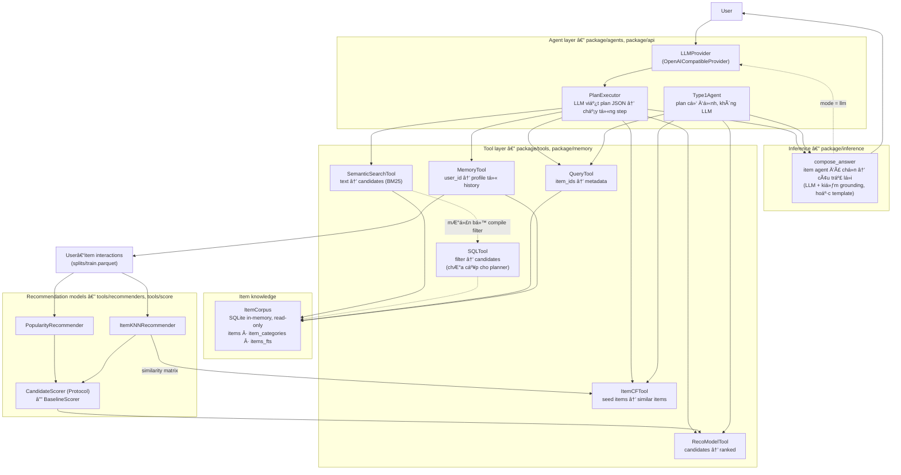

# Project Repository Reading — agentic-rag-for-rcm-sys

**agentic-rag-for-rcm-sys / `src`** — An LLM-agent product recommender running on Amazon Reviews 2023 (3 domains: `Video_Games`, `Toys_and_Games`, `Electronics`).

> **Architectural principle:** The LLM only decides *what to do*; tools provide controlled operations; `ItemCorpus` provides item knowledge; recommenders provide recommendation signals; the agent layer combines results; the inference layer writes the final response using only items the agent selected.

## 1. Repository State (as of 2026-11-07)

| Item | Value |
|------|-------|
| **Repository root** | `C:\Users\ph181\Documents\Repositories\agentic-rag-for-rcm-sys` |
| **Current branch** | `tools-building` |
| **HEAD commit** | `6fe49ee` ("quick save", 2026-11-06 20:31:58 +0700) |
| **Working tree** | **Modified** — 16 modified files, 50+ untracked files (mostly new reports and experimental artifacts) |
| **GitNexus index** | 5,462 symbols, 11,115 relationships, 254 execution flows (indexed 2026-11-03) |
| **Test baseline** | 1,318 passed, 4 skipped, 2 xfailed (64s) — clean regression gate |

### Key Uncommitted Changes (Summary)
- **Configuration centralization**: `src_root`, `config_dir` added to `data_paths.yaml`; path chains replaced with `get_data_paths().src_root`; Jev timeout defaults removed
- **Jev reliability**: Config loader switched to `load_config`; env var aligned to `TYPESAFE_API_KEY`; explicit evaluation states added; fake-provider tests (8 passed)
- **Component benchmarks**: `run_all` fixed (4/5 components work; planner requires `LLM_BASE_URL`); schema fields added; subprocess error handling improved
- **New reports**: 15+ phase/report files added documenting Opik assessment, configuration centralization, and component verification

---

## 2. Repository Structure
---

## 3. System Architecture

### 3.1 Overall Data Flow

```
User Request
    │
    ▼
┌─────────────────────────────────────────────────────────────┐
│                    PLANNER (PlanExecutor)                   │
│  • LLM writes full JSON plan (steps + optional ask_user)    │
│  • Tools: SearchTool, FilterTool, SimilarTool, RankTool,   │
│           QueryTool, SQLTool, MemoryTool                    │
│  • Reference resolution: $N.path (step N output field)      │
│  • Reflection: up to N rounds on failure / quality threshold│
└─────────────────────────────────────────────────────────────┘
    │
    ▼
┌─────────────────────────────────────────────────────────────┐
│                    EXECUTOR (PlanExecutor.run)              │
│  • Executes steps in order, resolves references             │
│  • Validates args, catches invented IDs, logs via ToolCallLogger│
│  • Handles tool errors, retries, reflection triggers        │
└─────────────────────────────────────────────────────────────┘
    │
    ▼
┌─────────────────────────────────────────────────────────────┐
│                    TOOLS (6 controlled operations)          │
│  • SearchTool        — BM25/FTS5 text retrieval             │
│  • FilterTool        — Structured filter retrieval          │
│  • SimilarTool       — ItemCF (item-item collaborative)     │
│  • RankTool          — CandidateScorer (popularity/ItemKNN) │
│  • QueryTool         — Item metadata hydration              │
│  • SQLTool           — Raw SQL (read-only, authorised)      │
│  • MemoryTool        — User profile from interaction history│
└─────────────────────────────────────────────────────────────┘
    │
    ▼
┌─────────────────────────────────────────────────────────────┐
│                    RECOMMENDATION FOUNDATION                │
│  • ItemCorpus (SQLite FTS5 + BM25, read-only)               │
│  • CandidateScorer protocol (BaselineScorer: pop + ItemKNN) │
│  • Recommenders: Popularity, ItemKNN, BPR-MF (evaluation)   │
│  • Provenance tracking: file_hash, mapping_hash, fit_provenance│
└─────────────────────────────────────────────────────────────┘
    │
    ▼
┌─────────────────────────────────────────────────────────────┐
│                    INFERENCE LAYER                          │
│  • compose_llm.py    — LLM writes answer from agent items   │
│  • compose_template.py — Deterministic template fallback    │
│  • check_grounding.py — Claim validation (bare ASIN, nums)  │
│  • Jev evaluation    — Faithfulness + communication (LLM-judge)│
└─────────────────────────────────────────────────────────────┘
    │
    ▼
Final Response (grounded, validated)
```

### 3.2 Recommendation Foundation vs. Agentic Layer

| Aspect | Recommendation Foundation | Agentic Layer |
|--------|---------------------------|---------------|
| **Components** | ItemCorpus, CandidateScorer, Recommenders (Popularity, ItemKNN, BPR-MF) | PlanExecutor, Type1Agent, Tools, MemoryTool, Inference |
| **Role** | Core recommendation signals (collaborative, content, popularity) | Planning, tool orchestration, multi-turn, grounding, explanation |
| **LLM involvement** | None (except BPR-MF training, offline) | PlanExecutor (planning), Inference (answer composition), Jev (judgment) |
| **Data flow** | Offline training → online scoring | User request → plan → tool execution → ranking → answer |

### 3.3 Agent Types

| Agent | Planning | LLM | Tools | Use Case |
|-------|----------|-----|-------|----------|
| **baseline** (ItemKNN) | Fixed (retrieve→rank→fetch) | No | SimilarTool, RankTool, QueryTool | Pure CF, no LLM cost |
| **type1** | Fixed (retrieve→rank→fetch) | No | SearchTool, RankTool, QueryTool | Text query → retrieval → ranking |
| **planner** | LLM-generated JSON plan | Yes | All 6 tools | Complex multi-step reasoning |
| **planner_memory** | LLM-generated JSON plan | Yes | All 6 + MemoryTool | Personalized with user profile |

---

```
src/
├── configs/                    # YAML configuration (single source of truth)
│   ├── agent/                  # agent.yaml, llm.yaml, agent_eval.yaml, inference.yaml, ...
│   ├── data/                   # cleaning.yaml, filtering.yaml, split.yaml
│   ├── eval/                   # component_benchmarks.yaml, judge.yaml, baselines.yaml, ...
│   ├── evaluation/             # campaign.yaml
│   └── path/                   # data_paths.yaml (centralized paths), domains.yaml, run_tag.yaml
├── package/                    # Main application package
│   ├── agents/                 # PlanExecutor (LLM planner), Type1Agent (fixed plan), toolkit, session
│   ├── api/                    # LLMProvider (OpenAI-compatible), JevProvider (judgment)
│   ├── config/                 # load_config, get_data_paths, Pydantic schemas
│   ├── data/                   # Pipeline: clean → merge/filter → map/split → leakage check
│   ├── demo/                   # Gradio demo (adapter, backend, samples, view)
│   ├── evaluation/             # 5-layer framework + component benchmarks + campaign runner
│   ├── inference/              # compose (LLM/template), grounding (claim check), outcome
│   ├── memory/                 # MemoryTool (read-only user profile from interactions)
│   ├── tools/                  # Base tool protocol + 6 tools + corpus + recommenders + scoring
│   └── utils/                  # Utilities
├── scripts/                    # Entry points: run_agent_eval, run_pipeline, run_demo, ...
├── tests/                      # pytest suite (config, data, agents, tools, evaluation)
├── experiments/                # Artifacts: agent_eval (exp_002–024), component_benchmarks, campaigns
├── docs/                       # Research docs (architecture, data_spec, experiment_plan, decisions)
├── benchmarks/                 # Baseline ranking scripts
├── resource/                   # Data directory (gitignored): raw, cleaned, filtered, mapped, splits, corpus, item_knn
└── *.md                        # Phase reports, audit reports, architecture docs
```

**Code convention:** One public symbol per file (file name = symbol name). Private symbols prefixed with `_`.
---
---

## 4. Data Pipeline and Datasets

### 4.1 Amazon Reviews 2023

- **Domains**: `Video_Games`, `Toys_and_Games`, `Electronics` (configurable via `domains.yaml`)
- **Key statistics** (from Phase 2 EDA):
  - 72.21% users have only 1 interaction (cold-start dominant)
  - Sparsity: 99.9988%
  - Data split: temporal (train < validation < test) — **no random split**

### 4.2 Pipeline Stages (scripts/data_pipeline/run_pipeline.py)

| Stage | Input | Output | Description |
|-------|-------|--------|-------------|
| 1. Clean | `resource/raw/<Domain>.jsonl.gz` | `resource/cleaned/<Domain>/interactions.parquet` | Parse, normalize, dedupe, filter missing fields |
| 2. Merge/Filter | Cleaned per-domain | `resource/filtered/<tag>/interactions.parquet` | Merge domains, k-core filter (min_user=5, min_item=5), cold-start report |
| 3. Map/Split | Filtered | `resource/mapped/<tag>/{user2id,item2id}.json`, `resource/splits/<tag>/{train,validation,test}.parquet` | ID mapping, temporal split (80/10/10), leakage checks |
| 4. Artifacts | Mapped + splits | `resource/corpus/<tag>/corpus_<tag>.sqlite`, `resource/item_knn/<tag>/item_knn_<tag>_<eval_on>.npz` | Build ItemCorpus (SQLite FTS5), ItemKNN similarity matrix |

**Leakage prevention**: Profile snapshot at timestamp `t` only uses interactions ≤ `t` (enforced in `MemoryTool`, `RankTool`, evaluation).

### 4.3 Item ID Format

- **Namespaced**: `{domain}::{parent_asin}` (e.g., `Video_Games::B071HMD7CM`)
- **No plain-ID mode** — same ASIN in different domains = different items
- **Corpus stores domain as column** — never parsed from ID string

---

## 5. Recommendation Foundation

### 5.1 Embedding — **NOT IMPLEMENTED**

**Status**: `package/tools/embeddings/__init__.py` explicitly states "NOT IMPLEMENTED"

- Current retrieval: **SQLite FTS5 + BM25** over `title`, `store`, `main_category`, `categories` (lexical only)
- No embedding model integration found in codebase
- BPR-MF recommender uses embeddings internally but is separate from candidate retrieval
- Future work documented: select multilingual model, design indexing, evaluate vs. FTS5/BM25 baseline

**Implication**: Retrieval is purely lexical. Vietnamese queries must be translated to English (catalog is English). Semantic gap for cold users with no interaction history.

### 5.2 Retrieval

**Implementations**:
1. **SearchTool** — BM25/FTS5 free-text search (English keywords required). Supports structured filters (domain, price, rating, categories, store). Returns candidates with BM25 score.
2. **FilterTool** — Pure structured filter retrieval (no text query). Same filter keys as SearchTool.
3. **SimilarTool** — ItemCF: given seed items, returns similar items from precomputed ItemKNN similarity matrix.

**Query preprocessing**: `_tokenize` (lowercase, \w-only, ASCII-fold for Unicode). Tokens double-quoted for FTS5 safety.

**Candidate generation**: Tools return `candidates` list with `item_id`, metadata, and `score` (BM25 or similarity). Planner combines via `$N.path` references.

**Top-K**: Configurable per tool, capped at `MAX_CANDIDATES` (default 100). `SEMANTIC_DEFAULT_LIMIT` = 50.

**Evaluation**: `candidate_recall` experiments exist (`exp_001`–`exp_012`) but **environmental blocker** — `resource/` data missing prevents verification.

### 5.3 Ranking

**Architecture**: `CandidateScorer` protocol → `BaselineScorer` adapter → `RankTool`

| Scorer | Signal | Cold-start handling |
|--------|--------|---------------------|
| **Popularity** | Global item popularity (interaction count) | Works for all users |
| **ItemKNN** | Item-item collaborative filtering (cosine similarity) | Falls back to popularity |
| **BPR-MF** | Bayesian Personalized Ranking (matrix factorization) | Evaluation only (offline) |

**BaselineScorer** combines popularity (tiny weight 1e-6 for tie-breaking) + ItemKNN CF signal. Users with no CF signal get popularity only.

**RankTool output**: `ranked` (rank, item_id, score, domain), `model` name, `cold_start` flag, `excluded_seen`, `unscored_item_ids`, `has_personal_signal`, `note` (explanation if empty).

**Provenance**: `fit_provenance.py`, `file_hash.py`, `mapping_hash.py`, `fit_split_names.py` track artifact reproducibility.

**Evaluation metrics** (Layer 1 Outcome):
- `precision@k`, `recall@k`, `hit_rate@k`, `ndcg@k`, `mrr@k`, `map@k`
- `seen_item_rate`, `seed_in_result`, `distinct_domains`, `category_coverage`
- **Retrieval funnel**: `candidate_generation_count`, `retrieved_count`, `filtered_count`, `ranked_count`, `target_in_pool`, `target_reachable`, `stage_lost`

**Known limitation**: No embedding-based retrieval; BM25 recall on cold users unverified (data missing).

---

## 6. Agentic RAG Architecture


---

## 7. End-to-End Data Flow (Example: Planner Agent)

```
User Request (Vietnamese)
    │
    ▼
[Optional] Translate to English keywords for SearchTool
    │
    ▼
PlanExecutor.plan() → LLM writes JSON plan
    │  Example: 
    │  { "steps": [
    │      {"tool": "MemoryTool", "args": {"user_id": "..."}},
    │      {"tool": "SearchTool", "args": {"query": "$1.top_categories[0] quiet keyboard", "filters": {"price_max": "$1.price_range.max"}}},
    │      {"tool": "RankTool", "args": {"user_id": "...", "candidates": "$2.candidates", "top_k": 10}},
    │      {"tool": "QueryTool", "args": {"item_ids": "$3.ranked[0:10].item_id"}}
    │  ]}
    │
    ▼
PlanExecutor.run() executes steps sequentially
    │
    ├─ Step 1: MemoryTool → user profile (top_categories, price_range, recent_items, ...)
    ├─ Step 2: SearchTool → BM25 candidates (resolves $1 references)
    ├─ Step 3: RankTool → ranked candidates (resolves $2.candidates)
    └─ Step 4: QueryTool → item metadata for top-K (resolves $3.ranked)
    │
    ▼
AgentOutcome: { recommended: [...], steps: [...], ask_user: null }
    │
    ▼
Inference.compose_answer() (LLM or template)
    │
    ▼
Grounding.check_grounding() validates answer against AgentOutcome.items
    │
    ▼
[Optional] Jev evaluation: faithfulness + communication quality
    │
    ▼
Final Response + Trajectory (saved to JSONL)
```

---

~~Ba điểm dễ nhầm:~~

1. ~~🔴**Planner không có `SQLTool`.** `agents/toolkit/build_tools.py` (`build_tools()` → `AgentTools`; `for_planner()` = 4 tool: ItemCF, RecoModel, Query, SemanticSearch; `for_planner_memory()` = thêm `MemoryTool`) — dùng bởi `run_agent_eval.py` và `smoke_real_llm.py` — không đưa `SQLTool` vào. `SQLTool` vẫn được code, test và chạy trong `scripts/tools/run_tools.py`, và `SemanticSearchTool` dùng chung hàm `compile_filters` (`sql_query/compile_filters.py`) với nó. Nếu muốn planner dùng filter thuần cấu trúc (không text) thì phải thêm vào `agents/toolkit/build_tools.py` **và** cập nhật `agents/planner/_prompt.py`. (`scripts/demo/demo_full_agent.py` còn bản `build_tools()` riêng, cũ, 5 tool, không qua `AgentTools` — đừng nhầm với bản thật.)~~
2. ~~`PlanExecutor.run()` **trả về danh sách kết quả tool**; câu trả lời cuối do `package/inference` (mục 9.4) sinh sau đó và **chỉ trình bày** các item agent đã chọn (không chọn lại, không đổi thứ tự). Chưa có vòng lặp "LLM đọc kết quả → quyết định bước kế" (mục 15). `demo` chưa gọi `inference` (mục 13.1).~~
3. ~~🔴`MemoryTool` đọc **cả** `interactions` (DataFrame) và `ItemCorpus`.~~

---

## 8. Evaluation Framework

### 8.1 Five-Layer Architecture (package/evaluation/)

| Layer | File | Focus | Key Metrics |
|-------|------|-------|-------------|
| **L1: Outcome** | `layer1_outcome/score_layer1_outcome.py` | Recommendation quality | precision@k, recall@k, hit_rate@k, ndcg@k, mrr@k, map@k, seen_item_rate, retrieval funnel |
| **L2: Interaction** | `layer2_interaction/score_layer2_interaction.py` | Output quality | task_success (v2, kind-specific), constraint_satisfaction, asked_clarification, exclusion_compliance |
| **L3: Grounding** | `layer3_grounding/score_layer3_grounding.py` | Faithfulness | answer_grounded, answer_fallback, retrieval diagnostics (target_in_pool, retrieved_by_*, stage_lost) |
| **L4: Process** | `layer4_process/score_layer4_process.py` | Planning quality | tool_selection_ok, argument_ok, plan_validity, reflection_triggered, reflection_rescued |
| **L5: Deployment** | `layer5_deployment/score_layer5_deployment.py` | Latency/cost | wall_seconds, token usage, provider_error_rate |

**Entry point**: `score_trajectory.py` orchestrates all 5 layers per trajectory.

### 8.2 Component Benchmarks (package/evaluation/component/)

**5 isolated component evaluators** with JSONL datasets:

| Component | Dataset | Key Metrics | Status |
|-----------|---------|-------------|--------|
| **Memory** | `memory_correctness_dataset.jsonl` (30 cases) | known_correct, n_interactions_correct, top_categories_exact, loved_items_exact (0.5), all_fields_match (0.933), future_leakage (0) | ✅ Works (mock tools) |
| **Planner** | `planner_dataset.jsonl` (32 cases) | tool_selection_accuracy (0.31), argument_correctness (0.20), plan_validity (1.0), constraint_handling (0.25), clarification_precision (0.5), refusal_to_guess (0.88) | ⚠️ Requires `LLM_BASE_URL` |
| **Executor** | `executor_dataset.jsonl` (35 cases) | all_steps_ok (0.57), reflection_rescued (0), reflection_triggered (0.43) | ✅ Works (mock LLM + controlled tools) |
| **Grounding** | `grounding_dataset.jsonl` (32 cases) | claims_supported (0), grounding_rate (0), hallucination_rate (0.09), prompt_injection_detected (0.03) | ✅ Works (fake Jev provider) |
| **Integration** | `integration_dataset.jsonl` (35 cases) | contract_valid (0.69), no_mismatch (0.69) | ✅ Works |

**Unified runner**: `package/evaluation/component/_run_all.py` → subprocesses each component CLI → aggregates into `unified_report_*.json/.md`

**Latest unified report** (`unified_report_20261106_221802.json`):
- All 5 components: status=success, success_rate=1.0 (execution reliability)
- **But quality metrics reveal gaps**: Planner tool_selection_accuracy=0.31, Executor all_steps_ok=0.57, Grounding grounding_rate=0.0
- Integration latency suspiciously low (2.8μs mean) — likely measures contract validation only, not end-to-end execution
- All `git_sha` fields empty (not populated)

### 8.3 Campaign Runner (package/evaluation/campaign/campaign_runner.py)

- Orchestrates multiple `run_agent_eval.py` experiments via subprocess
- Parameter grid expansion, comparison pairs, repetition
- **Environmental blocker**: `run_agent_eval.py` requires `resource/` data (raw, splits, mappings, corpus) — **not available in current environment**. Campaign runs return `success: True` but empty experiment dirs, `metrics: {}`.

### 8.4 Opik Integration Assessment

**Workstream A (Phases A0–A2)** — Complete:

| Phase | Deliverable | Key Finding |
|-------|-------------|-------------|
| A0 | `opik_phase_0_current_architecture.md` | RCM has 60+ custom metrics, flat trajectory format, no tracing framework |
| A1 | `opik_phase_1_capability_assessment.md` | Opik cannot replace RCM metrics; **recommends Option B: Complementary Integration** (Opik for tracing/UI, RCM for metrics) |
| A2 | `opik_phase_2_poc_report.md` | PoC demonstrated: load 58 trajectories, create Opik dataset, log metrics as metadata, custom metric wrapper pattern. Feasible, 1-2 weeks effort. |

**Status**: PoC only (`scripts/evaluation/opik_poc.py`). No live Opik server deployed. No span instrumentation in RCM agents yet.

### 8.5 Configuration Centralization

**Workstream B (Phases B0–B3)** — Complete:

| Phase | Deliverable | Changes |
|-------|-------------|---------|
| B0 | `config_audit_inventory.md` | 48 findings: 8 MUST CENTRALIZE, 5 SHOULD, 20 KEEP AS CODE, 15 TEST-SPECIFIC |
| B1 | `config_architecture_design.md` | Design: reuse `load_config` with `CONFIG_OVERLAY_PATH`, add `src_root`/`config_dir` to `data_paths.yaml` |
| B2 | `config_centralization_phase_2_report.md` | Implemented: added `src_root`/`config_dir`, replaced path chains in 3 files, removed Jev timeout defaults from 2 files |
| B3 | `config_centralization_phase_3_verification.md` | Verified: Config tests 50 passed, Component tests 40 passed/2 skipped, Jev tests 8 passed, Path hygiene all passed |

**Result**: All operational parameters centralized in YAML. Single source of truth. Path resolution via `get_data_paths()`. No regression.

---
## 9. Configuration Architecture

### 9.1 Centralized Path Management (configs/path/data_paths.yaml)

**Single source of truth** for all directories:

```yaml
paths:
  src_root: "."
  config_dir: "configs"
  raw_dir: "resource/raw"
  cleaned_dir: "resource/cleaned"
  filtered_dir: "resource/filtered"
  mapped_dir: "resource/mapped"
  splits_dir: "resource/splits"
  item_knn_dir: "resource/item_knn"
  corpus_dir: "resource/corpus"
  log_dir: "experiments/logs"
  experiments_dir: "experiments"

outputs:  # Relative to experiments_dir
  baselines: "baselines"
  agent_eval: "agent_eval"
  candidate_recall: "candidate_recall"
  ranking_eval: "ranking_eval"
  ranking_diagnostics: "ranking_diagnostics"
  ablation: "agent_eval/ablation"
  component_benchmarks: "agent_eval/component_benchmarks"
  memory_utility: "agent_eval/memory_utility_analysis"
  multi_turn: "agent_eval/multi_turn"
  test_logs: "test_logs"
```

**Access in code**: `get_data_paths().corpus_path`, `get_data_paths().output_dir("agent_eval")`, etc.

### 9.2 Configuration Loading (package/config/load_config.py)

- `load_config("agent/llm")` → loads `configs/agent/llm.yaml` with Pydantic validation
- **Overlay support**: `CONFIG_OVERLAY_PATH` env var points to YAML that overrides base config (used by campaign runner)
- **Env var expansion**: `${VAR:-default}` syntax in YAML (e.g., `${LLM_BASE_URL:-}`)
- **Strict schemas**: `extra="forbid"` — unknown keys raise error
- **All scripts use `load_config`** — no direct `yaml.safe_load` (enforced by Jev reliability fix)

### 9.3 Key Config Files

| File | Purpose |
|------|---------|
| `configs/agent/agent.yaml` | PlanExecutor limits (max_steps, reflect_rounds, tokens, temperature) |
| `configs/agent/llm.yaml` | Provider, model, base_url, api_key, timeout |
| `configs/agent/agent_eval.yaml` | Agents list, request_scope, per_segment, trajectory_file |
| `configs/agent/inference.yaml` | Inference mode (llm/template), llm_retries, price_tolerance |
| `configs/eval/component_benchmarks.yaml` | Component benchmark runs, per-component configs (e.g., `grounding.use_jev: true`) |
| `configs/eval/judge.yaml` | Jev provider config (api_key, model, timeout, evaluation criteria) |
| `configs/evaluation/campaign.yaml` | Campaign orchestration (parameter_grid, comparison_pairs, repetition_count) |
| `configs/path/run_tag.yaml` | Run tag for artifact directories (default: `multi_domain`) |

---

## 10. Scripts and Execution Workflows

### 10.1 Primary Entry Points

| Script | Purpose | Key Config |
|--------|---------|------------|
| `scripts/evaluation/run_agent_eval.py` | Full agent evaluation (ranking + agent metrics) | `agent_eval.yaml`, `agent.yaml`, `inference.yaml`, `eval/baselines.yaml` |
| `package/evaluation/component/run_benchmark_cli.py` | Single component benchmark | `component_benchmarks.yaml` (per-component config) |
| `package/evaluation/component/_run_all.py` | All 5 components + unified report | Same as above |
| `package/evaluation/campaign/campaign_runner.py` | Campaign orchestration | `evaluation/campaign.yaml` |
| `scripts/data_pipeline/run_pipeline.py` | Data pipeline (stages 1–4) | `data/cleaning.yaml`, `data/filtering.yaml`, `data/split.yaml`, `path/data_paths.yaml` |
| `scripts/evaluation/run_baselines.py` | Ranking baseline evaluation | `eval/baselines.yaml` |
| `scripts/demo/run_demo.py` | Gradio demo (mock/live) | `agent/demo.yaml` |
| `scripts/evaluation/opik_poc.py` | Opik complementary integration PoC | — |

### 10.2 Execution Conventions

- **All scripts require `PYTHONPATH=.`** (pytest sets via `pyproject.toml`; direct runs need explicit)
- **No CLI override flags** — all tunables in YAML (enforced by refactor)
- **Tag-based runs**: `run_tag.yaml` controls `filtered_dir`, `mapped_dir`, `splits_dir`, `corpus_dir`, `item_knn_dir`
- **Resume support**: `run_agent_eval.py --resume` continues from existing trajectory file

---

## 11. Script Reference Details

This section provides comprehensive command-line reference for all scripts, extending the summary in §10.

### 11.1 Data Pipeline (Phase 3)

**`scripts/data_pipeline/run_pipeline.py`** — Run the full data pipeline or selected stages.

```bash
# Run all stages (1→2→3→4)
PYTHONPATH=. python scripts/data_pipeline/run_pipeline.py

# Run specific stages
PYTHONPATH=. python scripts/data_pipeline/run_pipeline.py --stages 1
PYTHONPATH=. python scripts/data_pipeline/run_pipeline.py --stages 1,2
PYTHONPATH=. python scripts/data_pipeline/run_pipeline.py --stages 2,3,4

# Run for specific domains (default: all domains in domains.yaml)
PYTHONPATH=. python scripts/data_pipeline/run_pipeline.py --domain Video_Games
PYTHONPATH=. python scripts/data_pipeline/run_pipeline.py --domain Video_Games --domain Toys_and_Games

# Override run tag (default: tag from configs/path/run_tag.yaml)
PYTHONPATH=. python scripts/data_pipeline/run_pipeline.py --tag my_run_v1

# Force overwrite existing outputs
PYTHONPATH=. python scripts/data_pipeline/run_pipeline.py --force

# Stage 1 options
PYTHONPATH=. python scripts/data_pipeline/run_pipeline.py --stages 1 --domain Video_Games \
    --review-path /path/to/review_Video_Games.jsonl.gz

# Stage 2 options
PYTHONPATH=. python scripts/data_pipeline/run_pipeline.py --stages 2 --cold-start-report

# Stage 4 options
PYTHONPATH=. python scripts/data_pipeline/run_pipeline.py --stages 4 \
    --skip-corpus \
    --skip-item-knn
```

**Stages**:
| Stage | Description |
|-------|-------------|
| 1 | Clean raw reviews per domain → `resource/cleaned/<domain>/interactions.parquet` |
| 2 | Merge domains + filter (k-core) → `resource/filtered/<tag>/interactions.parquet` |
| 3 | ID mapping + temporal split → `resource/mapped/<tag>/`, `resource/splits/<tag>/` |
| 4 | Build ItemCorpus SQLite + ItemKNN artifacts → `resource/corpus/<tag>/`, `resource/item_knn/<tag>/` |
---

## 12. Testing Strategy and Coverage

| Test Suite | Command | Coverage |
|------------|---------|----------|
| **Config tests** | `pytest tests/config/ -v` | 50 passed (overlay, path resolution, schema validation) |
| **Component tests** | `pytest tests/evaluation/component/ -v` | 40 passed, 2 skipped (benchmark schemas, regression, loaders) |
| **Jev reliability tests** | `pytest tests/evaluation/test_jev_reliability.py -v` | 8 passed (fake provider: success, exception, missing key, env expansion, malformed) |
| **Data tests** | `pytest tests/data/ -v` | Pipeline stages, leakage checks, mapping |
| **Agent tests** | `pytest tests/agents/ -v` | PlanExecutor, Type1Agent, tools, session |
| **Tool tests** | `pytest tests/tools/ -v` | All 6 tools, corpus, recommenders, scoring |
| **Full suite** | `pytest tests/ -q` | 1,318 passed, 4 skipped, 2 xfailed (64s) |

**Mock vs. Real Provider**:
- Component benchmarks: **all mocked** (fake LLM, fake Jev, controlled tools)
- Agent evaluation: Can run with real LLM (requires `LLM_BASE_URL`, `LLM_API_KEY`)
- Jev smoke test: `scripts/evaluation/jev_smoke_test.py` for manual real-provider testing
### 11.2 EDA & Diagnostics

**`scripts/eda_diagnostic/run_eda.py`** — Streaming EDA on raw review files.

```bash
# All domains
PYTHONPATH=. python scripts/eda_diagnostic/run_eda.py

# Specific domain(s)
PYTHONPATH=. python scripts/eda_diagnostic/run_eda.py --domain Video_Games
PYTHONPATH=. python scripts/eda_diagnostic/run_eda.py --domain Video_Games --domain Toys_and_Games

# Direct file path
PYTHONPATH=. python scripts/eda_diagnostic/run_eda.py --path /path/to/review_Video_Games.jsonl.gz
```

**`scripts/eda_diagnostic/diagnose_splits.py`** — Check split quality (leakage, temporal order, user coverage).

```bash
PYTHONPATH=. python scripts/eda_diagnostic/diagnose_splits.py --tag v1 --domain Video_Games
```

### 11.3 Demo Scripts

**`scripts/demo/run_demo.py`** — Gradio UI demo.

```bash
# Mock mode (no data/LLM needed)
PYTHONPATH=. python scripts/demo/run_demo.py --mock

# Live mode with real data
PYTHONPATH=. python scripts/demo/run_demo.py --tag v1 --domain Video_Games

# Live mode options (inference mode, corpus flags, eval split come from
# configs/agent/demo.yaml and configs/agent/inference.yaml — not CLI)
PYTHONPATH=. python scripts/demo/run_demo.py \
    --tag v1 \
    --domain Video_Games \
    --host 0.0.0.0 \
    --port 7860
```

**Arguments**:
| Arg | Default | Description |
|-----|---------|-------------|
| `--mock` | false | Mock mode (no data/LLM needed) |
| `--tag` | from run_tag.yaml | Run tag for data |
| `--domain` | required in live | Domain name |
| `--host` | 127.0.0.1 | Gradio host |
| `--port` | 7860 | Gradio port |

### 11.4 Tool Validation & Runner

**`scripts/tools/run_tools.py`** — Direct tool validation (no LLM, no agent). Validates tool logic with real data.

```bash
# List available tools
PYTHONPATH=. python scripts/tools/run_tools.py --list

# Run a single tool with JSON args
PYTHONPATH=. python scripts/tools/run_tools.py --tool SearchTool --args '{"query": "mechanical keyboard", "filters": {}, "limit": 5}'

# Chain tools
PYTHONPATH=. python scripts/tools/run_tools.py --chain SearchTool RankTool QueryTool --init-args '{"user_id": "user_123"}'

# Test data overrides
PYTHONPATH=. python scripts/tools/run_tools.py --tool MemoryTool --args '{"user_id": "u1"}' --interactions /path/to/interactions.parquet
```

**`scripts/tools/check_llm_provider.py`** — Quick LLM provider connectivity test.

```bash
PYTHONPATH=. python scripts/tools/check_llm_provider.py
```

### 11.5 Evaluation Scripts

**`scripts/evaluation/run_agent_eval.py`** — Full agent evaluation (ranking + agent metrics).

```bash
# Run on validation split
PYTHONPATH=. python scripts/evaluation/run_agent_eval.py --eval-on validation

# Resume interrupted run
PYTHONPATH=. python scripts/evaluation/run_agent_eval.py --resume

# Run on test split (use sparingly)
PYTHONPATH=. python scripts/evaluation/run_agent_eval.py --eval-on test
```

**`scripts/evaluation/run_baselines.py`** — Ranking baseline evaluation (Popularity, ItemKNN, BPR-MF).

```bash
# Run on validation
PYTHONPATH=. python scripts/evaluation/run_baselines.py --eval-on validation

# With specific model
PYTHONPATH=. python scripts/evaluation/run_baselines.py --eval-on validation --model item_knn
```

**`scripts/evaluation/opik_poc.py`** — Opik complementary integration PoC.

```bash
PYTHONPATH=. python scripts/evaluation/opik_poc.py
```

### 11.6 Experiment Orchestration

**`scripts/experiments/compare_experiments.py`** — Compare experiment pairs (ablation).

```bash
PYTHONPATH=. python scripts/experiments/compare_experiments.py --contrast reflect_0_vs_reflect_1
```

**`scripts/evaluation/jev_smoke_test.py`** — Real Jev provider smoke test (manual, requires TYPESAFE_API_KEY).

```bash
TYPESAFE_API_KEY=your_key PYTHONPATH=. python scripts/evaluation/jev_smoke_test.py
```

**No integration test** runs full agent + real LLM + real corpus end-to-end (environmental blocker: `resource/` data).

---

## 13. Known Issues and Bottlenecks

### 12.1 Upstream Bottlenecks (Embedding → Retrieval → Ranking)

| Bottleneck | Evidence | Downstream Impact |
|------------|----------|-------------------|
| **No embedding retrieval** | `package/tools/embeddings/__init__.py`: "NOT IMPLEMENTED" | Cold users (72% single-interaction) rely on BM25 over English catalog; Vietnamese semantic gap |
| **BM25 recall unverified** | `candidate_recall` experiments exist but `resource/` data missing | If relevant items not retrieved, ranking cannot promote them |
| **ItemKNN similarity matrix** | Precomputed offline; cold items outside matrix → `unscored_item_ids` | Ranking falls back to popularity for unknown items |
| **Planner tool selection poor** | `tool_selection_accuracy=0.31` in component benchmark | Wrong tools → wrong candidates → poor ranking input |
| **Executor reflection ineffective** | `reflection_rescued=0.0`, `reflection_no_change=1.0` | Failed plans not corrected; quality threshold reflection untested |

**Dependency chain verified**: Embedding (absent) → Retrieval (BM25/FTS5) → Ranking (CandidateScorer) → Agent Tools → Agent Response → Grounding. Weak upstream quality propagates downstream.

### 12.2 Agentic Layer Issues

| Issue | Evidence | Status |
|-------|----------|--------|
| **Planner LLM produces invalid tool calls** | 31% tool selection accuracy, 20% argument correctness | Requires better prompt / few-shot / model |
| **Reflection doesn't rescue failures** | `reflection_rescued=0.0` across all executor benchmarks | Quality threshold reflection (configurable) untested |
| **Grounding rate zero** | `grounding_rate=0.0` in component benchmark | Dummy answer limitation fixed (Phase 1); real answer generation untested |
| **Integration latency anomaly** | 2.8μs mean suggests contract-only measurement | Need end-to-end latency measurement |
| **Multi-turn not real-LLM evaluated** | `mock: true` in multi-turn framework | Real provider verification pending |
### 12.3 Evaluation Framework Gaps

| Gap | Evidence | Impact |
|-----|----------|--------|
| **No real-provider agent evaluation** | All component benchmarks mocked; agent eval requires `resource/` data | Quality metrics from mocks ≠ real behavior |
| **Campaign runner unverified** | Empty experiment dirs, `metrics: {}` | Cannot run comparative experiments |
| **Retrieval recall unmeasured** | Environmental blocker | Cannot quantify upstream bottleneck |
| **Opik integration PoC only** | No live server, no span instrumentation | Tracing/observability not operational |
| **Provenance incomplete** | `git_sha` empty in unified report | Cannot link results to exact code version |

### 14.1 Running Tests
```bash
# Full suite (regression gate)
PYTHONPATH=. python -m pytest tests/ -q

# Specific suites
PYTHONPATH=. python -m pytest tests/config/ -v
PYTHONPATH=. python -m pytest tests/evaluation/component/ -v
PYTHONPATH=. python -m pytest tests/evaluation/test_jev_reliability.py -v
```

### 14.2 Running Component Benchmarks
```bash
# Single component (from src/)
python -m package.evaluation.component.run --component memory --dataset package/evaluation/component/benchmarks/memory_correctness_dataset.jsonl

# All components + unified report
python -m package.evaluation.component._run_all
```

### 14.3 Running Agent Evaluation (requires `resource/` data + LLM)
```bash
PYTHONPATH=. python scripts/evaluation/run_agent_eval.py --eval-on validation
### 11.7 Config Reference

All tunable parameters live in YAML. CLI flags are only operational selectors (`--tag`, `--domain`, `--eval-on`, `--resume`, `--work-dir`, `--candidates-from`, `--stages`, `--force`, `--mock`, `--host`, `--port`).

Key config files and their purposes:

| Config File | Purpose |
|-------------|---------|
| `agent/tools` | `configs/agent/tools.yaml` | Tool runtime limits (max steps, etc.) |
| `agent/agent` | `configs/agent/agent.yaml` | Agent limits (max steps, etc.) |
| `agent/agent_eval` | `configs/agent/agent_eval.yaml` | Agent eval settings |
| `eval/baselines` | `configs/eval/baselines.yaml` | Baseline model configs |
| `eval/tuning` | `configs/eval/tuning.yaml` | Hyperparameter grids |
| `eval/candidate_recall` | `configs/eval/candidate_recall.yaml` | Recall budgets |
| `eval/ranking_eval` | `configs/eval/ranking_eval.yaml` | Ranking eval settings |
| `eval/ranking_diagnostics` | `configs/eval/ranking_diagnostics.yaml` | Bottleneck analysis settings |
| `eval/tool_validation` | `configs/eval/tool_validation.yaml` | run_tools.py settings |
| `eval/memory_utility` | `configs/eval/memory_utility.yaml` | Memory utility analysis settings |
| `eval/categories_any_benchmark` | `configs/eval/categories_any_benchmark.yaml` | categories_any benchmark settings |
| `eval/component_benchmarks` | `configs/eval/component_benchmarks.yaml` | Component benchmark runs |
| `eval/recommendation_metrics` | `configs/eval/recommendation_metrics.yaml` | K values, metrics |
| `path/data_paths` | `configs/path/data_paths.yaml` | All filesystem paths |
| `path/run_tag` | `configs/path/run_tag.yaml` | Current run tag |
| `path/domains` | `configs/path/domains.yaml` | Domain list |

### 11.8 Output Locations

| Output | Location |
|--------|----------|
| Pipeline logs | `experiments/logs/<tag>/run_pipeline.log` |
| Tool validation log | `experiments/logs/<tag>/run_tools.log` |
| Baseline experiments | `experiments/baselines/exp_NNN/` |
| Agent eval experiments | `experiments/agent_eval/exp_NNN/` |
| Candidate recall experiments | `experiments/candidate_recall/exp_NNN/` |
| Ranking eval experiments | `experiments/ranking_eval/exp_NNN/` |
| Ranking diagnostics | `experiments/ranking_diagnostics/exp_NNN/` |
| Ablation comparisons | `experiments/agent_eval/ablation/` |
| Component benchmarks | `experiments/agent_eval/component_benchmarks/` |
| Memory utility analysis | `experiments/agent_eval/memory_utility_analysis/` |
| Multi-turn evaluation | `experiments/agent_eval/multi_turn/` |
| Test logs / results | `experiments/test_logs/` |

All of the above are configured in `outputs:` in `configs/path/data_paths.yaml` (relative to `experiments_dir`).

### 11.9 Common Patterns

```bash
# Always use PYTHONPATH=. from project root or cd src
cd /path/to/agentic-rag-for-rcm-sys
PYTHONPATH=. python src/scripts/...

# Or from src/
cd /path/to/agentic-rag-for-rcm-sys/src
python scripts/...

# Set domain for config interpolation
DOMAIN=Video_Games PYTHONPATH=. python scripts/...
```

### 11.10 Config Overlay (per-experiment overrides)

All tunables live in YAML; CLI flags are only operational selectors (`--tag`, `--domain`, `--eval-on`, `--resume`, `--work-dir`, `--candidates-from`, `--stages`, `--force`, `--mock`, `--host`, `--port`).

To run an experiment with different hyperparameters, write a YAML overlay shaped like the config tree and point `CONFIG_OVERLAY_PATH` at it:

```yaml
# overlay.yaml
agent/agent_eval:
  agent_eval:
    agents: [baseline, type1]
    per_segment: 2
agent/inference:
  inference:
    mode: template
```

```bash
CONFIG_OVERLAY_PATH=/path/to/overlay.yaml PYTHONPATH=. \
    python scripts/evaluation/run_agent_eval.py --eval-on validation
```

The campaign runner (`package/evaluation/campaign/`) writes one overlay per experiment automatically. Overlay fragments are deep-merged over the base configs before Pydantic validation, and changing the overlay invalidates cached limits.
PYTHONPATH=. python scripts/evaluation/run_agent_eval.py --resume
```

### 14.4 Data Pipeline (requires raw data)
```bash
PYTHONPATH=. python scripts/data_pipeline/run_pipeline.py --stages all --domain Video_Games --tag my_run --force
```

### 14.5 Configuration Override (for experiments)
```bash
CONFIG_OVERLAY_PATH=my_overlay.yaml PYTHONPATH=. python scripts/evaluation/run_agent_eval.py ...
```

---

---

## 14. Limitations and Unverified Areas

| Area | Status | Evidence |
|------|--------|----------|
| **Embedding-based retrieval** | Not implemented | Explicit in code |
| **Real LLM agent evaluation** | Not verified | Requires `LLM_BASE_URL` + `resource/` data |
| **Real Jev grounding evaluation** | Not verified | Requires `TYPESAFE_API_KEY` |
| **Campaign orchestration** | Code verified, artifacts empty | Phase 3 report: environmental blocker |
| **Retrieval recall (BM25 vs. embedding)** | Not measured | Phase 5: environmental blocker |
| **Vietnamese/English retrieval gap** | Not measured | Phase 5: environmental blocker |
| **Multi-turn real-LLM behavior** | Mock only | Framework exists, no real evaluation |
| **BPR-MF online serving** | Evaluation only | `package/tools/recommenders/evaluation/bpr_mf_recommender.py` |
| **End-to-end latency profiling** | Anomalous integration latency | Component benchmark shows 2.8μs for integration |
| **Provenance (git_sha, config hash)** | Partially implemented | `build_run_provenance.py` exists; `git_sha` empty in reports |

---

## 15. Development Workflow

### 14.1 Running Tests
```bash
# Full suite (regression gate)
PYTHONPATH=. python -m pytest tests/ -q

# Specific suites
PYTHONPATH=. python -m pytest tests/config/ -v
PYTHONPATH=. python -m pytest tests/evaluation/component/ -v
PYTHONPATH=. python -m pytest tests/evaluation/test_jev_reliability.py -v
```

### 14.2 Running Component Benchmarks
```bash
# Single component (from src/)
python -m package.evaluation.component.run --component memory --dataset package/evaluation/component/benchmarks/memory_correctness_dataset.jsonl

# All components + unified report
python -m package.evaluation.component._run_all
```

### 14.3 Running Agent Evaluation (requires `resource/` data + LLM)
```bash
PYTHONPATH=. python scripts/evaluation/run_agent_eval.py --eval-on validation
PYTHONPATH=. python scripts/evaluation/run_agent_eval.py --resume
```

### 14.4 Data Pipeline (requires raw data)
```bash
PYTHONPATH=. python scripts/data_pipeline/run_pipeline.py --stages all --domain Video_Games --tag my_run --force
```

### 14.5 Configuration Override (for experiments)
```bash
CONFIG_OVERLAY_PATH=my_overlay.yaml PYTHONPATH=. python scripts/evaluation/run_agent_eval.py ...
```

---
## 16. Future Work and Recommended Investigation Order

### Priority 1: Resolve Environmental Blockers
1. **Obtain/generate `resource/` data** — Enables agent evaluation, campaign runner, retrieval recall, baselines
2. **Configure `LLM_BASE_URL` / `LLM_API_KEY`** — Enables planner benchmark, real agent evaluation
3. **Configure `TYPESAFE_API_KEY`** — Enables real Jev grounding evaluation

### Priority 2: Quantify Upstream Bottlenecks
4. **Measure BM25 recall** on real data (candidate_recall experiments)
5. **Evaluate embedding model candidates** (multilingual, Vietnamese+English) vs. BM25 baseline
6. **Analyze retrieval funnel** per request kind (similar vs. constrained vs. cold_text)

### Priority 3: Improve Agentic Quality
7. **Diagnose planner failures** — Low tool_selection_accuracy (0.31): prompt engineering, few-shot examples, model upgrade
8. **Fix reflection effectiveness** — Quality threshold reflection untested; `reflect_quality_threshold` in config
9. **Validate grounding with real answers** — Dummy answer limitation fixed; test with real LLM inference output

### Priority 4: Operationalize Evaluation
10. **Complete Opik complementary integration** — Deploy Opik, add `@opik.track` decorators, import historical experiments
11. **Fix integration latency measurement** — Ensure end-to-end execution time captured
12. **Populate `git_sha` in all reports** — Link results to exact code version
13. **Add real-provider smoke tests** to CI (optional, gated)

### Priority 5: Architectural Enhancements
14. **Implement embedding-based retrieval** if BM25 recall insufficient
15. **Add BPR-MF to online serving** (currently evaluation only)
16. **Real multi-turn evaluation** with LLM
17. **Cross-domain recommendation** (currently per-domain corpus)

---

## 17. Glossary of Important Components and Terms

| Term | Definition |
|------|------------|
| **ItemCorpus** | Read-only SQLite database (FTS5 + BM25) storing item metadata. Built once, locked with `PRAGMA query_only=ON` and authoriser. |
| **CandidateScorer** | Protocol for scoring candidate items for a user. Implemented by `BaselineScorer` (popularity + ItemKNN). |
| **PlanExecutor** | LLM-based agent: writes JSON plan → executes steps → optional reflection. Main planner agent. |
| **Type1Agent** | Fixed-plan agent (no LLM): retrieve → rank → fetch. Used for baseline comparisons. |
| **$N.path** | Reference syntax in planner: `$1.candidates`, `$2.ranked[0].item_id`, etc. Resolved at execution. |
| **MemoryTool** | Read-only user profile from interaction history (categories, price range, love/hate, recent items). |
| **Jev (TypeSafe AI)** | LLM-as-judge service for faithfulness (claim support) and communication quality (1-5 scale). |
| **Grounding** | Validation that answer only mentions items from `recommended` list, with correct numbers. |
| **Retrieval Funnel** | S0(target in pool)→S1(candidate gen)→S2(retrieval)→S3(filtering)→S4(ranking)→S5(final inclusion). |
| **Oracle Request Kinds** | `constrained`, `cold_text` — use held-out target categories/prices. Upper bound, not real queries. |
| **CONFIG_OVERLAY_PATH** | Env var for per-experiment config overrides (used by campaign runner). |
| **Run Tag** | Identifier for artifact directories (from `run_tag.yaml`, default `multi_domain`). |
| **Provenance** | Artifact tracking: file_hash, mapping_hash, fit_provenance, git_sha, config hash. |

---

## 18. Document Provenance

| Field | Value |
|------|-------|
| **Document** | `src/Project repository reading 29.10.md` (updated in place) |
| **Update date** | 2026-11-07 |
| **Branch** | `tools-building` |
| **Commit** | `6fe49ee` ("quick save") |
| **Working tree** | Modified (16 files changed, 50+ untracked) — reflects current working tree |
| **Key evidence sources** | Phase 0–6 reports, Opik A0–A2 reports, Config B0–B3 reports, `unified_report_20261106_221802.json`, `FINAL_SUMMARY.md`, source code inspection |
| **Unresolved evidence** | `resource/` data (missing), real LLM/Jev evaluation (no credentials), campaign artifacts (empty) |

---

**End of Repository Reading**