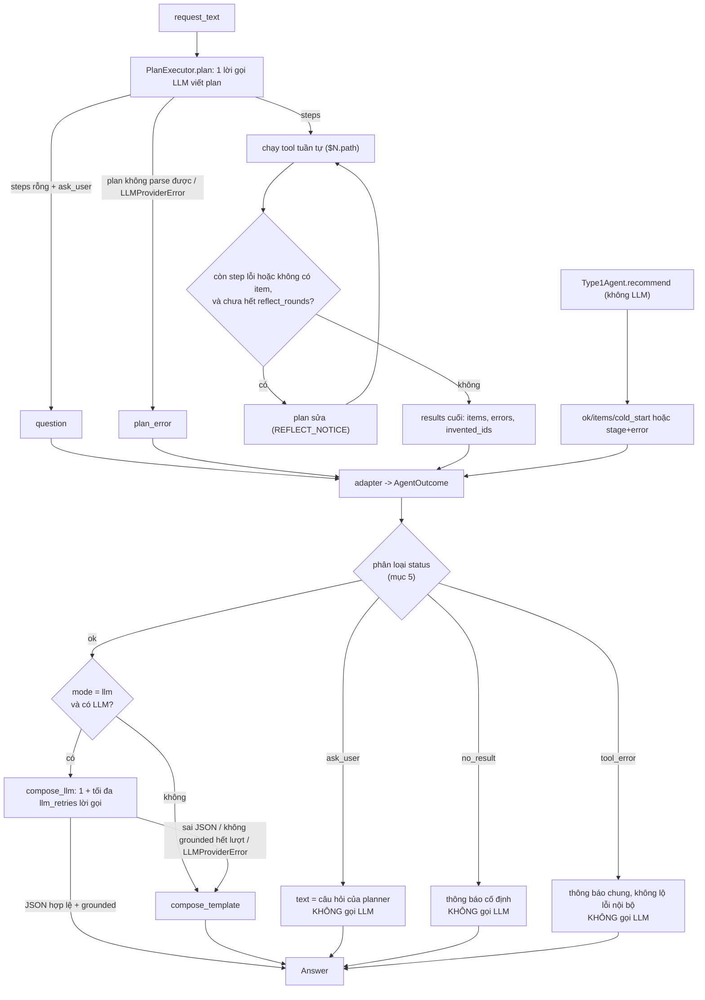

# Inference contract: tầng sinh câu trả lời cuối

Trạng thái: **đã duyệt D1, D2, D4, D8, D9; hoãn D5, D6, D10 (chưa có thí nghiệm); D3 và D7 chờ xác nhận lần cuối (Giai đoạn 0, chưa có code)**.
Phạm vi: `package/inference/` (hiện là stub rỗng), `configs/agent/inference.yaml` (mới), điểm nối ở `scripts/evaluation/run_agent_eval.py` (Giai đoạn 2).
Mốc trước khi sửa: `pytest tests -q` = **811 passed** (7.35 s trên bản `src.zip` đã đọc); `python3 -m pyflakes package scripts` = 10 dòng cảnh báo có sẵn (không do tầng này).

## 1. Mục tiêu và nguyên tắc

Luồng đồ án: *request → plan → tools → recommendation → **tổng hợp câu trả lời***. Hiện luồng dừng ở danh sách item. Inference thêm bước cuối, với 5 nguyên tắc đã chốt:

1. **Chỉ trình bày, không quyết định.** Không đổi tập item, thứ tự, số lượng agent đã chọn. `task_success`, recall... không đổi (chúng đọc `trajectory["recommended"]`, Inference không chạm).
2. **Chống ảo giác:** câu trả lời chỉ dùng dữ liệu tool đã trả; mọi item được nhắc phải thuộc danh sách.
3. **Luôn có đường lui tất định** (template, không LLM).
4. **Một Inference cho mọi agent có sinh câu trả lời** (type1, planner, planner_memory). Baseline ItemKNN không qua Inference.
5. Không thêm tool, không đổi `output_schema` của tool, không đổi prompt planner.

## 2. Sơ đồ luồng



## 3. Đầu vào: `AgentOutcome`

Dataclass ở `package/inference/_dataclass.py`. Là cửa duy nhất vào Inference; hai adapter dựng nó.

| Trường | Kiểu | Ý nghĩa |
|---|---|---|
| `request_text` | `str` | Nguyên văn câu người dùng (planner và type1 đều có từ `AgentRequest.text`). |
| `items` | `list[dict]` | Item agent chọn, **đúng thứ tự agent**, đã khử trùng lặp, cắt `max_items`. Mỗi dict có đủ khoá `item_id, domain, title, store, price, average_rating, rating_number, main_category`; thiếu thì `None` (không tự điền). Không mang `score`/`similarity` (thang điểm nội bộ, không có nghĩa với người dùng). |
| `question` | `str \| None` | Câu hỏi lại của planner (`executor.last_question`). |
| `errors` | `list[dict]` | `{"tool": str, "error": str}`, `error` cắt `REASON_CHARS = 300`. Chỉ để log/`reason`, **không** đưa vào text người dùng. Lỗi plan (không parse được, provider) vào đây với `tool="planner"`. |
| `invented_ids` | `list[str]` | Gộp `invented_ids` của các step. |
| `cold_start` | `bool \| None` | Chỉ type1 (từ `Type1Agent`); planner = `None`. Chỉ ghi nhận, không đổi thông báo. |
| `n_steps` | `int` | Số step đã chạy (để phân biệt "hỏi lại" với "có plan"). |

### Adapter (a): `outcome_from_plan_results(request_text, results, *, question, plan_error=None, max_items)`

- `results`: kết quả `PlanExecutor.run()` (hoặc `[]` nếu `run()` ném).
- `question`: truyền `executor.last_question`; `plan_error`: chuỗi của `ValueError`/`LLMProviderError` nếu `run()` ném (caller `run_planner` đang bắt đúng hai loại này).
- Id item: `extract_recommendations(results, max_items)` (dùng lại nguyên, nên danh sách và thứ tự **trùng** `trajectory["recommended"]` khi `max_items >= k`).
- Metadata: duyệt mọi step `ok`, gom theo `item_id` từ `QueryTool.data["items"]`, và `SQLTool/SemanticSearchTool.data["candidates"]` (các candidate này mang `title, store, price...` vì cùng `ITEM_COLUMNS`). Với mỗi trường lấy giá trị **không-None đầu tiên**, ưu tiên QueryTool. Không có step nào mang metadata (ví dụ ItemCF + RecoModel mà không QueryTool) thì item chỉ có id.
- `errors`: mọi step `ok == False`. `invented_ids`: gộp từ step.

### Adapter (b): `outcome_from_type1(request_text, out, *, max_items)`

- `out = Type1Agent.recommend(...)`. `out["ok"]` False: `errors=[{"tool": out["stage"], "error": out["error"][:300]}]`, `items=[]`. `ok` True: `items = out["items"][:max_items]` (đã gộp rank + metadata; chuẩn hoá về cùng khoá như trên), `cold_start = out["cold_start"]`. Type1 không có `question`, không có `invented_ids`.

## 4. Đầu ra: `Answer`

| Trường | Kiểu | Ý nghĩa |
|---|---|---|
| `status` | `"ok" \| "ask_user" \| "no_result" \| "tool_error"` | Mục 5. |
| `text` | `str` | Câu trả lời cho người dùng. |
| `items` | `list[dict]` | **Đúng các item mà `text` trình bày**, cùng thứ tự agent chọn; `[]` khi status khác `ok`. Không phải nguồn tính metric (metric đọc `trajectory["recommended"]`). |
| `grounded` | `bool` | `True` nếu `text` qua bộ kiểm grounding (mục 6). Template qua cùng bộ kiểm (một test sẽ khẳng định điều này). Status khác `ok`: `True` (không khẳng định gì về item); khi chấm, `answer_grounded` chỉ tính trên status `ok` (`None` ở các ca khác để `summarize` bỏ qua). |
| `composer` | `"llm" \| "template"` | Ai viết `text`. Ca không gọi LLM (ask_user/no_result/tool_error) ghi `template` (văn bản cố định/của planner). |
| `fallback_reason` | `str \| None` | Chỉ khi **đáng lẽ** dùng LLM mà phải lùi về template: `invalid_json`, `ungrounded: <chi tiết>`, `provider_error: <cắt 300>`, `no_llm` (mode `llm` nhưng không truyền provider). `mode=template` do người dùng chọn thì `None` (không phải lùi). |
| `usage` | `dict` | `attempts, prompt_tokens, completion_tokens, latency_seconds` của **riêng** Inference (cùng khoá với `last_usage`), cộng dồn qua retry; toàn 0 khi không gọi LLM. `attempts` đếm cả lời gọi bị `LLMProviderError` (đã tốn); khác `last_usage` của executor (chỉ đếm sau khi có response), sẽ ghi rõ trong docstring. |
| `reason` | `str \| None` | Lý do của status (log, không hiển thị): `tool_error: ItemCFTool: ...`, `partial: QueryTool failed`, `question ignored: plan also had steps`... |

Hàm điều phối: `compose_answer(outcome, llm=None, *, mode=None, max_tokens=None, temperature=None, llm_retries=None) -> Answer`. **Không bao giờ ném** (kể cả `LLMProviderError`); không sửa `outcome`.

## 5. Bảng ánh xạ trạng thái

Xét **theo thứ tự**, dừng ở dòng đầu khớp:

| # | Điều kiện | `status` | Gọi LLM? | `text` |
|---|---|---|---|---|
| 1 | `question` có nội dung **và** `n_steps == 0` | `ask_user` | không | đúng `question` (giữ ngôn ngữ planner viết) |
| 2 | có `plan_error`, hoặc `invented_ids` không rỗng | `tool_error` | không | thông báo chung cố định (mục dưới bảng) |
| 3 | `items` rỗng và còn step lỗi | `tool_error` | không | như trên |
| 4 | `items` rỗng, mọi step ok (kể cả plan rỗng không câu hỏi) | `no_result` | không | thông báo cố định: không tìm thấy, gợi ý nới điều kiện |
| 5 | `items` không rỗng | `ok` | theo `mode` | mục 7 |

Các ca lấn nhau và quyết định của tôi:

- **Câu hỏi + step cùng lúc** (prompt planner cấm, nhưng model có thể vi phạm): coi là *không* hỏi lại (khớp định nghĩa `asked` của `score_trajectory`: "không step + có ask_user"); xét theo kết quả step, `reason="question ignored: plan also had steps"`. Lý do: giữ `answer_status` nhất quán với `asked_clarification`.
- **Có item nhưng một step phụ lỗi** (ví dụ QueryTool lỗi sau khi RecoModel đã xếp hạng; hoặc RecoModel lỗi và item lấy từ ItemCF): `status = ok`, `reason = "partial: <tool> failed"`. Lý do: bỏ một danh sách hợp lệ chỉ vì thiếu metadata là phí; metric `task_success` vẫn tính ca này là thất bại (không đổi). Khi partial, template dùng câu dẫn trung tính ("Các sản phẩm tìm được") thay vì "phù hợp nhất với bạn", và item thiếu metadata chỉ hiện id.
- **`invented_ids` + có item** (step khác chạy được): vẫn `tool_error` (theo yêu cầu của bạn), `Answer.items=[]`. Lý do: planner đã định dùng một id người dùng không đưa; trình bày các item còn lại là trả lời một câu hỏi khác. Đây là điểm cần duyệt (D3).
- **Type1 `ok=True`, `items=[]`** (cold start rỗng) → dòng 4 `no_result`. **Type1 `ok=False`** → dòng 3 `tool_error`, `reason` giữ `stage`.
- **Text `tool_error` cố định, ngắn:** xin lỗi, hệ thống chưa xử lý được yêu cầu, bảo thử lại hoặc mô tả/ kiểm tra mã sản phẩm. Không nêu tên tool, không in chuỗi lỗi. Chuỗi lỗi chỉ ở `reason` (đã cắt 300).

## 6. Quy tắc grounding

Áp cho `status = ok` khi composer là LLM. Kiểm 6-7 tắt được bằng `check_numbers: false`; các kiểm 1-5 luôn chạy. `allowed` = id trong `outcome.items` (sau cắt `max_items`).

**Kiểm (vi phạm = không grounded):**

1. **JSON hợp lệ:** parse được (bóc rào ```json như `_extract_plan`), có `answer` là chuỗi không rỗng, `mentioned_item_ids` là list chuỗi.
2. **Id trong text:** mọi chuỗi khớp `<Domain>::<asin>` (dựng regex từ `ITEM_ID_SEPARATOR`, khớp nguyên token, bỏ dấu câu cuối) phải thuộc `allowed`. Id bịa kiểu cắt cụt (`Video_Games::B01` khi thật là `Video_Games::B01234`) bị bắt vì so khớp nguyên token.
3. **`mentioned_item_ids` ⊆ `allowed`** và **khớp với id thật sự có trong text** (cùng tập).
4. **Đủ và đúng thứ tự (bảo vệ nguyên tắc 1):** các id xuất hiện trong text, xếp theo lần xuất hiện đầu, phải bằng đúng danh sách `items` theo thứ tự agent. Nghĩa là mỗi item phải xuất hiện kèm id nguyên văn (ví dụ `(Video_Games::B0...)`); UI sau này có thể ẩn id.
5. **ASIN trần:** token dạng `B0[0-9A-Z]{8}` không đi kèm `Domain::` mà không thuộc asin của `allowed` bị coi là bịa.
6. **Giá** (chỉ khi `check_numbers: true`): mọi số tiền có dấu hiệu tiền tệ (`$12.99`, `12.99 USD`, `12 đô`, `đô la`) phải cách một giá đã biết ≤ `price_tolerance` (config, mặc định 0.5; càng nhỏ càng chặt). Giá đã biết = giá các item `allowed` ∪ các số có trong `request_text` (để người dùng nói "dưới 30 đô" mà LLM nhắc lại không bị oan).
7. **Rating** (cùng công tắc `check_numbers`): mọi giá trị dạng `x/5`, `x sao`, `x stars` phải bằng `average_rating` của một item `allowed` (làm tròn 1 chữ số).

**Không kiểm (và vì sao):**

- **Tên sản phẩm.** LLM được phép rút gọn/dịch tên; so khớp chuỗi sẽ vừa bỏ sót (nhắc một sản phẩm thật nhưng ngoài danh sách bằng tên, không kèm id) vừa báo oan. Giảm thiểu bằng kiểm tra 4 (mỗi item nhắc phải có id, và danh sách id phải khớp đúng) chứ không bằng đối chiếu tên.
- **Gán đúng giá/rating cho đúng item.** Kiểm 6-7 chỉ nói "số này có trong dữ liệu", không nói nó thuộc item nào. LLM gán giá item A cho item B không bị bắt.
- **Đặc điểm định tính** ("bán chạy", "phù hợp trẻ em", mô tả tính năng): dữ liệu tool không có trường nào để đối chiếu. Chỉ chặn gián tiếp bằng prompt ("không thêm thông tin ngoài dữ liệu").
- **Số khác** (số đánh giá, tổng, phần trăm) và các giá trị không có dấu hiệu tiền tệ/rating.
- **Prompt injection trong title** (title lấy từ Amazon): chỉ giảm bằng prompt (dữ liệu nằm trong khối dữ liệu, không phải chỉ dẫn); kiểm tra 1-7 sẽ bắt hệ quả nếu nó làm LLM nhắc item lạ, không bắt hết các hệ quả khác.

**Giới hạn chung:** đây là kiểm tra *hình thức* bằng regex. `grounded=True` nghĩa là "qua các kiểm tra trên", không phải "đã chứng minh mọi câu đúng". Báo cáo luận văn nên viết đúng như vậy.

**Retry:** vi phạm → gửi lại với `assistant` (reply cũ) + `user` (thông báo lỗi cụ thể, định dạng như `RETRY_NOTICE`), tối đa `llm_retries` lần; hết lượt → template + `fallback_reason`.

## 7. Văn bản `ok`

**Template (tất định).** Ngôn ngữ mặc định: **tiếng Việt**. Lý do: request đánh giá mặc định `language: vi` (`agent_eval.yaml`), người dùng đích là người Việt; câu hỏi lại của planner đã theo ngôn ngữ người dùng nên không thuộc template. Giới hạn: request tiếng Anh vẫn nhận template tiếng Việt (không phát hiện ngôn ngữ). Mỗi item vài dòng: số thứ tự, title (cắt `TITLE_CHARS = 120`, hằng số trong code vì title Amazon rất dài), `(item_id)`, giá nếu có (thiếu giá thì bỏ dòng giá, không ghi 0), rating nếu có. Item không có metadata: chỉ `item_id` và ghi chú "chưa có thông tin chi tiết, chỉ có mã sản phẩm".

**LLM.** System prompt riêng, ngắn: chỉ dùng dữ liệu cho sẵn; không thêm sản phẩm/đặc điểm; liệt kê đúng các item theo đúng thứ tự, mỗi item kèm id nguyên văn; thiếu giá/rating thì nói "không có thông tin", không đoán; trả lời bằng ngôn ngữ của request; chỉ JSON `{"answer": "...", "mentioned_item_ids": [...]}`. Dữ liệu (request + items dạng JSON) nằm trong message `user`. Văn bản chính xác chốt ở Giai đoạn 1.

## 8. Cấu hình đề xuất: `configs/agent/inference.yaml`

```yaml
# Inference config: tầng sinh câu trả lời cuối (package/inference/_limits.py).
# LLM provider/model lấy từ llm.yaml; hành vi planner ở agent.yaml. File này chỉ chứa hành vi của bước trả lời.

inference:
  mode: llm          # llm | template. llm = LLM viết, có kiểm grounding, lỗi thì lùi về template; template = luôn tất định, không gọi LLM
  max_items: 10      # chỉ trình bày tối đa chừng này item (cắt từ đầu danh sách agent, không đổi thứ tự); đặt >= agent_eval.k kẻo trả lời ít hơn số được yêu cầu
  max_tokens: 2048   # ngân sách token cho 1 lần viết câu trả lời; model reasoning ăn token suy luận vào đây nên đừng đặt thấp
  temperature: 0.0   # 0 để câu trả lời lặp lại được giữa các lần chạy (nhà cung cấp vẫn có thể không tất định hoàn toàn)
  llm_retries: 1     # số lần gọi lại khi reply sai JSON hoặc không grounded (0 = không retry); hết lượt thì dùng template
  check_numbers: true    # bật kiểm giá/rating trong câu trả lời LLM (kiểm 6-7); false = chỉ kiểm id/JSON/thứ tự
  price_tolerance: 0.5   # USD; số tiền trong text lệch mọi giá đã biết quá mức này thì bị coi là bịa (0 = phải khớp đúng); chỉ có tác dụng khi check_numbers = true
```

Mặc định và lý do: `mode: llm` vì đó là tính năng cần đo, `template` là ablation/đường lui (`--inference-mode template`); `max_items: 10` = `agent_eval.k` và số item trong câu request; `max_tokens: 2048` và `temperature: 0.0` đồng bộ `agent.yaml` (model `gpt-5.4` trong `llm.yaml` có thể ăn token suy luận); `llm_retries: 1` đồng bộ `plan_retries`. Mọi giá trị là **mặc định hợp lý, [Chưa đo]**.

`_limits.py` nạp bằng mẫu `package/agents/_limits.py` và ném `ConfigError` khi: thiếu khoá, `mode` ngoài `{llm, template}`, `max_items <= 0`, `max_tokens <= 0`, `llm_retries < 0`, `temperature < 0`, `price_tolerance < 0`, `check_numbers` không phải bool. Hằng số hợp đồng cố định trong `_schema.py`: tên khoá item, `TITLE_CHARS`, `REASON_CHARS`, các status. Không có đường dẫn cứng (qua test path hygiene).

## 9. Chi phí

Mỗi request thêm, so với hiện tại:

- `ask_user`, `no_result`, `tool_error`, `mode=template`, hoặc không có LLM: **0 lời gọi**.
- `ok` + `mode=llm`: **1 lời gọi**; tối đa **1 + `llm_retries` = 2** với mặc định (mỗi retry gửi lại thêm reply cũ + thông báo lỗi nên prompt dài hơn).
- Không thêm lời gọi tool, không thêm lời gọi planner.
- Kích thước prompt tăng theo `max_items` x độ dài title (đã cắt 120 ký tự) + system prompt ngắn. Số token và latency thực tế: **[Chưa đo]**; sẽ có ở `inference_usage` sau lần chạy của bạn.
- `usage` của Inference tách riêng khỏi `executor.last_usage` để tính chi phí "trước/sau".

## 10. Quyết định

| # | Nội dung | Kết quả |
|---|---|---|
| D1 | Text liệt kê đúng, đủ, đúng thứ tự item agent chọn, mỗi item kèm id | **Giữ chặt.** Nếu đo thấy fallback quá cao thì nới ở Giai đoạn 2, nói trước. |
| D2 | Kiểm giá/rating | **Thành config:** `check_numbers` (bật/tắt) và `price_tolerance` (độ gần giá). |
| D3 | `invented_ids` luôn là `tool_error`, kể cả khi còn item từ step khác | Chờ xác nhận (giải thích ở mục 5 và trong phản hồi). Khuyến nghị: giữ. |
| D4 | Câu hỏi + step cùng lúc: bỏ câu hỏi, theo plan | **Đã duyệt.** |
| D5 | Id trần trong text | Hoãn (UI/Gradio để sau); giữ id trong text để kiểm chứng. |
| D6 | Template tiếng Việt | Hoãn, giữ mặc định tiếng Việt. |
| D7 | `Answer.items` rỗng khi không `ok`; `grounded` chỉ tính trên `ok` khi chấm | Chờ xác nhận. Khuyến nghị: giữ (chỉ là quy ước ghi sổ, không đổi gì người dùng thấy). |
| D8 | `usage.attempts` đếm cả lời gọi lỗi provider | **Đã duyệt.** |
| D9 | Thêm trường `reason` | **Đã duyệt.** |
| D10 | `max_items` 10, `max_tokens` 2048 | Hoãn: giữ mặc định, chỉnh sau khi có thí nghiệm. |

## 11. Chưa làm / ngoài phạm vi

UI; hội thoại nhiều lượt; trả lời xử lý lỗi bằng LLM (thông báo lỗi cố định); đa ngôn ngữ cho template; dịch/ viết lại câu hỏi lại của planner; so khớp tên sản phẩm; kiểm đặc điểm định tính; đổi prompt/tool/`run()`/`plan()`; sinh câu trả lời cho baseline ItemKNN; cho Inference tự gọi tool hay đổi/lọc/xếp lại item.

## 12. Gợi ý cho Giai đoạn 2 (để Nhánh B định nghĩa chỉ số, chưa chốt code)

Cột mới: `answer_grounded` (chỉ `ok`), `answer_fallback` (0/1, = `fallback_reason is not None`), tỉ lệ từng `answer_status`; trajectory thêm `answer`, `answer_status`, `answer_grounded`, `answer_composer`, `answer_fallback`, `inference_usage` (+ `inference_mode` trong `config`). Trajectory cũ thiếu các trường này: `score_trajectory` dùng `.get`, các cột thành `None`.
