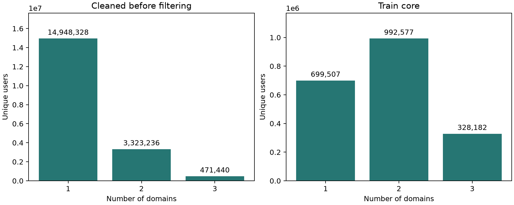

# Độ phủ người dùng của ba domain

## Dữ liệu và cách đo

Thí nghiệm dùng Video_Games, Toys_and_Games và Electronics trong bộ dữ liệu `multi_domain_v2_audit_20261030`. Mỗi `user_id` được đếm một lần trong từng domain. Một người dùng được tính là đa domain nếu xuất hiện ở ít nhất hai domain.

Dữ liệu trước lọc gồm các tương tác đã làm sạch đến hết mốc train `1617737606134` tính bằng mili giây Unix. Dữ liệu sau lọc lấy từ `train_core.parquet`. Phép so sánh bỏ từng domain giữ nguyên các tập người dùng đã đo, rồi tính lại hợp và giao trên cặp còn lại.

## Phân bố người dùng theo số domain

| Dữ liệu | Đúng 1 domain | Đúng 2 domain | Đúng 3 domain | Tổng user | Tỷ lệ đa domain |
|---|---:|---:|---:|---:|---:|
| Trước lọc | 14.948.328 | 3.323.236 | 471.440 | 18.743.004 | 20,25% |
| Train core | 699.507 | 992.577 | 328.182 | 2.020.266 | 65,38% |

Số người dùng đa domain giảm từ 3.794.676 xuống 1.320.759. Tỷ lệ tăng vì tổng số người dùng giảm mạnh hơn.



## Giao nhau theo cặp

| Cặp A và B | User chung trước lọc | User chung trong train core | Tỷ lệ trên user của A | Tỷ lệ trên user của B |
|---|---:|---:|---:|---:|
| Video_Games và Toys_and_Games | 630.653 | 354.123 | 54,74% | 31,72% |
| Video_Games và Electronics | 1.305.963 | 611.283 | 94,48% | 32,07% |
| Toys_and_Games và Electronics | 2.800.940 | 1.011.717 | 90,63% | 53,08% |

Hai cột tỷ lệ dùng mẫu số trong train core. Tập giao của mỗi cặp bao gồm 328.182 người dùng xuất hiện ở cả ba domain.

## Đóng góp của từng domain trong train core

| Domain thêm vào cặp còn lại | User mới trong hợp | User chuyển từ 1 lên 2 domain | Tỷ lệ đa domain trước khi thêm |
|---|---:|---:|---:|
| Video_Games | 9.745 | 309.042 | 50,32% |
| Toys_and_Games | 78.616 | 709.476 | 31,48% |
| Electronics | 611.146 | 966.636 | 25,13% |

Electronics đóng góp nhiều nhất về số người dùng mới và số người dùng chuyển sang có lịch sử đa domain. Toys_and_Games và Electronics tạo thành cặp có nhiều người dùng chung nhất. Thêm Video_Games vào cặp này đưa số người dùng đa domain từ 1.011.717 lên 1.320.759, tăng 30,55%. Nhóm 328.182 người dùng có mặt trong cả ba domain chuyển từ hai lên ba domain khi bổ sung domain còn thiếu.

## Tín hiệu liên miền trên test

| Domain đích | User có tương tác test | User có lịch sử train core ở domain khác | Tỷ lệ |
|---|---:|---:|---:|
| Video_Games | 325.231 | 49.333 | 15,17% |
| Toys_and_Games | 1.422.768 | 135.054 | 9,49% |
| Electronics | 3.255.836 | 258.993 | 7,95% |

Mẫu số là toàn bộ người dùng test của domain đích. Tỷ lệ này đo mức độ sẵn có của lịch sử liên miền cho gợi ý. Phép đo hiệu quả gợi ý trên nhóm này cần kết quả xếp hạng ở cấp người dùng.

## Phạm vi kết luận

Cả ba domain đều đóng góp người dùng mới và mở rộng lịch sử liên miền cho người dùng đã có mặt trong các domain còn lại. Thí nghiệm định lượng lợi ích về độ phủ khi dùng cả ba thay vì từng cặp. Việc xếp hạng bộ ba này so với các bộ ba khác cần dữ liệu của các domain ứng viên với cùng mốc thời gian và quy tắc xử lý.

## Tái lập

Chạy từ thư mục gốc của repo trong môi trường Python có `pyarrow` và `matplotlib`.

```powershell
python .\src\scripts\eda_diagnostic\user_id_coverage.py
```

[Kết quả số liệu](coverage.json) · [Biểu đồ](domain_counts.png)
